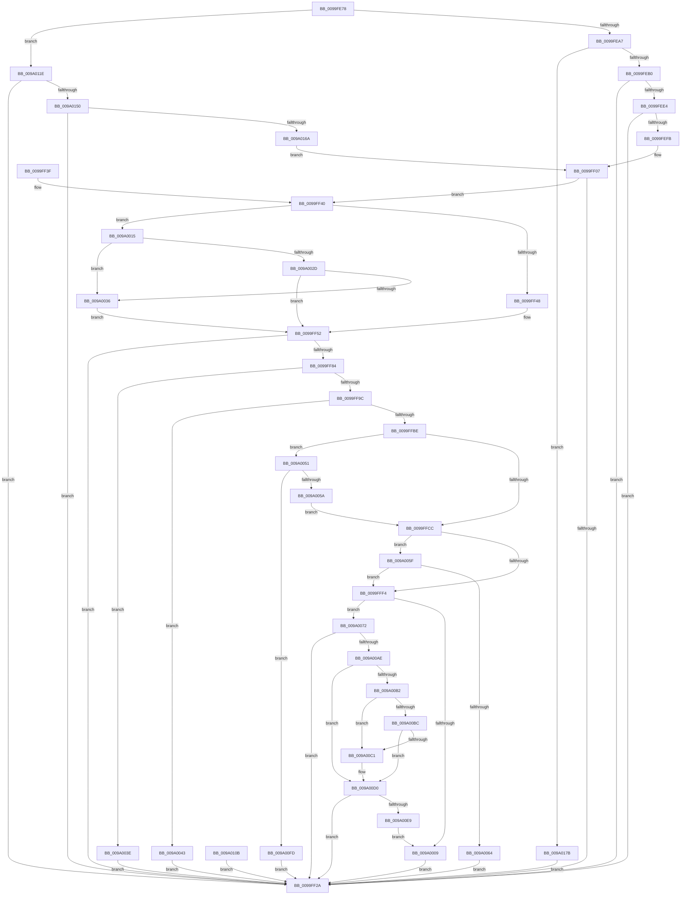

# sub_0099FE78

- RVA: `0x0099FE78`–`0x009A0185` (길이 `781` bytes)
- VA: `0x000000014099FE78`
- 실행 섹션: `PAGE`
- PDB 이름 있음: `아니요`; PDB Function 태그: `아니요`
- unwind 정보 RVA: `0x0009B31C`
- 디코드: `205`개 명령, `781/781` bytes 표시
- 미해석 바이트: `0` (있으면 어셈블리에 `.byte`로 보존)

> 이 문서는 커널 이미지의 기계어와 PDB 기호를 분석해 생성했습니다. 4번과 5번은 함수 원형과 자료형을 바이너리 사용 방식에서 추정한 C 해석이며 원본 소스 복구 결과는 아닙니다.

## 1. Dependencies

- 직접 호출 지점: **7**; 고유 호출 대상: **5**
- 직접 호출자로 확인된 함수: **1**
- RIP 상대 이미지 참조: **0**

### Outgoing calls
- `0x0099FF1B` → [sub_009A018C](../9A/Unknown_function_009A018C.md) (function, `0x009A018C`)
- `0x0099FF64` → [memcpy](../../text/6C/memcpy_function_006C6840.md) (function, `0x006C6840`)
- `0x0099FF75` → [sub_009A13B8](../9A/Unknown_function_009A13B8.md) (function, `0x009A13B8`)
- `0x0099FF89` → [sub_008D1C2C](../8D/Unknown_function_008D1C2C.md) (function, `0x008D1C2C`)
- `0x0099FFAB` → [RtlCompareMemory](../../text/6B/RtlCompareMemory_function_006BA670.md) (function, `0x006BA670`)
- `0x009A00D6` → [sub_009A018C](../9A/Unknown_function_009A018C.md) (function, `0x009A018C`)
- `0x009A00F3` → [memcpy](../../text/6C/memcpy_function_006C6840.md) (function, `0x006C6840`)

### Direct callers
- [sub_009A051C](../9A/Unknown_function_009A051C.md) at `0x009A064E`

### Static image references
- 디코드된 RIP-relative 메모리 참조가 없습니다.

## 2. Other-region calls and transfers

- 다른 실행 섹션으로 향하는 call: **3**
  - `0x0099FF64` → [memcpy](../../text/6C/memcpy_function_006C6840.md) (`PAGE` → `.text`)
  - `0x0099FFAB` → [RtlCompareMemory](../../text/6B/RtlCompareMemory_function_006BA670.md) (`PAGE` → `.text`)
  - `0x009A00F3` → [memcpy](../../text/6C/memcpy_function_006C6840.md) (`PAGE` → `.text`)
- 별도 외부 분기/꼬리 이동을 확인하지 못했습니다.

## 3. Assembly (complete function range)

```asm
0099FE78  4C 89 44 24 18                  mov qword ptr [rsp + 0x18], r8
0099FE7D  48 89 54 24 10                  mov qword ptr [rsp + 0x10], rdx
0099FE82  53                              push rbx
0099FE83  56                              push rsi
0099FE84  57                              push rdi
0099FE85  41 54                           push r12
0099FE87  41 55                           push r13
0099FE89  41 56                           push r14
0099FE8B  41 57                           push r15
0099FE8D  48 83 EC 40                     sub rsp, 0x40
0099FE91  49 8B F8                        mov rdi, r8
0099FE94  4C 8B FA                        mov r15, rdx
0099FE97  4C 8B E9                        mov r13, rcx
0099FE9A  44 8B 01                        mov r8d, dword ptr [rcx]
0099FE9D  41 83 F8 01                     cmp r8d, 1
0099FEA1  0F 84 77 02 00 00               je 0x1409a011e
0099FEA7  45 85 C0                        test r8d, r8d
0099FEAA  0F 85 CB 02 00 00               jne 0x1409a017b
0099FEB0  48 8B 41 08                     mov rax, qword ptr [rcx + 8]
0099FEB4  8B 88 F0 00 00 00               mov ecx, dword ptr [rax + 0xf0]
0099FEBA  48 8D 0C 49                     lea rcx, [rcx + rcx*2]
0099FEBE  48 C1 E1 02                     shl rcx, 2
0099FEC2  41 BC FF FF FF FF               mov r12d, 0xffffffff
0099FEC8  41 8B D4                        mov edx, r12d
0099FECB  49 3B CC                        cmp rcx, r12
0099FECE  0F 46 D1                        cmovbe edx, ecx
0099FED1  4C 3B E1                        cmp r12, rcx
0099FED4  1B DB                           sbb ebx, ebx
0099FED6  41 B9 95 00 00 C0               mov r9d, 0xc0000095
0099FEDC  41 23 D9                        and ebx, r9d
0099FEDF  49 3B CC                        cmp rcx, r12
0099FEE2  77 46                           ja 0x14099ff2a
0099FEE4  8D 82 F4 00 00 00               lea eax, [rdx + 0xf4]
0099FEEA  41 8B F4                        mov esi, r12d
0099FEED  3B C2                           cmp eax, edx
0099FEEF  0F 43 F0                        cmovae esi, eax
0099FEF2  1B DB                           sbb ebx, ebx
0099FEF4  41 23 D9                        and ebx, r9d
0099FEF7  3B C2                           cmp eax, edx
0099FEF9  72 2F                           jb 0x14099ff2a
0099FEFB  48 C7 84 24 80 00 00 00 F4 00 00 00  mov qword ptr [rsp + 0x80], 0xf4
0099FF07  44 89 47 30                     mov dword ptr [rdi + 0x30], r8d
0099FF0B  41 8B 45 04                     mov eax, dword ptr [r13 + 4]
0099FF0F  89 47 34                        mov dword ptr [rdi + 0x34], eax
0099FF12  4C 8D 77 38                     lea r14, [rdi + 0x38]
0099FF16  49 8B D6                        mov rdx, r14
0099FF19  8B CE                           mov ecx, esi
0099FF1B  E8 6C 02 00 00                  call 0x1409a018c
0099FF20  8B D8                           mov ebx, eax
0099FF22  89 44 24 24                     mov dword ptr [rsp + 0x24], eax
0099FF26  85 C0                           test eax, eax
0099FF28  79 16                           jns 0x14099ff40
0099FF2A  89 5F 14                        mov dword ptr [rdi + 0x14], ebx
0099FF2D  8B C3                           mov eax, ebx
0099FF2F  48 83 C4 40                     add rsp, 0x40
0099FF33  41 5F                           pop r15
0099FF35  41 5E                           pop r14
0099FF37  41 5D                           pop r13
0099FF39  41 5C                           pop r12
0099FF3B  5F                              pop rdi
0099FF3C  5E                              pop rsi
0099FF3D  5B                              pop rbx
0099FF3E  C3                              ret
0099FF3F  CC                              int3
0099FF40  85 F6                           test esi, esi
0099FF42  0F 85 CD 00 00 00               jne 0x1409a0015
0099FF48  49 BF 00 00 FF FF FF 7F 00 00   movabs r15, 0x7fffffff0000
0099FF52  44 8B C6                        mov r8d, esi
0099FF55  48 8B 9C 24 88 00 00 00         mov rbx, qword ptr [rsp + 0x88]
0099FF5D  48 8B 53 08                     mov rdx, qword ptr [rbx + 8]
0099FF61  49 8B 0E                        mov rcx, qword ptr [r14]
0099FF64  E8 D7 68 D2 FF                  call 0x1406c6840
0099FF69  41 B8 01 00 00 00               mov r8d, 1
0099FF6F  8B D6                           mov edx, esi
0099FF71  48 8B 4B 08                     mov rcx, qword ptr [rbx + 8]
0099FF75  E8 3E 14 00 00                  call 0x1409a13b8
0099FF7A  8B D8                           mov ebx, eax
0099FF7C  89 44 24 24                     mov dword ptr [rsp + 0x24], eax
0099FF80  85 C0                           test eax, eax
0099FF82  78 A6                           js 0x14099ff2a
0099FF84  8B D6                           mov edx, esi
0099FF86  49 8B 0E                        mov rcx, qword ptr [r14]
0099FF89  E8 9E 1C F3 FF                  call 0x1408d1c2c
0099FF8E  8B D8                           mov ebx, eax
0099FF90  89 44 24 24                     mov dword ptr [rsp + 0x24], eax
0099FF94  85 C0                           test eax, eax
0099FF96  0F 88 A2 00 00 00               js 0x1409a003e
0099FF9C  4C 8B 84 24 80 00 00 00         mov r8, qword ptr [rsp + 0x80]
0099FFA4  49 8B 16                        mov rdx, qword ptr [r14]
0099FFA7  49 8B 4D 08                     mov rcx, qword ptr [r13 + 8]
0099FFAB  E8 C0 A6 D1 FF                  call 0x1406ba670
0099FFB0  48 3B 84 24 80 00 00 00         cmp rax, qword ptr [rsp + 0x80]
0099FFB8  0F 85 85 00 00 00               jne 0x1409a0043
0099FFBE  44 8B 47 30                     mov r8d, dword ptr [rdi + 0x30]
0099FFC2  41 83 F8 01                     cmp r8d, 1
0099FFC6  0F 85 85 00 00 00               jne 0x1409a0051
0099FFCC  49 8B 0E                        mov rcx, qword ptr [r14]
0099FFCF  41 B9 FF FF FF 0F               mov r9d, 0xfffffff
0099FFD5  8B 41 28                        mov eax, dword ptr [rcx + 0x28]
0099FFD8  48 8B 94 24 88 00 00 00         mov rdx, qword ptr [rsp + 0x88]
0099FFE0  49 23 C1                        and rax, r9
0099FFE3  48 8B 52 08                     mov rdx, qword ptr [rdx + 8]
0099FFE7  48 2B D0                        sub rdx, rax
0099FFEA  48 89 57 20                     mov qword ptr [rdi + 0x20], rdx
0099FFEE  41 83 F8 01                     cmp r8d, 1
0099FFF2  75 6B                           jne 0x1409a005f
0099FFF4  8B 41 30                        mov eax, dword ptr [rcx + 0x30]
0099FFF7  44 8B 41 2C                     mov r8d, dword ptr [rcx + 0x2c]
0099FFFB  89 84 24 80 00 00 00            mov dword ptr [rsp + 0x80], eax
009A0002  45 23 C1                        and r8d, r9d
009A0005  85 C0                           test eax, eax
009A0007  75 69                           jne 0x1409a0072
009A0009  C7 47 10 01 00 00 00            mov dword ptr [rdi + 0x10], 1
009A0010  E9 15 FF FF FF                  jmp 0x14099ff2a
009A0015  49 8B 4F 08                     mov rcx, qword ptr [r15 + 8]
009A0019  8B D6                           mov edx, esi
009A001B  48 03 D1                        add rdx, rcx
009A001E  49 BF 00 00 FF FF FF 7F 00 00   movabs r15, 0x7fffffff0000
009A0028  49 3B D7                        cmp rdx, r15
009A002B  77 09                           ja 0x1409a0036
009A002D  48 3B D1                        cmp rdx, rcx
009A0030  0F 83 1C FF FF FF               jae 0x14099ff52
009A0036  41 8A 07                        mov al, byte ptr [r15]
009A0039  E9 14 FF FF FF                  jmp 0x14099ff52
009A003E  E9 E7 FE FF FF                  jmp 0x14099ff2a
009A0043  BB 0D 00 00 C0                  mov ebx, 0xc000000d
009A0048  89 5C 24 24                     mov dword ptr [rsp + 0x24], ebx
009A004C  E9 D9 FE FF FF                  jmp 0x14099ff2a
009A0051  45 85 C0                        test r8d, r8d
009A0054  0F 85 A3 00 00 00               jne 0x1409a00fd
009A005A  E9 6D FF FF FF                  jmp 0x14099ffcc
009A005F  45 85 C0                        test r8d, r8d
009A0062  74 90                           je 0x14099fff4
009A0064  BB 0D 00 00 C0                  mov ebx, 0xc000000d
009A0069  89 5C 24 24                     mov dword ptr [rsp + 0x24], ebx
009A006D  E9 B8 FE FF FF                  jmp 0x14099ff2a
009A0072  45 8B F0                        mov r14d, r8d
009A0075  4C 03 F2                        add r14, rdx
009A0078  4C 89 74 24 28                  mov qword ptr [rsp + 0x28], r14
009A007D  48 C1 E0 02                     shl rax, 2
009A0081  48 89 84 24 98 00 00 00         mov qword ptr [rsp + 0x98], rax
009A0089  41 8B F4                        mov esi, r12d
009A008C  49 3B C4                        cmp rax, r12
009A008F  0F 46 F0                        cmovbe esi, eax
009A0092  89 B4 24 98 00 00 00            mov dword ptr [rsp + 0x98], esi
009A0099  4C 3B E0                        cmp r12, rax
009A009C  1B DB                           sbb ebx, ebx
009A009E  81 E3 95 00 00 C0               and ebx, 0xc0000095
009A00A4  89 5C 24 24                     mov dword ptr [rsp + 0x24], ebx
009A00A8  0F 8C 7C FE FF FF               jl 0x14099ff2a
009A00AE  85 F6                           test esi, esi
009A00B0  74 1E                           je 0x1409a00d0
009A00B2  8B CE                           mov ecx, esi
009A00B4  49 03 CE                        add rcx, r14
009A00B7  49 3B CF                        cmp rcx, r15
009A00BA  77 05                           ja 0x1409a00c1
009A00BC  49 3B CE                        cmp rcx, r14
009A00BF  73 0F                           jae 0x1409a00d0
009A00C1  41 8A 07                        mov al, byte ptr [r15]
009A00C4  8B B4 24 98 00 00 00            mov esi, dword ptr [rsp + 0x98]
009A00CB  4C 8B 74 24 28                  mov r14, qword ptr [rsp + 0x28]
009A00D0  48 8D 57 28                     lea rdx, [rdi + 0x28]
009A00D4  8B CE                           mov ecx, esi
009A00D6  E8 B1 00 00 00                  call 0x1409a018c
009A00DB  8B D8                           mov ebx, eax
009A00DD  89 44 24 24                     mov dword ptr [rsp + 0x24], eax
009A00E1  85 C0                           test eax, eax
009A00E3  0F 88 41 FE FF FF               js 0x14099ff2a
009A00E9  44 8B C6                        mov r8d, esi
009A00EC  49 8B D6                        mov rdx, r14
009A00EF  48 8B 4F 28                     mov rcx, qword ptr [rdi + 0x28]
009A00F3  E8 48 67 D2 FF                  call 0x1406c6840
009A00F8  E9 0C FF FF FF                  jmp 0x1409a0009
009A00FD  BB 0D 00 00 C0                  mov ebx, 0xc000000d
009A0102  89 5C 24 24                     mov dword ptr [rsp + 0x24], ebx
009A0106  E9 1F FE FF FF                  jmp 0x14099ff2a
009A010B  8B D8                           mov ebx, eax
009A010D  89 44 24 24                     mov dword ptr [rsp + 0x24], eax
009A0111  48 8B BC 24 90 00 00 00         mov rdi, qword ptr [rsp + 0x90]
009A0119  E9 0C FE FF FF                  jmp 0x14099ff2a
009A011E  48 8B 41 08                     mov rax, qword ptr [rcx + 8]
009A0122  8B 80 F0 00 00 00               mov eax, dword ptr [rax + 0xf0]
009A0128  48 C1 E0 04                     shl rax, 4
009A012C  41 BC FF FF FF FF               mov r12d, 0xffffffff
009A0132  41 8B CC                        mov ecx, r12d
009A0135  49 3B C4                        cmp rax, r12
009A0138  0F 46 C8                        cmovbe ecx, eax
009A013B  4C 3B E0                        cmp r12, rax
009A013E  1B DB                           sbb ebx, ebx
009A0140  BA 95 00 00 C0                  mov edx, 0xc0000095
009A0145  23 DA                           and ebx, edx
009A0147  49 3B C4                        cmp rax, r12
009A014A  0F 87 DA FD FF FF               ja 0x14099ff2a
009A0150  8D 81 F8 00 00 00               lea eax, [rcx + 0xf8]
009A0156  41 8B F4                        mov esi, r12d
009A0159  3B C1                           cmp eax, ecx
009A015B  0F 43 F0                        cmovae esi, eax
009A015E  1B DB                           sbb ebx, ebx
009A0160  23 DA                           and ebx, edx
009A0162  3B C1                           cmp eax, ecx
009A0164  0F 82 C0 FD FF FF               jb 0x14099ff2a
009A016A  48 C7 84 24 80 00 00 00 F8 00 00 00  mov qword ptr [rsp + 0x80], 0xf8
009A0176  E9 8C FD FF FF                  jmp 0x14099ff07
009A017B  BB 0D 00 00 C0                  mov ebx, 0xc000000d
009A0180  E9 A5 FD FF FF                  jmp 0x14099ff2a
```

## 4. C-style interpretation (structured pseudocode)

```c
__int64 __fastcall sub_0099FE78(__int64 a1, __int64 a2, __int64 a3)
{
    __int64 result;
    __int64 v_r14;
    __int64 v_rbx;
    __int64 v_rsi;
    __int64 v_rsp;
    unsigned int v_stack_m54;
    unsigned __int64 v_stack_p10;
    unsigned __int64 v_stack_p18;
    unsigned int v_stack_p24;
    unsigned __int64 v_stack_p28;
    unsigned __int64 v_stack_p8;
    unsigned __int64 v_stack_p80;
    unsigned __int64 v_stack_p88;
    unsigned __int64 v_stack_p90;
    unsigned __int64 v_stack_p98;

    v_stack_p18 = a3;
    v_stack_p10 = a2;
    v_rsp = (v_rsp) - (64);
    if (((unsigned int)((unsigned int)(*(unsigned int *)(a1)))) == 1) goto loc_009A011E;
    if ((unsigned int)((unsigned int)(*(unsigned int *)(a1))) != 0) goto loc_009A017B;
    a1 = ((unsigned int)(*(unsigned int *)(*(unsigned __int64 *)(a1 + 8) + 240)) + (unsigned int)(*(unsigned int *)(*(unsigned __int64 *)(a1 + 8) + 240)) * 2) << (2);
    a2 = (unsigned int)((unsigned int)((unsigned int)(0xFFFFFFFFULL)));
    if (a1 <= ((unsigned int)(0xFFFFFFFFULL))) { a2 = (unsigned int)(a1); }
    v_rbx = (unsigned int)((v_rbx) & ((unsigned int)((unsigned int)(0xC0000095ULL))));
    if (a1 > ((unsigned int)(0xFFFFFFFFULL))) goto loc_0099FF2A;
    v_rsi = (unsigned int)((unsigned int)((unsigned int)(0xFFFFFFFFULL)));
    if (((unsigned int)(a2 + 244)) >= ((unsigned int)(a2))) { v_rsi = (unsigned int)(a2 + 244); }
    v_rbx = (unsigned int)((v_rbx) & ((unsigned int)((unsigned int)(0xC0000095ULL))));
    if (((unsigned int)(a2 + 244)) < ((unsigned int)(a2))) goto loc_0099FF2A;
    v_stack_p8 = 244;
loc_0099FF07:
    *(unsigned int *)(a3 + 48) = (unsigned int)((unsigned int)(*(unsigned int *)(a1)));
    *(unsigned int *)(a3 + 52) = (unsigned int)((unsigned int)(*(unsigned int *)(a1 + 4)));
    result = sub_009A018C((unsigned int)((unsigned int)(v_rsi)), a3 + 56, (unsigned int)(*(unsigned int *)(a1)), (unsigned int)(0xC0000095ULL));
    v_stack_m54 = (unsigned int)(result);
    if (!sign_flag) goto loc_0099FF40;
loc_0099FF2A:
    *(unsigned int *)(a3 + 20) = (unsigned int)((unsigned int)((unsigned int)(result)));
    v_rsp = (v_rsp) + (64);
    return (unsigned int)((unsigned int)((unsigned int)((unsigned int)(result))));
loc_0099FF40:
    if ((unsigned int)(v_rsi) != 0) goto loc_009A0015;
loc_0099FF52:
    result = memcpy(*(unsigned __int64 *)(a3 + 56), *(unsigned __int64 *)(v_stack_p88 + 8), (unsigned int)((unsigned int)(v_rsi)), (unsigned int)(0xC0000095ULL));
    result = sub_009A13B8(*(unsigned __int64 *)(v_stack_p88 + 8), (unsigned int)((unsigned int)(v_rsi)), 1, (unsigned int)(0xC0000095ULL));
    v_stack_p24 = (unsigned int)(result);
    if (sign_flag) goto loc_0099FF2A;
    result = sub_008D1C2C(*(unsigned __int64 *)(a3 + 56), (unsigned int)((unsigned int)(v_rsi)), 1, (unsigned int)(0xC0000095ULL));
    v_stack_p24 = (unsigned int)(result);
    if (sign_flag) goto loc_009A003E;
    result = RtlCompareMemory(*(unsigned __int64 *)(a1 + 8), *(unsigned __int64 *)(a3 + 56), v_stack_p80, (unsigned int)(0xC0000095ULL));
    if (result != v_stack_p80) goto loc_009A0043;
    if (((unsigned int)((unsigned int)(*(unsigned int *)(a3 + 48)))) != 1) goto loc_009A0051;
loc_0099FFCC:
    result = ((unsigned int)(*(unsigned int *)(*(unsigned __int64 *)(a3 + 56) + 40))) & ((unsigned int)(0xFFFFFFFULL));
    a2 = (*(unsigned __int64 *)(v_stack_p88 + 8)) - (result);
    *(unsigned __int64 *)(a3 + 32) = a2;
    if (((unsigned int)((unsigned int)(*(unsigned int *)(a3 + 48)))) != 1) goto loc_009A005F;
loc_0099FFF4:
    v_stack_p80 = (unsigned int)((unsigned int)(*(unsigned int *)(*(unsigned __int64 *)(a3 + 56) + 48)));
    a3 = (unsigned int)(((unsigned int)(*(unsigned int *)(*(unsigned __int64 *)(a3 + 56) + 44))) & ((unsigned int)((unsigned int)(0xFFFFFFFULL))));
    if ((unsigned int)((unsigned int)(*(unsigned int *)(*(unsigned __int64 *)(a3 + 56) + 48))) != 0) goto loc_009A0072;
loc_009A0009:
    *(unsigned int *)(a3 + 16) = 1;
    goto loc_0099FF2A;
loc_009A0015:
    a2 = ((unsigned int)((unsigned int)(v_rsi))) + (*(unsigned __int64 *)(a2 + 8));
    if (a2 > a2) goto loc_009A0036;
    if (a2 >= (*(unsigned __int64 *)(a2 + 8))) goto loc_0099FF52;
loc_009A0036:
    goto loc_0099FF52;
loc_009A003E:
    goto loc_0099FF2A;
loc_009A0043:
    v_stack_p24 = (unsigned int)((unsigned int)(0xC000000DULL));
    goto loc_0099FF2A;
loc_009A0051:
    if ((unsigned int)(a3) != 0) goto loc_009A00FD;
    goto loc_0099FFCC;
loc_009A005F:
    if ((unsigned int)(a3) == 0) goto loc_0099FFF4;
    v_stack_p24 = (unsigned int)((unsigned int)(0xC000000DULL));
    goto loc_0099FF2A;
loc_009A0072:
    v_r14 = ((unsigned int)((unsigned int)(a3))) + (a2);
    v_stack_p28 = v_r14;
    result = (*(unsigned __int8 *)(a2)) << (2);
    v_stack_p98 = result;
    v_rsi = (unsigned int)((unsigned int)((unsigned int)(0xFFFFFFFFULL)));
    if (result <= ((unsigned int)(0xFFFFFFFFULL))) { v_rsi = (unsigned int)(result); }
    v_stack_p98 = (unsigned int)(v_rsi);
    v_rbx = (unsigned int)(((unsigned int)(0xC000000DULL)) & (0xC0000095ULL));
    v_stack_p24 = (unsigned int)(v_rbx);
    if (condition_is_less) goto loc_0099FF2A;
    if ((unsigned int)(v_rsi) == 0) goto loc_009A00D0;
    a1 = ((unsigned int)((unsigned int)(v_rsi))) + (v_r14);
    if (a1 > a2) goto loc_009A00C1;
    if (a1 < v_r14) {
        result = *(unsigned __int8 *)(a2);
        v_rsi = v_stack_p98;
        v_r14 = v_stack_p28;
    }
    result = sub_009A018C((unsigned int)((unsigned int)(v_rsi)), a3 + 40, a3, (unsigned int)(0xFFFFFFFULL));
    v_stack_p24 = (unsigned int)(result);
    if (sign_flag) goto loc_0099FF2A;
    result = memcpy(*(unsigned __int64 *)(a3 + 40), v_r14, (unsigned int)((unsigned int)(v_rsi)), (unsigned int)(0xFFFFFFFULL));
    goto loc_009A0009;
loc_009A00FD:
    v_stack_p24 = (unsigned int)((unsigned int)(0xC000000DULL));
    goto loc_0099FF2A;
loc_009A011E:
    result = ((unsigned int)(*(unsigned int *)(*(unsigned __int64 *)(*(unsigned __int64 *)(a3 + 40) + 8) + 240))) << (4);
    a1 = (unsigned int)((unsigned int)((unsigned int)(0xFFFFFFFFULL)));
    if (result <= ((unsigned int)(0xFFFFFFFFULL))) { a1 = (unsigned int)(result); }
    v_rbx = (unsigned int)(((unsigned int)(0xC000000DULL)) & ((unsigned int)((unsigned int)(0xC0000095ULL))));
    if (result > ((unsigned int)(0xFFFFFFFFULL))) goto loc_0099FF2A;
    v_rsi = (unsigned int)((unsigned int)((unsigned int)(0xFFFFFFFFULL)));
    if (((unsigned int)(a1 + 248)) >= ((unsigned int)(a1))) { v_rsi = (unsigned int)(a1 + 248); }
    v_rbx = (unsigned int)((v_rbx) & ((unsigned int)((unsigned int)(0xC0000095ULL))));
    if (((unsigned int)(a1 + 248)) < ((unsigned int)(a1))) goto loc_0099FF2A;
    v_stack_p80 = 248;
    goto loc_0099FF07;
loc_009A017B:
    goto loc_0099FF2A;
}
```

## 5. (Beta) C Style

```c
int64_t sub_0099FE78(void *Arg1, void *Arg2, void *Arg3)
{
    uint8_t *arg1 = (uint8_t *)Arg1;
    uint8_t *arg2 = (uint8_t *)Arg2;
    uint8_t *arg3 = (uint8_t *)Arg3;

    int64_t result;
    int64_t local_r14;
    int64_t local_rbx;
    int64_t local_rsi;
    int64_t local_rsp;
    uint32_t v_stack_m54;
    uint64_t v_stack_p10;
    uint64_t v_stack_p18;
    uint32_t v_stack_p24;
    uint64_t v_stack_p28;
    uint64_t v_stack_p8;
    uint64_t v_stack_p80;
    uint64_t v_stack_p88;
    uint64_t v_stack_p90;
    uint64_t v_stack_p98;

    v_stack_p18 = Arg3;
    v_stack_p10 = Arg2;
    local_rsp = (local_rsp) - (64);
    if (((uint32_t)((uint32_t)(*(uint32_t *)(arg1)))) == 1) goto loc_009A011E;
    if ((uint32_t)((uint32_t)(*(uint32_t *)(arg1))) != 0) goto loc_009A017B;
    Arg1 = ((uint32_t)(*(uint32_t *)(*(uint64_t *)(arg1 + 0x8) + 0xF0)) + (uint32_t)(*(uint32_t *)(*(uint64_t *)(arg1 + 0x8) + 0xF0)) * 2) << (2);
    Arg2 = (uint32_t)((uint32_t)((uint32_t)(0xFFFFFFFFULL)));
    if (Arg1 <= ((uint32_t)(0xFFFFFFFFULL))) { Arg2 = (uint32_t)(Arg1); }
    local_rbx = (uint32_t)((local_rbx) & ((uint32_t)((uint32_t)(0xC0000095ULL))));
    if (Arg1 > ((uint32_t)(0xFFFFFFFFULL))) goto loc_0099FF2A;
    local_rsi = (uint32_t)((uint32_t)((uint32_t)(0xFFFFFFFFULL)));
    if (((uint32_t)(Arg2 + 244)) >= ((uint32_t)(Arg2))) { local_rsi = (uint32_t)(Arg2 + 244); }
    local_rbx = (uint32_t)((local_rbx) & ((uint32_t)((uint32_t)(0xC0000095ULL))));
    if (((uint32_t)(Arg2 + 244)) < ((uint32_t)(Arg2))) goto loc_0099FF2A;
    v_stack_p8 = 244;
loc_0099FF07:
    *(uint32_t *)(arg3 + 0x30) = (uint32_t)((uint32_t)(*(uint32_t *)(arg1)));
    *(uint32_t *)(arg3 + 0x34) = (uint32_t)((uint32_t)(*(uint32_t *)(arg1 + 0x4)));
    result = sub_009A018C((uint32_t)((uint32_t)(local_rsi)), Arg3 + 56, (uint32_t)(*(uint32_t *)(arg1)), (uint32_t)(0xC0000095ULL));
    v_stack_m54 = (uint32_t)(result);
    if (!sign_flag) goto loc_0099FF40;
loc_0099FF2A:
    *(uint32_t *)(arg3 + 0x14) = (uint32_t)((uint32_t)((uint32_t)(result)));
    local_rsp = (local_rsp) + (64);
    return (uint32_t)((uint32_t)((uint32_t)((uint32_t)(result))));
loc_0099FF40:
    if ((uint32_t)(local_rsi) != 0) goto loc_009A0015;
loc_0099FF52:
    result = memcpy(*(uint64_t *)(arg3 + 0x38), *(uint64_t *)(v_stack_p88 + 0x8), (uint32_t)((uint32_t)(local_rsi)), (uint32_t)(0xC0000095ULL));
    result = sub_009A13B8(*(uint64_t *)(v_stack_p88 + 0x8), (uint32_t)((uint32_t)(local_rsi)), 1, (uint32_t)(0xC0000095ULL));
    v_stack_p24 = (uint32_t)(result);
    if (sign_flag) goto loc_0099FF2A;
    result = sub_008D1C2C(*(uint64_t *)(arg3 + 0x38), (uint32_t)((uint32_t)(local_rsi)), 1, (uint32_t)(0xC0000095ULL));
    v_stack_p24 = (uint32_t)(result);
    if (sign_flag) goto loc_009A003E;
    result = RtlCompareMemory(*(uint64_t *)(arg1 + 0x8), *(uint64_t *)(arg3 + 0x38), v_stack_p80, (uint32_t)(0xC0000095ULL));
    if (result != v_stack_p80) goto loc_009A0043;
    if (((uint32_t)((uint32_t)(*(uint32_t *)(arg3 + 0x30)))) != 1) goto loc_009A0051;
loc_0099FFCC:
    result = ((uint32_t)(*(uint32_t *)(*(uint64_t *)(arg3 + 0x38) + 0x28))) & ((uint32_t)(0xFFFFFFFULL));
    Arg2 = (*(uint64_t *)(v_stack_p88 + 0x8)) - (result);
    *(void **)(arg3 + 0x20) = Arg2;
    if (((uint32_t)((uint32_t)(*(uint32_t *)(arg3 + 0x30)))) != 1) goto loc_009A005F;
loc_0099FFF4:
    v_stack_p80 = (uint32_t)((uint32_t)(*(uint32_t *)(*(uint64_t *)(arg3 + 0x38) + 0x30)));
    Arg3 = (uint32_t)(((uint32_t)(*(uint32_t *)(*(uint64_t *)(arg3 + 0x38) + 0x2C))) & ((uint32_t)((uint32_t)(0xFFFFFFFULL))));
    if ((uint32_t)((uint32_t)(*(uint32_t *)(*(uint64_t *)(arg3 + 0x38) + 0x30))) != 0) goto loc_009A0072;
loc_009A0009:
    *(uint32_t *)(arg3 + 0x10) = 1;
    goto loc_0099FF2A;
loc_009A0015:
    Arg2 = ((uint32_t)((uint32_t)(local_rsi))) + (*(uint64_t *)(arg2 + 0x8));
    if (Arg2 > Arg2) goto loc_009A0036;
    if (Arg2 >= (*(uint64_t *)(arg2 + 0x8))) goto loc_0099FF52;
loc_009A0036:
    goto loc_0099FF52;
loc_009A003E:
    goto loc_0099FF2A;
loc_009A0043:
    v_stack_p24 = (uint32_t)((uint32_t)(0xC000000DULL));
    goto loc_0099FF2A;
loc_009A0051:
    if ((uint32_t)(Arg3) != 0) goto loc_009A00FD;
    goto loc_0099FFCC;
loc_009A005F:
    if ((uint32_t)(Arg3) == 0) goto loc_0099FFF4;
    v_stack_p24 = (uint32_t)((uint32_t)(0xC000000DULL));
    goto loc_0099FF2A;
loc_009A0072:
    local_r14 = ((uint32_t)((uint32_t)(Arg3))) + (Arg2);
    v_stack_p28 = local_r14;
    result = (*(uint8_t *)(arg2)) << (2);
    v_stack_p98 = result;
    local_rsi = (uint32_t)((uint32_t)((uint32_t)(0xFFFFFFFFULL)));
    if (result <= ((uint32_t)(0xFFFFFFFFULL))) { local_rsi = (uint32_t)(result); }
    v_stack_p98 = (uint32_t)(local_rsi);
    local_rbx = (uint32_t)(((uint32_t)(0xC000000DULL)) & (0xC0000095ULL));
    v_stack_p24 = (uint32_t)(local_rbx);
    if (condition_is_less) goto loc_0099FF2A;
    if ((uint32_t)(local_rsi) == 0) goto loc_009A00D0;
    Arg1 = ((uint32_t)((uint32_t)(local_rsi))) + (local_r14);
    if (Arg1 > Arg2) goto loc_009A00C1;
    if (Arg1 < local_r14) {
        result = *(uint8_t *)(arg2);
        local_rsi = v_stack_p98;
        local_r14 = v_stack_p28;
    }
    result = sub_009A018C((uint32_t)((uint32_t)(local_rsi)), Arg3 + 40, Arg3, (uint32_t)(0xFFFFFFFULL));
    v_stack_p24 = (uint32_t)(result);
    if (sign_flag) goto loc_0099FF2A;
    result = memcpy(*(uint64_t *)(arg3 + 0x28), local_r14, (uint32_t)((uint32_t)(local_rsi)), (uint32_t)(0xFFFFFFFULL));
    goto loc_009A0009;
loc_009A00FD:
    v_stack_p24 = (uint32_t)((uint32_t)(0xC000000DULL));
    goto loc_0099FF2A;
loc_009A011E:
    result = ((uint32_t)(*(uint32_t *)(*(uint64_t *)(*(uint64_t *)(arg3 + 0x28) + 0x8) + 0xF0))) << (4);
    Arg1 = (uint32_t)((uint32_t)((uint32_t)(0xFFFFFFFFULL)));
    if (result <= ((uint32_t)(0xFFFFFFFFULL))) { Arg1 = (uint32_t)(result); }
    local_rbx = (uint32_t)(((uint32_t)(0xC000000DULL)) & ((uint32_t)((uint32_t)(0xC0000095ULL))));
    if (result > ((uint32_t)(0xFFFFFFFFULL))) goto loc_0099FF2A;
    local_rsi = (uint32_t)((uint32_t)((uint32_t)(0xFFFFFFFFULL)));
    if (((uint32_t)(Arg1 + 248)) >= ((uint32_t)(Arg1))) { local_rsi = (uint32_t)(Arg1 + 248); }
    local_rbx = (uint32_t)((local_rbx) & ((uint32_t)((uint32_t)(0xC0000095ULL))));
    if (((uint32_t)(Arg1 + 248)) < ((uint32_t)(Arg1))) goto loc_0099FF2A;
    v_stack_p80 = 248;
    goto loc_0099FF07;
loc_009A017B:
    goto loc_0099FF2A;
}
```

### 관측된 메모리 오프셋

구조체 형식이 확인되지 않은 접근은 인자 기준의 오프셋으로만 기록했습니다.

| 기준 인자 | 오프셋 표현 | 폭 (bit) | 접근 |
|---|---:|---:|---|
| `Arg1` | `+ 0x0` | `32` | `R` |
| `Arg1` | `+ 0x4` | `32` | `R` |
| `Arg1` | `+ 0x8` | `64` | `R` |
| `Arg2` | `+ 0x8` | `64` | `R` |
| `Arg3` | `+ 0x0` | `64` | `R` |
| `Arg3` | `+ 0x10` | `32` | `W` |
| `Arg3` | `+ 0x14` | `32` | `W` |
| `Arg3` | `+ 0x20` | `64` | `W` |
| `Arg3` | `+ 0x28` | `64` | `R` |
| `Arg3` | `+ 0x30` | `32` | `R` |
| `Arg3` | `+ 0x30` | `32` | `W` |
| `Arg3` | `+ 0x34` | `32` | `W` |
| `Arg3` | `+ 0x38` | `64` | `R` |

## 6. Execution-region graph

[열기: 2D/3D 그래프와 함수 탐색 컨트롤 패널](../../../control-panel.html?section=page&rva=0x0099FE78&view=graph)

- 2D 그래프는 위에서 아래로 흐르고, 3D 그래프는 빈 공간을 드래그해 회전합니다. Shift+드래그는 이동, 휠은 확대·축소, 함수 노드 선택은 대상 보고서 이동입니다.

### Static fallback


