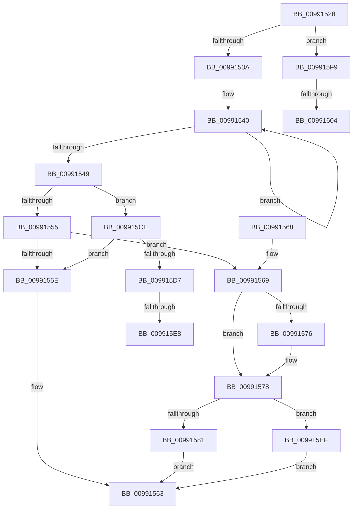

# _CmGetDeviceHardwareKeyPath

- RVA: `0x00991528`–`0x0099160D` (길이 `229` bytes)
- VA: `0x0000000140991528`
- 실행 섹션: `PAGE`
- PDB 이름 있음: `예`; PDB Function 태그: `예`
- unwind 정보 RVA: `0x00098CE0`
- 디코드: `54`개 명령, `229/229` bytes 표시
- 미해석 바이트: `0` (있으면 어셈블리에 `.byte`로 보존)

> 이 문서는 커널 이미지의 기계어와 PDB 기호를 분석해 생성했습니다. 4번과 5번은 함수 원형과 자료형을 바이너리 사용 방식에서 추정한 C 해석이며 원본 소스 복구 결과는 아닙니다.

## 1. Dependencies

- 직접 호출 지점: **1**; 고유 호출 대상: **1**
- 직접 호출자로 확인된 함수: **1**
- RIP 상대 이미지 참조: **3**

### Outgoing calls
- `0x009915C7` → [RtlStringCchPrintfExW](../../text/42/RtlStringCchPrintfExW_function_0042B390.md) (function, `0x0042B390`)

### Direct callers
- [CmGetDeviceRegKeyPath](CmGetDeviceRegKeyPath_function_00990CC0.md) at `0x00990F0D`

### Static image references
- `0x00991581` → RVA `0x00B0D340` (` ?? ::NNGAKEGL::`string'`; read)
- `0x0099158D` → RVA `0x00B0D550` (` ?? ::NNGAKEGL::`string'`; read)
- `0x009915B3` → RVA `0x00AFDE50` (` ?? ::NNGAKEGL::`string'`; read)

## 2. Other-region calls and transfers

- 다른 실행 섹션으로 향하는 call: **1**
  - `0x009915C7` → [RtlStringCchPrintfExW](../../text/42/RtlStringCchPrintfExW_function_0042B390.md) (`PAGE` → `.text`)
- call이 아닌 외부 분기/꼬리 이동: **4**
  - `0x009915E2` → [sub_00B2BE00 + 0xF9](../B2/Unknown_function_00B2BE00.md) (`tail-transfer`)
  - `0x009915EA` → [sub_00B2BE00 + 0xF9](../B2/Unknown_function_00B2BE00.md) (`tail-transfer`)
  - `0x009915FE` → [sub_00B2BE00 + 0x54](../B2/Unknown_function_00B2BE00.md) (`tail-transfer`)
  - `0x00991608` → [sub_00B2BE00](../B2/Unknown_function_00B2BE00.md) (`tail-transfer`)

## 3. Assembly (complete function range)

```asm
00991528  48 83 EC 58                     sub rsp, 0x58
0099152C  4C 8B D2                        mov r10, rdx
0099152F  41 0F BA E0 09                  bt r8d, 9
00991534  0F 82 BF 00 00 00               jb 0x1409915f9
0099153A  48 83 C8 FF                     or rax, 0xffffffffffffffff
0099153E  33 C9                           xor ecx, ecx
00991540  48 FF C0                        inc rax
00991543  66 39 0C 42                     cmp word ptr [rdx + rax*2], cx
00991547  75 F7                           jne 0x140991540
00991549  BA FF FF FF FF                  mov edx, 0xffffffff
0099154E  41 0F BA E0 08                  bt r8d, 8
00991553  72 79                           jb 0x1409915ce
00991555  48 83 C0 31                     add rax, 0x31
00991559  48 3B C2                        cmp rax, rdx
0099155C  76 0B                           jbe 0x140991569
0099155E  B8 95 00 00 C0                  mov eax, 0xc0000095
00991563  48 83 C4 58                     add rsp, 0x58
00991567  C3                              ret
00991568  CC                              int3
00991569  48 8B 94 24 98 00 00 00         mov rdx, qword ptr [rsp + 0x98]
00991571  48 85 D2                        test rdx, rdx
00991574  74 02                           je 0x140991578
00991576  89 02                           mov dword ptr [rdx], eax
00991578  3B 84 24 90 00 00 00            cmp eax, dword ptr [rsp + 0x90]
0099157F  77 6E                           ja 0x1409915ef
00991581  48 8D 05 B8 BD 17 00            lea rax, [rip + 0x17bdb8]
00991588  48 89 44 24 40                  mov qword ptr [rsp + 0x40], rax
0099158D  48 8D 05 BC BF 17 00            lea rax, [rip + 0x17bfbc]
00991594  4C 89 54 24 38                  mov qword ptr [rsp + 0x38], r10
00991599  8B 94 24 90 00 00 00            mov edx, dword ptr [rsp + 0x90]
009915A0  45 33 C9                        xor r9d, r9d
009915A3  48 8B 8C 24 88 00 00 00         mov rcx, qword ptr [rsp + 0x88]
009915AB  45 33 C0                        xor r8d, r8d
009915AE  48 89 44 24 30                  mov qword ptr [rsp + 0x30], rax
009915B3  48 8D 05 96 C8 16 00            lea rax, [rip + 0x16c896]
009915BA  48 89 44 24 28                  mov qword ptr [rsp + 0x28], rax
009915BF  C7 44 24 20 00 08 00 00         mov dword ptr [rsp + 0x20], 0x800
009915C7  E8 C4 9D A9 FF                  call 0x14042b390
009915CC  EB 95                           jmp 0x140991563
009915CE  48 83 C0 1F                     add rax, 0x1f
009915D2  48 3B C2                        cmp rax, rdx
009915D5  77 87                           ja 0x14099155e
009915D7  48 8B 94 24 98 00 00 00         mov rdx, qword ptr [rsp + 0x98]
009915DF  48 85 D2                        test rdx, rdx
009915E2  0F 84 11 A9 19 00               je 0x140b2bef9
009915E8  89 02                           mov dword ptr [rdx], eax
009915EA  E9 0A A9 19 00                  jmp 0x140b2bef9
009915EF  B8 23 00 00 C0                  mov eax, 0xc0000023
009915F4  E9 6A FF FF FF                  jmp 0x140991563
009915F9  33 C9                           xor ecx, ecx
009915FB  45 85 C9                        test r9d, r9d
009915FE  0F 85 50 A8 19 00               jne 0x140b2be54
00991604  48 83 C8 FF                     or rax, 0xffffffffffffffff
00991608  E9 F3 A7 19 00                  jmp 0x140b2be00
```

## 4. C-style interpretation (structured pseudocode)

```c
__int64 __fastcall _CmGetDeviceHardwareKeyPath(int a1, __int64 a2, int a3, int a4, __int64 a5, __int64 a6, unsigned int a7, __int64 a8)
{
    __int64 result;
    __int64 v_rsp;
    unsigned int v_stack_p20;
    unsigned __int64 v_stack_p28;
    unsigned __int64 v_stack_p30;
    unsigned __int64 v_stack_p38;
    unsigned __int64 v_stack_p40;

    v_rsp = (v_rsp) - (88);
    if (condition_is_below) goto loc_009915F9;
    result = (result) | (-1);
    a1 = 0;
loc_00991540:
    result = (result) + 1;
    if ((*(unsigned __int16 *)(a2 + result * 2)) != 0) goto loc_00991540;
    if ((*(unsigned __int16 *)(a2 + result * 2)) < 0) goto loc_009915CE;
    result = (result) + (49);
    if (result <= ((unsigned int)(0xFFFFFFFFULL))) goto loc_00991569;
loc_0099155E:
loc_00991563:
    v_rsp = (v_rsp) + (88);
    return (unsigned int)(0xC0000095ULL);
loc_00991569:
    if (a8 != 0) {
        *(unsigned int *)(a8) = (unsigned int)((unsigned int)(0xC0000095ULL));
    }
    if (((unsigned int)((unsigned int)(0xC0000095ULL))) > a7) goto loc_009915EF;
    v_stack_p40 = v_rip + 1555896;
    v_stack_p38 = a2;
    a4 = 0;
    a3 = 0;
    v_stack_p30 = v_rip + 1556412;
    v_stack_p28 = v_rip + 1493142;
    v_stack_p20 = 0x800ULL;
    result = RtlStringCchPrintfExW(a6, (unsigned int)(a7), a3, a4);
    goto loc_00991563;
loc_009915CE:
    result = (result) + (31);
    if (result > ((unsigned int)(a7))) goto loc_0099155E;
    *(unsigned int *)(a8) = (unsigned int)(result);
loc_009915EF:
    goto loc_00991563;
loc_009915F9:
    a1 = 0;
    result = ((unsigned int)(0xC0000023ULL)) | (-1);
}
```

## 5. (Beta) C Style

```c
int64_t _CmGetDeviceHardwareKeyPath(int32_t Arg1, void *Arg2, int32_t Arg3, int32_t Arg4, uint64_t Arg5, int64_t Arg6, uint32_t Arg7, int64_t Arg8)
{
    uint8_t *arg2 = (uint8_t *)Arg2;

    int64_t result;
    int64_t local_rsp;
    uint32_t v_stack_p20;
    uint64_t v_stack_p28;
    uint64_t v_stack_p30;
    uint64_t v_stack_p38;
    uint64_t v_stack_p40;

    local_rsp = (local_rsp) - (88);
    if (condition_is_below) goto loc_009915F9;
    result = (result) | (-1);
    Arg1 = 0;
loc_00991540:
    result = (result) + 1;
    if ((*(uint16_t *)(arg2 + result * 2)) != 0) goto loc_00991540;
    if ((*(uint16_t *)(arg2 + result * 2)) < 0) goto loc_009915CE;
    result = (result) + (49);
    if (result <= ((uint32_t)(0xFFFFFFFFULL))) goto loc_00991569;
loc_0099155E:
loc_00991563:
    local_rsp = (local_rsp) + (88);
    return (uint32_t)(0xC0000095ULL);
loc_00991569:
    if (Arg8 != 0) {
        *(uint32_t *)(Arg8) = (uint32_t)((uint32_t)(0xC0000095ULL));
    }
    if (((uint32_t)((uint32_t)(0xC0000095ULL))) > Arg7) goto loc_009915EF;
    v_stack_p40 = v_rip + 1555896;
    v_stack_p38 = Arg2;
    Arg4 = 0;
    Arg3 = 0;
    v_stack_p30 = v_rip + 1556412;
    v_stack_p28 = v_rip + 1493142;
    v_stack_p20 = 0x800ULL;
    result = RtlStringCchPrintfExW(Arg6, (uint32_t)(Arg7), Arg3, Arg4);
    goto loc_00991563;
loc_009915CE:
    result = (result) + (31);
    if (result > ((uint32_t)(Arg7))) goto loc_0099155E;
    *(uint32_t *)(Arg8) = (uint32_t)(result);
loc_009915EF:
    goto loc_00991563;
loc_009915F9:
    Arg1 = 0;
    result = ((uint32_t)(0xC0000023ULL)) | (-1);
}
```

### 관측된 메모리 오프셋

구조체 형식이 확인되지 않은 접근은 인자 기준의 오프셋으로만 기록했습니다.

| 기준 인자 | 오프셋 표현 | 폭 (bit) | 접근 |
|---|---:|---:|---|
| `Arg2` | `+ 0x0 + rax*2` | `16` | `R` |

## 6. Execution-region graph

[열기: 2D/3D 그래프와 함수 탐색 컨트롤 패널](../../../control-panel.html?section=page&rva=0x00991528&view=graph)

- 2D 그래프는 위에서 아래로 흐르고, 3D 그래프는 빈 공간을 드래그해 회전합니다. Shift+드래그는 이동, 휠은 확대·축소, 함수 노드 선택은 대상 보고서 이동입니다.

### Static fallback


