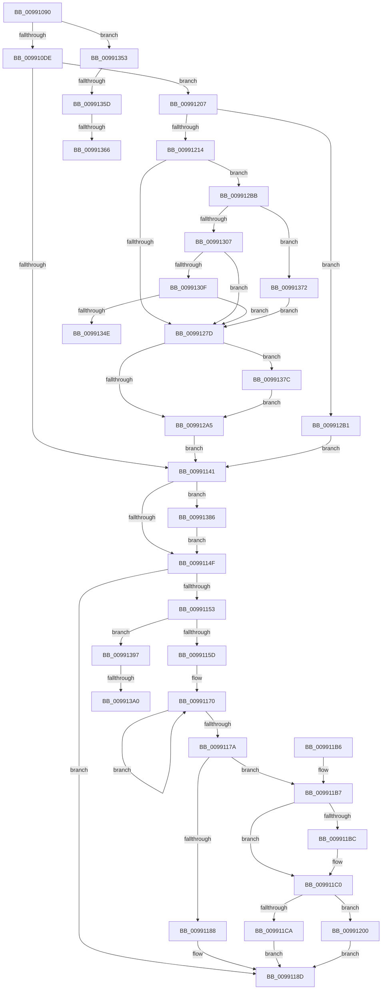

# _CmGetDeviceSoftwareKeyPath

- RVA: `0x00991090`–`0x009913B0` (길이 `800` bytes)
- VA: `0x0000000140991090`
- 실행 섹션: `PAGE`
- PDB 이름 있음: `예`; PDB Function 태그: `예`
- unwind 정보 RVA: `0x00098C9C`
- 디코드: `187`개 명령, `800/800` bytes 표시
- 미해석 바이트: `0` (있으면 어셈블리에 `.byte`로 보존)

> 이 문서는 커널 이미지의 기계어와 PDB 기호를 분석해 생성했습니다. 4번과 5번은 함수 원형과 자료형을 바이너리 사용 방식에서 추정한 C 해석이며 원본 소스 복구 결과는 아닙니다.

## 1. Dependencies

- 직접 호출 지점: **11**; 고유 호출 대상: **8**
- 직접 호출자로 확인된 함수: **2**
- RIP 상대 이미지 참조: **3**

### Outgoing calls
- `0x00991128` → [CmGetDeviceRegProp](../8E/CmGetDeviceRegProp_function_008ED870.md) (function, `0x008ED870`)
- `0x00991196` → [_security_check_cookie](../../text/6A/_security_check_cookie_function_006AC640.md) (function, `0x006AC640`)
- `0x009911F7` → [RtlStringCchPrintfExW](../../text/42/RtlStringCchPrintfExW_function_0042B390.md) (function, `0x0042B390`)
- `0x0099122E` → [ExAcquireResourceExclusiveLite](../../text/21/ExAcquireResourceExclusiveLite_function_00214E20.md) (function, `0x00214E20`)
- `0x0099126F` → [CmGetDeviceRegProp](../8E/CmGetDeviceRegProp_function_008ED870.md) (function, `0x008ED870`)
- `0x00991284` → [ExReleaseResourceLite](../../text/25/ExReleaseResourceLite_function_0025FA10.md) (function, `0x0025FA10`)
- `0x00991292` → [KeLeaveCriticalRegionThread](../../text/25/KeLeaveCriticalRegionThread_function_0025EFF0.md) (function, `0x0025EFF0`)
- `0x009912F9` → [CmGetDeviceRegProp](../8E/CmGetDeviceRegProp_function_008ED870.md) (function, `0x008ED870`)
- `0x0099133F` → [CmOpenCommonClassRegKey](../8E/CmOpenCommonClassRegKey_function_008EFF5C.md) (function, `0x008EFF5C`)
- `0x0099137C` → [ZwClose](../../text/6A/ZwClose_function_006AD2B0.md) (function, `0x006AD2B0`)
- `0x00991386` → [ZwClose](../../text/6A/ZwClose_function_006AD2B0.md) (function, `0x006AD2B0`)

### Direct callers
- [sub_008EE966](../8E/Unknown_function_008EE966.md) at `0x008EEE56`
- [CmGetDeviceRegKeyPath](CmGetDeviceRegKeyPath_function_00990CC0.md) at `0x00990E4B`

### Static image references
- `0x009910AC` → RVA `0x00E0A740` (`.data`; read)
- `0x0099112D` → RVA `0x00AFD430` (` ?? ::NNGAKEGL::`string'`; read)
- `0x009911D8` → RVA `0x00B0D6B0` (` ?? ::NNGAKEGL::`string'`; read)

## 2. Other-region calls and transfers

- 다른 실행 섹션으로 향하는 call: **7**
  - `0x00991196` → [_security_check_cookie](../../text/6A/_security_check_cookie_function_006AC640.md) (`PAGE` → `.text`)
  - `0x009911F7` → [RtlStringCchPrintfExW](../../text/42/RtlStringCchPrintfExW_function_0042B390.md) (`PAGE` → `.text`)
  - `0x0099122E` → [ExAcquireResourceExclusiveLite](../../text/21/ExAcquireResourceExclusiveLite_function_00214E20.md) (`PAGE` → `.text`)
  - `0x00991284` → [ExReleaseResourceLite](../../text/25/ExReleaseResourceLite_function_0025FA10.md) (`PAGE` → `.text`)
  - `0x00991292` → [KeLeaveCriticalRegionThread](../../text/25/KeLeaveCriticalRegionThread_function_0025EFF0.md) (`PAGE` → `.text`)
  - `0x0099137C` → [ZwClose](../../text/6A/ZwClose_function_006AD2B0.md) (`PAGE` → `.text`)
  - `0x00991386` → [ZwClose](../../text/6A/ZwClose_function_006AD2B0.md) (`PAGE` → `.text`)
- call이 아닌 외부 분기/꼬리 이동: **6**
  - `0x0099134E` → [sub_00B2BA82 + 0x220](../B2/Unknown_function_00B2BA82.md) (`tail-transfer`)
  - `0x00991357` → [sub_00B2BA82 + 0x151](../B2/Unknown_function_00B2BA82.md) (`tail-transfer`)
  - `0x00991360` → [sub_00B2BA82 + 0xB6](../B2/Unknown_function_00B2BA82.md) (`tail-transfer`)
  - `0x0099136D` → [sub_00B2BA82](../B2/Unknown_function_00B2BA82.md) (`tail-transfer`)
  - `0x0099139A` → [sub_00B2BA82 + 0x32B](../B2/Unknown_function_00B2BA82.md) (`tail-transfer`)
  - `0x009913AB` → [sub_00B2BA82 + 0x2F3](../B2/Unknown_function_00B2BA82.md) (`tail-transfer`)

## 3. Assembly (complete function range)

```asm
00991090  48 89 5C 24 18                  mov qword ptr [rsp + 0x18], rbx
00991095  55                              push rbp
00991096  56                              push rsi
00991097  57                              push rdi
00991098  41 54                           push r12
0099109A  41 55                           push r13
0099109C  41 56                           push r14
0099109E  41 57                           push r15
009910A0  48 8D 6C 24 A0                  lea rbp, [rsp - 0x60]
009910A5  48 81 EC 60 01 00 00            sub rsp, 0x160
009910AC  48 8B 05 8D 96 47 00            mov rax, qword ptr [rip + 0x47968d]
009910B3  48 33 C4                        xor rax, rsp
009910B6  48 89 45 50                     mov qword ptr [rbp + 0x50], rax
009910BA  80 79 04 00                     cmp byte ptr [rcx + 4], 0
009910BE  45 8B F9                        mov r15d, r9d
009910C1  4C 8B AD C8 00 00 00            mov r13, qword ptr [rbp + 0xc8]
009910C8  41 8B F0                        mov esi, r8d
009910CB  4C 8B A5 D8 00 00 00            mov r12, qword ptr [rbp + 0xd8]
009910D2  4C 8B F2                        mov r14, rdx
009910D5  48 8B F9                        mov rdi, rcx
009910D8  0F 85 75 02 00 00               jne 0x140991353
009910DE  33 C0                           xor eax, eax
009910E0  C7 44 24 60 58 00 00 00         mov dword ptr [rsp + 0x60], 0x58
009910E8  89 44 24 38                     mov dword ptr [rsp + 0x38], eax
009910EC  0F 57 C0                        xorps xmm0, xmm0
009910EF  48 89 44 24 68                  mov qword ptr [rsp + 0x68], rax
009910F4  41 B9 0A 00 00 00               mov r9d, 0xa
009910FA  48 89 44 24 70                  mov qword ptr [rsp + 0x70], rax
009910FF  45 33 C0                        xor r8d, r8d
00991102  89 44 24 64                     mov dword ptr [rsp + 0x64], eax
00991106  48 8D 44 24 60                  lea rax, [rsp + 0x60]
0099110B  48 89 44 24 30                  mov qword ptr [rsp + 0x30], rax
00991110  48 8D 45 A0                     lea rax, [rbp - 0x60]
00991114  48 89 44 24 28                  mov qword ptr [rsp + 0x28], rax
00991119  48 8D 44 24 64                  lea rax, [rsp + 0x64]
0099111E  48 89 44 24 20                  mov qword ptr [rsp + 0x20], rax
00991123  0F 11 44 24 78                  movups xmmword ptr [rsp + 0x78], xmm0
00991128  E8 43 C7 F5 FF                  call 0x1408ed870
0099112D  4C 8D 05 FC C2 16 00            lea r8, [rip + 0x16c2fc]
00991134  8B D8                           mov ebx, eax
00991136  3D 25 02 00 C0                  cmp eax, 0xc0000225
0099113B  0F 84 C6 00 00 00               je 0x140991207
00991141  48 8B 4C 24 68                  mov rcx, qword ptr [rsp + 0x68]
00991146  48 85 C9                        test rcx, rcx
00991149  0F 85 37 02 00 00               jne 0x140991386
0099114F  85 DB                           test ebx, ebx
00991151  78 3A                           js 0x14099118d
00991153  0F BA E6 09                     bt esi, 9
00991157  0F 82 3A 02 00 00               jb 0x140991397
0099115D  48 8D 4D A0                     lea rcx, [rbp - 0x60]
00991161  48 C7 C0 FF FF FF FF            mov rax, 0xffffffffffffffff
00991168  0F 1F 84 00 00 00 00 00         nop dword ptr [rax + rax]
00991170  48 FF C0                        inc rax
00991173  66 83 3C 41 00                  cmp word ptr [rcx + rax*2], 0
00991178  75 F6                           jne 0x140991170
0099117A  48 83 C0 28                     add rax, 0x28
0099117E  B9 FF FF FF FF                  mov ecx, 0xffffffff
00991183  48 3B C1                        cmp rax, rcx
00991186  76 2F                           jbe 0x1409911b7
00991188  BB 95 00 00 C0                  mov ebx, 0xc0000095
0099118D  8B C3                           mov eax, ebx
0099118F  48 8B 4D 50                     mov rcx, qword ptr [rbp + 0x50]
00991193  48 33 CC                        xor rcx, rsp
00991196  E8 A5 B4 D1 FF                  call 0x1406ac640
0099119B  48 8B 9C 24 B0 01 00 00         mov rbx, qword ptr [rsp + 0x1b0]
009911A3  48 81 C4 60 01 00 00            add rsp, 0x160
009911AA  41 5F                           pop r15
009911AC  41 5E                           pop r14
009911AE  41 5D                           pop r13
009911B0  41 5C                           pop r12
009911B2  5F                              pop rdi
009911B3  5E                              pop rsi
009911B4  5D                              pop rbp
009911B5  C3                              ret
009911B6  CC                              int3
009911B7  4D 85 E4                        test r12, r12
009911BA  74 04                           je 0x1409911c0
009911BC  41 89 04 24                     mov dword ptr [r12], eax
009911C0  8B 8D D0 00 00 00               mov ecx, dword ptr [rbp + 0xd0]
009911C6  3B C1                           cmp eax, ecx
009911C8  77 36                           ja 0x140991200
009911CA  48 8D 45 A0                     lea rax, [rbp - 0x60]
009911CE  8B D1                           mov edx, ecx
009911D0  48 89 44 24 38                  mov qword ptr [rsp + 0x38], rax
009911D5  45 33 C9                        xor r9d, r9d
009911D8  48 8D 05 D1 C4 17 00            lea rax, [rip + 0x17c4d1]
009911DF  49 8B CD                        mov rcx, r13
009911E2  48 89 44 24 30                  mov qword ptr [rsp + 0x30], rax
009911E7  4C 89 44 24 28                  mov qword ptr [rsp + 0x28], r8
009911EC  45 33 C0                        xor r8d, r8d
009911EF  C7 44 24 20 00 08 00 00         mov dword ptr [rsp + 0x20], 0x800
009911F7  E8 94 A1 A9 FF                  call 0x14042b390
009911FC  8B D8                           mov ebx, eax
009911FE  EB 8D                           jmp 0x14099118d
00991200  BB 23 00 00 C0                  mov ebx, 0xc0000023
00991205  EB 86                           jmp 0x14099118d
00991207  80 BD C0 00 00 00 01            cmp byte ptr [rbp + 0xc0], 1
0099120E  0F 85 9D 00 00 00               jne 0x1409912b1
00991214  65 48 8B 04 25 88 01 00 00      mov rax, qword ptr gs:[0x188]
0099121D  B2 01                           mov dl, 1
0099121F  66 FF 88 E4 01 00 00            dec word ptr [rax + 0x1e4]
00991226  90                              nop
00991227  48 8B 8F F0 00 00 00            mov rcx, qword ptr [rdi + 0xf0]
0099122E  E8 ED 3B 88 FF                  call 0x140214e20
00991233  33 C9                           xor ecx, ecx
00991235  C7 44 24 60 58 00 00 00         mov dword ptr [rsp + 0x60], 0x58
0099123D  89 4C 24 38                     mov dword ptr [rsp + 0x38], ecx
00991241  48 8D 44 24 60                  lea rax, [rsp + 0x60]
00991246  48 89 44 24 30                  mov qword ptr [rsp + 0x30], rax
0099124B  45 33 C0                        xor r8d, r8d
0099124E  48 8D 45 A0                     lea rax, [rbp - 0x60]
00991252  89 4C 24 64                     mov dword ptr [rsp + 0x64], ecx
00991256  48 89 44 24 28                  mov qword ptr [rsp + 0x28], rax
0099125B  44 8D 49 0A                     lea r9d, [rcx + 0xa]
0099125F  48 8D 44 24 64                  lea rax, [rsp + 0x64]
00991264  49 8B D6                        mov rdx, r14
00991267  48 8B CF                        mov rcx, rdi
0099126A  48 89 44 24 20                  mov qword ptr [rsp + 0x20], rax
0099126F  E8 FC C5 F5 FF                  call 0x1408ed870
00991274  8B D8                           mov ebx, eax
00991276  3D 25 02 00 C0                  cmp eax, 0xc0000225
0099127B  74 3E                           je 0x1409912bb
0099127D  48 8B 8F F0 00 00 00            mov rcx, qword ptr [rdi + 0xf0]
00991284  E8 87 E7 8C FF                  call 0x14025fa10
00991289  65 48 8B 0C 25 88 01 00 00      mov rcx, qword ptr gs:[0x188]
00991292  E8 59 DD 8C FF                  call 0x14025eff0
00991297  48 8B 4C 24 70                  mov rcx, qword ptr [rsp + 0x70]
0099129C  48 85 C9                        test rcx, rcx
0099129F  0F 85 D7 00 00 00               jne 0x14099137c
009912A5  4C 8D 05 84 C1 16 00            lea r8, [rip + 0x16c184]
009912AC  E9 90 FE FF FF                  jmp 0x140991141
009912B1  BB 34 00 00 C0                  mov ebx, 0xc0000034
009912B6  E9 86 FE FF FF                  jmp 0x140991141
009912BB  33 C0                           xor eax, eax
009912BD  C7 44 24 60 4E 00 00 00         mov dword ptr [rsp + 0x60], 0x4e
009912C5  89 44 24 38                     mov dword ptr [rsp + 0x38], eax
009912C9  41 B9 09 00 00 00               mov r9d, 9
009912CF  89 44 24 64                     mov dword ptr [rsp + 0x64], eax
009912D3  45 33 C0                        xor r8d, r8d
009912D6  48 8D 44 24 60                  lea rax, [rsp + 0x60]
009912DB  49 8B D6                        mov rdx, r14
009912DE  48 89 44 24 30                  mov qword ptr [rsp + 0x30], rax
009912E3  48 8B CF                        mov rcx, rdi
009912E6  48 8D 45 00                     lea rax, [rbp]
009912EA  48 89 44 24 28                  mov qword ptr [rsp + 0x28], rax
009912EF  48 8D 44 24 64                  lea rax, [rsp + 0x64]
009912F4  48 89 44 24 20                  mov qword ptr [rsp + 0x20], rax
009912F9  E8 72 C5 F5 FF                  call 0x1408ed870
009912FE  8B D8                           mov ebx, eax
00991300  3D 25 02 00 C0                  cmp eax, 0xc0000225
00991305  74 6B                           je 0x140991372
00991307  85 C0                           test eax, eax
00991309  0F 88 6E FF FF FF               js 0x14099127d
0099130F  33 C0                           xor eax, eax
00991311  48 8D 55 00                     lea rdx, [rbp]
00991315  48 89 44 24 38                  mov qword ptr [rsp + 0x38], rax
0099131A  45 33 C9                        xor r9d, r9d
0099131D  66 89 45 4C                     mov word ptr [rbp + 0x4c], ax
00991321  48 8B CF                        mov rcx, rdi
00991324  48 8D 44 24 68                  lea rax, [rsp + 0x68]
00991329  48 89 44 24 30                  mov qword ptr [rsp + 0x30], rax
0099132E  C6 44 24 28 00                  mov byte ptr [rsp + 0x28], 0
00991333  45 8D 41 20                     lea r8d, [r9 + 0x20]
00991337  C7 44 24 20 1F 00 02 00         mov dword ptr [rsp + 0x20], 0x2001f
0099133F  E8 18 EC F5 FF                  call 0x1408eff5c
00991344  8B D8                           mov ebx, eax
00991346  85 C0                           test eax, eax
00991348  0F 88 2F FF FF FF               js 0x14099127d
0099134E  E9 4F A9 19 00                  jmp 0x140b2bca2
00991353  0F BA E6 09                     bt esi, 9
00991357  0F 83 76 A8 19 00               jae 0x140b2bbd3
0099135D  45 85 FF                        test r15d, r15d
00991360  0F 85 D2 A7 19 00               jne 0x140b2bb38
00991366  48 C7 C0 FF FF FF FF            mov rax, 0xffffffffffffffff
0099136D  E9 10 A7 19 00                  jmp 0x140b2ba82
00991372  BB 34 00 00 C0                  mov ebx, 0xc0000034
00991377  E9 01 FF FF FF                  jmp 0x14099127d
0099137C  E8 2F BF D1 FF                  call 0x1406ad2b0
00991381  E9 1F FF FF FF                  jmp 0x1409912a5
00991386  E8 25 BF D1 FF                  call 0x1406ad2b0
0099138B  4C 8D 05 9E C0 16 00            lea r8, [rip + 0x16c09e]
00991392  E9 B8 FD FF FF                  jmp 0x14099114f
00991397  45 85 FF                        test r15d, r15d
0099139A  0F 85 0D AA 19 00               jne 0x140b2bdad
009913A0  48 8D 4D A0                     lea rcx, [rbp - 0x60]
009913A4  48 C7 C0 FF FF FF FF            mov rax, 0xffffffffffffffff
009913AB  E9 C5 A9 19 00                  jmp 0x140b2bd75
```

## 4. C-style interpretation (structured pseudocode)

```c
__int64 __fastcall _CmGetDeviceSoftwareKeyPath(__int64 a1, __int64 a2, int a3, int a4, unsigned __int8 a5, __int64 a6, unsigned int a7, __int64 a8)
{
    __int64 result;
    __int64 v_rsp;
    unsigned __int64 v_stack_m120;
    unsigned __int64 v_stack_m128;
    unsigned __int64 v_stack_m130;
    unsigned int v_stack_m134;
    unsigned int v_stack_m138;
    unsigned int v_stack_m160;
    unsigned __int64 v_stack_m168;
    unsigned __int64 v_stack_m170;
    unsigned __int64 v_stack_m178;
    unsigned __int64 v_stack_m48;
    unsigned __int16 v_stack_m4C;
    unsigned __int64 v_stack_m98;
    unsigned __int64 v_stack_mF8;
    unsigned __int64 v_stack_p18;
    unsigned int v_stack_p20;
    unsigned __int64 v_stack_p28;
    unsigned __int64 v_stack_p30;
    unsigned __int64 v_stack_p38;
    unsigned int v_stack_p60;
    unsigned int v_stack_p64;
    unsigned __int64 v_stack_p68;
    unsigned __int64 v_stack_p70;

    v_stack_p18 = v_rbx;
    v_rsp = (v_rsp) - (352);
    result = (*(unsigned __int64 *)(v_rip + 4691597)) ^ (v_rsp);
    v_stack_m48 = result;
    if ((*(unsigned __int8 *)(a1 + 4)) != 0) goto loc_00991353;
    result = 0;
    v_stack_m138 = 88;
    v_stack_m160 = 0;
    v_stack_m130 = 0;
    v_stack_m128 = 0;
    a3 = 0;
    v_stack_m134 = 0;
    v_stack_m168 = v_stack_m138;
    v_stack_m170 = v_stack_mF8;
    v_stack_m178 = v_stack_m134;
    v_stack_m120 = v_xmm0;
    result = CmGetDeviceRegProp(a1, a2, a3, 10);
    if (((unsigned int)(result)) == 0xC0000225ULL) goto loc_00991207;
loc_00991141:
    if (v_stack_m130 != 0) goto loc_00991386;
loc_0099114F:
    if (sign_flag) goto loc_0099118D;
    if (condition_is_below) goto loc_00991397;
loc_00991170:
    result = (-1) + 1;
    if ((*(unsigned __int16 *)(v_stack_mF8 + result * 2)) != 0) goto loc_00991170;
    result = (result) + (40);
    if (result <= ((unsigned int)(0xFFFFFFFFULL))) goto loc_009911B7;
loc_0099118D:
    a1 = (v_stack_m48) ^ (v_rsp);
    result = _security_check_cookie(a1, a2, v_rip + 1491708, 10);
    v_rsp = (v_rsp) + (352);
    return result;
loc_009911B7:
    if (a8 != 0) {
        *(unsigned int *)(a8) = (unsigned int)(result);
    }
    if (((unsigned int)(result)) > ((unsigned int)((unsigned int)(a7)))) goto loc_00991200;
    v_stack_p38 = v_stack_mF8;
    a4 = 0;
    v_stack_p30 = v_rip + 1557713;
    v_stack_p28 = v_rip + 1491708;
    a3 = 0;
    v_stack_p20 = 0x800ULL;
    result = RtlStringCchPrintfExW(a6, (unsigned int)((unsigned int)((unsigned int)(a7))), a3, a4);
    goto loc_0099118D;
loc_00991200:
    goto loc_0099118D;
loc_00991207:
    if (a5 != 1) goto loc_009912B1;
    result = ExAcquireResourceExclusiveLite(*(unsigned __int64 *)(a1 + 240), 1, a3, a4);
    a1 = 0;
    v_stack_p60 = 88;
    v_stack_p38 = 0;
    v_stack_p30 = v_stack_p60;
    a3 = 0;
    v_stack_p64 = 0;
    v_stack_p28 = v_stack_mF8;
    v_stack_p20 = v_stack_p64;
    result = CmGetDeviceRegProp(0, a2, a3, a1 + 10);
    if (((unsigned int)(result)) == 0xC0000225ULL) goto loc_009912BB;
loc_0099127D:
    result = ExReleaseResourceLite(*(unsigned __int64 *)(a1 + 240), a2, a3, a1 + 10);
    result = KeLeaveCriticalRegionThread(*(unsigned __int64 *)(gs_base + (0 + 392)), a2, a3, a1 + 10);
    if (v_stack_p70 != 0) goto loc_0099137C;
loc_009912A5:
    goto loc_00991141;
loc_009912B1:
    goto loc_00991141;
loc_009912BB:
    result = 0;
    v_stack_p60 = 78;
    v_stack_p38 = 0;
    v_stack_p64 = 0;
    a3 = 0;
    v_stack_p30 = v_stack_p60;
    v_stack_p28 = v_stack_m98;
    v_stack_p20 = v_stack_p64;
    result = CmGetDeviceRegProp(0, a2, a3, 9);
    if (((unsigned int)(result)) == 0xC0000225ULL) goto loc_00991372;
    if (sign_flag) goto loc_0099127D;
    result = 0;
    v_stack_p38 = 0;
    a4 = 0;
    v_stack_m4C = 0;
    v_stack_p30 = v_stack_p68;
    v_stack_p28 = 0;
    v_stack_p20 = 0x2001FULL;
    result = CmOpenCommonClassRegKey(0, v_stack_m98, a4 + 32, a4);
    if (sign_flag) goto loc_0099127D;
loc_00991353:
loc_00991372:
    goto loc_0099127D;
loc_0099137C:
    result = ZwClose(0, v_stack_m98, a4 + 32, a4);
    goto loc_009912A5;
loc_00991386:
    result = ZwClose(0, v_stack_m98, a4 + 32, a4);
    goto loc_0099114F;
loc_00991397:
}
```

## 5. (Beta) C Style

```c
int64_t _CmGetDeviceSoftwareKeyPath(void *Arg1, int64_t Arg2, int32_t Arg3, int32_t Arg4, uint8_t Arg5, int64_t Arg6, uint32_t Arg7, int64_t Arg8)
{
    uint8_t *arg1 = (uint8_t *)Arg1;

    int64_t result;
    int64_t local_rsp;
    uint64_t v_stack_m120;
    uint64_t v_stack_m128;
    uint64_t v_stack_m130;
    uint32_t v_stack_m134;
    uint32_t v_stack_m138;
    uint32_t v_stack_m160;
    uint64_t v_stack_m168;
    uint64_t v_stack_m170;
    uint64_t v_stack_m178;
    uint64_t v_stack_m48;
    uint16_t v_stack_m4C;
    uint64_t v_stack_m98;
    uint64_t v_stack_mF8;
    uint64_t v_stack_p18;
    uint32_t v_stack_p20;
    uint64_t v_stack_p28;
    uint64_t v_stack_p30;
    uint64_t v_stack_p38;
    uint32_t v_stack_p60;
    uint32_t v_stack_p64;
    uint64_t v_stack_p68;
    uint64_t v_stack_p70;

    v_stack_p18 = local_rbx;
    local_rsp = (local_rsp) - (352);
    result = (*(uint64_t *)(v_rip + 0x47968D)) ^ (local_rsp);
    v_stack_m48 = result;
    if ((*(uint8_t *)(arg1 + 0x4)) != 0) goto loc_00991353;
    result = 0;
    v_stack_m138 = 88;
    v_stack_m160 = 0;
    v_stack_m130 = 0;
    v_stack_m128 = 0;
    Arg3 = 0;
    v_stack_m134 = 0;
    v_stack_m168 = v_stack_m138;
    v_stack_m170 = v_stack_mF8;
    v_stack_m178 = v_stack_m134;
    v_stack_m120 = v_xmm0;
    result = CmGetDeviceRegProp(Arg1, Arg2, Arg3, 10);
    if (((uint32_t)(result)) == 0xC0000225ULL) goto loc_00991207;
loc_00991141:
    if (v_stack_m130 != 0) goto loc_00991386;
loc_0099114F:
    if (sign_flag) goto loc_0099118D;
    if (condition_is_below) goto loc_00991397;
loc_00991170:
    result = (-1) + 1;
    if ((*(uint16_t *)(v_stack_mF8 + result * 2)) != 0) goto loc_00991170;
    result = (result) + (40);
    if (result <= ((uint32_t)(0xFFFFFFFFULL))) goto loc_009911B7;
loc_0099118D:
    Arg1 = (v_stack_m48) ^ (local_rsp);
    result = _security_check_cookie(Arg1, Arg2, v_rip + 1491708, 10);
    local_rsp = (local_rsp) + (352);
    return result;
loc_009911B7:
    if (Arg8 != 0) {
        *(uint32_t *)(Arg8) = (uint32_t)(result);
    }
    if (((uint32_t)(result)) > ((uint32_t)((uint32_t)(Arg7)))) goto loc_00991200;
    v_stack_p38 = v_stack_mF8;
    Arg4 = 0;
    v_stack_p30 = v_rip + 1557713;
    v_stack_p28 = v_rip + 1491708;
    Arg3 = 0;
    v_stack_p20 = 0x800ULL;
    result = RtlStringCchPrintfExW(Arg6, (uint32_t)((uint32_t)((uint32_t)(Arg7))), Arg3, Arg4);
    goto loc_0099118D;
loc_00991200:
    goto loc_0099118D;
loc_00991207:
    if (Arg5 != 1) goto loc_009912B1;
    result = ExAcquireResourceExclusiveLite(*(uint64_t *)(arg1 + 0xF0), 1, Arg3, Arg4);
    Arg1 = 0;
    v_stack_p60 = 88;
    v_stack_p38 = 0;
    v_stack_p30 = v_stack_p60;
    Arg3 = 0;
    v_stack_p64 = 0;
    v_stack_p28 = v_stack_mF8;
    v_stack_p20 = v_stack_p64;
    result = CmGetDeviceRegProp(0, Arg2, Arg3, Arg1 + 10);
    if (((uint32_t)(result)) == 0xC0000225ULL) goto loc_009912BB;
loc_0099127D:
    result = ExReleaseResourceLite(*(uint64_t *)(arg1 + 0xF0), Arg2, Arg3, Arg1 + 10);
    result = KeLeaveCriticalRegionThread(*(uint64_t *)(gs_base + (0 + 0x188)), Arg2, Arg3, Arg1 + 10);
    if (v_stack_p70 != 0) goto loc_0099137C;
loc_009912A5:
    goto loc_00991141;
loc_009912B1:
    goto loc_00991141;
loc_009912BB:
    result = 0;
    v_stack_p60 = 78;
    v_stack_p38 = 0;
    v_stack_p64 = 0;
    Arg3 = 0;
    v_stack_p30 = v_stack_p60;
    v_stack_p28 = v_stack_m98;
    v_stack_p20 = v_stack_p64;
    result = CmGetDeviceRegProp(0, Arg2, Arg3, 9);
    if (((uint32_t)(result)) == 0xC0000225ULL) goto loc_00991372;
    if (sign_flag) goto loc_0099127D;
    result = 0;
    v_stack_p38 = 0;
    Arg4 = 0;
    v_stack_m4C = 0;
    v_stack_p30 = v_stack_p68;
    v_stack_p28 = 0;
    v_stack_p20 = 0x2001FULL;
    result = CmOpenCommonClassRegKey(0, v_stack_m98, Arg4 + 32, Arg4);
    if (sign_flag) goto loc_0099127D;
loc_00991353:
loc_00991372:
    goto loc_0099127D;
loc_0099137C:
    result = ZwClose(0, v_stack_m98, Arg4 + 32, Arg4);
    goto loc_009912A5;
loc_00991386:
    result = ZwClose(0, v_stack_m98, Arg4 + 32, Arg4);
    goto loc_0099114F;
loc_00991397:
}
```

### 관측된 메모리 오프셋

구조체 형식이 확인되지 않은 접근은 인자 기준의 오프셋으로만 기록했습니다.

| 기준 인자 | 오프셋 표현 | 폭 (bit) | 접근 |
|---|---:|---:|---|
| `Arg1` | `+ 0x4` | `8` | `R` |
| `Arg1` | `+ 0xF0` | `64` | `R` |

## 6. Execution-region graph

[열기: 2D/3D 그래프와 함수 탐색 컨트롤 패널](../../../control-panel.html?section=page&rva=0x00991090&view=graph)

- 2D 그래프는 위에서 아래로 흐르고, 3D 그래프는 빈 공간을 드래그해 회전합니다. Shift+드래그는 이동, 휠은 확대·축소, 함수 노드 선택은 대상 보고서 이동입니다.

### Static fallback


