# _CmGetInterfaceClassMappedPropertyFromRegValue

- RVA: `0x00993EB8`–`0x009940F5` (길이 `573` bytes)
- VA: `0x0000000140993EB8`
- 실행 섹션: `PAGE`
- PDB 이름 있음: `예`; PDB Function 태그: `예`
- unwind 정보 RVA: `0x00098FBC`
- 디코드: `156`개 명령, `573/573` bytes 표시
- 미해석 바이트: `0` (있으면 어셈블리에 `.byte`로 보존)

> 이 문서는 커널 이미지의 기계어와 PDB 기호를 분석해 생성했습니다. 4번과 5번은 함수 원형과 자료형을 바이너리 사용 방식에서 추정한 C 해석이며 원본 소스 복구 결과는 아닙니다.

## 1. Dependencies

- 직접 호출 지점: **5**; 고유 호출 대상: **4**
- 직접 호출자로 확인된 함수: **2**
- RIP 상대 이미지 참조: **5**

### Outgoing calls
- `0x00993FCA` → [_RegRtlOpenKeyTransacted](../8E/_RegRtlOpenKeyTransacted_function_008EF810.md) (function, `0x008EF810`)
- `0x00993FF9` → [ZwClose](../../text/6A/ZwClose_function_006AD2B0.md) (function, `0x006AD2B0`)
- `0x00994048` → [PnpCtxRegQueryValue](PnpCtxRegQueryValue_function_009940FC.md) (function, `0x009940FC`)
- `0x00994053` → [ZwClose](../../text/6A/ZwClose_function_006AD2B0.md) (function, `0x006AD2B0`)
- `0x009940C5` → [CmOpenCommonClassRegKey](../8E/CmOpenCommonClassRegKey_function_008EFF5C.md) (function, `0x008EFF5C`)

### Direct callers
- [CmGetInterfaceClassMappedPropertyKeys](../83/CmGetInterfaceClassMappedPropertyKeys_function_00830C70.md) at `0x00830D14`
- [_PnpDispatchInterfaceClass](_PnpDispatchInterfaceClass_function_00993BD0.md) at `0x00993CE8`

### Static image references
- `0x00993F26` → RVA `0x00B4AE80` (`PAGE`; read)
- `0x00993F6C` → RVA `0x00013348` (`.rdata`; read)
- `0x00993F79` → RVA `0x00013350` (`.rdata`; read)
- `0x00993FC0` → RVA `0x00AFCD40` (` ?? ::NNGAKEGL::`string'`; read)
- `0x00994039` → RVA `0x00AFF600` (` ?? ::NNGAKEGL::`string'`; read)

## 2. Other-region calls and transfers

- 다른 실행 섹션으로 향하는 call: **2**
  - `0x00993FF9` → [ZwClose](../../text/6A/ZwClose_function_006AD2B0.md) (`PAGE` → `.text`)
  - `0x00994053` → [ZwClose](../../text/6A/ZwClose_function_006AD2B0.md) (`PAGE` → `.text`)
- call이 아닌 외부 분기/꼬리 이동: **2**
  - `0x00994069` → [sub_00B2C0CC](../B2/Unknown_function_00B2C0CC.md) (`tail-transfer`)
  - `0x00994071` → [sub_00B2C0CC](../B2/Unknown_function_00B2C0CC.md) (`tail-transfer`)

## 3. Assembly (complete function range)

```asm
00993EB8  48 89 5C 24 20                  mov qword ptr [rsp + 0x20], rbx
00993EBD  55                              push rbp
00993EBE  56                              push rsi
00993EBF  57                              push rdi
00993EC0  41 54                           push r12
00993EC2  41 55                           push r13
00993EC4  41 56                           push r14
00993EC6  41 57                           push r15
00993EC8  48 8B EC                        mov rbp, rsp
00993ECB  48 83 EC 70                     sub rsp, 0x70
00993ECF  48 8B 45 60                     mov rax, qword ptr [rbp + 0x60]
00993ED3  4C 8B F1                        mov r14, rcx
00993ED6  48 8B 4D 78                     mov rcx, qword ptr [rbp + 0x78]
00993EDA  4C 8B EA                        mov r13, rdx
00993EDD  4C 8B 65 68                     mov r12, qword ptr [rbp + 0x68]
00993EE1  33 D2                           xor edx, edx
00993EE3  48 89 45 F0                     mov qword ptr [rbp - 0x10], rax
00993EE7  4D 8B F8                        mov r15, r8
00993EEA  89 10                           mov dword ptr [rax], edx
00993EEC  8B DA                           mov ebx, edx
00993EEE  89 11                           mov dword ptr [rcx], edx
00993EF0  48 89 4D E8                     mov qword ptr [rbp - 0x18], rcx
00993EF4  89 55 D4                        mov dword ptr [rbp - 0x2c], edx
00993EF7  48 89 55 E0                     mov qword ptr [rbp - 0x20], rdx
00993EFB  48 89 55 D8                     mov qword ptr [rbp - 0x28], rdx
00993EFF  4D 85 E4                        test r12, r12
00993F02  0F 84 11 01 00 00               je 0x140994019
00993F08  8B 75 70                        mov esi, dword ptr [rbp + 0x70]
00993F0B  8B C6                           mov eax, esi
00993F0D  F7 D8                           neg eax
00993F0F  48 1B C9                        sbb rcx, rcx
00993F12  4C 23 E1                        and r12, rcx
00993F15  45 8B 41 10                     mov r8d, dword ptr [r9 + 0x10]
00993F19  41 83 F8 02                     cmp r8d, 2
00993F1D  0F 82 71 01 00 00               jb 0x140994094
00993F23  44 8B D2                        mov r10d, edx
00993F26  48 8D 15 53 6F 1B 00            lea rdx, [rip + 0x1b6f53]
00993F2D  4C 8B 1A                        mov r11, qword ptr [rdx]
00993F30  48 8B FA                        mov rdi, rdx
00993F33  45 3B 43 10                     cmp r8d, dword ptr [r11 + 0x10]
00993F37  0F 85 A0 01 00 00               jne 0x1409940dd
00993F3D  49 8B 09                        mov rcx, qword ptr [r9]
00993F40  49 2B 0B                        sub rcx, qword ptr [r11]
00993F43  75 08                           jne 0x140993f4d
00993F45  49 8B 49 08                     mov rcx, qword ptr [r9 + 8]
00993F49  49 2B 4B 08                     sub rcx, qword ptr [r11 + 8]
00993F4D  48 85 C9                        test rcx, rcx
00993F50  0F 85 87 01 00 00               jne 0x1409940dd
00993F56  48 85 FF                        test rdi, rdi
00993F59  0F 84 35 01 00 00               je 0x140994094
00993F5F  41 83 F8 02                     cmp r8d, 2
00993F63  0F 85 95 00 00 00               jne 0x140993ffe
00993F69  49 8B 01                        mov rax, qword ptr [r9]
00993F6C  48 2B 05 D5 F3 67 FF            sub rax, qword ptr [rip - 0x980c2b]
00993F73  75 0B                           jne 0x140993f80
00993F75  49 8B 41 08                     mov rax, qword ptr [r9 + 8]
00993F79  48 2B 05 D0 F3 67 FF            sub rax, qword ptr [rip - 0x980c30]
00993F80  48 85 C0                        test rax, rax
00993F83  75 79                           jne 0x140993ffe
00993F85  4D 85 FF                        test r15, r15
00993F88  0F 84 10 01 00 00               je 0x14099409e
00993F8E  33 DB                           xor ebx, ebx
00993F90  4D 85 F6                        test r14, r14
00993F93  0F 84 87 00 00 00               je 0x140994020
00993F99  49 8B 86 E0 00 00 00            mov rax, qword ptr [r14 + 0xe0]
00993FA0  48 85 C0                        test rax, rax
00993FA3  74 7B                           je 0x140994020
00993FA5  48 8B 48 08                     mov rcx, qword ptr [rax + 8]
00993FA9  48 89 4C 24 28                  mov qword ptr [rsp + 0x28], rcx
00993FAE  48 8D 45 D8                     lea rax, [rbp - 0x28]
00993FB2  49 8B CF                        mov rcx, r15
00993FB5  48 89 44 24 20                  mov qword ptr [rsp + 0x20], rax
00993FBA  41 B9 01 00 00 00               mov r9d, 1
00993FC0  48 8D 15 79 8D 16 00            lea rdx, [rip + 0x168d79]
00993FC7  45 33 C0                        xor r8d, r8d
00993FCA  E8 41 B8 F5 FF                  call 0x1408ef810
00993FCF  41 BE 34 00 00 C0               mov r14d, 0xc0000034
00993FD5  41 BF 7C 01 00 C0               mov r15d, 0xc000017c
00993FDB  41 3B C6                        cmp eax, r14d
00993FDE  0F 85 9A 00 00 00               jne 0x14099407e
00993FE4  8B D8                           mov ebx, eax
00993FE6  41 3B DE                        cmp ebx, r14d
00993FE9  75 39                           jne 0x140994024
00993FEB  BB 25 02 00 C0                  mov ebx, 0xc0000225
00993FF0  48 8B 4D E0                     mov rcx, qword ptr [rbp - 0x20]
00993FF4  48 85 C9                        test rcx, rcx
00993FF7  74 05                           je 0x140993ffe
00993FF9  E8 B2 92 D1 FF                  call 0x1406ad2b0
00993FFE  8B C3                           mov eax, ebx
00994000  48 8B 9C 24 C8 00 00 00         mov rbx, qword ptr [rsp + 0xc8]
00994008  48 83 C4 70                     add rsp, 0x70
0099400C  41 5F                           pop r15
0099400E  41 5E                           pop r14
00994010  41 5D                           pop r13
00994012  41 5C                           pop r12
00994014  5F                              pop rdi
00994015  5E                              pop rsi
00994016  5D                              pop rbp
00994017  C3                              ret
00994018  CC                              int3
00994019  8B F2                           mov esi, edx
0099401B  E9 F5 FE FF FF                  jmp 0x140993f15
00994020  33 C9                           xor ecx, ecx
00994022  EB 85                           jmp 0x140993fa9
00994024  85 DB                           test ebx, ebx
00994026  78 C8                           js 0x140993ff0
00994028  48 8B 55 D8                     mov rdx, qword ptr [rbp - 0x28]
0099402C  48 8D 45 D0                     lea rax, [rbp - 0x30]
00994030  48 89 44 24 28                  mov qword ptr [rsp + 0x28], rax
00994035  4C 8D 4D D4                     lea r9, [rbp - 0x2c]
00994039  4C 8D 05 C0 B5 16 00            lea r8, [rip + 0x16b5c0]
00994040  4C 89 64 24 20                  mov qword ptr [rsp + 0x20], r12
00994045  89 75 D0                        mov dword ptr [rbp - 0x30], esi
00994048  E8 AF 00 00 00                  call 0x1409940fc
0099404D  48 8B 4D D8                     mov rcx, qword ptr [rbp - 0x28]
00994051  8B F8                           mov edi, eax
00994053  E8 58 92 D1 FF                  call 0x1406ad2b0
00994058  41 3B FE                        cmp edi, r14d
0099405B  74 8E                           je 0x140993feb
0099405D  41 3B FF                        cmp edi, r15d
00994060  74 89                           je 0x140993feb
00994062  BA 23 00 00 C0                  mov edx, 0xc0000023
00994067  85 FF                           test edi, edi
00994069  0F 84 5D 80 19 00               je 0x140b2c0cc
0099406F  3B FA                           cmp edi, edx
00994071  0F 84 55 80 19 00               je 0x140b2c0cc
00994077  8B DF                           mov ebx, edi
00994079  E9 72 FF FF FF                  jmp 0x140993ff0
0099407E  41 3B C7                        cmp eax, r15d
00994081  0F 84 64 FF FF FF               je 0x140993feb
00994087  85 C0                           test eax, eax
00994089  0F 89 57 FF FF FF               jns 0x140993fe6
0099408F  E9 50 FF FF FF                  jmp 0x140993fe4
00994094  BB 30 02 00 C0                  mov ebx, 0xc0000230
00994099  E9 60 FF FF FF                  jmp 0x140993ffe
0099409E  48 21 5C 24 38                  and qword ptr [rsp + 0x38], rbx
009940A3  48 8D 45 E0                     lea rax, [rbp - 0x20]
009940A7  48 89 44 24 30                  mov qword ptr [rsp + 0x30], rax
009940AC  45 33 C9                        xor r9d, r9d
009940AF  88 5C 24 28                     mov byte ptr [rsp + 0x28], bl
009940B3  49 8B D5                        mov rdx, r13
009940B6  49 8B CE                        mov rcx, r14
009940B9  C7 44 24 20 01 00 00 00         mov dword ptr [rsp + 0x20], 1
009940C1  45 8D 41 40                     lea r8d, [r9 + 0x40]
009940C5  E8 92 BE F5 FF                  call 0x1408eff5c
009940CA  8B D8                           mov ebx, eax
009940CC  85 C0                           test eax, eax
009940CE  0F 88 1C FF FF FF               js 0x140993ff0
009940D4  4C 8B 7D E0                     mov r15, qword ptr [rbp - 0x20]
009940D8  E9 B1 FE FF FF                  jmp 0x140993f8e
009940DD  33 FF                           xor edi, edi
009940DF  41 FF C2                        inc r10d
009940E2  48 83 C2 10                     add rdx, 0x10
009940E6  41 83 FA 01                     cmp r10d, 1
009940EA  0F 82 3D FE FF FF               jb 0x140993f2d
009940F0  E9 61 FE FF FF                  jmp 0x140993f56
```

## 4. C-style interpretation (structured pseudocode)

```c
__int64 __fastcall _CmGetInterfaceClassMappedPropertyFromRegValue(__int64 a1, __int64 a2, __int64 a3, __int64 a4, __int64 a5, __int64 a6, unsigned int a7, __int64 a8)
{
    __int64 result;
    __int64 v_r10;
    __int64 v_r12;
    __int64 v_rbx;
    __int64 v_rdi;
    __int64 v_rsp;
    unsigned __int64 v_stack_m48;
    unsigned __int64 v_stack_m50;
    unsigned __int64 v_stack_m58;
    unsigned __int64 v_stack_m60;
    unsigned int v_stack_m64;
    unsigned __int64 v_stack_m68;
    unsigned __int64 v_stack_m80;
    unsigned __int64 v_stack_m88;
    unsigned __int64 v_stack_p20;
    unsigned __int64 v_stack_p28;
    unsigned __int64 v_stack_p30;
    unsigned __int64 v_stack_p38;

    v_stack_p20 = v_rbx;
    v_rsp = (v_rsp) - (112);
    a2 = 0;
    v_stack_m48 = a5;
    *(unsigned int *)(a5) = 0;
    *(unsigned int *)(a8) = 0;
    v_stack_m50 = a8;
    v_stack_m64 = 0;
    v_stack_m58 = 0;
    v_stack_m60 = 0;
    if (a6 == 0) goto loc_00994019;
    result = (unsigned int)(-((unsigned int)((unsigned int)((unsigned int)(a7)))));
    v_r12 = (a6) & (a8);
loc_00993F15:
    if (((unsigned int)((unsigned int)(*(unsigned int *)(a4 + 16)))) < 2) goto loc_00994094;
loc_00993F2D:
    if (((unsigned int)((unsigned int)(*(unsigned int *)(a4 + 16)))) != (*(unsigned int *)(*(unsigned __int64 *)(v_rip + 1797971) + 16))) goto loc_009940DD;
    a1 = (*(unsigned __int64 *)(a4)) - (*(unsigned __int64 *)(*(unsigned __int64 *)(v_rip + 1797971)));
    if (!(condition_is_not_equal)) {
        a1 = *(unsigned __int64 *)(a4 + 8);
        a1 = (a1) - (*(unsigned __int64 *)(*(unsigned __int64 *)(v_rip + 1797971) + 8));
    }
    if (a1 != 0) goto loc_009940DD;
loc_00993F56:
    if (v_rip + 1797971 == 0) goto loc_00994094;
    if (((unsigned int)((unsigned int)(*(unsigned int *)(a4 + 16)))) != 2) goto loc_00993FFE;
    result = (*(unsigned __int64 *)(a4)) - (*(unsigned __int64 *)(v_rip - 9964587));
    if (!(condition_is_not_equal)) {
        result = *(unsigned __int64 *)(a4 + 8);
        result = (result) - (*(unsigned __int64 *)(v_rip - 9964592));
    }
    if (result != 0) goto loc_00993FFE;
    if (a3 == 0) goto loc_0099409E;
loc_00993F8E:
    v_rbx = 0;
    if (a1 == 0) goto loc_00994020;
    if (*(unsigned __int64 *)(a1 + 224) == 0) goto loc_00994020;
loc_00993FA9:
    v_stack_m80 = *(unsigned __int64 *)(*(unsigned __int64 *)(a1 + 224) + 8);
    v_stack_m88 = v_stack_m60;
    a3 = 0;
    result = _RegRtlOpenKeyTransacted(a3, v_rip + 1478009, a3, 1);
    if (((unsigned int)(result)) != ((unsigned int)((unsigned int)(0xC0000034ULL)))) goto loc_0099407E;
loc_00993FE4:
loc_00993FE6:
    if (((unsigned int)((unsigned int)((unsigned int)(result)))) != ((unsigned int)((unsigned int)(0xC0000034ULL)))) goto loc_00994024;
loc_00993FEB:
loc_00993FF0:
    if (v_stack_m58 != 0) {
        result = ZwClose(v_stack_m58, v_rip + 1478009, a3, 1);
    }
    v_rsp = (v_rsp) + (112);
    return (unsigned int)((unsigned int)((unsigned int)(0xC0000225ULL)));
loc_00994019:
    goto loc_00993F15;
loc_00994020:
    a1 = 0;
    goto loc_00993FA9;
loc_00994024:
    if (sign_flag) goto loc_00993FF0;
    v_stack_p28 = v_stack_m68;
    v_stack_p20 = v_r12;
    v_stack_m68 = (unsigned int)((unsigned int)((unsigned int)(v_rip + 1478009)));
    result = PnpCtxRegQueryValue(a1, v_stack_m60, v_rip + 1488320, v_stack_m64);
    result = ZwClose(v_stack_m60, v_stack_m60, v_rip + 1488320, v_stack_m64);
    if (((unsigned int)((unsigned int)((unsigned int)(result)))) == ((unsigned int)((unsigned int)(0xC0000034ULL)))) goto loc_00993FEB;
    if (((unsigned int)((unsigned int)((unsigned int)(result)))) == ((unsigned int)((unsigned int)(0xC000017CULL)))) goto loc_00993FEB;
    goto loc_00993FF0;
loc_0099407E:
    if (((unsigned int)(result)) == ((unsigned int)((unsigned int)(0xC000017CULL)))) goto loc_00993FEB;
    if (!sign_flag) goto loc_00993FE6;
    goto loc_00993FE4;
loc_00994094:
    goto loc_00993FFE;
loc_0099409E:
    v_stack_p30 = v_stack_m58;
    a4 = 0;
    v_stack_p28 = (unsigned __int8)((unsigned int)(0xC0000230ULL));
    v_stack_p20 = 1;
    result = CmOpenCommonClassRegKey((unsigned int)(0xC0000034ULL), 0, a4 + 64, a4);
    if (sign_flag) goto loc_00993FF0;
    goto loc_00993F8E;
loc_009940DD:
    v_rdi = 0;
    v_r10 = (unsigned int)((0) + 1);
    a2 = (0) + (16);
    if (((unsigned int)(v_r10)) < 1) goto loc_00993F2D;
    goto loc_00993F56;
}
```

## 5. (Beta) C Style

```c
int64_t _CmGetInterfaceClassMappedPropertyFromRegValue(int64_t Arg1, int64_t Arg2, int64_t Arg3, void *Arg4, void *Arg5, int64_t Arg6, uint32_t Arg7, void *Arg8)
{
    uint8_t *arg4 = (uint8_t *)Arg4;
    uint8_t *arg5 = (uint8_t *)Arg5;
    uint8_t *arg8 = (uint8_t *)Arg8;

    int64_t result;
    int64_t local_r10;
    int64_t local_r12;
    int64_t local_rbx;
    int64_t local_rdi;
    int64_t local_rsp;
    uint64_t v_stack_m48;
    uint64_t v_stack_m50;
    uint64_t v_stack_m58;
    uint64_t v_stack_m60;
    uint32_t v_stack_m64;
    uint64_t v_stack_m68;
    uint64_t v_stack_m80;
    uint64_t v_stack_m88;
    uint64_t v_stack_p20;
    uint64_t v_stack_p28;
    uint64_t v_stack_p30;
    uint64_t v_stack_p38;

    v_stack_p20 = local_rbx;
    local_rsp = (local_rsp) - (112);
    Arg2 = 0;
    v_stack_m48 = Arg5;
    *(uint32_t *)(arg5) = 0;
    *(uint32_t *)(arg8) = 0;
    v_stack_m50 = Arg8;
    v_stack_m64 = 0;
    v_stack_m58 = 0;
    v_stack_m60 = 0;
    if (Arg6 == 0) goto loc_00994019;
    result = (uint32_t)(-((uint32_t)((uint32_t)((uint32_t)(Arg7)))));
    local_r12 = (Arg6) & (Arg8);
loc_00993F15:
    if (((uint32_t)((uint32_t)(*(uint32_t *)(arg4 + 0x10)))) < 2) goto loc_00994094;
loc_00993F2D:
    if (((uint32_t)((uint32_t)(*(uint32_t *)(arg4 + 0x10)))) != (*(uint32_t *)(*(uint64_t *)(v_rip + 0x1B6F53) + 0x10))) goto loc_009940DD;
    Arg1 = (*(uint64_t *)(arg4)) - (*(uint64_t *)(*(uint64_t *)(v_rip + 0x1B6F53)));
    if (!(condition_is_not_equal)) {
        Arg1 = *(uint64_t *)(arg4 + 0x8);
        Arg1 = (Arg1) - (*(uint64_t *)(*(uint64_t *)(v_rip + 0x1B6F53) + 0x8));
    }
    if (Arg1 != 0) goto loc_009940DD;
loc_00993F56:
    if (v_rip + 1797971 == 0) goto loc_00994094;
    if (((uint32_t)((uint32_t)(*(uint32_t *)(arg4 + 0x10)))) != 2) goto loc_00993FFE;
    result = (*(uint64_t *)(arg4)) - (*(uint64_t *)(v_rip - 0x980C2B));
    if (!(condition_is_not_equal)) {
        result = *(uint64_t *)(arg4 + 0x8);
        result = (result) - (*(uint64_t *)(v_rip - 0x980C30));
    }
    if (result != 0) goto loc_00993FFE;
    if (Arg3 == 0) goto loc_0099409E;
loc_00993F8E:
    local_rbx = 0;
    if (Arg1 == 0) goto loc_00994020;
    if (*(uint64_t *)(Arg1 + 0xE0) == 0) goto loc_00994020;
loc_00993FA9:
    v_stack_m80 = *(uint64_t *)(*(uint64_t *)(Arg1 + 0xE0) + 0x8);
    v_stack_m88 = v_stack_m60;
    Arg3 = 0;
    result = _RegRtlOpenKeyTransacted(Arg3, v_rip + 1478009, Arg3, 1);
    if (((uint32_t)(result)) != ((uint32_t)((uint32_t)(0xC0000034ULL)))) goto loc_0099407E;
loc_00993FE4:
loc_00993FE6:
    if (((uint32_t)((uint32_t)((uint32_t)(result)))) != ((uint32_t)((uint32_t)(0xC0000034ULL)))) goto loc_00994024;
loc_00993FEB:
loc_00993FF0:
    if (v_stack_m58 != 0) {
        result = ZwClose(v_stack_m58, v_rip + 1478009, Arg3, 1);
    }
    local_rsp = (local_rsp) + (112);
    return (uint32_t)((uint32_t)((uint32_t)(0xC0000225ULL)));
loc_00994019:
    goto loc_00993F15;
loc_00994020:
    Arg1 = 0;
    goto loc_00993FA9;
loc_00994024:
    if (sign_flag) goto loc_00993FF0;
    v_stack_p28 = v_stack_m68;
    v_stack_p20 = local_r12;
    v_stack_m68 = (uint32_t)((uint32_t)((uint32_t)(v_rip + 1478009)));
    result = PnpCtxRegQueryValue(Arg1, v_stack_m60, v_rip + 1488320, v_stack_m64);
    result = ZwClose(v_stack_m60, v_stack_m60, v_rip + 1488320, v_stack_m64);
    if (((uint32_t)((uint32_t)((uint32_t)(result)))) == ((uint32_t)((uint32_t)(0xC0000034ULL)))) goto loc_00993FEB;
    if (((uint32_t)((uint32_t)((uint32_t)(result)))) == ((uint32_t)((uint32_t)(0xC000017CULL)))) goto loc_00993FEB;
    goto loc_00993FF0;
loc_0099407E:
    if (((uint32_t)(result)) == ((uint32_t)((uint32_t)(0xC000017CULL)))) goto loc_00993FEB;
    if (!sign_flag) goto loc_00993FE6;
    goto loc_00993FE4;
loc_00994094:
    goto loc_00993FFE;
loc_0099409E:
    v_stack_p30 = v_stack_m58;
    Arg4 = 0;
    v_stack_p28 = (uint8_t)((uint32_t)(0xC0000230ULL));
    v_stack_p20 = 1;
    result = CmOpenCommonClassRegKey((uint32_t)(0xC0000034ULL), 0, Arg4 + 64, Arg4);
    if (sign_flag) goto loc_00993FF0;
    goto loc_00993F8E;
loc_009940DD:
    local_rdi = 0;
    local_r10 = (uint32_t)((0) + 1);
    Arg2 = (0) + (16);
    if (((uint32_t)(local_r10)) < 1) goto loc_00993F2D;
    goto loc_00993F56;
}
```

### 관측된 메모리 오프셋

구조체 형식이 확인되지 않은 접근은 인자 기준의 오프셋으로만 기록했습니다.

| 기준 인자 | 오프셋 표현 | 폭 (bit) | 접근 |
|---|---:|---:|---|
| `Arg4` | `+ 0x0` | `64` | `R` |
| `Arg4` | `+ 0x8` | `64` | `R` |
| `Arg4` | `+ 0x10` | `32` | `R` |
| `Arg5` | `+ 0x0` | `32` | `W` |
| `Arg8` | `+ 0x0` | `32` | `W` |

## 6. Execution-region graph

[열기: 2D/3D 그래프와 함수 탐색 컨트롤 패널](../../../control-panel.html?section=page&rva=0x00993EB8&view=graph)

- 2D 그래프는 위에서 아래로 흐르고, 3D 그래프는 빈 공간을 드래그해 회전합니다. Shift+드래그는 이동, 휠은 확대·축소, 함수 노드 선택은 대상 보고서 이동입니다.

### Static fallback

```mermaid
flowchart TD
  bb_00993EB8[BB_00993EB8]
  bb_00993F08[BB_00993F08]
  bb_00993F15[BB_00993F15]
  bb_00993F23[BB_00993F23]
  bb_00993F2D[BB_00993F2D]
  bb_00993F3D[BB_00993F3D]
  bb_00993F45[BB_00993F45]
  bb_00993F4D[BB_00993F4D]
  bb_00993F56[BB_00993F56]
  bb_00993F5F[BB_00993F5F]
  bb_00993F69[BB_00993F69]
  bb_00993F75[BB_00993F75]
  bb_00993F80[BB_00993F80]
  bb_00993F85[BB_00993F85]
  bb_00993F8E[BB_00993F8E]
  bb_00993F99[BB_00993F99]
  bb_00993FA5[BB_00993FA5]
  bb_00993FA9[BB_00993FA9]
  bb_00993FE4[BB_00993FE4]
  bb_00993FE6[BB_00993FE6]
  bb_00993FEB[BB_00993FEB]
  bb_00993FF0[BB_00993FF0]
  bb_00993FF9[BB_00993FF9]
  bb_00993FFE[BB_00993FFE]
  bb_00994018[BB_00994018]
  bb_00994019[BB_00994019]
  bb_00994020[BB_00994020]
  bb_00994024[BB_00994024]
  bb_00994028[BB_00994028]
  bb_0099405D[BB_0099405D]
  bb_00994062[BB_00994062]
  bb_0099406F[BB_0099406F]
  bb_00994077[BB_00994077]
  bb_0099407E[BB_0099407E]
  bb_00994087[BB_00994087]
  bb_0099408F[BB_0099408F]
  bb_00994094[BB_00994094]
  bb_0099409E[BB_0099409E]
  bb_009940D4[BB_009940D4]
  bb_009940DD[BB_009940DD]
  bb_009940F0[BB_009940F0]
  bb_00993EB8 -->|branch| bb_00994019
  bb_00993EB8 -->|fallthrough| bb_00993F08
  bb_00993F08 -->|flow| bb_00993F15
  bb_00993F15 -->|branch| bb_00994094
  bb_00993F15 -->|fallthrough| bb_00993F23
  bb_00993F23 -->|flow| bb_00993F2D
  bb_00993F2D -->|branch| bb_009940DD
  bb_00993F2D -->|fallthrough| bb_00993F3D
  bb_00993F3D -->|branch| bb_00993F4D
  bb_00993F3D -->|fallthrough| bb_00993F45
  bb_00993F45 -->|flow| bb_00993F4D
  bb_00993F4D -->|branch| bb_009940DD
  bb_00993F4D -->|fallthrough| bb_00993F56
  bb_00993F56 -->|branch| bb_00994094
  bb_00993F56 -->|fallthrough| bb_00993F5F
  bb_00993F5F -->|branch| bb_00993FFE
  bb_00993F5F -->|fallthrough| bb_00993F69
  bb_00993F69 -->|branch| bb_00993F80
  bb_00993F69 -->|fallthrough| bb_00993F75
  bb_00993F75 -->|flow| bb_00993F80
  bb_00993F80 -->|branch| bb_00993FFE
  bb_00993F80 -->|fallthrough| bb_00993F85
  bb_00993F85 -->|branch| bb_0099409E
  bb_00993F85 -->|fallthrough| bb_00993F8E
  bb_00993F8E -->|branch| bb_00994020
  bb_00993F8E -->|fallthrough| bb_00993F99
  bb_00993F99 -->|branch| bb_00994020
  bb_00993F99 -->|fallthrough| bb_00993FA5
  bb_00993FA5 -->|flow| bb_00993FA9
  bb_00993FA9 -->|branch| bb_0099407E
  bb_00993FA9 -->|fallthrough| bb_00993FE4
  bb_00993FE4 -->|flow| bb_00993FE6
  bb_00993FE6 -->|branch| bb_00994024
  bb_00993FE6 -->|fallthrough| bb_00993FEB
  bb_00993FEB -->|flow| bb_00993FF0
  bb_00993FF0 -->|branch| bb_00993FFE
  bb_00993FF0 -->|fallthrough| bb_00993FF9
  bb_00993FF9 -->|flow| bb_00993FFE
  bb_00994018 -->|flow| bb_00994019
  bb_00994019 -->|branch| bb_00993F15
  bb_00994020 -->|branch| bb_00993FA9
  bb_00994024 -->|branch| bb_00993FF0
  bb_00994024 -->|fallthrough| bb_00994028
  bb_00994028 -->|branch| bb_00993FEB
  bb_00994028 -->|fallthrough| bb_0099405D
  bb_0099405D -->|branch| bb_00993FEB
  bb_0099405D -->|fallthrough| bb_00994062
  bb_00994062 -->|fallthrough| bb_0099406F
  bb_0099406F -->|fallthrough| bb_00994077
  bb_00994077 -->|branch| bb_00993FF0
  bb_0099407E -->|branch| bb_00993FEB
  bb_0099407E -->|fallthrough| bb_00994087
  bb_00994087 -->|branch| bb_00993FE6
  bb_00994087 -->|fallthrough| bb_0099408F
  bb_0099408F -->|branch| bb_00993FE4
  bb_00994094 -->|branch| bb_00993FFE
  bb_0099409E -->|branch| bb_00993FF0
  bb_0099409E -->|fallthrough| bb_009940D4
  bb_009940D4 -->|branch| bb_00993F8E
  bb_009940DD -->|branch| bb_00993F2D
  bb_009940DD -->|fallthrough| bb_009940F0
  bb_009940F0 -->|branch| bb_00993F56
```


