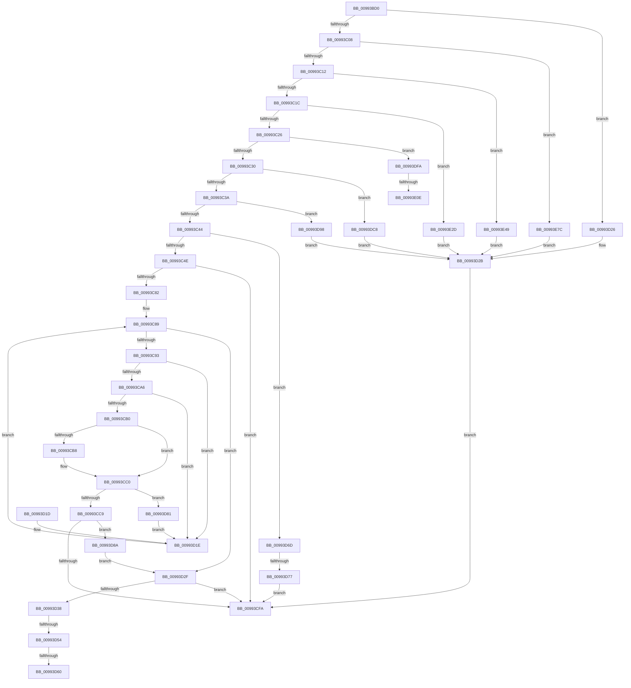

# _PnpDispatchInterfaceClass

- RVA: `0x00993BD0`–`0x00993EB0` (길이 `736` bytes)
- VA: `0x0000000140993BD0`
- 실행 섹션: `PAGE`
- PDB 이름 있음: `예`; PDB Function 태그: `예`
- unwind 정보 RVA: `0x00098F8C`
- 디코드: `176`개 명령, `736/736` bytes 표시
- 미해석 바이트: `0` (있으면 어셈블리에 `.byte`로 보존)

> 이 문서는 커널 이미지의 기계어와 PDB 기호를 분석해 생성했습니다. 4번과 5번은 함수 원형과 자료형을 바이너리 사용 방식에서 추정한 C 해석이며 원본 소스 복구 결과는 아닙니다.

## 1. Dependencies

- 직접 호출 지점: **8**; 고유 호출 대상: **8**
- 직접 호출자로 확인된 함수: **0**
- RIP 상대 이미지 참조: **2**

### Outgoing calls
- `0x00993CE8` → [_CmGetInterfaceClassMappedPropertyFromRegValue](_CmGetInterfaceClassMappedPropertyFromRegValue_function_00993EB8.md) (function, `0x00993EB8`)
- `0x00993CFA` → [PnpMapCmStatusToDispatchStatus](../../text/45/PnpMapCmStatusToDispatchStatus_function_0045461C.md) (function, `0x0045461C`)
- `0x00993D26` → [CmValidateInstallerClassName](../8F/CmValidateInstallerClassName_function_008F4098.md) (function, `0x008F4098`)
- `0x00993DBE` → [CmGetInterfaceClassMappedPropertyLocales](../83/CmGetInterfaceClassMappedPropertyLocales_function_00830E70.md) (function, `0x00830E70`)
- `0x00993DF0` → [CmGetInterfaceClassMappedPropertyKeys](../83/CmGetInterfaceClassMappedPropertyKeys_function_00830C70.md) (function, `0x00830C70`)
- `0x00993E3F` → [CmDeleteInterfaceClass](../82/CmDeleteInterfaceClass_function_0082A6E0.md) (function, `0x0082A6E0`)
- `0x00993E72` → [CmCreateInterfaceClass](../90/CmCreateInterfaceClass_function_00901838.md) (function, `0x00901838`)
- `0x00993EA6` → [CmOpenInterfaceClassRegKey](../A3/CmOpenInterfaceClassRegKey_function_00A304F8.md) (function, `0x00A304F8`)

### Direct callers
- 이 함수 시작 RVA로 연결되는 직접 call은 확인되지 않았습니다. 간접 호출은 완전히 역산할 수 없습니다.

### Static image references
- `0x00993C82` → RVA `0x00000000` (`image boundary/outside`; read)
- `0x00993E13` → RVA `0x008317F0` (`PnpCmMatchCallbackRoutine`; read)

## 2. Other-region calls and transfers

- 다른 실행 섹션으로 향하는 call: **1**
  - `0x00993CFA` → [PnpMapCmStatusToDispatchStatus](../../text/45/PnpMapCmStatusToDispatchStatus_function_0045461C.md) (`PAGE` → `.text`)
- call이 아닌 외부 분기/꼬리 이동: **6**
  - `0x00993D4E` → [sub_00B2C010 + 0x48](../B2/Unknown_function_00B2C010.md) (`tail-transfer`)
  - `0x00993D5A` → [sub_00B2C010 + 0x3C](../B2/Unknown_function_00B2C010.md) (`tail-transfer`)
  - `0x00993D68` → [sub_00B2C010 + 0x3C](../B2/Unknown_function_00B2C010.md) (`tail-transfer`)
  - `0x00993D71` → [sub_00B2C010](../B2/Unknown_function_00B2C010.md) (`tail-transfer`)
  - `0x00993E08` → [sub_00B2C010 + 0x7A](../B2/Unknown_function_00B2C010.md) (`tail-transfer`)
  - `0x00993E28` → [sub_00B2C010 + 0x7A](../B2/Unknown_function_00B2C010.md) (`tail-transfer`)

## 3. Assembly (complete function range)

```asm
00993BD0  48 8B C4                        mov rax, rsp
00993BD3  48 89 58 08                     mov qword ptr [rax + 8], rbx
00993BD7  48 89 68 10                     mov qword ptr [rax + 0x10], rbp
00993BDB  48 89 70 18                     mov qword ptr [rax + 0x18], rsi
00993BDF  57                              push rdi
00993BE0  41 54                           push r12
00993BE2  41 55                           push r13
00993BE4  41 56                           push r14
00993BE6  41 57                           push r15
00993BE8  48 83 EC 60                     sub rsp, 0x60
00993BEC  33 DB                           xor ebx, ebx
00993BEE  0F 57 C0                        xorps xmm0, xmm0
00993BF1  48 8B FA                        mov rdi, rdx
00993BF4  48 8B F1                        mov rsi, rcx
00993BF7  44 8B C3                        mov r8d, ebx
00993BFA  0F 11 40 C0                     movups xmmword ptr [rax - 0x40], xmm0
00993BFE  41 83 E9 01                     sub r9d, 1
00993C02  0F 84 1E 01 00 00               je 0x140993d26
00993C08  41 83 E9 01                     sub r9d, 1
00993C0C  0F 84 6A 02 00 00               je 0x140993e7c
00993C12  41 83 E9 01                     sub r9d, 1
00993C16  0F 84 2D 02 00 00               je 0x140993e49
00993C1C  41 83 E9 01                     sub r9d, 1
00993C20  0F 84 07 02 00 00               je 0x140993e2d
00993C26  41 83 E9 01                     sub r9d, 1
00993C2A  0F 84 CA 01 00 00               je 0x140993dfa
00993C30  41 83 E9 01                     sub r9d, 1
00993C34  0F 84 8E 01 00 00               je 0x140993dc8
00993C3A  41 83 E9 01                     sub r9d, 1
00993C3E  0F 84 54 01 00 00               je 0x140993d98
00993C44  41 83 E9 01                     sub r9d, 1
00993C48  0F 85 1F 01 00 00               jne 0x140993d6d
00993C4E  48 8B 8C 24 B0 00 00 00         mov rcx, qword ptr [rsp + 0xb0]
00993C56  48 8B 41 08                     mov rax, qword ptr [rcx + 8]
00993C5A  4C 8B 11                        mov r10, qword ptr [rcx]
00993C5D  4C 8B 79 30                     mov r15, qword ptr [rcx + 0x30]
00993C61  8B 69 28                        mov ebp, dword ptr [rcx + 0x28]
00993C64  4C 8B 61 20                     mov r12, qword ptr [rcx + 0x20]
00993C68  4C 8B 69 18                     mov r13, qword ptr [rcx + 0x18]
00993C6C  4C 8B 71 10                     mov r14, qword ptr [rcx + 0x10]
00993C70  B9 16 00 00 C0                  mov ecx, 0xc0000016
00993C75  41 89 1F                        mov dword ptr [r15], ebx
00993C78  4C 89 54 24 40                  mov qword ptr [rsp + 0x40], r10
00993C7D  48 85 C0                        test rax, rax
00993C80  75 78                           jne 0x140993cfa
00993C82  48 8D 15 77 C3 66 FF            lea rdx, [rip - 0x993c89]
00993C89  41 83 F8 01                     cmp r8d, 1
00993C8D  0F 83 9C 00 00 00               jae 0x140993d2f
00993C93  41 8B C0                        mov eax, r8d
00993C96  48 03 C0                        add rax, rax
00993C99  4C 8B 8C C2 80 AE B4 00         mov r9, qword ptr [rdx + rax*8 + 0xb4ae80]
00993CA1  4D 85 C9                        test r9, r9
00993CA4  74 78                           je 0x140993d1e
00993CA6  41 8B 41 10                     mov eax, dword ptr [r9 + 0x10]
00993CAA  41 39 46 10                     cmp dword ptr [r14 + 0x10], eax
00993CAE  75 6E                           jne 0x140993d1e
00993CB0  49 8B 16                        mov rdx, qword ptr [r14]
00993CB3  49 2B 11                        sub rdx, qword ptr [r9]
00993CB6  75 08                           jne 0x140993cc0
00993CB8  49 8B 56 08                     mov rdx, qword ptr [r14 + 8]
00993CBC  49 2B 51 08                     sub rdx, qword ptr [r9 + 8]
00993CC0  48 85 D2                        test rdx, rdx
00993CC3  0F 85 B8 00 00 00               jne 0x140993d81
00993CC9  4C 89 7C 24 38                  mov qword ptr [rsp + 0x38], r15
00993CCE  4D 8B CE                        mov r9, r14
00993CD1  89 6C 24 30                     mov dword ptr [rsp + 0x30], ebp
00993CD5  4D 8B C2                        mov r8, r10
00993CD8  4C 89 64 24 28                  mov qword ptr [rsp + 0x28], r12
00993CDD  48 8B D7                        mov rdx, rdi
00993CE0  48 8B CE                        mov rcx, rsi
00993CE3  4C 89 6C 24 20                  mov qword ptr [rsp + 0x20], r13
00993CE8  E8 CB 01 00 00                  call 0x140993eb8
00993CED  8B C8                           mov ecx, eax
00993CEF  3D 16 00 00 C0                  cmp eax, 0xc0000016
00993CF4  0F 84 90 00 00 00               je 0x140993d8a
00993CFA  E8 1D 09 AC FF                  call 0x14045461c
00993CFF  4C 8D 5C 24 60                  lea r11, [rsp + 0x60]
00993D04  49 8B 5B 30                     mov rbx, qword ptr [r11 + 0x30]
00993D08  49 8B 6B 38                     mov rbp, qword ptr [r11 + 0x38]
00993D0C  49 8B 73 40                     mov rsi, qword ptr [r11 + 0x40]
00993D10  49 8B E3                        mov rsp, r11
00993D13  41 5F                           pop r15
00993D15  41 5E                           pop r14
00993D17  41 5D                           pop r13
00993D19  41 5C                           pop r12
00993D1B  5F                              pop rdi
00993D1C  C3                              ret
00993D1D  CC                              int3
00993D1E  41 FF C0                        inc r8d
00993D21  E9 63 FF FF FF                  jmp 0x140993c89
00993D26  E8 6D 03 F6 FF                  call 0x1408f4098
00993D2B  8B C8                           mov ecx, eax
00993D2D  EB CB                           jmp 0x140993cfa
00993D2F  44 8B C3                        mov r8d, ebx
00993D32  41 83 F8 01                     cmp r8d, 1
00993D36  73 C2                           jae 0x140993cfa
00993D38  41 8B C0                        mov eax, r8d
00993D3B  48 03 C0                        add rax, rax
00993D3E  4C 8B 8C C2 10 AF B4 00         mov r9, qword ptr [rdx + rax*8 + 0xb4af10]
00993D46  41 8B 41 10                     mov eax, dword ptr [r9 + 0x10]
00993D4A  41 39 46 10                     cmp dword ptr [r14 + 0x10], eax
00993D4E  0F 85 04 83 19 00               jne 0x140b2c058
00993D54  49 8B 16                        mov rdx, qword ptr [r14]
00993D57  49 2B 11                        sub rdx, qword ptr [r9]
00993D5A  0F 85 EC 82 19 00               jne 0x140b2c04c
00993D60  49 8B 56 08                     mov rdx, qword ptr [r14 + 8]
00993D64  49 2B 51 08                     sub rdx, qword ptr [r9 + 8]
00993D68  E9 DF 82 19 00                  jmp 0x140b2c04c
00993D6D  41 83 F9 01                     cmp r9d, 1
00993D71  0F 84 99 82 19 00               je 0x140b2c010
00993D77  B9 0D 00 00 C0                  mov ecx, 0xc000000d
00993D7C  E9 79 FF FF FF                  jmp 0x140993cfa
00993D81  48 8D 15 78 C2 66 FF            lea rdx, [rip - 0x993d88]
00993D88  EB 94                           jmp 0x140993d1e
00993D8A  4C 8B 54 24 40                  mov r10, qword ptr [rsp + 0x40]
00993D8F  48 8D 15 6A C2 66 FF            lea rdx, [rip - 0x993d96]
00993D96  EB 97                           jmp 0x140993d2f
00993D98  4C 8B 8C 24 B0 00 00 00         mov r9, qword ptr [rsp + 0xb0]
00993DA0  49 8B 41 20                     mov rax, qword ptr [r9 + 0x20]
00993DA4  48 89 44 24 30                  mov qword ptr [rsp + 0x30], rax
00993DA9  41 8B 41 18                     mov eax, dword ptr [r9 + 0x18]
00993DAD  89 44 24 28                     mov dword ptr [rsp + 0x28], eax
00993DB1  49 8B 41 10                     mov rax, qword ptr [r9 + 0x10]
00993DB5  4D 8B 49 08                     mov r9, qword ptr [r9 + 8]
00993DB9  48 89 44 24 20                  mov qword ptr [rsp + 0x20], rax
00993DBE  E8 AD D0 E9 FF                  call 0x140830e70
00993DC3  E9 63 FF FF FF                  jmp 0x140993d2b
00993DC8  4C 8B 84 24 B0 00 00 00         mov r8, qword ptr [rsp + 0xb0]
00993DD0  45 33 C9                        xor r9d, r9d
00993DD3  49 8B 40 28                     mov rax, qword ptr [r8 + 0x28]
00993DD7  48 89 44 24 30                  mov qword ptr [rsp + 0x30], rax
00993DDC  41 8B 40 20                     mov eax, dword ptr [r8 + 0x20]
00993DE0  89 44 24 28                     mov dword ptr [rsp + 0x28], eax
00993DE4  49 8B 40 18                     mov rax, qword ptr [r8 + 0x18]
00993DE8  4D 8B 00                        mov r8, qword ptr [r8]
00993DEB  48 89 44 24 20                  mov qword ptr [rsp + 0x20], rax
00993DF0  E8 7B CE E9 FF                  call 0x140830c70
00993DF5  E9 31 FF FF FF                  jmp 0x140993d2b
00993DFA  48 8B 94 24 B0 00 00 00         mov rdx, qword ptr [rsp + 0xb0]
00993E02  48 8B 02                        mov rax, qword ptr [rdx]
00993E05  48 85 C0                        test rax, rax
00993E08  0F 84 7C 82 19 00               je 0x140b2c08a
00993E0E  48 89 44 24 48                  mov qword ptr [rsp + 0x48], rax
00993E13  48 8D 1D D6 D9 E9 FF            lea rbx, [rip - 0x16262a]
00993E1A  48 8B 42 08                     mov rax, qword ptr [rdx + 8]
00993E1E  4C 8D 44 24 48                  lea r8, [rsp + 0x48]
00993E23  48 89 44 24 50                  mov qword ptr [rsp + 0x50], rax
00993E28  E9 5D 82 19 00                  jmp 0x140b2c08a
00993E2D  48 8B 84 24 B0 00 00 00         mov rax, qword ptr [rsp + 0xb0]
00993E35  44 8B 00                        mov r8d, dword ptr [rax]
00993E38  41 81 E0 00 00 FF FF            and r8d, 0xffff0000
00993E3F  E8 9C 68 E9 FF                  call 0x14082a6e0
00993E44  E9 E2 FE FF FF                  jmp 0x140993d2b
00993E49  4C 8B 84 24 B0 00 00 00         mov r8, qword ptr [rsp + 0xb0]
00993E51  41 8B 48 14                     mov ecx, dword ptr [r8 + 0x14]
00993E55  49 8D 40 10                     lea rax, [r8 + 0x10]
00993E59  81 E1 00 00 FF FF               and ecx, 0xffff0000
00993E5F  4D 8D 48 08                     lea r9, [r8 + 8]
00993E63  45 8B 00                        mov r8d, dword ptr [r8]
00993E66  89 4C 24 28                     mov dword ptr [rsp + 0x28], ecx
00993E6A  48 8B CE                        mov rcx, rsi
00993E6D  48 89 44 24 20                  mov qword ptr [rsp + 0x20], rax
00993E72  E8 C1 D9 F6 FF                  call 0x140901838
00993E77  E9 AF FE FF FF                  jmp 0x140993d2b
00993E7C  48 8B 8C 24 B0 00 00 00         mov rcx, qword ptr [rsp + 0xb0]
00993E84  48 8D 41 10                     lea rax, [rcx + 0x10]
00993E88  48 89 44 24 38                  mov qword ptr [rsp + 0x38], rax
00993E8D  48 8B 41 08                     mov rax, qword ptr [rcx + 8]
00993E91  48 89 44 24 30                  mov qword ptr [rsp + 0x30], rax
00993E96  8A 41 04                        mov al, byte ptr [rcx + 4]
00993E99  88 44 24 28                     mov byte ptr [rsp + 0x28], al
00993E9D  8B 01                           mov eax, dword ptr [rcx]
00993E9F  48 8B CE                        mov rcx, rsi
00993EA2  89 44 24 20                     mov dword ptr [rsp + 0x20], eax
00993EA6  E8 4D C6 09 00                  call 0x140a304f8
00993EAB  E9 7B FE FF FF                  jmp 0x140993d2b
```

## 4. C-style interpretation (structured pseudocode)

```c
__int64 __fastcall _PnpDispatchInterfaceClass(__int64 a1, __int64 a2, __int64 a3, int a4, __int64 a5)
{
    __int64 result;
    __int64 v_rbx;
    __int64 v_rsp;
    unsigned __int64 v_stack_m10;
    unsigned __int64 v_stack_m18;
    unsigned __int64 v_stack_m20;
    unsigned __int64 v_stack_m28;
    unsigned __int64 v_stack_m30;
    unsigned int v_stack_m38;
    unsigned __int64 v_stack_m40;
    unsigned __int64 v_stack_m48;
    unsigned __int64 v_stack_m50;
    unsigned int v_stack_m58;
    unsigned __int64 v_stack_m60;
    unsigned __int64 v_stack_m68;

    *(unsigned __int64 *)(v_rsp + 8) = v_rbx;
    *(unsigned __int64 *)(v_rsp + 16) = v_rbp;
    *(unsigned __int64 *)(v_rsp + 24) = v_rsi;
    v_rsp = (v_rsp) - (96);
    v_rbx = 0;
    *(unsigned __int64 *)(v_rsp - 64) = v_xmm0;
    a4 = (unsigned int)((a4) - (1));
    if (condition_is_equal) goto loc_00993D26;
    a4 = (unsigned int)((a4) - (1));
    if (condition_is_equal) goto loc_00993E7C;
    a4 = (unsigned int)((a4) - (1));
    if (condition_is_equal) goto loc_00993E49;
    a4 = (unsigned int)((a4) - (1));
    if (condition_is_equal) goto loc_00993E2D;
    a4 = (unsigned int)((a4) - (1));
    if (condition_is_equal) goto loc_00993DFA;
    a4 = (unsigned int)((a4) - (1));
    if (condition_is_equal) goto loc_00993DC8;
    a4 = (unsigned int)((a4) - (1));
    if (condition_is_equal) goto loc_00993D98;
    a4 = (unsigned int)((a4) - (1));
    if (condition_is_not_equal) goto loc_00993D6D;
    *(unsigned int *)(*(unsigned __int64 *)(a5 + 48)) = 0;
    v_stack_m48 = *(unsigned __int64 *)(a5);
    if (*(unsigned __int64 *)(a5 + 8) != 0) goto loc_00993CFA;
loc_00993C89:
    if (0 >= 1) goto loc_00993D2F;
    result = (0) + (0);
    if (*(unsigned __int64 *)(v_rip - 10042505 + result * 8 + 11841152) == 0) goto loc_00993D1E;
    if ((*(unsigned int *)(*(unsigned __int64 *)(a5 + 16) + 16)) != ((unsigned int)((unsigned int)(*(unsigned int *)(*(unsigned __int64 *)(v_rip - 10042505 + result * 8 + 11841152) + 16))))) goto loc_00993D1E;
    a2 = (*(unsigned __int64 *)(*(unsigned __int64 *)(a5 + 16))) - (*(unsigned __int64 *)(*(unsigned __int64 *)(v_rip - 10042505 + result * 8 + 11841152)));
    if (!(condition_is_not_equal)) {
        a2 = *(unsigned __int64 *)(*(unsigned __int64 *)(a5 + 16) + 8);
        a2 = (a2) - (*(unsigned __int64 *)(*(unsigned __int64 *)(v_rip - 10042505 + result * 8 + 11841152) + 8));
    }
    if (a2 != 0) goto loc_00993D81;
    v_stack_m50 = *(unsigned __int64 *)(a5 + 48);
    v_stack_m58 = (unsigned int)((unsigned int)(*(unsigned int *)(a5 + 40)));
    v_stack_m60 = *(unsigned __int64 *)(a5 + 32);
    v_stack_m68 = *(unsigned __int64 *)(a5 + 24);
    result = _CmGetInterfaceClassMappedPropertyFromRegValue(a1, a2, *(unsigned __int64 *)(a5), *(unsigned __int64 *)(a5 + 16));
    if (((unsigned int)(result)) == 0xC0000016ULL) goto loc_00993D8A;
loc_00993CFA:
    result = PnpMapCmStatusToDispatchStatus((unsigned int)((unsigned int)(result)), a2, *(unsigned __int64 *)(a5), *(unsigned __int64 *)(a5 + 16));
    return result;
loc_00993D1E:
    a3 = (unsigned int)((*(unsigned __int64 *)(a5)) + 1);
    goto loc_00993C89;
loc_00993D26:
    result = CmValidateInstallerClassName((unsigned int)((unsigned int)(result)), a2, a3, *(unsigned __int64 *)(a5 + 16));
loc_00993D2B:
    goto loc_00993CFA;
loc_00993D2F:
    if (((unsigned int)((unsigned int)((unsigned int)(*(unsigned __int64 *)(v_stack_m28 + 48))))) >= 1) goto loc_00993CFA;
    result = ((unsigned int)((unsigned int)((unsigned int)((unsigned int)(*(unsigned __int64 *)(v_stack_m28 + 48)))))) + ((unsigned int)((unsigned int)((unsigned int)((unsigned int)(*(unsigned __int64 *)(v_stack_m28 + 48))))));
    a2 = (*(unsigned __int64 *)(*(unsigned __int64 *)(a5 + 16))) - (*(unsigned __int64 *)(*(unsigned __int64 *)(a2 + result * 8 + 11841296)));
    a2 = (*(unsigned __int64 *)(*(unsigned __int64 *)(a5 + 16) + 8)) - (*(unsigned __int64 *)(*(unsigned __int64 *)(a2 + result * 8 + 11841296) + 8));
loc_00993D6D:
    goto loc_00993CFA;
loc_00993D81:
    goto loc_00993D1E;
loc_00993D8A:
    goto loc_00993D2F;
loc_00993D98:
    v_stack_m30 = *(unsigned __int64 *)(a5 + 32);
    v_stack_m38 = (unsigned int)((unsigned int)(*(unsigned int *)(a5 + 24)));
    v_stack_m40 = *(unsigned __int64 *)(a5 + 16);
    result = CmGetInterfaceClassMappedPropertyLocales((unsigned int)(0xC000000DULL), v_rip - 10042774, (unsigned int)((unsigned int)(*(unsigned __int64 *)(v_stack_m28 + 48))), *(unsigned __int64 *)(a5 + 8));
    goto loc_00993D2B;
loc_00993DC8:
    a4 = 0;
    v_stack_m30 = *(unsigned __int64 *)(a5 + 40);
    v_stack_m38 = (unsigned int)((unsigned int)(*(unsigned int *)(a5 + 32)));
    v_stack_m40 = *(unsigned __int64 *)(a5 + 24);
    result = CmGetInterfaceClassMappedPropertyKeys((unsigned int)(0xC000000DULL), v_rip - 10042774, *(unsigned __int64 *)(a5), a4);
    goto loc_00993D2B;
loc_00993DFA:
    v_stack_m18 = *(unsigned __int64 *)(a5);
    v_stack_m10 = *(unsigned __int64 *)(a5 + 8);
loc_00993E2D:
    a3 = (unsigned int)(((unsigned int)(*(unsigned int *)(a5))) & (0xFFFF0000ULL));
    result = CmDeleteInterfaceClass((unsigned int)(0xC000000DULL), a5, a3, a4);
    goto loc_00993D2B;
loc_00993E49:
    a1 = (unsigned int)(((unsigned int)(*(unsigned int *)(a5 + 20))) & (0xFFFF0000ULL));
    v_stack_m38 = (unsigned int)(a1);
    v_stack_m40 = a5 + 16;
    result = CmCreateInterfaceClass(*(unsigned __int64 *)(v_stack_m28 + 64), a5, (unsigned int)(*(unsigned int *)(a5)), a5 + 8);
    goto loc_00993D2B;
loc_00993E7C:
    v_stack_m28 = a5 + 16;
    v_stack_m30 = *(unsigned __int64 *)(a5 + 8);
    v_stack_m38 = (unsigned __int8)(*(unsigned __int8 *)(a5 + 4));
    v_stack_m40 = (unsigned int)((unsigned int)(*(unsigned int *)(a5)));
    result = CmOpenInterfaceClassRegKey(*(unsigned __int64 *)(v_stack_m28 + 64), a5, (unsigned int)(*(unsigned int *)(a5)), a5 + 8);
    goto loc_00993D2B;
}
```

## 5. (Beta) C Style

```c
int64_t _PnpDispatchInterfaceClass(int64_t Arg1, int64_t Arg2, int64_t Arg3, int32_t Arg4, void *Arg5)
{
    uint8_t *arg5 = (uint8_t *)Arg5;

    int64_t result;
    int64_t local_rbx;
    int64_t local_rsp;
    uint64_t v_stack_m10;
    uint64_t v_stack_m18;
    uint64_t v_stack_m20;
    uint64_t v_stack_m28;
    uint64_t v_stack_m30;
    uint32_t v_stack_m38;
    uint64_t v_stack_m40;
    uint64_t v_stack_m48;
    uint64_t v_stack_m50;
    uint32_t v_stack_m58;
    uint64_t v_stack_m60;
    uint64_t v_stack_m68;

    *(uint64_t *)(local_rsp + 0x8) = local_rbx;
    *(uint64_t *)(local_rsp + 0x10) = local_rbp;
    *(uint64_t *)(local_rsp + 0x18) = local_rsi;
    local_rsp = (local_rsp) - (96);
    local_rbx = 0;
    *(uint64_t *)(local_rsp - 0x40) = v_xmm0;
    Arg4 = (uint32_t)((Arg4) - (1));
    if (condition_is_equal) goto loc_00993D26;
    Arg4 = (uint32_t)((Arg4) - (1));
    if (condition_is_equal) goto loc_00993E7C;
    Arg4 = (uint32_t)((Arg4) - (1));
    if (condition_is_equal) goto loc_00993E49;
    Arg4 = (uint32_t)((Arg4) - (1));
    if (condition_is_equal) goto loc_00993E2D;
    Arg4 = (uint32_t)((Arg4) - (1));
    if (condition_is_equal) goto loc_00993DFA;
    Arg4 = (uint32_t)((Arg4) - (1));
    if (condition_is_equal) goto loc_00993DC8;
    Arg4 = (uint32_t)((Arg4) - (1));
    if (condition_is_equal) goto loc_00993D98;
    Arg4 = (uint32_t)((Arg4) - (1));
    if (condition_is_not_equal) goto loc_00993D6D;
    *(uint32_t *)(*(uint64_t *)(arg5 + 0x30)) = 0;
    v_stack_m48 = *(uint64_t *)(arg5);
    if (*(uint64_t *)(arg5 + 0x8) != 0) goto loc_00993CFA;
loc_00993C89:
    if (0 >= 1) goto loc_00993D2F;
    result = (0) + (0);
    if (*(uint64_t *)(v_rip - 0x993C89 + result * 8 + 0xB4AE80) == 0) goto loc_00993D1E;
    if ((*(uint32_t *)(*(uint64_t *)(arg5 + 0x10) + 0x10)) != ((uint32_t)((uint32_t)(*(uint32_t *)(*(uint64_t *)(v_rip - 0x993C89 + result * 8 + 0xB4AE80) + 0x10))))) goto loc_00993D1E;
    Arg2 = (*(uint64_t *)(*(uint64_t *)(arg5 + 0x10))) - (*(uint64_t *)(*(uint64_t *)(v_rip - 0x993C89 + result * 8 + 0xB4AE80)));
    if (!(condition_is_not_equal)) {
        Arg2 = *(uint64_t *)(*(uint64_t *)(arg5 + 0x10) + 0x8);
        Arg2 = (Arg2) - (*(uint64_t *)(*(uint64_t *)(v_rip - 0x993C89 + result * 8 + 0xB4AE80) + 0x8));
    }
    if (Arg2 != 0) goto loc_00993D81;
    v_stack_m50 = *(uint64_t *)(arg5 + 0x30);
    v_stack_m58 = (uint32_t)((uint32_t)(*(uint32_t *)(arg5 + 0x28)));
    v_stack_m60 = *(uint64_t *)(arg5 + 0x20);
    v_stack_m68 = *(uint64_t *)(arg5 + 0x18);
    result = _CmGetInterfaceClassMappedPropertyFromRegValue(Arg1, Arg2, *(uint64_t *)(arg5), *(uint64_t *)(arg5 + 0x10));
    if (((uint32_t)(result)) == 0xC0000016ULL) goto loc_00993D8A;
loc_00993CFA:
    result = PnpMapCmStatusToDispatchStatus((uint32_t)((uint32_t)(result)), Arg2, *(uint64_t *)(arg5), *(uint64_t *)(arg5 + 0x10));
    return result;
loc_00993D1E:
    Arg3 = (uint32_t)((*(uint64_t *)(arg5)) + 1);
    goto loc_00993C89;
loc_00993D26:
    result = CmValidateInstallerClassName((uint32_t)((uint32_t)(result)), Arg2, Arg3, *(uint64_t *)(arg5 + 0x10));
loc_00993D2B:
    goto loc_00993CFA;
loc_00993D2F:
    if (((uint32_t)((uint32_t)((uint32_t)(*(uint64_t *)(v_stack_m28 + 0x30))))) >= 1) goto loc_00993CFA;
    result = ((uint32_t)((uint32_t)((uint32_t)((uint32_t)(*(uint64_t *)(v_stack_m28 + 0x30)))))) + ((uint32_t)((uint32_t)((uint32_t)((uint32_t)(*(uint64_t *)(v_stack_m28 + 0x30))))));
    Arg2 = (*(uint64_t *)(*(uint64_t *)(arg5 + 0x10))) - (*(uint64_t *)(*(uint64_t *)(Arg2 + result * 8 + 0xB4AF10)));
    Arg2 = (*(uint64_t *)(*(uint64_t *)(arg5 + 0x10) + 0x8)) - (*(uint64_t *)(*(uint64_t *)(Arg2 + result * 8 + 0xB4AF10) + 0x8));
loc_00993D6D:
    goto loc_00993CFA;
loc_00993D81:
    goto loc_00993D1E;
loc_00993D8A:
    goto loc_00993D2F;
loc_00993D98:
    v_stack_m30 = *(uint64_t *)(arg5 + 0x20);
    v_stack_m38 = (uint32_t)((uint32_t)(*(uint32_t *)(arg5 + 0x18)));
    v_stack_m40 = *(uint64_t *)(arg5 + 0x10);
    result = CmGetInterfaceClassMappedPropertyLocales((uint32_t)(0xC000000DULL), v_rip - 10042774, (uint32_t)((uint32_t)(*(uint64_t *)(v_stack_m28 + 0x30))), *(uint64_t *)(arg5 + 0x8));
    goto loc_00993D2B;
loc_00993DC8:
    Arg4 = 0;
    v_stack_m30 = *(uint64_t *)(arg5 + 0x28);
    v_stack_m38 = (uint32_t)((uint32_t)(*(uint32_t *)(arg5 + 0x20)));
    v_stack_m40 = *(uint64_t *)(arg5 + 0x18);
    result = CmGetInterfaceClassMappedPropertyKeys((uint32_t)(0xC000000DULL), v_rip - 10042774, *(uint64_t *)(arg5), Arg4);
    goto loc_00993D2B;
loc_00993DFA:
    v_stack_m18 = *(uint64_t *)(arg5);
    v_stack_m10 = *(uint64_t *)(arg5 + 0x8);
loc_00993E2D:
    Arg3 = (uint32_t)(((uint32_t)(*(uint32_t *)(arg5))) & (0xFFFF0000ULL));
    result = CmDeleteInterfaceClass((uint32_t)(0xC000000DULL), Arg5, Arg3, Arg4);
    goto loc_00993D2B;
loc_00993E49:
    Arg1 = (uint32_t)(((uint32_t)(*(uint32_t *)(arg5 + 0x14))) & (0xFFFF0000ULL));
    v_stack_m38 = (uint32_t)(Arg1);
    v_stack_m40 = Arg5 + 16;
    result = CmCreateInterfaceClass(*(uint64_t *)(v_stack_m28 + 0x40), Arg5, (uint32_t)(*(uint32_t *)(arg5)), Arg5 + 8);
    goto loc_00993D2B;
loc_00993E7C:
    v_stack_m28 = Arg5 + 16;
    v_stack_m30 = *(uint64_t *)(arg5 + 0x8);
    v_stack_m38 = (uint8_t)(*(uint8_t *)(arg5 + 0x4));
    v_stack_m40 = (uint32_t)((uint32_t)(*(uint32_t *)(arg5)));
    result = CmOpenInterfaceClassRegKey(*(uint64_t *)(v_stack_m28 + 0x40), Arg5, (uint32_t)(*(uint32_t *)(arg5)), Arg5 + 8);
    goto loc_00993D2B;
}
```

### 관측된 메모리 오프셋

구조체 형식이 확인되지 않은 접근은 인자 기준의 오프셋으로만 기록했습니다.

| 기준 인자 | 오프셋 표현 | 폭 (bit) | 접근 |
|---|---:|---:|---|
| `Arg5` | `+ 0x0` | `32` | `R` |
| `Arg5` | `+ 0x0` | `64` | `R` |
| `Arg5` | `+ 0x4` | `8` | `R` |
| `Arg5` | `+ 0x8` | `64` | `R` |
| `Arg5` | `+ 0x10` | `64` | `R` |
| `Arg5` | `+ 0x14` | `32` | `R` |
| `Arg5` | `+ 0x18` | `32` | `R` |
| `Arg5` | `+ 0x18` | `64` | `R` |
| `Arg5` | `+ 0x20` | `32` | `R` |
| `Arg5` | `+ 0x20` | `64` | `R` |
| `Arg5` | `+ 0x28` | `32` | `R` |
| `Arg5` | `+ 0x28` | `64` | `R` |
| `Arg5` | `+ 0x30` | `64` | `R` |

## 6. Execution-region graph

[열기: 2D/3D 그래프와 함수 탐색 컨트롤 패널](../../../control-panel.html?section=page&rva=0x00993BD0&view=graph)

- 2D 그래프는 위에서 아래로 흐르고, 3D 그래프는 빈 공간을 드래그해 회전합니다. Shift+드래그는 이동, 휠은 확대·축소, 함수 노드 선택은 대상 보고서 이동입니다.

### Static fallback


