# _PnpOpenPropertiesKey

- RVA: `0x009938A0`–`0x00993BBD` (길이 `797` bytes)
- VA: `0x00000001409938A0`
- 실행 섹션: `PAGE`
- PDB 이름 있음: `예`; PDB Function 태그: `예`
- unwind 정보 RVA: `0x00098F58`
- 디코드: `201`개 명령, `797/797` bytes 표시
- 미해석 바이트: `0` (있으면 어셈블리에 `.byte`로 보존)

> 이 문서는 커널 이미지의 기계어와 PDB 기호를 분석해 생성했습니다. 4번과 5번은 함수 원형과 자료형을 바이너리 사용 방식에서 추정한 C 해석이며 원본 소스 복구 결과는 아닙니다.

## 1. Dependencies

- 직접 호출 지점: **12**; 고유 호출 대상: **10**
- 직접 호출자로 확인된 함수: **11**
- RIP 상대 이미지 참조: **3**

### Outgoing calls
- `0x00993966` → [RtlStringCchPrintfExW](../../text/42/RtlStringCchPrintfExW_function_0042B390.md) (function, `0x0042B390`)
- `0x009939A6` → [_RegRtlOpenKeyTransacted](../8E/_RegRtlOpenKeyTransacted_function_008EF810.md) (function, `0x008EF810`)
- `0x009939E8` → [_security_check_cookie](../../text/6A/_security_check_cookie_function_006AC640.md) (function, `0x006AC640`)
- `0x00993A40` → [_RegRtlOpenKeyTransacted](../8E/_RegRtlOpenKeyTransacted_function_008EF810.md) (function, `0x008EF810`)
- `0x00993AB8` → [PnpCtxRegCreateTree](../93/PnpCtxRegCreateTree_function_00931CA0.md) (function, `0x00931CA0`)
- `0x00993AE3` → [_PnpGetPropertiesSecurityDescriptor](../A9/_PnpGetPropertiesSecurityDescriptor_function_00A91B8C.md) (function, `0x00A91B8C`)
- `0x00993AFC` → [RtlValidSecurityDescriptor](../8B/RtlValidSecurityDescriptor_function_008BD3F0.md) (function, `0x008BD3F0`)
- `0x00993B0F` → [ExFreePoolWithTag](../../poolcode/B8/ExFreePoolWithTag_function_00B82870.md) (function, `0x00B82870`)
- `0x00993B47` → [SysCtxRegCreateKey](../A6/SysCtxRegCreateKey_function_00A6933C.md) (function, `0x00A6933C`)
- `0x00993B68` → [ExAllocatePool2](../../poolcode/B8/ExAllocatePool2_function_00B820F0.md) (function, `0x00B820F0`)
- `0x00993BA6` → [ExFreePoolWithTag](../../poolcode/B8/ExFreePoolWithTag_function_00B82870.md) (function, `0x00B82870`)
- `0x00993BB3` → [ZwClose](../../text/6A/ZwClose_function_006AD2B0.md) (function, `0x006AD2B0`)

### Direct callers
- [CmSetInstallerClassRegPropWorker](../82/CmSetInstallerClassRegPropWorker_function_0082ABF4.md) at `0x0082AD95`
- [CmDeleteInstallerClassMappedPropertyFromRegValue](../82/CmDeleteInstallerClassMappedPropertyFromRegValue_function_0082FB70.md) at `0x0082FC72`
- [CmDeleteInterfaceClassMappedPropertyFromRegValue](../82/CmDeleteInterfaceClassMappedPropertyFromRegValue_function_0082FD08.md) at `0x0082FE02`
- [CmSetInterfaceClassMappedPropertyFromRegValue](../83/CmSetInterfaceClassMappedPropertyFromRegValue_function_0083164C.md) at `0x0083175F`
- [PnpDeletePropertyWorker](../8F/PnpDeletePropertyWorker_function_008FE754.md) at `0x008FE87F`
- [PnpSetPropertyWorker](PnpSetPropertyWorker_function_00991C08.md) at `0x00991D55`
- [PnpGetGenericStorePropertyKeys](PnpGetGenericStorePropertyKeys_function_00992378.md) at `0x0099240E`
- [CmGetInstallerClassRegPropWorker](CmGetInstallerClassRegPropWorker_function_00994AF4.md) at `0x00994D26`
- [PnpGetGenericStorePropertyLocales](PnpGetGenericStorePropertyLocales_function_00994DBC.md) at `0x00994EDB`
- [CmSetInstallerClassMappedPropertyFromRegValue](../AA/CmSetInstallerClassMappedPropertyFromRegValue_function_00AAEF20.md) at `0x00AAF1A2`
- [sub_00B2F7FC](../B2/Unknown_function_00B2F7FC.md) at `0x00B2F942`

### Static image references
- `0x009938B4` → RVA `0x00E0A740` (`.data`; read)
- `0x0099393B` → RVA `0x00AFD430` (` ?? ::NNGAKEGL::`string'`; read)
- `0x00993942` → RVA `0x00AFCD40` (` ?? ::NNGAKEGL::`string'`; read)

## 2. Other-region calls and transfers

- 다른 실행 섹션으로 향하는 call: **6**
  - `0x00993966` → [RtlStringCchPrintfExW](../../text/42/RtlStringCchPrintfExW_function_0042B390.md) (`PAGE` → `.text`)
  - `0x009939E8` → [_security_check_cookie](../../text/6A/_security_check_cookie_function_006AC640.md) (`PAGE` → `.text`)
  - `0x00993B0F` → [ExFreePoolWithTag](../../poolcode/B8/ExFreePoolWithTag_function_00B82870.md) (`PAGE` → `POOLCODE`)
  - `0x00993B68` → [ExAllocatePool2](../../poolcode/B8/ExAllocatePool2_function_00B820F0.md) (`PAGE` → `POOLCODE`)
  - `0x00993BA6` → [ExFreePoolWithTag](../../poolcode/B8/ExFreePoolWithTag_function_00B82870.md) (`PAGE` → `POOLCODE`)
  - `0x00993BB3` → [ZwClose](../../text/6A/ZwClose_function_006AD2B0.md) (`PAGE` → `.text`)
- call이 아닌 외부 분기/꼬리 이동: **1**
  - `0x00993AC2` → [sub_00B2C006](../B2/Unknown_function_00B2C006.md) (`tail-transfer`)

## 3. Assembly (complete function range)

```asm
009938A0  40 53                           push rbx
009938A2  55                              push rbp
009938A3  56                              push rsi
009938A4  57                              push rdi
009938A5  41 54                           push r12
009938A7  41 55                           push r13
009938A9  41 56                           push r14
009938AB  41 57                           push r15
009938AD  48 81 EC 08 01 00 00            sub rsp, 0x108
009938B4  48 8B 05 85 6E 47 00            mov rax, qword ptr [rip + 0x476e85]
009938BB  48 33 C4                        xor rax, rsp
009938BE  48 89 84 24 F0 00 00 00         mov qword ptr [rsp + 0xf0], rax
009938C6  4C 8B AC 24 80 01 00 00         mov r13, qword ptr [rsp + 0x180]
009938CE  4C 8B F1                        mov r14, rcx
009938D1  33 C9                           xor ecx, ecx
009938D3  44 89 4C 24 50                  mov dword ptr [rsp + 0x50], r9d
009938D8  48 89 54 24 58                  mov qword ptr [rsp + 0x58], rdx
009938DD  4D 8B F8                        mov r15, r8
009938E0  48 89 4C 24 60                  mov qword ptr [rsp + 0x60], rcx
009938E5  48 8B F2                        mov rsi, rdx
009938E8  49 89 4D 00                     mov qword ptr [r13], rcx
009938EC  8B F9                           mov edi, ecx
009938EE  8B D9                           mov ebx, ecx
009938F0  44 8B E1                        mov r12d, ecx
009938F3  4D 85 C0                        test r8, r8
009938F6  0F 84 87 02 00 00               je 0x140993b83
009938FC  BF 00 02 00 00                  mov edi, 0x200
00993901  49 8B C0                        mov rax, r8
00993904  8B CF                           mov ecx, edi
00993906  66 39 18                        cmp word ptr [rax], bx
00993909  74 14                           je 0x14099391f
0099390B  48 83 C0 02                     add rax, 2
0099390F  48 83 E9 01                     sub rcx, 1
00993913  75 F1                           jne 0x140993906
00993915  B8 0D 00 00 C0                  mov eax, 0xc000000d
0099391A  E9 BE 00 00 00                  jmp 0x1409939dd
0099391F  48 2B F9                        sub rdi, rcx
00993922  48 83 FF 30                     cmp rdi, 0x30
00993926  0F 83 29 02 00 00               jae 0x140993b55
0099392C  48 8D 5C 24 70                  lea rbx, [rsp + 0x70]
00993931  BF 3B 00 00 00                  mov edi, 0x3b
00993936  4C 89 7C 24 38                  mov qword ptr [rsp + 0x38], r15
0099393B  48 8D 05 EE 9A 16 00            lea rax, [rip + 0x169aee]
00993942  48 8D 2D F7 93 16 00            lea rbp, [rip + 0x1693f7]
00993949  8B D7                           mov edx, edi
0099394B  48 89 6C 24 30                  mov qword ptr [rsp + 0x30], rbp
00993950  45 33 C9                        xor r9d, r9d
00993953  48 89 44 24 28                  mov qword ptr [rsp + 0x28], rax
00993958  45 33 C0                        xor r8d, r8d
0099395B  48 8B CB                        mov rcx, rbx
0099395E  C7 44 24 20 00 08 00 00         mov dword ptr [rsp + 0x20], 0x800
00993966  E8 25 7A A9 FF                  call 0x14042b390
0099396B  8B F8                           mov edi, eax
0099396D  85 C0                           test eax, eax
0099396F  78 4E                           js 0x1409939bf
00993971  4D 85 F6                        test r14, r14
00993974  0F 84 F0 00 00 00               je 0x140993a6a
0099397A  49 8B 86 E0 00 00 00            mov rax, qword ptr [r14 + 0xe0]
00993981  48 85 C0                        test rax, rax
00993984  0F 84 E0 00 00 00               je 0x140993a6a
0099398A  48 8B 48 08                     mov rcx, qword ptr [rax + 8]
0099398E  44 8B 4C 24 50                  mov r9d, dword ptr [rsp + 0x50]
00993993  45 33 C0                        xor r8d, r8d
00993996  48 89 4C 24 28                  mov qword ptr [rsp + 0x28], rcx
0099399B  48 8B D3                        mov rdx, rbx
0099399E  48 8B CE                        mov rcx, rsi
009939A1  4C 89 6C 24 20                  mov qword ptr [rsp + 0x20], r13
009939A6  E8 65 BE F5 FF                  call 0x1408ef810
009939AB  3D 7C 01 00 C0                  cmp eax, 0xc000017c
009939B0  0F 84 19 01 00 00               je 0x140993acf
009939B6  3D 34 00 00 C0                  cmp eax, 0xc0000034
009939BB  74 45                           je 0x140993a02
009939BD  8B F8                           mov edi, eax
009939BF  48 85 DB                        test rbx, rbx
009939C2  74 0E                           je 0x1409939d2
009939C4  48 8D 44 24 70                  lea rax, [rsp + 0x70]
009939C9  48 3B D8                        cmp rbx, rax
009939CC  0F 85 CF 01 00 00               jne 0x140993ba1
009939D2  4D 85 E4                        test r12, r12
009939D5  0F 85 D5 01 00 00               jne 0x140993bb0
009939DB  8B C7                           mov eax, edi
009939DD  48 8B 8C 24 F0 00 00 00         mov rcx, qword ptr [rsp + 0xf0]
009939E5  48 33 CC                        xor rcx, rsp
009939E8  E8 53 8C D1 FF                  call 0x1406ac640
009939ED  48 81 C4 08 01 00 00            add rsp, 0x108
009939F4  41 5F                           pop r15
009939F6  41 5E                           pop r14
009939F8  41 5D                           pop r13
009939FA  41 5C                           pop r12
009939FC  5F                              pop rdi
009939FD  5E                              pop rsi
009939FE  5D                              pop rbp
009939FF  5B                              pop rbx
00993A00  C3                              ret
00993A01  CC                              int3
00993A02  0F B6 B4 24 70 01 00 00         movzx esi, byte ptr [rsp + 0x170]
00993A0A  40 84 F6                        test sil, sil
00993A0D  74 AE                           je 0x1409939bd
00993A0F  44 8B 4C 24 50                  mov r9d, dword ptr [rsp + 0x50]
00993A14  33 C9                           xor ecx, ecx
00993A16  4D 85 F6                        test r14, r14
00993A19  74 10                           je 0x140993a2b
00993A1B  49 8B 86 E0 00 00 00            mov rax, qword ptr [r14 + 0xe0]
00993A22  48 85 C0                        test rax, rax
00993A25  74 04                           je 0x140993a2b
00993A27  48 8B 48 08                     mov rcx, qword ptr [rax + 8]
00993A2B  48 89 4C 24 28                  mov qword ptr [rsp + 0x28], rcx
00993A30  45 33 C0                        xor r8d, r8d
00993A33  48 8B 4C 24 58                  mov rcx, qword ptr [rsp + 0x58]
00993A38  48 8B D5                        mov rdx, rbp
00993A3B  4C 89 6C 24 20                  mov qword ptr [rsp + 0x20], r13
00993A40  E8 CB BD F5 FF                  call 0x1408ef810
00993A45  3D 34 00 00 C0                  cmp eax, 0xc0000034
00993A4A  75 25                           jne 0x140993a71
00993A4C  40 84 F6                        test sil, sil
00993A4F  0F 85 8E 00 00 00               jne 0x140993ae3
00993A55  8B F8                           mov edi, eax
00993A57  48 8B 74 24 60                  mov rsi, qword ptr [rsp + 0x60]
00993A5C  48 85 F6                        test rsi, rsi
00993A5F  0F 84 5A FF FF FF               je 0x1409939bf
00993A65  E9 A0 00 00 00                  jmp 0x140993b0a
00993A6A  33 C9                           xor ecx, ecx
00993A6C  E9 1D FF FF FF                  jmp 0x14099398e
00993A71  8B 74 24 50                     mov esi, dword ptr [rsp + 0x50]
00993A75  3D 7C 01 00 C0                  cmp eax, 0xc000017c
00993A7A  74 5D                           je 0x140993ad9
00993A7C  85 C0                           test eax, eax
00993A7E  78 D5                           js 0x140993a55
00993A80  4D 85 FF                        test r15, r15
00993A83  74 D2                           je 0x140993a57
00993A85  4D 8B 65 00                     mov r12, qword ptr [r13]
00993A89  45 33 C9                        xor r9d, r9d
00993A8C  48 C7 44 24 38 00 00 00 00      mov qword ptr [rsp + 0x38], 0
00993A95  49 8B D4                        mov rdx, r12
00993A98  4C 89 6C 24 30                  mov qword ptr [rsp + 0x30], r13
00993A9D  4D 8B C7                        mov r8, r15
00993AA0  48 C7 44 24 28 00 00 00 00      mov qword ptr [rsp + 0x28], 0
00993AA9  49 8B CE                        mov rcx, r14
00993AAC  89 74 24 20                     mov dword ptr [rsp + 0x20], esi
00993AB0  49 C7 45 00 00 00 00 00         mov qword ptr [r13], 0
00993AB8  E8 E3 E1 F9 FF                  call 0x140931ca0
00993ABD  3D 7C 01 00 C0                  cmp eax, 0xc000017c
00993AC2  0F 85 3E 85 19 00               jne 0x140b2c006
00993AC8  BF 34 00 00 C0                  mov edi, 0xc0000034
00993ACD  EB 88                           jmp 0x140993a57
00993ACF  BF 34 00 00 C0                  mov edi, 0xc0000034
00993AD4  E9 E6 FE FF FF                  jmp 0x1409939bf
00993AD9  BF 34 00 00 C0                  mov edi, 0xc0000034
00993ADE  E9 74 FF FF FF                  jmp 0x140993a57
00993AE3  E8 A4 E0 0F 00                  call 0x140a91b8c
00993AE8  48 89 44 24 60                  mov qword ptr [rsp + 0x60], rax
00993AED  48 8B F0                        mov rsi, rax
00993AF0  48 85 C0                        test rax, rax
00993AF3  0F 84 9E 00 00 00               je 0x140993b97
00993AF9  48 8B C8                        mov rcx, rax
00993AFC  E8 EF 98 F2 FF                  call 0x1408bd3f0
00993B01  84 C0                           test al, al
00993B03  75 14                           jne 0x140993b19
00993B05  BF E5 00 00 C0                  mov edi, 0xc00000e5
00993B0A  33 D2                           xor edx, edx
00993B0C  48 8B CE                        mov rcx, rsi
00993B0F  E8 5C ED 1E 00                  call 0x140b82870
00993B14  E9 A6 FE FF FF                  jmp 0x1409939bf
00993B19  4D 85 F6                        test r14, r14
00993B1C  74 33                           je 0x140993b51
00993B1E  49 8B 8E E0 00 00 00            mov rcx, qword ptr [r14 + 0xe0]
00993B25  48 8B 54 24 58                  mov rdx, qword ptr [rsp + 0x58]
00993B2A  45 33 C9                        xor r9d, r9d
00993B2D  4C 89 64 24 40                  mov qword ptr [rsp + 0x40], r12
00993B32  4C 8B C5                        mov r8, rbp
00993B35  4C 89 6C 24 38                  mov qword ptr [rsp + 0x38], r13
00993B3A  48 89 74 24 28                  mov qword ptr [rsp + 0x28], rsi
00993B3F  8B 74 24 50                     mov esi, dword ptr [rsp + 0x50]
00993B43  89 74 24 20                     mov dword ptr [rsp + 0x20], esi
00993B47  E8 F0 57 0D 00                  call 0x140a6933c
00993B4C  E9 24 FF FF FF                  jmp 0x140993a75
00993B51  33 C9                           xor ecx, ecx
00993B53  EB D0                           jmp 0x140993b25
00993B55  83 C7 0C                        add edi, 0xc
00993B58  B9 00 01 00 00                  mov ecx, 0x100
00993B5D  8B D7                           mov edx, edi
00993B5F  41 B8 50 4E 50 52               mov r8d, 0x52504e50
00993B65  48 03 D2                        add rdx, rdx
00993B68  E8 83 E5 1E 00                  call 0x140b820f0
00993B6D  48 8B D8                        mov rbx, rax
00993B70  48 85 C0                        test rax, rax
00993B73  0F 85 BD FD FF FF               jne 0x140993936
00993B79  B8 17 00 00 C0                  mov eax, 0xc0000017
00993B7E  E9 5A FE FF FF                  jmp 0x1409939dd
00993B83  0F B6 B4 24 70 01 00 00         movzx esi, byte ptr [rsp + 0x170]
00993B8B  48 8D 2D AE 91 16 00            lea rbp, [rip + 0x1691ae]
00993B92  E9 7F FE FF FF                  jmp 0x140993a16
00993B97  BF E5 00 00 C0                  mov edi, 0xc00000e5
00993B9C  E9 1E FE FF FF                  jmp 0x1409939bf
00993BA1  33 D2                           xor edx, edx
00993BA3  48 8B CB                        mov rcx, rbx
00993BA6  E8 C5 EC 1E 00                  call 0x140b82870
00993BAB  E9 22 FE FF FF                  jmp 0x1409939d2
00993BB0  49 8B CC                        mov rcx, r12
00993BB3  E8 F8 96 D1 FF                  call 0x1406ad2b0
00993BB8  E9 1E FE FF FF                  jmp 0x1409939db
```

## 4. C-style interpretation (structured pseudocode)

```c
__int64 __fastcall _PnpOpenPropertiesKey(__int64 a1, __int64 a2, __int64 a3, int a4, unsigned __int8 a5, __int64 a6, __int64 a7)
{
    __int64 result;
    __int64 v_rdi;
    __int64 v_rsp;
    unsigned __int64 v_stack_m110;
    unsigned __int64 v_stack_m118;
    unsigned __int64 v_stack_m120;
    unsigned int v_stack_m128;
    unsigned __int64 v_stack_m58;
    unsigned __int64 v_stack_mD8;
    unsigned __int64 v_stack_mE8;
    unsigned __int64 v_stack_mF0;
    unsigned int v_stack_mF8;
    unsigned __int64 v_stack_p20;
    unsigned __int64 v_stack_p28;
    unsigned __int64 v_stack_p30;
    unsigned __int64 v_stack_p38;
    unsigned __int64 v_stack_p40;
    unsigned int v_stack_p50;
    unsigned __int64 v_stack_p58;
    unsigned __int64 v_stack_p60;

    v_rsp = (v_rsp) - (264);
    result = (*(unsigned __int64 *)(v_rip + 4681349)) ^ (v_rsp);
    v_stack_m58 = result;
    a1 = 0;
    v_stack_mF8 = a4;
    v_stack_mF0 = a2;
    v_stack_mE8 = 0;
    *(unsigned __int64 *)(a7) = 0;
    if (a3 == 0) goto loc_00993B83;
loc_00993906:
    if ((*(unsigned __int16 *)(a3)) == 0) goto loc_0099391F;
    result = (a3) + (2);
    a1 = (512) - (1);
    if (condition_is_not_equal) goto loc_00993906;
    goto loc_009939DD;
loc_0099391F:
    v_rdi = (512) - (a1);
    if (v_rdi >= 48) goto loc_00993B55;
loc_00993936:
    v_stack_m110 = a3;
    v_stack_m118 = v_rip + 1479671;
    a4 = 0;
    v_stack_m120 = v_rip + 1481454;
    a3 = 0;
    v_stack_m128 = 0x800ULL;
    result = RtlStringCchPrintfExW(v_stack_mD8, 59, a3, a4);
    if (sign_flag) goto loc_009939BF;
    if (a1 == 0) goto loc_00993A6A;
    if (*(unsigned __int64 *)(a1 + 224) == 0) goto loc_00993A6A;
loc_0099398E:
    a3 = 0;
    v_stack_m120 = *(unsigned __int64 *)(*(unsigned __int64 *)(a1 + 224) + 8);
    v_stack_m128 = a7;
    result = _RegRtlOpenKeyTransacted(a2, v_stack_mD8, a3, (unsigned int)(v_stack_mF8));
    if (((unsigned int)(result)) == 0xC000017CULL) goto loc_00993ACF;
    if (((unsigned int)(result)) == 0xC0000034ULL) goto loc_00993A02;
loc_009939BD:
loc_009939BF:
    if (v_stack_mD8 == 0) goto loc_009939D2;
    if (v_stack_mD8 != v_stack_mD8) goto loc_00993BA1;
loc_009939D2:
    if (0 != 0) goto loc_00993BB0;
loc_009939DB:
loc_009939DD:
    a1 = (v_stack_m58) ^ (v_rsp);
    result = _security_check_cookie(a1, v_stack_mD8, a3, (unsigned int)(v_stack_mF8));
    v_rsp = (v_rsp) + (264);
    return result;
loc_00993A02:
    if (a5 == 0) goto loc_009939BD;
    a1 = 0;
loc_00993A16:
    if (0 == 0) goto loc_00993A2B;
    if (*(unsigned __int64 *)(a1 + 224) != 0) {
        a1 = *(unsigned __int64 *)(*(unsigned __int64 *)(a1 + 224) + 8);
    }
    v_stack_p28 = a1;
    a3 = 0;
    v_stack_p20 = a7;
    result = _RegRtlOpenKeyTransacted(v_stack_p58, v_rip + 1479671, a3, (unsigned int)(v_stack_p50));
    if (((unsigned int)(result)) != 0xC0000034ULL) goto loc_00993A71;
    if (a5 != 0) goto loc_00993AE3;
loc_00993A55:
loc_00993A57:
    if (v_stack_p60 == 0) goto loc_009939BF;
    goto loc_00993B0A;
loc_00993A6A:
    a1 = 0;
    goto loc_0099398E;
loc_00993A71:
loc_00993A75:
    if (((unsigned int)(result)) == 0xC000017CULL) goto loc_00993AD9;
    if (sign_flag) goto loc_00993A55;
    if (0 == 0) goto loc_00993A57;
    a4 = 0;
    v_stack_p38 = 0;
    v_stack_p30 = a7;
    v_stack_p28 = 0;
    v_stack_p20 = (unsigned int)((unsigned int)(v_stack_p50));
    *(unsigned __int64 *)(a7) = 0;
    result = PnpCtxRegCreateTree(0, *(unsigned __int64 *)(a7), 0, a4);
    goto loc_00993A57;
loc_00993ACF:
    goto loc_009939BF;
loc_00993AD9:
    goto loc_00993A57;
loc_00993AE3:
    result = _PnpGetPropertiesSecurityDescriptor(0, *(unsigned __int64 *)(a7), 0, a4);
    v_stack_p60 = result;
    if (result == 0) goto loc_00993B97;
    result = RtlValidSecurityDescriptor(result, *(unsigned __int64 *)(a7), 0, a4);
    if ((unsigned __int8)(result) != 0) goto loc_00993B19;
loc_00993B0A:
    a2 = 0;
    result = ExFreePoolWithTag(result, a2, 0, a4);
    goto loc_009939BF;
loc_00993B19:
    if (0 == 0) goto loc_00993B51;
loc_00993B25:
    a4 = 0;
    v_stack_p40 = *(unsigned __int64 *)(a7);
    v_stack_p38 = a7;
    v_stack_p28 = result;
    v_stack_p20 = (unsigned int)((unsigned int)(v_stack_p50));
    result = SysCtxRegCreateKey(*(unsigned __int64 *)(a1 + 224), v_stack_p58, v_rip + 1479671, a4);
    goto loc_00993A75;
loc_00993B51:
    a1 = 0;
    goto loc_00993B25;
loc_00993B55:
    v_rdi = (unsigned int)(((unsigned int)(0xC00000E5ULL)) + (12));
    a2 = ((unsigned int)((unsigned int)(v_rdi))) + ((unsigned int)((unsigned int)(v_rdi)));
    result = ExAllocatePool2(256, a2, (unsigned int)(0x52504E50ULL), a4);
    if (result != 0) goto loc_00993936;
    goto loc_009939DD;
loc_00993B83:
    goto loc_00993A16;
loc_00993B97:
    goto loc_009939BF;
loc_00993BA1:
    a2 = 0;
    result = ExFreePoolWithTag(result, a2, (unsigned int)(0x52504E50ULL), a4);
    goto loc_009939D2;
loc_00993BB0:
    result = ZwClose(*(unsigned __int64 *)(a7), a2, (unsigned int)(0x52504E50ULL), a4);
    goto loc_009939DB;
}
```

## 5. (Beta) C Style

```c
int64_t _PnpOpenPropertiesKey(int64_t Arg1, int64_t Arg2, int64_t Arg3, int32_t Arg4, uint8_t Arg5, uint64_t Arg6, void *Arg7)
{
    uint8_t *arg7 = (uint8_t *)Arg7;

    int64_t result;
    int64_t local_rdi;
    int64_t local_rsp;
    uint64_t v_stack_m110;
    uint64_t v_stack_m118;
    uint64_t v_stack_m120;
    uint32_t v_stack_m128;
    uint64_t v_stack_m58;
    uint64_t v_stack_mD8;
    uint64_t v_stack_mE8;
    uint64_t v_stack_mF0;
    uint32_t v_stack_mF8;
    uint64_t v_stack_p20;
    uint64_t v_stack_p28;
    uint64_t v_stack_p30;
    uint64_t v_stack_p38;
    uint64_t v_stack_p40;
    uint32_t v_stack_p50;
    uint64_t v_stack_p58;
    uint64_t v_stack_p60;

    local_rsp = (local_rsp) - (264);
    result = (*(uint64_t *)(v_rip + 0x476E85)) ^ (local_rsp);
    v_stack_m58 = result;
    Arg1 = 0;
    v_stack_mF8 = Arg4;
    v_stack_mF0 = Arg2;
    v_stack_mE8 = 0;
    *(uint64_t *)(arg7) = 0;
    if (Arg3 == 0) goto loc_00993B83;
loc_00993906:
    if ((*(uint16_t *)(Arg3)) == 0) goto loc_0099391F;
    result = (Arg3) + (2);
    Arg1 = (512) - (1);
    if (condition_is_not_equal) goto loc_00993906;
    goto loc_009939DD;
loc_0099391F:
    local_rdi = (512) - (Arg1);
    if (local_rdi >= 48) goto loc_00993B55;
loc_00993936:
    v_stack_m110 = Arg3;
    v_stack_m118 = v_rip + 1479671;
    Arg4 = 0;
    v_stack_m120 = v_rip + 1481454;
    Arg3 = 0;
    v_stack_m128 = 0x800ULL;
    result = RtlStringCchPrintfExW(v_stack_mD8, 59, Arg3, Arg4);
    if (sign_flag) goto loc_009939BF;
    if (Arg1 == 0) goto loc_00993A6A;
    if (*(uint64_t *)(Arg1 + 0xE0) == 0) goto loc_00993A6A;
loc_0099398E:
    Arg3 = 0;
    v_stack_m120 = *(uint64_t *)(*(uint64_t *)(Arg1 + 0xE0) + 0x8);
    v_stack_m128 = Arg7;
    result = _RegRtlOpenKeyTransacted(Arg2, v_stack_mD8, Arg3, (uint32_t)(v_stack_mF8));
    if (((uint32_t)(result)) == 0xC000017CULL) goto loc_00993ACF;
    if (((uint32_t)(result)) == 0xC0000034ULL) goto loc_00993A02;
loc_009939BD:
loc_009939BF:
    if (v_stack_mD8 == 0) goto loc_009939D2;
    if (v_stack_mD8 != v_stack_mD8) goto loc_00993BA1;
loc_009939D2:
    if (0 != 0) goto loc_00993BB0;
loc_009939DB:
loc_009939DD:
    Arg1 = (v_stack_m58) ^ (local_rsp);
    result = _security_check_cookie(Arg1, v_stack_mD8, Arg3, (uint32_t)(v_stack_mF8));
    local_rsp = (local_rsp) + (264);
    return result;
loc_00993A02:
    if (Arg5 == 0) goto loc_009939BD;
    Arg1 = 0;
loc_00993A16:
    if (0 == 0) goto loc_00993A2B;
    if (*(uint64_t *)(Arg1 + 0xE0) != 0) {
        Arg1 = *(uint64_t *)(*(uint64_t *)(Arg1 + 0xE0) + 0x8);
    }
    v_stack_p28 = Arg1;
    Arg3 = 0;
    v_stack_p20 = Arg7;
    result = _RegRtlOpenKeyTransacted(v_stack_p58, v_rip + 1479671, Arg3, (uint32_t)(v_stack_p50));
    if (((uint32_t)(result)) != 0xC0000034ULL) goto loc_00993A71;
    if (Arg5 != 0) goto loc_00993AE3;
loc_00993A55:
loc_00993A57:
    if (v_stack_p60 == 0) goto loc_009939BF;
    goto loc_00993B0A;
loc_00993A6A:
    Arg1 = 0;
    goto loc_0099398E;
loc_00993A71:
loc_00993A75:
    if (((uint32_t)(result)) == 0xC000017CULL) goto loc_00993AD9;
    if (sign_flag) goto loc_00993A55;
    if (0 == 0) goto loc_00993A57;
    Arg4 = 0;
    v_stack_p38 = 0;
    v_stack_p30 = Arg7;
    v_stack_p28 = 0;
    v_stack_p20 = (uint32_t)((uint32_t)(v_stack_p50));
    *(uint64_t *)(arg7) = 0;
    result = PnpCtxRegCreateTree(0, *(uint64_t *)(arg7), 0, Arg4);
    goto loc_00993A57;
loc_00993ACF:
    goto loc_009939BF;
loc_00993AD9:
    goto loc_00993A57;
loc_00993AE3:
    result = _PnpGetPropertiesSecurityDescriptor(0, *(uint64_t *)(arg7), 0, Arg4);
    v_stack_p60 = result;
    if (result == 0) goto loc_00993B97;
    result = RtlValidSecurityDescriptor(result, *(uint64_t *)(arg7), 0, Arg4);
    if ((uint8_t)(result) != 0) goto loc_00993B19;
loc_00993B0A:
    Arg2 = 0;
    result = ExFreePoolWithTag(result, Arg2, 0, Arg4);
    goto loc_009939BF;
loc_00993B19:
    if (0 == 0) goto loc_00993B51;
loc_00993B25:
    Arg4 = 0;
    v_stack_p40 = *(uint64_t *)(arg7);
    v_stack_p38 = Arg7;
    v_stack_p28 = result;
    v_stack_p20 = (uint32_t)((uint32_t)(v_stack_p50));
    result = SysCtxRegCreateKey(*(uint64_t *)(Arg1 + 0xE0), v_stack_p58, v_rip + 1479671, Arg4);
    goto loc_00993A75;
loc_00993B51:
    Arg1 = 0;
    goto loc_00993B25;
loc_00993B55:
    local_rdi = (uint32_t)(((uint32_t)(0xC00000E5ULL)) + (12));
    Arg2 = ((uint32_t)((uint32_t)(local_rdi))) + ((uint32_t)((uint32_t)(local_rdi)));
    result = ExAllocatePool2(256, Arg2, (uint32_t)(0x52504E50ULL), Arg4);
    if (result != 0) goto loc_00993936;
    goto loc_009939DD;
loc_00993B83:
    goto loc_00993A16;
loc_00993B97:
    goto loc_009939BF;
loc_00993BA1:
    Arg2 = 0;
    result = ExFreePoolWithTag(result, Arg2, (uint32_t)(0x52504E50ULL), Arg4);
    goto loc_009939D2;
loc_00993BB0:
    result = ZwClose(*(uint64_t *)(arg7), Arg2, (uint32_t)(0x52504E50ULL), Arg4);
    goto loc_009939DB;
}
```

### 관측된 메모리 오프셋

구조체 형식이 확인되지 않은 접근은 인자 기준의 오프셋으로만 기록했습니다.

| 기준 인자 | 오프셋 표현 | 폭 (bit) | 접근 |
|---|---:|---:|---|
| `Arg7` | `+ 0x0` | `64` | `R` |
| `Arg7` | `+ 0x0` | `64` | `W` |

## 6. Execution-region graph

[열기: 2D/3D 그래프와 함수 탐색 컨트롤 패널](../../../control-panel.html?section=page&rva=0x009938A0&view=graph)

- 2D 그래프는 위에서 아래로 흐르고, 3D 그래프는 빈 공간을 드래그해 회전합니다. Shift+드래그는 이동, 휠은 확대·축소, 함수 노드 선택은 대상 보고서 이동입니다.

### Static fallback

```mermaid
flowchart TD
  bb_009938A0[BB_009938A0]
  bb_009938FC[BB_009938FC]
  bb_00993906[BB_00993906]
  bb_0099390B[BB_0099390B]
  bb_00993915[BB_00993915]
  bb_0099391F[BB_0099391F]
  bb_0099392C[BB_0099392C]
  bb_00993936[BB_00993936]
  bb_00993971[BB_00993971]
  bb_0099397A[BB_0099397A]
  bb_0099398A[BB_0099398A]
  bb_0099398E[BB_0099398E]
  bb_009939B6[BB_009939B6]
  bb_009939BD[BB_009939BD]
  bb_009939BF[BB_009939BF]
  bb_009939C4[BB_009939C4]
  bb_009939D2[BB_009939D2]
  bb_009939DB[BB_009939DB]
  bb_009939DD[BB_009939DD]
  bb_00993A01[BB_00993A01]
  bb_00993A02[BB_00993A02]
  bb_00993A0F[BB_00993A0F]
  bb_00993A16[BB_00993A16]
  bb_00993A1B[BB_00993A1B]
  bb_00993A27[BB_00993A27]
  bb_00993A2B[BB_00993A2B]
  bb_00993A4C[BB_00993A4C]
  bb_00993A55[BB_00993A55]
  bb_00993A57[BB_00993A57]
  bb_00993A65[BB_00993A65]
  bb_00993A6A[BB_00993A6A]
  bb_00993A71[BB_00993A71]
  bb_00993A75[BB_00993A75]
  bb_00993A7C[BB_00993A7C]
  bb_00993A80[BB_00993A80]
  bb_00993A85[BB_00993A85]
  bb_00993AC8[BB_00993AC8]
  bb_00993ACF[BB_00993ACF]
  bb_00993AD9[BB_00993AD9]
  bb_00993AE3[BB_00993AE3]
  bb_00993AF9[BB_00993AF9]
  bb_00993B05[BB_00993B05]
  bb_00993B0A[BB_00993B0A]
  bb_00993B19[BB_00993B19]
  bb_00993B1E[BB_00993B1E]
  bb_00993B25[BB_00993B25]
  bb_00993B51[BB_00993B51]
  bb_00993B55[BB_00993B55]
  bb_00993B79[BB_00993B79]
  bb_00993B83[BB_00993B83]
  bb_00993B97[BB_00993B97]
  bb_00993BA1[BB_00993BA1]
  bb_00993BB0[BB_00993BB0]
  bb_009938A0 -->|branch| bb_00993B83
  bb_009938A0 -->|fallthrough| bb_009938FC
  bb_009938FC -->|flow| bb_00993906
  bb_00993906 -->|branch| bb_0099391F
  bb_00993906 -->|fallthrough| bb_0099390B
  bb_0099390B -->|branch| bb_00993906
  bb_0099390B -->|fallthrough| bb_00993915
  bb_00993915 -->|branch| bb_009939DD
  bb_0099391F -->|branch| bb_00993B55
  bb_0099391F -->|fallthrough| bb_0099392C
  bb_0099392C -->|flow| bb_00993936
  bb_00993936 -->|branch| bb_009939BF
  bb_00993936 -->|fallthrough| bb_00993971
  bb_00993971 -->|branch| bb_00993A6A
  bb_00993971 -->|fallthrough| bb_0099397A
  bb_0099397A -->|branch| bb_00993A6A
  bb_0099397A -->|fallthrough| bb_0099398A
  bb_0099398A -->|flow| bb_0099398E
  bb_0099398E -->|branch| bb_00993ACF
  bb_0099398E -->|fallthrough| bb_009939B6
  bb_009939B6 -->|branch| bb_00993A02
  bb_009939B6 -->|fallthrough| bb_009939BD
  bb_009939BD -->|flow| bb_009939BF
  bb_009939BF -->|branch| bb_009939D2
  bb_009939BF -->|fallthrough| bb_009939C4
  bb_009939C4 -->|branch| bb_00993BA1
  bb_009939C4 -->|fallthrough| bb_009939D2
  bb_009939D2 -->|branch| bb_00993BB0
  bb_009939D2 -->|fallthrough| bb_009939DB
  bb_009939DB -->|flow| bb_009939DD
  bb_00993A01 -->|flow| bb_00993A02
  bb_00993A02 -->|branch| bb_009939BD
  bb_00993A02 -->|fallthrough| bb_00993A0F
  bb_00993A0F -->|flow| bb_00993A16
  bb_00993A16 -->|branch| bb_00993A2B
  bb_00993A16 -->|fallthrough| bb_00993A1B
  bb_00993A1B -->|branch| bb_00993A2B
  bb_00993A1B -->|fallthrough| bb_00993A27
  bb_00993A27 -->|flow| bb_00993A2B
  bb_00993A2B -->|branch| bb_00993A71
  bb_00993A2B -->|fallthrough| bb_00993A4C
  bb_00993A4C -->|branch| bb_00993AE3
  bb_00993A4C -->|fallthrough| bb_00993A55
  bb_00993A55 -->|flow| bb_00993A57
  bb_00993A57 -->|branch| bb_009939BF
  bb_00993A57 -->|fallthrough| bb_00993A65
  bb_00993A65 -->|branch| bb_00993B0A
  bb_00993A6A -->|branch| bb_0099398E
  bb_00993A71 -->|flow| bb_00993A75
  bb_00993A75 -->|branch| bb_00993AD9
  bb_00993A75 -->|fallthrough| bb_00993A7C
  bb_00993A7C -->|branch| bb_00993A55
  bb_00993A7C -->|fallthrough| bb_00993A80
  bb_00993A80 -->|branch| bb_00993A57
  bb_00993A80 -->|fallthrough| bb_00993A85
  bb_00993A85 -->|fallthrough| bb_00993AC8
  bb_00993AC8 -->|branch| bb_00993A57
  bb_00993ACF -->|branch| bb_009939BF
  bb_00993AD9 -->|branch| bb_00993A57
  bb_00993AE3 -->|branch| bb_00993B97
  bb_00993AE3 -->|fallthrough| bb_00993AF9
  bb_00993AF9 -->|branch| bb_00993B19
  bb_00993AF9 -->|fallthrough| bb_00993B05
  bb_00993B05 -->|flow| bb_00993B0A
  bb_00993B0A -->|branch| bb_009939BF
  bb_00993B19 -->|branch| bb_00993B51
  bb_00993B19 -->|fallthrough| bb_00993B1E
  bb_00993B1E -->|flow| bb_00993B25
  bb_00993B25 -->|branch| bb_00993A75
  bb_00993B51 -->|branch| bb_00993B25
  bb_00993B55 -->|branch| bb_00993936
  bb_00993B55 -->|fallthrough| bb_00993B79
  bb_00993B79 -->|branch| bb_009939DD
  bb_00993B83 -->|branch| bb_00993A16
  bb_00993B97 -->|branch| bb_009939BF
  bb_00993BA1 -->|branch| bb_009939D2
  bb_00993BB0 -->|branch| bb_009939DB
```


