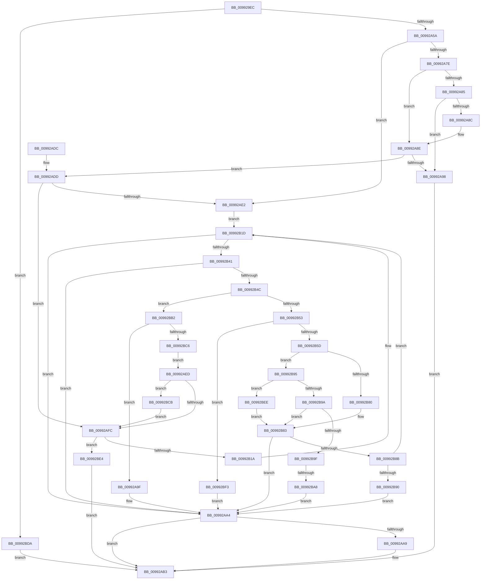

# _RegRtlEnumKeyWithCallback

- RVA: `0x009929EC`–`0x00992BFA` (길이 `526` bytes)
- VA: `0x00000001409929EC`
- 실행 섹션: `PAGE`
- PDB 이름 있음: `예`; PDB Function 태그: `예`
- unwind 정보 RVA: `0x00098E44`
- 디코드: `153`개 명령, `526/526` bytes 표시
- 미해석 바이트: `0` (있으면 어셈블리에 `.byte`로 보존)

> 이 문서는 커널 이미지의 기계어와 PDB 기호를 분석해 생성했습니다. 4번과 5번은 함수 원형과 자료형을 바이너리 사용 방식에서 추정한 C 해석이며 원본 소스 복구 결과는 아닙니다.

## 1. Dependencies

- 직접 호출 지점: **8**; 고유 호출 대상: **7**
- 직접 호출자로 확인된 함수: **2**
- RIP 상대 이미지 참조: **1**

### Outgoing calls
- `0x00992A39` → [RtlpGetStackLimits](../../text/2F/RtlpGetStackLimits_function_002F5F50.md) (function, `0x002F5F50`)
- `0x00992A70` → [RegRtlQueryInfoKey](RegRtlQueryInfoKey_function_0099463C.md) (function, `0x0099463C`)
- `0x00992AAE` → [ExFreePoolWithTag](../../poolcode/B8/ExFreePoolWithTag_function_00B82870.md) (function, `0x00B82870`)
- `0x00992ABC` → [_security_check_cookie](../../text/6A/_security_check_cookie_function_006AC640.md) (function, `0x006AC640`)
- `0x00992B09` → [ExAllocatePool2](../../poolcode/B8/ExAllocatePool2_function_00B820F0.md) (function, `0x00B820F0`)
- `0x00992B31` → [RegRtlEnumKey](RegRtlEnumKey_function_00992C00.md) (function, `0x00992C00`)
- `0x00992B71` → [SysCtxInternalEnumSubkeyCallback](../../text/47/SysCtxInternalEnumSubkeyCallback_function_00471998.md) (function, `0x00471998`)
- `0x00992BD0` → [ExFreePoolWithTag](../../poolcode/B8/ExFreePoolWithTag_function_00B82870.md) (function, `0x00B82870`)

### Direct callers
- [DrvDbGetObjectSubKeyList](../92/DrvDbGetObjectSubKeyList_function_0092F0C8.md) at `0x0092F1B0`
- [PnpCtxRegEnumKeyWithCallback](../AA/PnpCtxRegEnumKeyWithCallback_function_00AA146C.md) at `0x00AA14B0`

### Static image references
- `0x00992A08` → RVA `0x00E0A740` (`.data`; read)

## 2. Other-region calls and transfers

- 다른 실행 섹션으로 향하는 call: **6**
  - `0x00992A39` → [RtlpGetStackLimits](../../text/2F/RtlpGetStackLimits_function_002F5F50.md) (`PAGE` → `.text`)
  - `0x00992AAE` → [ExFreePoolWithTag](../../poolcode/B8/ExFreePoolWithTag_function_00B82870.md) (`PAGE` → `POOLCODE`)
  - `0x00992ABC` → [_security_check_cookie](../../text/6A/_security_check_cookie_function_006AC640.md) (`PAGE` → `.text`)
  - `0x00992B09` → [ExAllocatePool2](../../poolcode/B8/ExAllocatePool2_function_00B820F0.md) (`PAGE` → `POOLCODE`)
  - `0x00992B71` → [SysCtxInternalEnumSubkeyCallback](../../text/47/SysCtxInternalEnumSubkeyCallback_function_00471998.md) (`PAGE` → `.text`)
  - `0x00992BD0` → [ExFreePoolWithTag](../../poolcode/B8/ExFreePoolWithTag_function_00B82870.md) (`PAGE` → `POOLCODE`)
- call이 아닌 외부 분기/꼬리 이동: **1**
  - `0x00992BA2` → [sub_00B2BFA4](../B2/Unknown_function_00B2BFA4.md) (`tail-transfer`)

## 3. Assembly (complete function range)

```asm
009929EC  48 89 5C 24 10                  mov qword ptr [rsp + 0x10], rbx
009929F1  55                              push rbp
009929F2  56                              push rsi
009929F3  57                              push rdi
009929F4  41 54                           push r12
009929F6  41 55                           push r13
009929F8  41 56                           push r14
009929FA  41 57                           push r15
009929FC  48 8D 6C 24 D9                  lea rbp, [rsp - 0x27]
00992A01  48 81 EC B0 00 00 00            sub rsp, 0xb0
00992A08  48 8B 05 31 7D 47 00            mov rax, qword ptr [rip + 0x477d31]
00992A0F  48 33 C4                        xor rax, rsp
00992A12  48 89 45 17                     mov qword ptr [rbp + 0x17], rax
00992A16  45 33 FF                        xor r15d, r15d
00992A19  48 8D 55 B7                     lea rdx, [rbp - 0x49]
00992A1D  4C 8B E1                        mov r12, rcx
00992A20  44 89 7D A7                     mov dword ptr [rbp - 0x59], r15d
00992A24  48 8D 4D AF                     lea rcx, [rbp - 0x51]
00992A28  4C 89 7D B7                     mov qword ptr [rbp - 0x49], r15
00992A2C  41 8B DF                        mov ebx, r15d
00992A2F  4C 89 7D AF                     mov qword ptr [rbp - 0x51], r15
00992A33  41 8B FF                        mov edi, r15d
00992A36  4D 8B E8                        mov r13, r8
00992A39  E8 12 35 96 FF                  call 0x1402f5f50
00992A3E  F6 D8                           neg al
00992A40  48 8D 45 B7                     lea rax, [rbp - 0x49]
00992A44  48 1B C9                        sbb rcx, rcx
00992A47  48 23 4D AF                     and rcx, qword ptr [rbp - 0x51]
00992A4B  48 2B C1                        sub rax, rcx
00992A4E  48 3D 00 04 00 00               cmp rax, 0x400
00992A54  0F 82 80 01 00 00               jb 0x140992bda
00992A5A  4C 89 7C 24 28                  mov qword ptr [rsp + 0x28], r15
00992A5F  4C 8D 45 A7                     lea r8, [rbp - 0x59]
00992A63  45 33 C9                        xor r9d, r9d
00992A66  4C 89 7C 24 20                  mov qword ptr [rsp + 0x20], r15
00992A6B  33 D2                           xor edx, edx
00992A6D  49 8B CC                        mov rcx, r12
00992A70  E8 C7 1B 00 00                  call 0x14099463c
00992A75  BA FF FF FF FF                  mov edx, 0xffffffff
00992A7A  85 C0                           test eax, eax
00992A7C  75 64                           jne 0x140992ae2
00992A7E  8B 45 A7                        mov eax, dword ptr [rbp - 0x59]
00992A81  85 C0                           test eax, eax
00992A83  74 09                           je 0x140992a8e
00992A85  8D 48 01                        lea ecx, [rax + 1]
00992A88  3B C8                           cmp ecx, eax
00992A8A  72 0C                           jb 0x140992a98
00992A8C  8B C1                           mov eax, ecx
00992A8E  8B F0                           mov esi, eax
00992A90  48 03 F6                        add rsi, rsi
00992A93  48 3B F2                        cmp rsi, rdx
00992A96  76 45                           jbe 0x140992add
00992A98  BB 95 00 00 C0                  mov ebx, 0xc0000095
00992A9D  EB 14                           jmp 0x140992ab3
00992A9F  BB 95 00 00 C0                  mov ebx, 0xc0000095
00992AA4  48 85 FF                        test rdi, rdi
00992AA7  74 0A                           je 0x140992ab3
00992AA9  33 D2                           xor edx, edx
00992AAB  48 8B CF                        mov rcx, rdi
00992AAE  E8 BD FD 1E 00                  call 0x140b82870
00992AB3  8B C3                           mov eax, ebx
00992AB5  48 8B 4D 17                     mov rcx, qword ptr [rbp + 0x17]
00992AB9  48 33 CC                        xor rcx, rsp
00992ABC  E8 7F 9B D1 FF                  call 0x1406ac640
00992AC1  48 8B 9C 24 F8 00 00 00         mov rbx, qword ptr [rsp + 0xf8]
00992AC9  48 81 C4 B0 00 00 00            add rsp, 0xb0
00992AD0  41 5F                           pop r15
00992AD2  41 5E                           pop r14
00992AD4  41 5D                           pop r13
00992AD6  41 5C                           pop r12
00992AD8  5F                              pop rdi
00992AD9  5E                              pop rsi
00992ADA  5D                              pop rbp
00992ADB  C3                              ret
00992ADC  CC                              int3
00992ADD  83 FE 50                        cmp esi, 0x50
00992AE0  77 1A                           ja 0x140992afc
00992AE2  4C 8D 75 C7                     lea r14, [rbp - 0x39]
00992AE6  BE 50 00 00 00                  mov esi, 0x50
00992AEB  EB 30                           jmp 0x140992b1d
00992AED  45 33 F6                        xor r14d, r14d
00992AF0  41 8B DE                        mov ebx, r14d
00992AF3  48 85 FF                        test rdi, rdi
00992AF6  0F 85 CF 00 00 00               jne 0x140992bcb
00992AFC  41 B8 52 45 47 4C               mov r8d, 0x4c474552
00992B02  8B D6                           mov edx, esi
00992B04  B9 00 01 00 00                  mov ecx, 0x100
00992B09  E8 E2 F5 1E 00                  call 0x140b820f0
00992B0E  48 8B F8                        mov rdi, rax
00992B11  48 85 C0                        test rax, rax
00992B14  0F 84 CA 00 00 00               je 0x140992be4
00992B1A  4C 8B F0                        mov r14, rax
00992B1D  8B C6                           mov eax, esi
00992B1F  4C 8D 4D A7                     lea r9, [rbp - 0x59]
00992B23  D1 E8                           shr eax, 1
00992B25  4D 8B C6                        mov r8, r14
00992B28  41 8B D7                        mov edx, r15d
00992B2B  89 45 A7                        mov dword ptr [rbp - 0x59], eax
00992B2E  49 8B CC                        mov rcx, r12
00992B31  E8 CA 00 00 00                  call 0x140992c00
00992B36  3D 1A 00 00 80                  cmp eax, 0x8000001a
00992B3B  0F 84 63 FF FF FF               je 0x140992aa4
00992B41  3D 7C 01 00 C0                  cmp eax, 0xc000017c
00992B46  0F 84 58 FF FF FF               je 0x140992aa4
00992B4C  3D 23 00 00 C0                  cmp eax, 0xc0000023
00992B51  74 5F                           je 0x140992bb2
00992B53  33 C9                           xor ecx, ecx
00992B55  85 C0                           test eax, eax
00992B57  0F 85 96 00 00 00               jne 0x140992bf3
00992B5D  8B C6                           mov eax, esi
00992B5F  4D 8B C5                        mov r8, r13
00992B62  48 D1 E8                        shr rax, 1
00992B65  49 8B D6                        mov rdx, r14
00992B68  66 41 89 4C 46 FE               mov word ptr [r14 + rax*2 - 2], cx
00992B6E  49 8B CC                        mov rcx, r12
00992B71  E8 22 EE AD FF                  call 0x140471998
00992B76  8B C8                           mov ecx, eax
00992B78  8B D0                           mov edx, eax
00992B7A  33 C0                           xor eax, eax
00992B7C  85 C9                           test ecx, ecx
00992B7E  75 15                           jne 0x140992b95
00992B80  41 FF C7                        inc r15d
00992B83  85 DB                           test ebx, ebx
00992B85  0F 85 19 FF FF FF               jne 0x140992aa4
00992B8B  83 FA 02                        cmp edx, 2
00992B8E  75 8D                           jne 0x140992b1d
00992B90  E9 0F FF FF FF                  jmp 0x140992aa4
00992B95  83 E9 01                        sub ecx, 1
00992B98  74 54                           je 0x140992bee
00992B9A  83 E9 01                        sub ecx, 1
00992B9D  74 E4                           je 0x140992b83
00992B9F  83 F9 01                        cmp ecx, 1
00992BA2  0F 84 FC 93 19 00               je 0x140b2bfa4
00992BA8  BB E5 00 00 C0                  mov ebx, 0xc00000e5
00992BAD  E9 F2 FE FF FF                  jmp 0x140992aa4
00992BB2  8B 75 A7                        mov esi, dword ptr [rbp - 0x59]
00992BB5  B8 FF FF FF FF                  mov eax, 0xffffffff
00992BBA  48 03 F6                        add rsi, rsi
00992BBD  48 3B F0                        cmp rsi, rax
00992BC0  0F 87 D9 FE FF FF               ja 0x140992a9f
00992BC6  E9 22 FF FF FF                  jmp 0x140992aed
00992BCB  33 D2                           xor edx, edx
00992BCD  48 8B CF                        mov rcx, rdi
00992BD0  E8 9B FC 1E 00                  call 0x140b82870
00992BD5  E9 22 FF FF FF                  jmp 0x140992afc
00992BDA  BB 9A 00 00 C0                  mov ebx, 0xc000009a
00992BDF  E9 CF FE FF FF                  jmp 0x140992ab3
00992BE4  BB 17 00 00 C0                  mov ebx, 0xc0000017
00992BE9  E9 C5 FE FF FF                  jmp 0x140992ab3
00992BEE  44 8B F8                        mov r15d, eax
00992BF1  EB 90                           jmp 0x140992b83
00992BF3  8B D8                           mov ebx, eax
00992BF5  E9 AA FE FF FF                  jmp 0x140992aa4
```

## 4. C-style interpretation (structured pseudocode)

```c
__int64 __fastcall _RegRtlEnumKeyWithCallback(__int64 a1, __int64 a2, __int64 a3, int a4)
{
    __int64 result;
    __int64 v_r14;
    __int64 v_r15;
    __int64 v_rsi;
    __int64 v_rsp;
    unsigned __int64 v_stack_m48;
    unsigned __int64 v_stack_m5F;
    unsigned __int64 v_stack_m98;
    unsigned __int64 v_stack_mA8;
    unsigned __int64 v_stack_mB0;
    unsigned int v_stack_mB8;
    unsigned __int64 v_stack_mC0;
    unsigned __int64 v_stack_mC8;
    unsigned __int64 v_stack_p10;

    v_stack_p10 = v_rbx;
    v_rsp = (v_rsp) - (176);
    result = (*(unsigned __int64 *)(v_rip + 4685105)) ^ (v_rsp);
    v_stack_m48 = result;
    v_r15 = 0;
    v_stack_mB8 = 0;
    v_stack_mA8 = 0;
    v_stack_mB0 = 0;
    result = RtlpGetStackLimits(v_stack_mB0, v_stack_mA8, a3, a4);
    result = (unsigned __int8)(-(result));
    a1 = (v_stack_mB0) & (v_stack_mB0);
    result = (v_stack_mA8) - (a1);
    if (result < 0x400ULL) goto loc_00992BDA;
    v_stack_mC0 = 0;
    a4 = 0;
    v_stack_mC8 = 0;
    a2 = 0;
    result = RegRtlQueryInfoKey(a1, a2, v_stack_mB8, a4);
    if ((unsigned int)(result) != 0) goto loc_00992AE2;
    if ((unsigned int)((unsigned int)(v_stack_mB8)) == 0) goto loc_00992A8E;
    if (((unsigned int)((unsigned int)(v_stack_mB8) + 1)) < ((unsigned int)((unsigned int)(v_stack_mB8)))) goto loc_00992A98;
loc_00992A8E:
    v_rsi = ((unsigned int)((unsigned int)((unsigned int)((unsigned int)((unsigned int)(v_stack_mB8) + 1))))) + ((unsigned int)((unsigned int)((unsigned int)((unsigned int)((unsigned int)(v_stack_mB8) + 1)))));
    if (v_rsi <= ((unsigned int)(0xFFFFFFFFULL))) goto loc_00992ADD;
loc_00992A98:
    goto loc_00992AB3;
loc_00992A9F:
loc_00992AA4:
    result = (unsigned int)((unsigned int)((unsigned int)(v_stack_mB8) + 1));
    if (0 != 0) {
        a2 = 0;
        a1 = 0;
        result = ExFreePoolWithTag(a1, a2, v_stack_mB8, a4);
    }
    a1 = (v_stack_m48) ^ (v_rsp);
    result = _security_check_cookie(a1, a2, v_stack_mB8, a4);
    v_rsp = (v_rsp) + (176);
    return result;
loc_00992ADD:
    if (((unsigned int)(v_rsi)) > 80) goto loc_00992AFC;
loc_00992AE2:
    goto loc_00992B1D;
loc_00992AED:
    v_r14 = 0;
    if (0 != 0) goto loc_00992BCB;
loc_00992AFC:
    result = ExAllocatePool2(256, 80, (unsigned int)(0x4C474552ULL), a4);
    if (result == 0) goto loc_00992BE4;
loc_00992B1D:
    result = (unsigned int)((80) >> (1));
    v_stack_mB8 = (unsigned int)(result);
    result = RegRtlEnumKey(a1, 0, result, v_stack_mB8);
    if (((unsigned int)(result)) == 0x8000001AULL) goto loc_00992AA4;
    if (((unsigned int)(result)) == 0xC000017CULL) goto loc_00992AA4;
    if (((unsigned int)(result)) == 0xC0000023ULL) goto loc_00992BB2;
    a1 = 0;
    if ((unsigned int)(result) != 0) goto loc_00992BF3;
    result = (80) >> (1);
    *(unsigned __int16 *)(result + result * 2 - 2) = 0;
    result = SysCtxInternalEnumSubkeyCallback(0, result, a3, v_stack_mB8);
    result = 0;
    if ((unsigned int)((unsigned int)((unsigned int)(result))) != 0) goto loc_00992B95;
    v_r15 = (unsigned int)((v_r15) + 1);
loc_00992B83:
    if (0 != 0) goto loc_00992AA4;
    if (((unsigned int)((unsigned int)((unsigned int)(result)))) != 2) goto loc_00992B1D;
    goto loc_00992AA4;
loc_00992B95:
    a1 = (unsigned int)(((unsigned int)((unsigned int)(result))) - (1));
    if (condition_is_equal) goto loc_00992BEE;
    a1 = (unsigned int)((a1) - (1));
    if (condition_is_equal) goto loc_00992B83;
    goto loc_00992AA4;
loc_00992BB2:
    v_rsi = ((unsigned int)(v_stack_mB8)) + ((unsigned int)(v_stack_mB8));
    if (v_rsi > ((unsigned int)(0xFFFFFFFFULL))) goto loc_00992A9F;
    goto loc_00992AED;
loc_00992BCB:
    a2 = 0;
    result = ExFreePoolWithTag(0, a2, a3, v_stack_mB8);
    goto loc_00992AFC;
loc_00992BDA:
    goto loc_00992AB3;
loc_00992BE4:
    goto loc_00992AB3;
loc_00992BEE:
    goto loc_00992B83;
loc_00992BF3:
    goto loc_00992AA4;
}
```

## 5. (Beta) C Style

```c
int64_t _RegRtlEnumKeyWithCallback(int64_t Arg1, int64_t Arg2, int64_t Arg3, int32_t Arg4)
{
    int64_t result;
    int64_t local_r14;
    int64_t local_r15;
    int64_t local_rsi;
    int64_t local_rsp;
    uint64_t v_stack_m48;
    uint64_t v_stack_m5F;
    uint64_t v_stack_m98;
    uint64_t v_stack_mA8;
    uint64_t v_stack_mB0;
    uint32_t v_stack_mB8;
    uint64_t v_stack_mC0;
    uint64_t v_stack_mC8;
    uint64_t v_stack_p10;

    v_stack_p10 = local_rbx;
    local_rsp = (local_rsp) - (176);
    result = (*(uint64_t *)(v_rip + 0x477D31)) ^ (local_rsp);
    v_stack_m48 = result;
    local_r15 = 0;
    v_stack_mB8 = 0;
    v_stack_mA8 = 0;
    v_stack_mB0 = 0;
    result = RtlpGetStackLimits(v_stack_mB0, v_stack_mA8, Arg3, Arg4);
    result = (uint8_t)(-(result));
    Arg1 = (v_stack_mB0) & (v_stack_mB0);
    result = (v_stack_mA8) - (Arg1);
    if (result < 0x400ULL) goto loc_00992BDA;
    v_stack_mC0 = 0;
    Arg4 = 0;
    v_stack_mC8 = 0;
    Arg2 = 0;
    result = RegRtlQueryInfoKey(Arg1, Arg2, v_stack_mB8, Arg4);
    if ((uint32_t)(result) != 0) goto loc_00992AE2;
    if ((uint32_t)((uint32_t)(v_stack_mB8)) == 0) goto loc_00992A8E;
    if (((uint32_t)((uint32_t)(v_stack_mB8) + 1)) < ((uint32_t)((uint32_t)(v_stack_mB8)))) goto loc_00992A98;
loc_00992A8E:
    local_rsi = ((uint32_t)((uint32_t)((uint32_t)((uint32_t)((uint32_t)(v_stack_mB8) + 1))))) + ((uint32_t)((uint32_t)((uint32_t)((uint32_t)((uint32_t)(v_stack_mB8) + 1)))));
    if (local_rsi <= ((uint32_t)(0xFFFFFFFFULL))) goto loc_00992ADD;
loc_00992A98:
    goto loc_00992AB3;
loc_00992A9F:
loc_00992AA4:
    result = (uint32_t)((uint32_t)((uint32_t)(v_stack_mB8) + 1));
    if (0 != 0) {
        Arg2 = 0;
        Arg1 = 0;
        result = ExFreePoolWithTag(Arg1, Arg2, v_stack_mB8, Arg4);
    }
    Arg1 = (v_stack_m48) ^ (local_rsp);
    result = _security_check_cookie(Arg1, Arg2, v_stack_mB8, Arg4);
    local_rsp = (local_rsp) + (176);
    return result;
loc_00992ADD:
    if (((uint32_t)(local_rsi)) > 80) goto loc_00992AFC;
loc_00992AE2:
    goto loc_00992B1D;
loc_00992AED:
    local_r14 = 0;
    if (0 != 0) goto loc_00992BCB;
loc_00992AFC:
    result = ExAllocatePool2(256, 80, (uint32_t)(0x4C474552ULL), Arg4);
    if (result == 0) goto loc_00992BE4;
loc_00992B1D:
    result = (uint32_t)((80) >> (1));
    v_stack_mB8 = (uint32_t)(result);
    result = RegRtlEnumKey(Arg1, 0, result, v_stack_mB8);
    if (((uint32_t)(result)) == 0x8000001AULL) goto loc_00992AA4;
    if (((uint32_t)(result)) == 0xC000017CULL) goto loc_00992AA4;
    if (((uint32_t)(result)) == 0xC0000023ULL) goto loc_00992BB2;
    Arg1 = 0;
    if ((uint32_t)(result) != 0) goto loc_00992BF3;
    result = (80) >> (1);
    *(uint16_t *)(result + result * 2 - 0x2) = 0;
    result = SysCtxInternalEnumSubkeyCallback(0, result, Arg3, v_stack_mB8);
    result = 0;
    if ((uint32_t)((uint32_t)((uint32_t)(result))) != 0) goto loc_00992B95;
    local_r15 = (uint32_t)((local_r15) + 1);
loc_00992B83:
    if (0 != 0) goto loc_00992AA4;
    if (((uint32_t)((uint32_t)((uint32_t)(result)))) != 2) goto loc_00992B1D;
    goto loc_00992AA4;
loc_00992B95:
    Arg1 = (uint32_t)(((uint32_t)((uint32_t)(result))) - (1));
    if (condition_is_equal) goto loc_00992BEE;
    Arg1 = (uint32_t)((Arg1) - (1));
    if (condition_is_equal) goto loc_00992B83;
    goto loc_00992AA4;
loc_00992BB2:
    local_rsi = ((uint32_t)(v_stack_mB8)) + ((uint32_t)(v_stack_mB8));
    if (local_rsi > ((uint32_t)(0xFFFFFFFFULL))) goto loc_00992A9F;
    goto loc_00992AED;
loc_00992BCB:
    Arg2 = 0;
    result = ExFreePoolWithTag(0, Arg2, Arg3, v_stack_mB8);
    goto loc_00992AFC;
loc_00992BDA:
    goto loc_00992AB3;
loc_00992BE4:
    goto loc_00992AB3;
loc_00992BEE:
    goto loc_00992B83;
loc_00992BF3:
    goto loc_00992AA4;
}
```

## 6. Execution-region graph

[열기: 2D/3D 그래프와 함수 탐색 컨트롤 패널](../../../control-panel.html?section=page&rva=0x009929EC&view=graph)

- 2D 그래프는 위에서 아래로 흐르고, 3D 그래프는 빈 공간을 드래그해 회전합니다. Shift+드래그는 이동, 휠은 확대·축소, 함수 노드 선택은 대상 보고서 이동입니다.

### Static fallback


