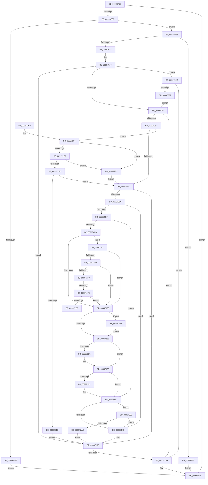

# pIoQueryBusDescription

- RVA: `0x00996F58`–`0x009972B7` (길이 `863` bytes)
- VA: `0x0000000140996F58`
- 실행 섹션: `PAGE`
- PDB 이름 있음: `예`; PDB Function 태그: `예`
- unwind 정보 RVA: `0x00099310`
- 디코드: `227`개 명령, `863/863` bytes 표시
- 미해석 바이트: `0` (있으면 어셈블리에 `.byte`로 보존)

> 이 문서는 커널 이미지의 기계어와 PDB 기호를 분석해 생성했습니다. 4번과 5번은 함수 원형과 자료형을 바이너리 사용 방식에서 추정한 C 해석이며 원본 소스 복구 결과는 아닙니다.

## 1. Dependencies

- 직접 호출 지점: **19**; 고유 호출 대상: **12**
- 직접 호출자로 확인된 함수: **2**
- RIP 상대 이미지 참조: **5**

### Outgoing calls
- `0x00996FBB` → [IopGetRegistryKeyInformation](IopGetRegistryKeyInformation_function_009972C0.md) (function, `0x009972C0`)
- `0x00996FF5` → [ExAllocatePool2](../../poolcode/B8/ExAllocatePool2_function_00B820F0.md) (function, `0x00B820F0`)
- `0x00997002` → [ExFreePoolWithTag](../../poolcode/B8/ExFreePoolWithTag_function_00B82870.md) (function, `0x00B82870`)
- `0x00997044` → [ZwEnumerateKey](../../text/6A/ZwEnumerateKey_function_006AD710.md) (function, `0x006AD710`)
- `0x009970AC` → [ZwOpenKey](../../text/6A/ZwOpenKey_function_006AD310.md) (function, `0x006AD310`)
- `0x009970D0` → [RtlAppendUnicodeToString](../../text/40/RtlAppendUnicodeToString_function_0040F990.md) (function, `0x0040F990`)
- `0x009970DD` → [RtlAppendUnicodeStringToString](../../text/40/RtlAppendUnicodeStringToString_function_0040FA50.md) (function, `0x0040FA50`)
- `0x009970F0` → [IopGetRegistryValues](IopGetRegistryValues_function_00996E88.md) (function, `0x00996E88`)
- `0x0099711F` → [ExFreePoolWithTag](../../poolcode/B8/ExFreePoolWithTag_function_00B82870.md) (function, `0x00B82870`)
- `0x00997133` → [ExFreePoolWithTag](../../poolcode/B8/ExFreePoolWithTag_function_00B82870.md) (function, `0x00B82870`)
- `0x0099716B` → [pIoQueryBusDescription](pIoQueryBusDescription_function_00996F58.md) (function, `0x00996F58`)
- `0x00997177` → [ZwClose](../../text/6A/ZwClose_function_006AD2B0.md) (function, `0x006AD2B0`)
- `0x0099719F` → [ExFreePoolWithTag](../../poolcode/B8/ExFreePoolWithTag_function_00B82870.md) (function, `0x00B82870`)
- `0x009971AD` → [_security_check_cookie](../../text/6A/_security_check_cookie_function_006AC640.md) (function, `0x006AC640`)
- `0x009971DA` → [wcsncmp](../../text/50/wcsncmp_function_00501CA0.md) (function, `0x00501CA0`)
- `0x009971F4` → [wcsncmp](../../text/50/wcsncmp_function_00501CA0.md) (function, `0x00501CA0`)
- `0x0099720E` → [wcsncmp](../../text/50/wcsncmp_function_00501CA0.md) (function, `0x00501CA0`)
- `0x00997286` → [ExFreePoolWithTag](../../poolcode/B8/ExFreePoolWithTag_function_00B82870.md) (function, `0x00B82870`)
- `0x009972A8` → [ZwClose](../../text/6A/ZwClose_function_006AD2B0.md) (function, `0x006AD2B0`)

### Direct callers
- [pIoQueryBusDescription](pIoQueryBusDescription_function_00996F58.md) at `0x0099716B`
- [IoQueryDeviceDescription](../A9/IoQueryDeviceDescription_function_00A9D8E0.md) at `0x00A9D9D0`

### Static image references
- `0x00996F6F` → RVA `0x00E0A740` (`.data`; read)
- `0x009970BD` → RVA `0x00AFC990` (` ?? ::NNGAKEGL::`string'`; read)
- `0x009971CD` → RVA `0x00B4D230` (`PAGE`; read)
- `0x009971EA` → RVA `0x00B4D210` (`PAGE`; read)
- `0x00997204` → RVA `0x00B4D218` (`PAGE`; read)

## 2. Other-region calls and transfers

- 다른 실행 섹션으로 향하는 call: **16**
  - `0x00996FF5` → [ExAllocatePool2](../../poolcode/B8/ExAllocatePool2_function_00B820F0.md) (`PAGE` → `POOLCODE`)
  - `0x00997002` → [ExFreePoolWithTag](../../poolcode/B8/ExFreePoolWithTag_function_00B82870.md) (`PAGE` → `POOLCODE`)
  - `0x00997044` → [ZwEnumerateKey](../../text/6A/ZwEnumerateKey_function_006AD710.md) (`PAGE` → `.text`)
  - `0x009970AC` → [ZwOpenKey](../../text/6A/ZwOpenKey_function_006AD310.md) (`PAGE` → `.text`)
  - `0x009970D0` → [RtlAppendUnicodeToString](../../text/40/RtlAppendUnicodeToString_function_0040F990.md) (`PAGE` → `.text`)
  - `0x009970DD` → [RtlAppendUnicodeStringToString](../../text/40/RtlAppendUnicodeStringToString_function_0040FA50.md) (`PAGE` → `.text`)
  - `0x0099711F` → [ExFreePoolWithTag](../../poolcode/B8/ExFreePoolWithTag_function_00B82870.md) (`PAGE` → `POOLCODE`)
  - `0x00997133` → [ExFreePoolWithTag](../../poolcode/B8/ExFreePoolWithTag_function_00B82870.md) (`PAGE` → `POOLCODE`)
  - `0x00997177` → [ZwClose](../../text/6A/ZwClose_function_006AD2B0.md) (`PAGE` → `.text`)
  - `0x0099719F` → [ExFreePoolWithTag](../../poolcode/B8/ExFreePoolWithTag_function_00B82870.md) (`PAGE` → `POOLCODE`)
  - `0x009971AD` → [_security_check_cookie](../../text/6A/_security_check_cookie_function_006AC640.md) (`PAGE` → `.text`)
  - `0x009971DA` → [wcsncmp](../../text/50/wcsncmp_function_00501CA0.md) (`PAGE` → `.text`)
  - `0x009971F4` → [wcsncmp](../../text/50/wcsncmp_function_00501CA0.md) (`PAGE` → `.text`)
  - `0x0099720E` → [wcsncmp](../../text/50/wcsncmp_function_00501CA0.md) (`PAGE` → `.text`)
  - `0x00997286` → [ExFreePoolWithTag](../../poolcode/B8/ExFreePoolWithTag_function_00B82870.md) (`PAGE` → `POOLCODE`)
  - `0x009972A8` → [ZwClose](../../text/6A/ZwClose_function_006AD2B0.md) (`PAGE` → `.text`)
- call이 아닌 외부 분기/꼬리 이동: **2**
  - `0x00997270` → [sub_00B2C588](../B2/Unknown_function_00B2C588.md) (`tail-transfer`)
  - `0x0099727F` → [sub_00B2C588](../B2/Unknown_function_00B2C588.md) (`tail-transfer`)

## 3. Assembly (complete function range)

```asm
00996F58  40 55                           push rbp
00996F5A  53                              push rbx
00996F5B  56                              push rsi
00996F5C  57                              push rdi
00996F5D  41 54                           push r12
00996F5F  41 56                           push r14
00996F61  41 57                           push r15
00996F63  48 8D 6C 24 F0                  lea rbp, [rsp - 0x10]
00996F68  48 81 EC 10 01 00 00            sub rsp, 0x110
00996F6F  48 8B 05 CA 37 47 00            mov rax, qword ptr [rip + 0x4737ca]
00996F76  48 33 C4                        xor rax, rsp
00996F79  48 89 45 08                     mov qword ptr [rbp + 8], rax
00996F7D  48 8B F1                        mov rsi, rcx
00996F80  48 89 55 A8                     mov qword ptr [rbp - 0x58], rdx
00996F84  33 C9                           xor ecx, ecx
00996F86  4C 89 45 90                     mov qword ptr [rbp - 0x70], r8
00996F8A  0F 57 C0                        xorps xmm0, xmm0
00996F8D  48 89 4D 00                     mov qword ptr [rbp], rcx
00996F91  33 DB                           xor ebx, ebx
00996F93  48 8D 54 24 68                  lea rdx, [rsp + 0x68]
00996F98  0F 57 C9                        xorps xmm1, xmm1
00996F9B  48 89 5C 24 60                  mov qword ptr [rsp + 0x60], rbx
00996FA0  49 8B C8                        mov rcx, r8
00996FA3  48 89 5C 24 68                  mov qword ptr [rsp + 0x68], rbx
00996FA8  4D 8B F9                        mov r15, r9
00996FAB  89 5C 24 70                     mov dword ptr [rsp + 0x70], ebx
00996FAF  0F 11 45 98                     movups xmmword ptr [rbp - 0x68], xmm0
00996FB3  0F 11 4D 80                     movups xmmword ptr [rbp - 0x80], xmm1
00996FB7  0F 11 45 F0                     movups xmmword ptr [rbp - 0x10], xmm0
00996FBB  E8 00 03 00 00                  call 0x1409972c0
00996FC0  85 C0                           test eax, eax
00996FC2  0F 88 DE 01 00 00               js 0x1409971a6
00996FC8  48 8B 5C 24 68                  mov rbx, qword ptr [rsp + 0x68]
00996FCD  8B 43 18                        mov eax, dword ptr [rbx + 0x18]
00996FD0  8D 48 20                        lea ecx, [rax + 0x20]
00996FD3  3B C8                           cmp ecx, eax
00996FD5  73 0A                           jae 0x140996fe1
00996FD7  B8 95 00 00 C0                  mov eax, 0xc0000095
00996FDC  E9 C5 01 00 00                  jmp 0x1409971a6
00996FE1  8B C1                           mov eax, ecx
00996FE3  41 B8 49 6F 4B 42               mov r8d, 0x424b6f49
00996FE9  8B D1                           mov edx, ecx
00996FEB  B9 00 01 00 00                  mov ecx, 0x100
00996FF0  48 89 44 24 68                  mov qword ptr [rsp + 0x68], rax
00996FF5  E8 F6 B0 1E 00                  call 0x140b820f0
00996FFA  33 D2                           xor edx, edx
00996FFC  48 8B CB                        mov rcx, rbx
00996FFF  4C 8B F0                        mov r14, rax
00997002  E8 69 B8 1E 00                  call 0x140b82870
00997007  33 DB                           xor ebx, ebx
00997009  4D 85 F6                        test r14, r14
0099700C  0F 84 10 02 00 00               je 0x140997222
00997012  44 8B E3                        mov r12d, ebx
00997015  8B FB                           mov edi, ebx
00997017  48 8B 4E 08                     mov rcx, qword ptr [rsi + 8]
0099701B  48 85 C9                        test rcx, rcx
0099701E  0F 85 08 02 00 00               jne 0x14099722c
00997024  48 8B 4D 90                     mov rcx, qword ptr [rbp - 0x70]
00997028  48 8D 44 24 70                  lea rax, [rsp + 0x70]
0099702D  48 89 44 24 28                  mov qword ptr [rsp + 0x28], rax
00997032  4D 8B CE                        mov r9, r14
00997035  48 8B 44 24 68                  mov rax, qword ptr [rsp + 0x68]
0099703A  45 33 C0                        xor r8d, r8d
0099703D  41 8B D4                        mov edx, r12d
00997040  89 44 24 20                     mov dword ptr [rsp + 0x20], eax
00997044  E8 C7 66 D1 FF                  call 0x1406ad710
00997049  8B F8                           mov edi, eax
0099704B  85 C0                           test eax, eax
0099704D  0F 88 47 01 00 00               js 0x14099719a
00997053  38 5D 70                        cmp byte ptr [rbp + 0x70], bl
00997056  0F 85 69 01 00 00               jne 0x1409971c5
0099705C  49 8D 46 10                     lea rax, [r14 + 0x10]
00997060  48 C7 45 C0 30 00 00 00         mov qword ptr [rbp - 0x40], 0x30
00997068  48 89 45 A0                     mov qword ptr [rbp - 0x60], rax
0099706C  4C 8D 45 C0                     lea r8, [rbp - 0x40]
00997070  41 0F B7 46 0C                  movzx eax, word ptr [r14 + 0xc]
00997075  48 8D 4C 24 60                  lea rcx, [rsp + 0x60]
0099707A  66 89 45 98                     mov word ptr [rbp - 0x68], ax
0099707E  0F 57 C0                        xorps xmm0, xmm0
00997081  41 0F B7 46 0C                  movzx eax, word ptr [r14 + 0xc]
00997086  BA 19 00 02 00                  mov edx, 0x20019
0099708B  66 89 45 9A                     mov word ptr [rbp - 0x66], ax
0099708F  48 8B 45 90                     mov rax, qword ptr [rbp - 0x70]
00997093  48 89 45 C8                     mov qword ptr [rbp - 0x38], rax
00997097  48 8D 45 98                     lea rax, [rbp - 0x68]
0099709B  48 89 45 D0                     mov qword ptr [rbp - 0x30], rax
0099709F  48 C7 45 D8 40 02 00 00         mov qword ptr [rbp - 0x28], 0x240
009970A7  F3 0F 7F 45 E0                  movdqu xmmword ptr [rbp - 0x20], xmm0
009970AC  E8 5F 62 D1 FF                  call 0x1406ad310
009970B1  85 C0                           test eax, eax
009970B3  0F 88 D6 00 00 00               js 0x14099718f
009970B9  48 8B 45 A8                     mov rax, qword ptr [rbp - 0x58]
009970BD  48 8D 15 CC 58 16 00            lea rdx, [rip + 0x1658cc]
009970C4  48 8D 4D 80                     lea rcx, [rbp - 0x80]
009970C8  0F 10 00                        movups xmm0, xmmword ptr [rax]
009970CB  F3 0F 7F 45 80                  movdqu xmmword ptr [rbp - 0x80], xmm0
009970D0  E8 BB 88 A7 FF                  call 0x14040f990
009970D5  48 8D 55 98                     lea rdx, [rbp - 0x68]
009970D9  48 8D 4D 80                     lea rcx, [rbp - 0x80]
009970DD  E8 6E 89 A7 FF                  call 0x14040fa50
009970E2  38 5D 70                        cmp byte ptr [rbp + 0x70], bl
009970E5  75 62                           jne 0x140997149
009970E7  48 8B 4C 24 60                  mov rcx, qword ptr [rsp + 0x60]
009970EC  48 8D 55 F0                     lea rdx, [rbp - 0x10]
009970F0  E8 93 FD FF FF                  call 0x140996e88
009970F5  8B F8                           mov edi, eax
009970F7  85 C0                           test eax, eax
009970F9  78 41                           js 0x14099713c
009970FB  4C 8B 45 F8                     mov r8, qword ptr [rbp - 8]
009970FF  4D 85 C0                        test r8, r8
00997102  0F 85 3B 01 00 00               jne 0x140997243
00997108  48 8B 4D F0                     mov rcx, qword ptr [rbp - 0x10]
0099710C  48 85 C9                        test rcx, rcx
0099710F  0F 85 6F 01 00 00               jne 0x140997284
00997115  4D 85 C0                        test r8, r8
00997118  74 0E                           je 0x140997128
0099711A  33 D2                           xor edx, edx
0099711C  49 8B C8                        mov rcx, r8
0099711F  E8 4C B7 1E 00                  call 0x140b82870
00997124  48 89 5D F8                     mov qword ptr [rbp - 8], rbx
00997128  48 8B 4D 00                     mov rcx, qword ptr [rbp]
0099712C  48 85 C9                        test rcx, rcx
0099712F  74 0B                           je 0x14099713c
00997131  33 D2                           xor edx, edx
00997133  E8 38 B7 1E 00                  call 0x140b82870
00997138  48 89 5D 00                     mov qword ptr [rbp], rbx
0099713C  48 8B 4E 08                     mov rcx, qword ptr [rsi + 8]
00997140  48 85 C9                        test rcx, rcx
00997143  0F 85 4F 01 00 00               jne 0x140997298
00997149  0F 28 45 80                     movaps xmm0, xmmword ptr [rbp - 0x80]
0099714D  48 8D 55 B0                     lea rdx, [rbp - 0x50]
00997151  38 5D 70                        cmp byte ptr [rbp + 0x70], bl
00997154  4D 8B CF                        mov r9, r15
00997157  4C 8B 44 24 60                  mov r8, qword ptr [rsp + 0x60]
0099715C  48 8B CE                        mov rcx, rsi
0099715F  0F 94 C0                        sete al
00997162  66 0F 7F 45 B0                  movdqa xmmword ptr [rbp - 0x50], xmm0
00997167  88 44 24 20                     mov byte ptr [rsp + 0x20], al
0099716B  E8 E8 FD FF FF                  call 0x140996f58
00997170  48 8B 4C 24 60                  mov rcx, qword ptr [rsp + 0x60]
00997175  8B D8                           mov ebx, eax
00997177  E8 34 61 D1 FF                  call 0x1406ad2b0
0099717C  48 83 64 24 60 00               and qword ptr [rsp + 0x60], 0
00997182  33 FF                           xor edi, edi
00997184  81 FB 1A 00 00 80               cmp ebx, 0x8000001a
0099718A  0F 45 FB                        cmovne edi, ebx
0099718D  33 DB                           xor ebx, ebx
0099718F  41 FF C4                        inc r12d
00997192  85 FF                           test edi, edi
00997194  0F 89 7D FE FF FF               jns 0x140997017
0099719A  33 D2                           xor edx, edx
0099719C  49 8B CE                        mov rcx, r14
0099719F  E8 CC B6 1E 00                  call 0x140b82870
009971A4  8B C7                           mov eax, edi
009971A6  48 8B 4D 08                     mov rcx, qword ptr [rbp + 8]
009971AA  48 33 CC                        xor rcx, rsp
009971AD  E8 8E 54 D1 FF                  call 0x1406ac640
009971B2  48 81 C4 10 01 00 00            add rsp, 0x110
009971B9  41 5F                           pop r15
009971BB  41 5E                           pop r14
009971BD  41 5C                           pop r12
009971BF  5F                              pop rdi
009971C0  5E                              pop rsi
009971C1  5B                              pop rbx
009971C2  5D                              pop rbp
009971C3  C3                              ret
009971C4  CC                              int3
009971C5  45 8B 46 0C                     mov r8d, dword ptr [r14 + 0xc]
009971C9  49 8D 5E 10                     lea rbx, [r14 + 0x10]
009971CD  48 8B 15 5C 60 1B 00            mov rdx, qword ptr [rip + 0x1b605c]
009971D4  48 8B CB                        mov rcx, rbx
009971D7  49 D1 E8                        shr r8, 1
009971DA  E8 C1 AA B6 FF                  call 0x140501ca0
009971DF  85 C0                           test eax, eax
009971E1  74 59                           je 0x14099723c
009971E3  45 8B 46 0C                     mov r8d, dword ptr [r14 + 0xc]
009971E7  48 8B CB                        mov rcx, rbx
009971EA  48 8B 15 1F 60 1B 00            mov rdx, qword ptr [rip + 0x1b601f]
009971F1  49 D1 E8                        shr r8, 1
009971F4  E8 A7 AA B6 FF                  call 0x140501ca0
009971F9  85 C0                           test eax, eax
009971FB  74 3F                           je 0x14099723c
009971FD  45 8B 46 0C                     mov r8d, dword ptr [r14 + 0xc]
00997201  48 8B CB                        mov rcx, rbx
00997204  48 8B 15 0D 60 1B 00            mov rdx, qword ptr [rip + 0x1b600d]
0099720B  49 D1 E8                        shr r8, 1
0099720E  E8 8D AA B6 FF                  call 0x140501ca0
00997213  33 DB                           xor ebx, ebx
00997215  85 C0                           test eax, eax
00997217  0F 84 3F FE FF FF               je 0x14099705c
0099721D  E9 6D FF FF FF                  jmp 0x14099718f
00997222  B8 9A 00 00 C0                  mov eax, 0xc000009a
00997227  E9 7A FF FF FF                  jmp 0x1409971a6
0099722C  41 8B 07                        mov eax, dword ptr [r15]
0099722F  39 01                           cmp dword ptr [rcx], eax
00997231  0F 84 63 FF FF FF               je 0x14099719a
00997237  E9 E8 FD FF FF                  jmp 0x140997024
0099723C  33 DB                           xor ebx, ebx
0099723E  E9 19 FE FF FF                  jmp 0x14099705c
00997243  41 39 58 0C                     cmp dword ptr [r8 + 0xc], ebx
00997247  0F 84 BB FE FF FF               je 0x140997108
0099724D  48 8B 06                        mov rax, qword ptr [rsi]
00997250  41 8B 50 08                     mov edx, dword ptr [r8 + 8]
00997254  8B 08                           mov ecx, dword ptr [rax]
00997256  42 39 0C 02                     cmp dword ptr [rdx + r8], ecx
0099725A  0F 85 A8 FE FF FF               jne 0x140997108
00997260  45 8B 0F                        mov r9d, dword ptr [r15]
00997263  41 FF C1                        inc r9d
00997266  45 89 0F                        mov dword ptr [r15], r9d
00997269  48 8B 46 08                     mov rax, qword ptr [rsi + 8]
0099726D  48 85 C0                        test rax, rax
00997270  0F 84 12 53 19 00               je 0x140b2c588
00997276  44 39 08                        cmp dword ptr [rax], r9d
00997279  0F 85 89 FE FF FF               jne 0x140997108
0099727F  E9 04 53 19 00                  jmp 0x140b2c588
00997284  33 D2                           xor edx, edx
00997286  E8 E5 B5 1E 00                  call 0x140b82870
0099728B  4C 8B 45 F8                     mov r8, qword ptr [rbp - 8]
0099728F  48 89 5D F0                     mov qword ptr [rbp - 0x10], rbx
00997293  E9 7D FE FF FF                  jmp 0x140997115
00997298  41 8B 07                        mov eax, dword ptr [r15]
0099729B  39 01                           cmp dword ptr [rcx], eax
0099729D  0F 85 A6 FE FF FF               jne 0x140997149
009972A3  48 8B 4C 24 60                  mov rcx, qword ptr [rsp + 0x60]
009972A8  E8 03 60 D1 FF                  call 0x1406ad2b0
009972AD  48 89 5C 24 60                  mov qword ptr [rsp + 0x60], rbx
009972B2  E9 D8 FE FF FF                  jmp 0x14099718f
```

## 4. C-style interpretation (structured pseudocode)

```c
__int64 __fastcall pIoQueryBusDescription(__int64 a1, __int64 a2, __int64 a3, __int64 a4, unsigned __int8 a5)
{
    __int64 result;
    __int64 v_r12;
    __int64 v_rbx;
    __int64 v_rdi;
    __int64 v_rsp;
    unsigned __int64 v_stack_m120;
    unsigned int v_stack_m128;
    unsigned __int64 v_stack_m40;
    unsigned __int64 v_stack_m48;
    unsigned __int64 v_stack_m50;
    unsigned __int64 v_stack_m58;
    unsigned __int64 v_stack_m68;
    unsigned __int64 v_stack_m70;
    unsigned __int64 v_stack_m78;
    unsigned __int64 v_stack_m80;
    unsigned __int64 v_stack_m88;
    unsigned __int64 v_stack_m98;
    unsigned __int64 v_stack_mA0;
    unsigned __int64 v_stack_mA8;
    unsigned __int16 v_stack_mAE;
    unsigned __int64 v_stack_mB0;
    unsigned __int64 v_stack_mB8;
    unsigned __int64 v_stack_mC8;
    unsigned int v_stack_mD8;
    unsigned __int64 v_stack_mE0;
    unsigned __int64 v_stack_mE8;
    unsigned __int64 v_stack_p60;

    v_rsp = (v_rsp) - (272);
    result = (*(unsigned __int64 *)(v_rip + 4667338)) ^ (v_rsp);
    v_stack_m40 = result;
    v_stack_mA0 = a2;
    a1 = 0;
    v_stack_mB8 = a3;
    v_stack_m48 = 0;
    v_rbx = 0;
    v_stack_mE8 = 0;
    v_stack_mE0 = 0;
    v_stack_mD8 = 0;
    v_stack_mB0 = v_xmm0;
    v_stack_mC8 = v_xmm1;
    v_stack_m58 = v_xmm0;
    result = IopGetRegistryKeyInformation(a3, v_stack_mE0, a3, a4);
    if (sign_flag) goto loc_009971A6;
    if (((unsigned int)((unsigned int)(*(unsigned int *)(v_stack_mE0 + 24)) + 32)) >= ((unsigned int)((unsigned int)(*(unsigned int *)(v_stack_mE0 + 24))))) goto loc_00996FE1;
    goto loc_009971A6;
loc_00996FE1:
    v_stack_mE0 = (unsigned int)((unsigned int)((unsigned int)(*(unsigned int *)(v_stack_mE0 + 24)) + 32));
    result = ExAllocatePool2(256, (unsigned int)((unsigned int)((unsigned int)(*(unsigned int *)(v_stack_mE0 + 24)) + 32)), (unsigned int)(0x424B6F49ULL), a4);
    a2 = 0;
    result = ExFreePoolWithTag(v_stack_mE0, a2, (unsigned int)(0x424B6F49ULL), a4);
    v_rbx = 0;
    if (result == 0) goto loc_00997222;
loc_00997017:
    if (*(unsigned __int64 *)(a1 + 8) != 0) goto loc_0099722C;
loc_00997024:
    v_stack_m120 = v_stack_mD8;
    a3 = 0;
    v_stack_m128 = (unsigned int)(v_stack_mE0);
    result = ZwEnumerateKey(v_stack_mB8, 0, a3, result);
    if (sign_flag) goto loc_0099719A;
    if (a5 != 0) goto loc_009971C5;
loc_0099705C:
    v_stack_m88 = 48;
    v_stack_mA8 = result + 16;
    v_stack_mB0 = (unsigned __int16)(*(unsigned __int16 *)(result + 12));
    v_stack_mAE = (unsigned __int16)(*(unsigned __int16 *)(result + 12));
    v_stack_m80 = v_stack_mB8;
    v_stack_m78 = v_stack_mB0;
    v_stack_m70 = 576;
    v_stack_m68 = v_xmm0;
    result = ZwOpenKey(v_stack_mE8, (unsigned int)(0x20019ULL), v_stack_m88, result);
    if (sign_flag) goto loc_0099718F;
    v_stack_mC8 = v_xmm0;
    result = RtlAppendUnicodeToString(v_stack_mC8, v_rip + 1464524, v_stack_m88, result);
    result = RtlAppendUnicodeStringToString(v_stack_mC8, v_stack_mB0, v_stack_m88, result);
    if (a5 != 0) goto loc_00997149;
    result = IopGetRegistryValues(v_stack_mE8, v_stack_m58, v_stack_m88, result);
    if (sign_flag) goto loc_0099713C;
    if (v_stack_m50 != 0) goto loc_00997243;
loc_00997108:
    if (v_stack_m58 != 0) goto loc_00997284;
loc_00997115:
    if (v_stack_m50 != 0) {
        a2 = 0;
        a1 = v_stack_m50;
        result = ExFreePoolWithTag(a1, a2, v_stack_m50, result);
        v_stack_m50 = 0;
    }
    if (v_stack_m48 != 0) {
        a2 = 0;
        result = ExFreePoolWithTag(v_stack_m48, a2, v_stack_m50, result);
        v_stack_m48 = 0;
    }
    if (*(unsigned __int64 *)(a1 + 8) != 0) goto loc_00997298;
loc_00997149:
    result = (a5 == 0) ? 1 : 0;
    v_stack_m98 = v_xmm0;
    v_stack_m128 = (unsigned __int8)(result);
    result = pIoQueryBusDescription(a1, v_stack_m98, v_stack_mE8, a4);
    result = ZwClose(v_stack_mE8, v_stack_m98, v_stack_mE8, a4);
    v_rdi = 0;
    if (((unsigned int)((unsigned int)((unsigned int)(result)))) != 0x8000001AULL) { v_rdi = (unsigned int)((unsigned int)((unsigned int)(result))); }
    v_rbx = 0;
loc_0099718F:
    v_r12 = (unsigned int)((0) + 1);
    if (!sign_flag) goto loc_00997017;
loc_0099719A:
    a2 = 0;
    result = ExFreePoolWithTag(result, a2, v_stack_mE8, a4);
loc_009971A6:
    a1 = (v_stack_m40) ^ (v_rsp);
    result = _security_check_cookie(a1, a2, v_stack_mE8, a4);
    v_rsp = (v_rsp) + (272);
    return result;
loc_009971C5:
    a3 = ((unsigned int)(*(unsigned int *)(result + 12))) >> (1);
    result = wcsncmp(result + 16, *(unsigned __int64 *)(v_rip + 1794140), a3, a4);
    if ((unsigned int)(result) == 0) goto loc_0099723C;
    a3 = ((unsigned int)(*(unsigned int *)(result + 12))) >> (1);
    result = wcsncmp(result + 16, *(unsigned __int64 *)(v_rip + 1794079), a3, a4);
    if ((unsigned int)(result) == 0) goto loc_0099723C;
    a3 = ((unsigned int)(*(unsigned int *)(result + 12))) >> (1);
    result = wcsncmp(result + 16, *(unsigned __int64 *)(v_rip + 1794061), a3, a4);
    v_rbx = 0;
    if ((unsigned int)(result) == 0) goto loc_0099705C;
    goto loc_0099718F;
loc_00997222:
    goto loc_009971A6;
loc_0099722C:
    if ((*(unsigned int *)(result + 16)) == ((unsigned int)((unsigned int)(*(unsigned int *)(a4))))) goto loc_0099719A;
    goto loc_00997024;
loc_0099723C:
    v_rbx = 0;
    goto loc_0099705C;
loc_00997243:
    if ((*(unsigned int *)(a3 + 12)) == 0) goto loc_00997108;
    if ((*(unsigned int *)((unsigned int)(*(unsigned int *)(a3 + 8)) + a3 * 1)) != ((unsigned int)((unsigned int)(*(unsigned int *)(*(unsigned __int64 *)(a1)))))) goto loc_00997108;
    a4 = (unsigned int)(((unsigned int)(*(unsigned int *)(a4))) + 1);
    *(unsigned int *)(a4) = (unsigned int)(a4);
    if ((*(unsigned int *)(*(unsigned __int64 *)(a1 + 8))) != ((unsigned int)(a4))) goto loc_00997108;
loc_00997284:
    a2 = 0;
    result = ExFreePoolWithTag((unsigned int)(*(unsigned int *)(*(unsigned __int64 *)(a1))), a2, a3, a4);
    v_stack_m58 = 0;
    goto loc_00997115;
loc_00997298:
    if ((*(unsigned int *)((unsigned int)(*(unsigned int *)(*(unsigned __int64 *)(a1))))) != ((unsigned int)((unsigned int)(*(unsigned int *)(a4))))) goto loc_00997149;
    result = ZwClose(v_stack_p60, a2, v_stack_m50, a4);
    v_stack_p60 = 0;
    goto loc_0099718F;
}
```

## 5. (Beta) C Style

```c
int64_t pIoQueryBusDescription(void *Arg1, int64_t Arg2, int64_t Arg3, void *Arg4, uint8_t Arg5)
{
    uint8_t *arg1 = (uint8_t *)Arg1;
    uint8_t *arg4 = (uint8_t *)Arg4;

    int64_t result;
    int64_t local_r12;
    int64_t local_rbx;
    int64_t local_rdi;
    int64_t local_rsp;
    uint64_t v_stack_m120;
    uint32_t v_stack_m128;
    uint64_t v_stack_m40;
    uint64_t v_stack_m48;
    uint64_t v_stack_m50;
    uint64_t v_stack_m58;
    uint64_t v_stack_m68;
    uint64_t v_stack_m70;
    uint64_t v_stack_m78;
    uint64_t v_stack_m80;
    uint64_t v_stack_m88;
    uint64_t v_stack_m98;
    uint64_t v_stack_mA0;
    uint64_t v_stack_mA8;
    uint16_t v_stack_mAE;
    uint64_t v_stack_mB0;
    uint64_t v_stack_mB8;
    uint64_t v_stack_mC8;
    uint32_t v_stack_mD8;
    uint64_t v_stack_mE0;
    uint64_t v_stack_mE8;
    uint64_t v_stack_p60;

    local_rsp = (local_rsp) - (272);
    result = (*(uint64_t *)(v_rip + 0x4737CA)) ^ (local_rsp);
    v_stack_m40 = result;
    v_stack_mA0 = Arg2;
    Arg1 = 0;
    v_stack_mB8 = Arg3;
    v_stack_m48 = 0;
    local_rbx = 0;
    v_stack_mE8 = 0;
    v_stack_mE0 = 0;
    v_stack_mD8 = 0;
    v_stack_mB0 = v_xmm0;
    v_stack_mC8 = v_xmm1;
    v_stack_m58 = v_xmm0;
    result = IopGetRegistryKeyInformation(Arg3, v_stack_mE0, Arg3, Arg4);
    if (sign_flag) goto loc_009971A6;
    if (((uint32_t)((uint32_t)(*(uint32_t *)(v_stack_mE0 + 0x18)) + 32)) >= ((uint32_t)((uint32_t)(*(uint32_t *)(v_stack_mE0 + 0x18))))) goto loc_00996FE1;
    goto loc_009971A6;
loc_00996FE1:
    v_stack_mE0 = (uint32_t)((uint32_t)((uint32_t)(*(uint32_t *)(v_stack_mE0 + 0x18)) + 32));
    result = ExAllocatePool2(256, (uint32_t)((uint32_t)((uint32_t)(*(uint32_t *)(v_stack_mE0 + 0x18)) + 32)), (uint32_t)(0x424B6F49ULL), Arg4);
    Arg2 = 0;
    result = ExFreePoolWithTag(v_stack_mE0, Arg2, (uint32_t)(0x424B6F49ULL), Arg4);
    local_rbx = 0;
    if (result == 0) goto loc_00997222;
loc_00997017:
    if (*(uint64_t *)(arg1 + 0x8) != 0) goto loc_0099722C;
loc_00997024:
    v_stack_m120 = v_stack_mD8;
    Arg3 = 0;
    v_stack_m128 = (uint32_t)(v_stack_mE0);
    result = ZwEnumerateKey(v_stack_mB8, 0, Arg3, result);
    if (sign_flag) goto loc_0099719A;
    if (Arg5 != 0) goto loc_009971C5;
loc_0099705C:
    v_stack_m88 = 48;
    v_stack_mA8 = result + 16;
    v_stack_mB0 = (uint16_t)(*(uint16_t *)(result + 0xC));
    v_stack_mAE = (uint16_t)(*(uint16_t *)(result + 0xC));
    v_stack_m80 = v_stack_mB8;
    v_stack_m78 = v_stack_mB0;
    v_stack_m70 = 576;
    v_stack_m68 = v_xmm0;
    result = ZwOpenKey(v_stack_mE8, (uint32_t)(0x20019ULL), v_stack_m88, result);
    if (sign_flag) goto loc_0099718F;
    v_stack_mC8 = v_xmm0;
    result = RtlAppendUnicodeToString(v_stack_mC8, v_rip + 1464524, v_stack_m88, result);
    result = RtlAppendUnicodeStringToString(v_stack_mC8, v_stack_mB0, v_stack_m88, result);
    if (Arg5 != 0) goto loc_00997149;
    result = IopGetRegistryValues(v_stack_mE8, v_stack_m58, v_stack_m88, result);
    if (sign_flag) goto loc_0099713C;
    if (v_stack_m50 != 0) goto loc_00997243;
loc_00997108:
    if (v_stack_m58 != 0) goto loc_00997284;
loc_00997115:
    if (v_stack_m50 != 0) {
        Arg2 = 0;
        Arg1 = v_stack_m50;
        result = ExFreePoolWithTag(Arg1, Arg2, v_stack_m50, result);
        v_stack_m50 = 0;
    }
    if (v_stack_m48 != 0) {
        Arg2 = 0;
        result = ExFreePoolWithTag(v_stack_m48, Arg2, v_stack_m50, result);
        v_stack_m48 = 0;
    }
    if (*(uint64_t *)(arg1 + 0x8) != 0) goto loc_00997298;
loc_00997149:
    result = (Arg5 == 0) ? 1 : 0;
    v_stack_m98 = v_xmm0;
    v_stack_m128 = (uint8_t)(result);
    result = pIoQueryBusDescription(Arg1, v_stack_m98, v_stack_mE8, Arg4);
    result = ZwClose(v_stack_mE8, v_stack_m98, v_stack_mE8, Arg4);
    local_rdi = 0;
    if (((uint32_t)((uint32_t)((uint32_t)(result)))) != 0x8000001AULL) { local_rdi = (uint32_t)((uint32_t)((uint32_t)(result))); }
    local_rbx = 0;
loc_0099718F:
    local_r12 = (uint32_t)((0) + 1);
    if (!sign_flag) goto loc_00997017;
loc_0099719A:
    Arg2 = 0;
    result = ExFreePoolWithTag(result, Arg2, v_stack_mE8, Arg4);
loc_009971A6:
    Arg1 = (v_stack_m40) ^ (local_rsp);
    result = _security_check_cookie(Arg1, Arg2, v_stack_mE8, Arg4);
    local_rsp = (local_rsp) + (272);
    return result;
loc_009971C5:
    Arg3 = ((uint32_t)(*(uint32_t *)(result + 0xC))) >> (1);
    result = wcsncmp(result + 16, *(uint64_t *)(v_rip + 0x1B605C), Arg3, Arg4);
    if ((uint32_t)(result) == 0) goto loc_0099723C;
    Arg3 = ((uint32_t)(*(uint32_t *)(result + 0xC))) >> (1);
    result = wcsncmp(result + 16, *(uint64_t *)(v_rip + 0x1B601F), Arg3, Arg4);
    if ((uint32_t)(result) == 0) goto loc_0099723C;
    Arg3 = ((uint32_t)(*(uint32_t *)(result + 0xC))) >> (1);
    result = wcsncmp(result + 16, *(uint64_t *)(v_rip + 0x1B600D), Arg3, Arg4);
    local_rbx = 0;
    if ((uint32_t)(result) == 0) goto loc_0099705C;
    goto loc_0099718F;
loc_00997222:
    goto loc_009971A6;
loc_0099722C:
    if ((*(uint32_t *)(result + 0x10)) == ((uint32_t)((uint32_t)(*(uint32_t *)(arg4))))) goto loc_0099719A;
    goto loc_00997024;
loc_0099723C:
    local_rbx = 0;
    goto loc_0099705C;
loc_00997243:
    if ((*(uint32_t *)(Arg3 + 0xC)) == 0) goto loc_00997108;
    if ((*(uint32_t *)((uint32_t)(*(uint32_t *)(Arg3 + 0x8)) + Arg3 * 1)) != ((uint32_t)((uint32_t)(*(uint32_t *)(*(uint64_t *)(arg1)))))) goto loc_00997108;
    Arg4 = (uint32_t)(((uint32_t)(*(uint32_t *)(arg4))) + 1);
    *(uint32_t *)(arg4) = (uint32_t)(Arg4);
    if ((*(uint32_t *)(*(uint64_t *)(arg1 + 0x8))) != ((uint32_t)(Arg4))) goto loc_00997108;
loc_00997284:
    Arg2 = 0;
    result = ExFreePoolWithTag((uint32_t)(*(uint32_t *)(*(uint64_t *)(arg1))), Arg2, Arg3, Arg4);
    v_stack_m58 = 0;
    goto loc_00997115;
loc_00997298:
    if ((*(uint32_t *)((uint32_t)(*(uint32_t *)(*(uint64_t *)(arg1))))) != ((uint32_t)((uint32_t)(*(uint32_t *)(arg4))))) goto loc_00997149;
    result = ZwClose(v_stack_p60, Arg2, v_stack_m50, Arg4);
    v_stack_p60 = 0;
    goto loc_0099718F;
}
```

### 관측된 메모리 오프셋

구조체 형식이 확인되지 않은 접근은 인자 기준의 오프셋으로만 기록했습니다.

| 기준 인자 | 오프셋 표현 | 폭 (bit) | 접근 |
|---|---:|---:|---|
| `Arg1` | `+ 0x0` | `64` | `R` |
| `Arg1` | `+ 0x8` | `64` | `R` |
| `Arg4` | `+ 0x0` | `32` | `R` |
| `Arg4` | `+ 0x0` | `32` | `W` |

## 6. Execution-region graph

[열기: 2D/3D 그래프와 함수 탐색 컨트롤 패널](../../../control-panel.html?section=page&rva=0x00996F58&view=graph)

- 2D 그래프는 위에서 아래로 흐르고, 3D 그래프는 빈 공간을 드래그해 회전합니다. Shift+드래그는 이동, 휠은 확대·축소, 함수 노드 선택은 대상 보고서 이동입니다.

### Static fallback


