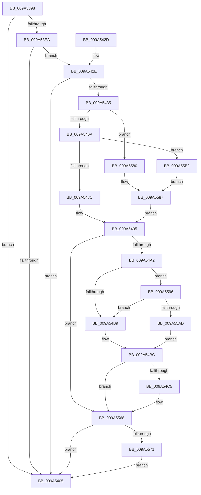

# AstLogDeviceCreated

- RVA: `0x009A5398`–`0x009A55BB` (길이 `547` bytes)
- VA: `0x00000001409A5398`
- 실행 섹션: `PAGE`
- PDB 이름 있음: `예`; PDB Function 태그: `아니요`
- unwind 정보 RVA: `0x0009C600`
- 디코드: `127`개 명령, `547/547` bytes 표시
- 미해석 바이트: `0` (있으면 어셈블리에 `.byte`로 보존)

> 이 문서는 커널 이미지의 기계어와 PDB 기호를 분석해 생성했습니다. 4번과 5번은 함수 원형과 자료형을 바이너리 사용 방식에서 추정한 C 해석이며 원본 소스 복구 결과는 아닙니다.

## 1. Dependencies

- 직접 호출 지점: **8**; 고유 호출 대상: **7**
- 직접 호출자로 확인된 함수: **1**
- RIP 상대 이미지 참조: **7**

### Outgoing calls
- `0x009A53E1` → [AstIsRecording](AstIsRecording_function_009A55D0.md) (function, `0x009A55D0`)
- `0x009A53F9` → [ObQueryNameStringMode](../8A/ObQueryNameStringMode_function_008A7ED0.md) (function, `0x008A7ED0`)
- `0x009A540C` → [_security_check_cookie](../../text/6A/_security_check_cookie_function_006AC640.md) (function, `0x006AC640`)
- `0x009A5459` → [ExAllocatePool3](../../poolcode/B8/ExAllocatePool3_function_00B84270.md) (function, `0x00B84270`)
- `0x009A547F` → [ObQueryNameStringMode](../8A/ObQueryNameStringMode_function_008A7ED0.md) (function, `0x008A7ED0`)
- `0x009A5563` → [tlgWriteTransfer_EtwWriteTransfer](../../text/42/tlgWriteTransfer_EtwWriteTransfer_function_004260E0.md) (function, `0x004260E0`)
- `0x009A5576` → [ExFreePoolWithTag](../../poolcode/B8/ExFreePoolWithTag_function_00B82870.md) (function, `0x00B82870`)
- `0x009A558C` → [RtlInitUnicodeString](../../text/42/RtlInitUnicodeString_function_0042A780.md) (function, `0x0042A780`)

### Direct callers
- [IoCreateDevice](IoCreateDevice_function_009A4B00.md) at `0x009A4E40`

### Static image references
- `0x009A53B6` → RVA `0x00E0A740` (`.data`; read)
- `0x009A5495` → RVA `0x00E06F10` (`.data`; read)
- `0x009A54AC` → RVA `0x00E06F20` (`.data`; read)
- `0x009A553D` → RVA `0x00046C7E` (`.rdata`; read)
- `0x009A5580` → RVA `0x00AFD0F0` (` ?? ::NNGAKEGL::`string'`; read)
- `0x009A5596` → RVA `0x00E06F28` (`.data`; read)
- `0x009A55B2` → RVA `0x00AFD0D0` (` ?? ::NNGAKEGL::`string'`; read)

## 2. Other-region calls and transfers

- 다른 실행 섹션으로 향하는 call: **5**
  - `0x009A540C` → [_security_check_cookie](../../text/6A/_security_check_cookie_function_006AC640.md) (`PAGE` → `.text`)
  - `0x009A5459` → [ExAllocatePool3](../../poolcode/B8/ExAllocatePool3_function_00B84270.md) (`PAGE` → `POOLCODE`)
  - `0x009A5563` → [tlgWriteTransfer_EtwWriteTransfer](../../text/42/tlgWriteTransfer_EtwWriteTransfer_function_004260E0.md) (`PAGE` → `.text`)
  - `0x009A5576` → [ExFreePoolWithTag](../../poolcode/B8/ExFreePoolWithTag_function_00B82870.md) (`PAGE` → `POOLCODE`)
  - `0x009A558C` → [RtlInitUnicodeString](../../text/42/RtlInitUnicodeString_function_0042A780.md) (`PAGE` → `.text`)
- 별도 외부 분기/꼬리 이동을 확인하지 못했습니다.

## 3. Assembly (complete function range)

```asm
009A5398  48 89 5C 24 10                  mov qword ptr [rsp + 0x10], rbx
009A539D  48 89 74 24 18                  mov qword ptr [rsp + 0x18], rsi
009A53A2  55                              push rbp
009A53A3  57                              push rdi
009A53A4  41 54                           push r12
009A53A6  41 56                           push r14
009A53A8  41 57                           push r15
009A53AA  48 8D 6C 24 C9                  lea rbp, [rsp - 0x37]
009A53AF  48 81 EC 00 01 00 00            sub rsp, 0x100
009A53B6  48 8B 05 83 53 46 00            mov rax, qword ptr [rip + 0x465383]
009A53BD  48 33 C4                        xor rax, rsp
009A53C0  48 89 45 27                     mov qword ptr [rbp + 0x27], rax
009A53C4  45 33 E4                        xor r12d, r12d
009A53C7  0F 57 C0                        xorps xmm0, xmm0
009A53CA  0F 11 44 24 40                  movups xmmword ptr [rsp + 0x40], xmm0
009A53CF  44 89 64 24 30                  mov dword ptr [rsp + 0x30], r12d
009A53D4  45 8B F0                        mov r14d, r8d
009A53D7  44 89 65 93                     mov dword ptr [rbp - 0x6d], r12d
009A53DB  44 8B FA                        mov r15d, edx
009A53DE  48 8B F1                        mov rsi, rcx
009A53E1  E8 EA 01 00 00                  call 0x1409a55d0
009A53E6  84 C0                           test al, al
009A53E8  74 1B                           je 0x1409a5405
009A53EA  4C 8D 4C 24 30                  lea r9, [rsp + 0x30]
009A53EF  44 88 64 24 20                  mov byte ptr [rsp + 0x20], r12b
009A53F4  45 33 C0                        xor r8d, r8d
009A53F7  33 D2                           xor edx, edx
009A53F9  E8 D2 2A F0 FF                  call 0x1408a7ed0
009A53FE  83 7C 24 30 10                  cmp dword ptr [rsp + 0x30], 0x10
009A5403  77 29                           ja 0x1409a542e
009A5405  48 8B 4D 27                     mov rcx, qword ptr [rbp + 0x27]
009A5409  48 33 CC                        xor rcx, rsp
009A540C  E8 2F 72 D0 FF                  call 0x1406ac640
009A5411  4C 8D 9C 24 00 01 00 00         lea r11, [rsp + 0x100]
009A5419  49 8B 5B 38                     mov rbx, qword ptr [r11 + 0x38]
009A541D  49 8B 73 40                     mov rsi, qword ptr [r11 + 0x40]
009A5421  49 8B E3                        mov rsp, r11
009A5424  41 5F                           pop r15
009A5426  41 5E                           pop r14
009A5428  41 5C                           pop r12
009A542A  5F                              pop rdi
009A542B  5D                              pop rbp
009A542C  C3                              ret
009A542D  CC                              int3
009A542E  3D 04 00 00 C0                  cmp eax, 0xc0000004
009A5433  75 D0                           jne 0x1409a5405
009A5435  8B 54 24 30                     mov edx, dword ptr [rsp + 0x30]
009A5439  4C 8D 4D 87                     lea r9, [rbp - 0x79]
009A543D  BF 01 00 00 00                  mov edi, 1
009A5442  4C 89 65 8F                     mov qword ptr [rbp - 0x71], r12
009A5446  B9 00 01 00 00                  mov ecx, 0x100
009A544B  48 89 7D 87                     mov qword ptr [rbp - 0x79], rdi
009A544F  41 B8 41 63 44 6E               mov r8d, 0x6e446341
009A5455  89 7C 24 20                     mov dword ptr [rsp + 0x20], edi
009A5459  E8 12 EE 1D 00                  call 0x140b84270
009A545E  48 8B D8                        mov rbx, rax
009A5461  48 85 C0                        test rax, rax
009A5464  0F 84 16 01 00 00               je 0x1409a5580
009A546A  44 8B 44 24 30                  mov r8d, dword ptr [rsp + 0x30]
009A546F  4C 8D 4C 24 30                  lea r9, [rsp + 0x30]
009A5474  48 8B D0                        mov rdx, rax
009A5477  44 88 64 24 20                  mov byte ptr [rsp + 0x20], r12b
009A547C  48 8B CE                        mov rcx, rsi
009A547F  E8 4C 2A F0 FF                  call 0x1408a7ed0
009A5484  85 C0                           test eax, eax
009A5486  0F 88 26 01 00 00               js 0x1409a55b2
009A548C  0F 10 03                        movups xmm0, xmmword ptr [rbx]
009A548F  F3 0F 7F 44 24 40               movdqu xmmword ptr [rsp + 0x40], xmm0
009A5495  83 3D 74 1A 46 00 05            cmp dword ptr [rip + 0x461a74], 5
009A549C  0F 86 C6 00 00 00               jbe 0x1409a5568
009A54A2  48 BA 00 00 00 00 00 20 00 00   movabs rdx, 0x200000000000
009A54AC  48 85 15 6D 1A 46 00            test qword ptr [rip + 0x461a6d], rdx
009A54B3  0F 85 DD 00 00 00               jne 0x1409a5596
009A54B9  41 8A FC                        mov dil, r12b
009A54BC  40 84 FF                        test dil, dil
009A54BF  0F 84 A3 00 00 00               je 0x1409a5568
009A54C5  BA 08 00 00 00                  mov edx, 8
009A54CA  48 C7 45 DF 02 00 00 00         mov qword ptr [rbp - 0x21], 2
009A54D2  B8 00 00 00 80                  mov eax, 0x80000000
009A54D7  48 89 55 CF                     mov qword ptr [rbp - 0x31], rdx
009A54DB  48 89 45 97                     mov qword ptr [rbp - 0x69], rax
009A54DF  48 8D 0D 2A 1A 46 00            lea rcx, [rip + 0x461a2a]
009A54E6  48 8D 45 97                     lea rax, [rbp - 0x69]
009A54EA  48 89 55 1F                     mov qword ptr [rbp + 0x1f], rdx
009A54EE  48 89 45 C7                     mov qword ptr [rbp - 0x39], rax
009A54F2  45 33 C9                        xor r9d, r9d
009A54F5  48 8D 45 EF                     lea rax, [rbp - 0x11]
009A54F9  44 89 65 F3                     mov dword ptr [rbp - 0xd], r12d
009A54FD  48 89 45 D7                     mov qword ptr [rbp - 0x29], rax
009A5501  45 33 C0                        xor r8d, r8d
009A5504  48 8B 44 24 48                  mov rax, qword ptr [rsp + 0x48]
009A5509  48 89 45 E7                     mov qword ptr [rbp - 0x19], rax
009A550D  0F B7 44 24 40                  movzx eax, word ptr [rsp + 0x40]
009A5512  89 45 EF                        mov dword ptr [rbp - 0x11], eax
009A5515  48 8D 44 24 34                  lea rax, [rsp + 0x34]
009A551A  48 89 45 F7                     mov qword ptr [rbp - 9], rax
009A551E  48 8D 44 24 38                  lea rax, [rsp + 0x38]
009A5523  48 89 45 07                     mov qword ptr [rbp + 7], rax
009A5527  48 8D 44 24 40                  lea rax, [rsp + 0x40]
009A552C  48 89 45 17                     mov qword ptr [rbp + 0x17], rax
009A5530  48 8D 45 A7                     lea rax, [rbp - 0x59]
009A5534  48 89 44 24 28                  mov qword ptr [rsp + 0x28], rax
009A5539  89 54 24 20                     mov dword ptr [rsp + 0x20], edx
009A553D  48 8D 15 3A 17 6A FF            lea rdx, [rip - 0x95e8c6]
009A5544  44 89 7C 24 34                  mov dword ptr [rsp + 0x34], r15d
009A5549  48 C7 45 FF 04 00 00 00         mov qword ptr [rbp - 1], 4
009A5551  44 89 74 24 38                  mov dword ptr [rsp + 0x38], r14d
009A5556  48 C7 45 0F 04 00 00 00         mov qword ptr [rbp + 0xf], 4
009A555E  48 89 74 24 40                  mov qword ptr [rsp + 0x40], rsi
009A5563  E8 78 0B A8 FF                  call 0x1404260e0
009A5568  48 85 DB                        test rbx, rbx
009A556B  0F 84 94 FE FF FF               je 0x1409a5405
009A5571  33 D2                           xor edx, edx
009A5573  48 8B CB                        mov rcx, rbx
009A5576  E8 F5 D2 1D 00                  call 0x140b82870
009A557B  E9 85 FE FF FF                  jmp 0x1409a5405
009A5580  48 8D 15 69 7B 15 00            lea rdx, [rip + 0x157b69]
009A5587  48 8D 4C 24 40                  lea rcx, [rsp + 0x40]
009A558C  E8 EF 51 A8 FF                  call 0x14042a780
009A5591  E9 FF FE FF FF                  jmp 0x1409a5495
009A5596  48 8B 05 8B 19 46 00            mov rax, qword ptr [rip + 0x46198b]
009A559D  48 23 C2                        and rax, rdx
009A55A0  48 3B 05 81 19 46 00            cmp rax, qword ptr [rip + 0x461981]
009A55A7  0F 85 0C FF FF FF               jne 0x1409a54b9
009A55AD  E9 0A FF FF FF                  jmp 0x1409a54bc
009A55B2  48 8D 15 17 7B 15 00            lea rdx, [rip + 0x157b17]
009A55B9  EB CC                           jmp 0x1409a5587
```

## 4. C-style interpretation (structured pseudocode)

```c
__int64 __fastcall AstLogDeviceCreated(__int64 a1, int a2, int a3)
{
    __int64 result;
    __int64 v_r12;
    __int64 v_rsp;
    unsigned __int8 v_stack_m108;
    unsigned __int64 v_stack_m28;
    unsigned __int64 v_stack_m38;
    unsigned __int64 v_stack_m40;
    unsigned __int64 v_stack_m48;
    unsigned __int64 v_stack_m50;
    unsigned __int64 v_stack_m58;
    unsigned __int64 v_stack_m5F;
    unsigned __int64 v_stack_m60;
    unsigned __int64 v_stack_m68;
    unsigned int v_stack_m6C;
    unsigned __int64 v_stack_m70;
    unsigned __int64 v_stack_m78;
    unsigned __int64 v_stack_m80;
    unsigned __int64 v_stack_m88;
    unsigned __int64 v_stack_m90;
    unsigned __int64 v_stack_m98;
    unsigned __int64 v_stack_mB8;
    unsigned __int64 v_stack_mC0;
    unsigned __int64 v_stack_mC8;
    unsigned int v_stack_mCC;
    unsigned int v_stack_mD0;
    unsigned __int64 v_stack_mD8;
    unsigned int v_stack_mE0;
    unsigned __int64 v_stack_mE8;
    unsigned int v_stack_mF8;
    unsigned __int64 v_stack_p10;
    unsigned __int64 v_stack_p18;

    v_stack_p10 = v_rbx;
    v_stack_p18 = v_rsi;
    v_rsp = (v_rsp) - (256);
    result = (*(unsigned __int64 *)(v_rip + 4608899)) ^ (v_rsp);
    v_stack_m38 = result;
    v_r12 = 0;
    v_stack_mE8 = v_xmm0;
    v_stack_mF8 = 0;
    v_stack_mCC = 0;
    result = AstIsRecording(a1, a2, a3, a4);
    if ((unsigned __int8)(result) == 0) goto loc_009A5405;
    v_stack_m108 = 0;
    a3 = 0;
    a2 = 0;
    result = ObQueryNameStringMode(a1, a2, a3, v_stack_mF8);
    if (v_stack_mF8 > 16) goto loc_009A542E;
loc_009A5405:
    a1 = (v_stack_m38) ^ (v_rsp);
    result = _security_check_cookie(a1, a2, a3, v_stack_mF8);
    return result;
loc_009A542E:
    if (((unsigned int)(result)) != 0xC0000004ULL) goto loc_009A5405;
    v_stack_mD0 = 0;
    v_stack_mD8 = 1;
    v_stack_mE0 = 1;
    result = ExAllocatePool3(256, (unsigned int)(v_stack_mD0), (unsigned int)(0x6E446341ULL), v_stack_mD8);
    if (result == 0) goto loc_009A5580;
    v_stack_mE0 = 0;
    result = ObQueryNameStringMode(*(unsigned __int64 *)(v_stack_m28 + 64), result, (unsigned int)(v_stack_mD0), v_stack_mD0);
    if (sign_flag) goto loc_009A55B2;
    v_stack_mC0 = v_xmm0;
loc_009A5495:
    if ((*(unsigned int *)(v_rip + 4594292)) <= 5) goto loc_009A5568;
    if (((*(unsigned __int64 *)(v_rip + 4594285)) & (result)) != 0) goto loc_009A5596;
loc_009A54B9:
loc_009A54BC:
    if (0 != 0) {
        a2 = 8;
        v_stack_m80 = 2;
        result = 0x80000000ULL;
        v_stack_m90 = a2;
        v_stack_mC8 = result;
        a1 = v_rip + 4594218;
        result = v_stack_mC8;
        v_stack_m40 = a2;
        v_stack_m98 = result;
        a4 = 0;
        result = v_stack_m70;
        v_stack_m6C = 0;
        v_stack_m88 = result;
        a3 = 0;
        result = v_stack_mB8;
        v_stack_m78 = result;
        result = v_stack_mC0;
        v_stack_m70 = (unsigned int)(result);
        result = v_stack_mCC;
        v_stack_m68 = result;
        result = v_stack_mC8;
        v_stack_m58 = result;
        result = v_stack_mC0;
        v_stack_m48 = result;
        result = v_stack_mB8;
        v_stack_mD8 = result;
        v_stack_mE0 = a2;
        a2 = v_rip - 9824454;
        v_stack_mCC = (unsigned int)((unsigned int)(a2));
        v_stack_m60 = 4;
        v_stack_mC8 = (unsigned int)((unsigned int)(a3));
        v_stack_m50 = 4;
        v_stack_mC0 = *(unsigned __int64 *)(v_stack_m28 + 64);
        result = tlgWriteTransfer_EtwWriteTransfer(a1, a2, a3, a4);
    }
    if (result == 0) goto loc_009A5405;
    a2 = 0;
    result = ExFreePoolWithTag(result, a2, a3, a4);
    goto loc_009A5405;
loc_009A5580:
loc_009A5587:
    result = RtlInitUnicodeString(v_stack_mC0, v_rip + 1407849, a3, a4);
    goto loc_009A5495;
loc_009A5596:
    result = (*(unsigned __int64 *)(v_rip + 4594059)) & (v_rip + 1407849);
    if (result != (*(unsigned __int64 *)(v_rip + 4594049))) goto loc_009A54B9;
    goto loc_009A54BC;
loc_009A55B2:
    goto loc_009A5587;
}
```

## 5. (Beta) C Style

```c
int64_t AstLogDeviceCreated(int64_t Arg1, int32_t Arg2, int32_t Arg3)
{
    int64_t result;
    int64_t local_r12;
    int64_t local_rsp;
    uint8_t v_stack_m108;
    uint64_t v_stack_m28;
    uint64_t v_stack_m38;
    uint64_t v_stack_m40;
    uint64_t v_stack_m48;
    uint64_t v_stack_m50;
    uint64_t v_stack_m58;
    uint64_t v_stack_m5F;
    uint64_t v_stack_m60;
    uint64_t v_stack_m68;
    uint32_t v_stack_m6C;
    uint64_t v_stack_m70;
    uint64_t v_stack_m78;
    uint64_t v_stack_m80;
    uint64_t v_stack_m88;
    uint64_t v_stack_m90;
    uint64_t v_stack_m98;
    uint64_t v_stack_mB8;
    uint64_t v_stack_mC0;
    uint64_t v_stack_mC8;
    uint32_t v_stack_mCC;
    uint32_t v_stack_mD0;
    uint64_t v_stack_mD8;
    uint32_t v_stack_mE0;
    uint64_t v_stack_mE8;
    uint32_t v_stack_mF8;
    uint64_t v_stack_p10;
    uint64_t v_stack_p18;

    v_stack_p10 = local_rbx;
    v_stack_p18 = local_rsi;
    local_rsp = (local_rsp) - (256);
    result = (*(uint64_t *)(v_rip + 0x465383)) ^ (local_rsp);
    v_stack_m38 = result;
    local_r12 = 0;
    v_stack_mE8 = v_xmm0;
    v_stack_mF8 = 0;
    v_stack_mCC = 0;
    result = AstIsRecording(Arg1, Arg2, Arg3, a4);
    if ((uint8_t)(result) == 0) goto loc_009A5405;
    v_stack_m108 = 0;
    Arg3 = 0;
    Arg2 = 0;
    result = ObQueryNameStringMode(Arg1, Arg2, Arg3, v_stack_mF8);
    if (v_stack_mF8 > 16) goto loc_009A542E;
loc_009A5405:
    Arg1 = (v_stack_m38) ^ (local_rsp);
    result = _security_check_cookie(Arg1, Arg2, Arg3, v_stack_mF8);
    return result;
loc_009A542E:
    if (((uint32_t)(result)) != 0xC0000004ULL) goto loc_009A5405;
    v_stack_mD0 = 0;
    v_stack_mD8 = 1;
    v_stack_mE0 = 1;
    result = ExAllocatePool3(256, (uint32_t)(v_stack_mD0), (uint32_t)(0x6E446341ULL), v_stack_mD8);
    if (result == 0) goto loc_009A5580;
    v_stack_mE0 = 0;
    result = ObQueryNameStringMode(*(uint64_t *)(v_stack_m28 + 0x40), result, (uint32_t)(v_stack_mD0), v_stack_mD0);
    if (sign_flag) goto loc_009A55B2;
    v_stack_mC0 = v_xmm0;
loc_009A5495:
    if ((*(uint32_t *)(v_rip + 0x461A74)) <= 5) goto loc_009A5568;
    if (((*(uint64_t *)(v_rip + 0x461A6D)) & (result)) != 0) goto loc_009A5596;
loc_009A54B9:
loc_009A54BC:
    if (0 != 0) {
        Arg2 = 8;
        v_stack_m80 = 2;
        result = 0x80000000ULL;
        v_stack_m90 = Arg2;
        v_stack_mC8 = result;
        Arg1 = v_rip + 4594218;
        result = v_stack_mC8;
        v_stack_m40 = Arg2;
        v_stack_m98 = result;
        a4 = 0;
        result = v_stack_m70;
        v_stack_m6C = 0;
        v_stack_m88 = result;
        Arg3 = 0;
        result = v_stack_mB8;
        v_stack_m78 = result;
        result = v_stack_mC0;
        v_stack_m70 = (uint32_t)(result);
        result = v_stack_mCC;
        v_stack_m68 = result;
        result = v_stack_mC8;
        v_stack_m58 = result;
        result = v_stack_mC0;
        v_stack_m48 = result;
        result = v_stack_mB8;
        v_stack_mD8 = result;
        v_stack_mE0 = Arg2;
        Arg2 = v_rip - 9824454;
        v_stack_mCC = (uint32_t)((uint32_t)(Arg2));
        v_stack_m60 = 4;
        v_stack_mC8 = (uint32_t)((uint32_t)(Arg3));
        v_stack_m50 = 4;
        v_stack_mC0 = *(uint64_t *)(v_stack_m28 + 0x40);
        result = tlgWriteTransfer_EtwWriteTransfer(Arg1, Arg2, Arg3, a4);
    }
    if (result == 0) goto loc_009A5405;
    Arg2 = 0;
    result = ExFreePoolWithTag(result, Arg2, Arg3, a4);
    goto loc_009A5405;
loc_009A5580:
loc_009A5587:
    result = RtlInitUnicodeString(v_stack_mC0, v_rip + 1407849, Arg3, a4);
    goto loc_009A5495;
loc_009A5596:
    result = (*(uint64_t *)(v_rip + 0x46198B)) & (v_rip + 1407849);
    if (result != (*(uint64_t *)(v_rip + 0x461981))) goto loc_009A54B9;
    goto loc_009A54BC;
loc_009A55B2:
    goto loc_009A5587;
}
```

## 6. Execution-region graph

[열기: 2D/3D 그래프와 함수 탐색 컨트롤 패널](../../../control-panel.html?section=page&rva=0x009A5398&view=graph)

- 2D 그래프는 위에서 아래로 흐르고, 3D 그래프는 빈 공간을 드래그해 회전합니다. Shift+드래그는 이동, 휠은 확대·축소, 함수 노드 선택은 대상 보고서 이동입니다.

### Static fallback


