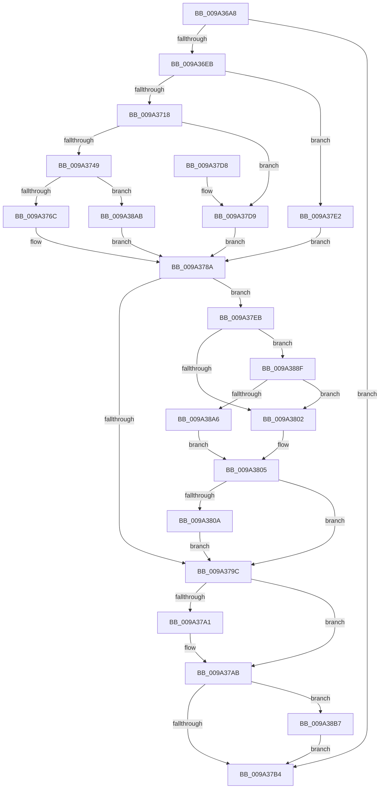

# AstLogDeviceSDDLUpdated

- RVA: `0x009A36A8`–`0x009A38C6` (길이 `542` bytes)
- VA: `0x00000001409A36A8`
- 실행 섹션: `PAGE`
- PDB 이름 있음: `예`; PDB Function 태그: `아니요`
- unwind 정보 RVA: `0x0009C3B4`
- 디코드: `132`개 명령, `542/542` bytes 표시
- 미해석 바이트: `0` (있으면 어셈블리에 `.byte`로 보존)

> 이 문서는 커널 이미지의 기계어와 PDB 기호를 분석해 생성했습니다. 4번과 5번은 함수 원형과 자료형을 바이너리 사용 방식에서 추정한 C 해석이며 원본 소스 복구 결과는 아닙니다.

## 1. Dependencies

- 직접 호출 지점: **10**; 고유 호출 대상: **8**
- 직접 호출자로 확인된 함수: **1**
- RIP 상대 이미지 참조: **8**

### Outgoing calls
- `0x009A36DE` → [AstIsRecording](AstIsRecording_function_009A55D0.md) (function, `0x009A55D0`)
- `0x009A3705` → [ObQuerySecurityObject](ObQuerySecurityObject_function_009A3564.md) (function, `0x009A3564`)
- `0x009A3738` → [ExAllocatePool3](../../poolcode/B8/ExAllocatePool3_function_00B84270.md) (function, `0x00B84270`)
- `0x009A375F` → [ObQuerySecurityObject](ObQuerySecurityObject_function_009A3564.md) (function, `0x009A3564`)
- `0x009A377E` → [SeConvertSecurityDescriptorToStringSecurityDescriptor](../../text/4A/SeConvertSecurityDescriptorToStringSecurityDescriptor_function_004A18B0.md) (function, `0x004A18B0`)
- `0x009A378E` → [RtlInitUnicodeString](../../text/42/RtlInitUnicodeString_function_0042A780.md) (function, `0x0042A780`)
- `0x009A37A6` → [ExFreePoolWithTag](../../poolcode/B8/ExFreePoolWithTag_function_00B82870.md) (function, `0x00B82870`)
- `0x009A37BB` → [_security_check_cookie](../../text/6A/_security_check_cookie_function_006AC640.md) (function, `0x006AC640`)
- `0x009A3885` → [tlgWriteTransfer_EtwWriteTransfer](../../text/42/tlgWriteTransfer_EtwWriteTransfer_function_004260E0.md) (function, `0x004260E0`)
- `0x009A38BC` → [ExFreePoolWithTag](../../poolcode/B8/ExFreePoolWithTag_function_00B82870.md) (function, `0x00B82870`)

### Direct callers
- [IopGetSetSecurityObject](../87/IopGetSetSecurityObject_function_00873A80.md) at `0x00873FE2`
- [IopGetSetSecurityObject](../87/IopGetSetSecurityObject_function_00873A80.md) at `0x0087402E`

### Static image references
- `0x009A36C2` → RVA `0x00E0A740` (`.data`; read)
- `0x009A3793` → RVA `0x00E06F10` (`.data`; read)
- `0x009A37D9` → RVA `0x00AFD0F0` (` ?? ::NNGAKEGL::`string'`; read)
- `0x009A37E2` → RVA `0x00AFD130` (` ?? ::NNGAKEGL::`string'`; read)
- `0x009A37F5` → RVA `0x00E06F20` (`.data`; read)
- `0x009A380E` → RVA `0x00046CF2` (`.rdata`; read)
- `0x009A388F` → RVA `0x00E06F28` (`.data`; read)
- `0x009A38AB` → RVA `0x00AFD0D0` (` ?? ::NNGAKEGL::`string'`; read)

## 2. Other-region calls and transfers

- 다른 실행 섹션으로 향하는 call: **7**
  - `0x009A3738` → [ExAllocatePool3](../../poolcode/B8/ExAllocatePool3_function_00B84270.md) (`PAGE` → `POOLCODE`)
  - `0x009A377E` → [SeConvertSecurityDescriptorToStringSecurityDescriptor](../../text/4A/SeConvertSecurityDescriptorToStringSecurityDescriptor_function_004A18B0.md) (`PAGE` → `.text`)
  - `0x009A378E` → [RtlInitUnicodeString](../../text/42/RtlInitUnicodeString_function_0042A780.md) (`PAGE` → `.text`)
  - `0x009A37A6` → [ExFreePoolWithTag](../../poolcode/B8/ExFreePoolWithTag_function_00B82870.md) (`PAGE` → `POOLCODE`)
  - `0x009A37BB` → [_security_check_cookie](../../text/6A/_security_check_cookie_function_006AC640.md) (`PAGE` → `.text`)
  - `0x009A3885` → [tlgWriteTransfer_EtwWriteTransfer](../../text/42/tlgWriteTransfer_EtwWriteTransfer_function_004260E0.md) (`PAGE` → `.text`)
  - `0x009A38BC` → [ExFreePoolWithTag](../../poolcode/B8/ExFreePoolWithTag_function_00B82870.md) (`PAGE` → `POOLCODE`)
- 별도 외부 분기/꼬리 이동을 확인하지 못했습니다.

## 3. Assembly (complete function range)

```asm
009A36A8  48 89 5C 24 10                  mov qword ptr [rsp + 0x10], rbx
009A36AD  48 89 74 24 18                  mov qword ptr [rsp + 0x18], rsi
009A36B2  55                              push rbp
009A36B3  57                              push rdi
009A36B4  41 56                           push r14
009A36B6  48 8D 6C 24 B9                  lea rbp, [rsp - 0x47]
009A36BB  48 81 EC D0 00 00 00            sub rsp, 0xd0
009A36C2  48 8B 05 77 70 46 00            mov rax, qword ptr [rip + 0x467077]
009A36C9  48 33 C4                        xor rax, rsp
009A36CC  48 89 45 37                     mov qword ptr [rbp + 0x37], rax
009A36D0  83 65 A7 00                     and dword ptr [rbp - 0x59], 0
009A36D4  0F 57 C0                        xorps xmm0, xmm0
009A36D7  0F 11 45 B7                     movups xmmword ptr [rbp - 0x49], xmm0
009A36DB  4C 8B F1                        mov r14, rcx
009A36DE  E8 ED 1E 00 00                  call 0x1409a55d0
009A36E3  84 C0                           test al, al
009A36E5  0F 84 C9 00 00 00               je 0x1409a37b4
009A36EB  48 8D 45 A7                     lea rax, [rbp - 0x59]
009A36EF  33 F6                           xor esi, esi
009A36F1  45 33 C9                        xor r9d, r9d
009A36F4  48 89 75 AF                     mov qword ptr [rbp - 0x51], rsi
009A36F8  45 33 C0                        xor r8d, r8d
009A36FB  48 89 44 24 20                  mov qword ptr [rsp + 0x20], rax
009A3700  83 CA FF                        or edx, 0xffffffff
009A3703  33 DB                           xor ebx, ebx
009A3705  E8 5A FE FF FF                  call 0x1409a3564
009A370A  8D 7B 01                        lea edi, [rbx + 1]
009A370D  3D 23 00 00 C0                  cmp eax, 0xc0000023
009A3712  0F 85 CA 00 00 00               jne 0x1409a37e2
009A3718  8B 55 A7                        mov edx, dword ptr [rbp - 0x59]
009A371B  4C 8D 4D C7                     lea r9, [rbp - 0x39]
009A371F  21 5D D3                        and dword ptr [rbp - 0x2d], ebx
009A3722  B9 00 01 00 00                  mov ecx, 0x100
009A3727  21 5D CF                        and dword ptr [rbp - 0x31], ebx
009A372A  41 B8 41 63 44 73               mov r8d, 0x73446341
009A3730  48 89 7D C7                     mov qword ptr [rbp - 0x39], rdi
009A3734  89 7C 24 20                     mov dword ptr [rsp + 0x20], edi
009A3738  E8 33 0B 1E 00                  call 0x140b84270
009A373D  48 8B D8                        mov rbx, rax
009A3740  48 85 C0                        test rax, rax
009A3743  0F 84 90 00 00 00               je 0x1409a37d9
009A3749  44 8B 4D A7                     mov r9d, dword ptr [rbp - 0x59]
009A374D  48 8D 45 A7                     lea rax, [rbp - 0x59]
009A3751  4C 8B C3                        mov r8, rbx
009A3754  48 89 44 24 20                  mov qword ptr [rsp + 0x20], rax
009A3759  83 CA FF                        or edx, 0xffffffff
009A375C  49 8B CE                        mov rcx, r14
009A375F  E8 00 FE FF FF                  call 0x1409a3564
009A3764  85 C0                           test eax, eax
009A3766  0F 88 3F 01 00 00               js 0x1409a38ab
009A376C  48 21 74 24 20                  and qword ptr [rsp + 0x20], rsi
009A3771  4C 8D 4D AF                     lea r9, [rbp - 0x51]
009A3775  41 83 C8 FF                     or r8d, 0xffffffff
009A3779  8B D7                           mov edx, edi
009A377B  48 8B CB                        mov rcx, rbx
009A377E  E8 2D E1 AF FF                  call 0x1404a18b0
009A3783  48 8B 75 AF                     mov rsi, qword ptr [rbp - 0x51]
009A3787  48 8B D6                        mov rdx, rsi
009A378A  48 8D 4D B7                     lea rcx, [rbp - 0x49]
009A378E  E8 ED 6F A8 FF                  call 0x14042a780
009A3793  83 3D 76 37 46 00 05            cmp dword ptr [rip + 0x463776], 5
009A379A  77 4F                           ja 0x1409a37eb
009A379C  48 85 DB                        test rbx, rbx
009A379F  74 0A                           je 0x1409a37ab
009A37A1  33 D2                           xor edx, edx
009A37A3  48 8B CB                        mov rcx, rbx
009A37A6  E8 C5 F0 1D 00                  call 0x140b82870
009A37AB  48 85 F6                        test rsi, rsi
009A37AE  0F 85 03 01 00 00               jne 0x1409a38b7
009A37B4  48 8B 4D 37                     mov rcx, qword ptr [rbp + 0x37]
009A37B8  48 33 CC                        xor rcx, rsp
009A37BB  E8 80 8E D0 FF                  call 0x1406ac640
009A37C0  4C 8D 9C 24 D0 00 00 00         lea r11, [rsp + 0xd0]
009A37C8  49 8B 5B 28                     mov rbx, qword ptr [r11 + 0x28]
009A37CC  49 8B 73 30                     mov rsi, qword ptr [r11 + 0x30]
009A37D0  49 8B E3                        mov rsp, r11
009A37D3  41 5E                           pop r14
009A37D5  5F                              pop rdi
009A37D6  5D                              pop rbp
009A37D7  C3                              ret
009A37D8  CC                              int3
009A37D9  48 8D 15 10 99 15 00            lea rdx, [rip + 0x159910]
009A37E0  EB A8                           jmp 0x1409a378a
009A37E2  48 8D 15 47 99 15 00            lea rdx, [rip + 0x159947]
009A37E9  EB 9F                           jmp 0x1409a378a
009A37EB  48 BA 00 00 00 00 00 20 00 00   movabs rdx, 0x200000000000
009A37F5  48 85 15 24 37 46 00            test qword ptr [rip + 0x463724], rdx
009A37FC  0F 85 8D 00 00 00               jne 0x1409a388f
009A3802  40 32 FF                        xor dil, dil
009A3805  40 84 FF                        test dil, dil
009A3808  74 92                           je 0x1409a379c
009A380A  83 65 03 00                     and dword ptr [rbp + 3], 0
009A380E  48 8D 15 DD 34 6A FF            lea rdx, [rip - 0x95cb23]
009A3815  83 65 13 00                     and dword ptr [rbp + 0x13], 0
009A3819  B9 08 00 00 00                  mov ecx, 8
009A381E  83 65 23 00                     and dword ptr [rbp + 0x23], 0
009A3822  B8 00 00 00 80                  mov eax, 0x80000000
009A3827  83 65 33 00                     and dword ptr [rbp + 0x33], 0
009A382B  45 33 C9                        xor r9d, r9d
009A382E  48 89 45 AF                     mov qword ptr [rbp - 0x51], rax
009A3832  45 33 C0                        xor r8d, r8d
009A3835  48 8D 45 AF                     lea rax, [rbp - 0x51]
009A3839  89 4D FF                        mov dword ptr [rbp - 1], ecx
009A383C  48 89 45 F7                     mov qword ptr [rbp - 9], rax
009A3840  48 8D 45 A7                     lea rax, [rbp - 0x59]
009A3844  48 89 45 07                     mov qword ptr [rbp + 7], rax
009A3848  48 8D 45 2F                     lea rax, [rbp + 0x2f]
009A384C  48 89 45 17                     mov qword ptr [rbp + 0x17], rax
009A3850  48 8B 45 BF                     mov rax, qword ptr [rbp - 0x41]
009A3854  48 89 45 27                     mov qword ptr [rbp + 0x27], rax
009A3858  0F B7 45 B7                     movzx eax, word ptr [rbp - 0x49]
009A385C  89 45 2F                        mov dword ptr [rbp + 0x2f], eax
009A385F  48 8D 45 D7                     lea rax, [rbp - 0x29]
009A3863  89 4D 0F                        mov dword ptr [rbp + 0xf], ecx
009A3866  48 8D 0D A3 36 46 00            lea rcx, [rip + 0x4636a3]
009A386D  48 89 44 24 28                  mov qword ptr [rsp + 0x28], rax
009A3872  C7 44 24 20 06 00 00 00         mov dword ptr [rsp + 0x20], 6
009A387A  4C 89 75 A7                     mov qword ptr [rbp - 0x59], r14
009A387E  C7 45 1F 02 00 00 00            mov dword ptr [rbp + 0x1f], 2
009A3885  E8 56 28 A8 FF                  call 0x1404260e0
009A388A  E9 0D FF FF FF                  jmp 0x1409a379c
009A388F  48 8B 05 92 36 46 00            mov rax, qword ptr [rip + 0x463692]
009A3896  48 23 C2                        and rax, rdx
009A3899  48 3B 05 88 36 46 00            cmp rax, qword ptr [rip + 0x463688]
009A38A0  0F 85 5C FF FF FF               jne 0x1409a3802
009A38A6  E9 5A FF FF FF                  jmp 0x1409a3805
009A38AB  48 8D 15 1E 98 15 00            lea rdx, [rip + 0x15981e]
009A38B2  E9 D3 FE FF FF                  jmp 0x1409a378a
009A38B7  33 D2                           xor edx, edx
009A38B9  48 8B CE                        mov rcx, rsi
009A38BC  E8 AF EF 1D 00                  call 0x140b82870
009A38C1  E9 EE FE FF FF                  jmp 0x1409a37b4
```

## 4. C-style interpretation (structured pseudocode)

```c
__int64 __fastcall AstLogDeviceSDDLUpdated(__int64 a1, int a2, int a3, int a4)
{
    __int64 result;
    __int64 v_rbx;
    __int64 v_rdi;
    __int64 v_rsi;
    __int64 v_rsp;
    unsigned __int64 v_stack_m18;
    unsigned __int64 v_stack_m28;
    unsigned int v_stack_m2C;
    unsigned __int64 v_stack_m30;
    unsigned __int64 v_stack_m38;
    unsigned int v_stack_m3C;
    unsigned int v_stack_m40;
    unsigned __int64 v_stack_m48;
    unsigned int v_stack_m4C;
    unsigned int v_stack_m50;
    unsigned __int64 v_stack_m58;
    unsigned int v_stack_m5C;
    unsigned __int64 v_stack_m5F;
    unsigned int v_stack_m60;
    unsigned __int64 v_stack_m68;
    unsigned __int64 v_stack_m88;
    unsigned int v_stack_m8C;
    unsigned int v_stack_m90;
    unsigned __int64 v_stack_m98;
    unsigned __int64 v_stack_mA0;
    unsigned __int64 v_stack_mA8;
    unsigned __int64 v_stack_mB0;
    unsigned int v_stack_mB8;
    unsigned __int64 v_stack_mC8;
    unsigned __int64 v_stack_p10;
    unsigned __int64 v_stack_p18;

    v_stack_p10 = v_rbx;
    v_stack_p18 = v_rsi;
    v_rsp = (v_rsp) - (208);
    result = (*(unsigned __int64 *)(v_rip + 4616311)) ^ (v_rsp);
    v_stack_m28 = result;
    v_stack_mA8 = v_xmm0;
    result = AstIsRecording(a1, a2, a3, a4);
    if ((unsigned __int8)(result) == 0) goto loc_009A37B4;
    v_rsi = 0;
    a4 = 0;
    v_stack_mB0 = 0;
    a3 = 0;
    v_stack_mC8 = v_stack_mB8;
    a2 = (unsigned int)((a2) | (0xFFFFFFFFULL));
    v_rbx = 0;
    result = ObQuerySecurityObject(a1, a2, a3, a4);
    if (((unsigned int)(result)) != 0xC0000023ULL) goto loc_009A37E2;
    v_stack_m98 = v_rbx + 1;
    v_stack_mC8 = (unsigned int)(v_rbx + 1);
    result = ExAllocatePool3(256, (unsigned int)(v_stack_mB8), (unsigned int)(0x73446341ULL), v_stack_m98);
    if (result == 0) goto loc_009A37D9;
    v_stack_mC8 = v_stack_mB8;
    a2 = (unsigned int)(((unsigned int)(v_stack_mB8)) | (0xFFFFFFFFULL));
    result = ObQuerySecurityObject(a1, a2, result, (unsigned int)(v_stack_mB8));
    if (sign_flag) goto loc_009A38AB;
    a3 = (unsigned int)((result) | (0xFFFFFFFFULL));
    result = SeConvertSecurityDescriptorToStringSecurityDescriptor(result, (unsigned int)((unsigned int)(v_rbx + 1)), a3, v_stack_mB0);
loc_009A378A:
    result = RtlInitUnicodeString(v_stack_mA8, v_stack_mB0, a3, v_stack_mB0);
    if ((*(unsigned int *)(v_rip + 4601718)) > 5) goto loc_009A37EB;
loc_009A379C:
    if (result != 0) {
        a2 = 0;
        a1 = result;
        result = ExFreePoolWithTag(a1, a2, a3, v_stack_mB0);
    }
    if (v_stack_mB0 != 0) goto loc_009A38B7;
loc_009A37B4:
    a1 = (v_stack_m28) ^ (v_rsp);
    result = _security_check_cookie(a1, a2, a3, v_stack_mB0);
    return result;
loc_009A37D9:
    goto loc_009A378A;
loc_009A37E2:
    goto loc_009A378A;
loc_009A37EB:
    if (((*(unsigned __int64 *)(v_rip + 4601636)) & (v_rip + 1415495)) != 0) goto loc_009A388F;
loc_009A3802:
    v_rdi = 0;
loc_009A3805:
    if (0 == 0) goto loc_009A379C;
    a4 = 0;
    v_stack_mB0 = (unsigned int)(0x80000000ULL);
    a3 = 0;
    v_stack_m60 = 8;
    v_stack_m68 = v_stack_mB0;
    v_stack_m58 = v_stack_mB8;
    v_stack_m48 = v_stack_m30;
    v_stack_m38 = v_stack_mA0;
    v_stack_m30 = (unsigned int)(v_stack_mA8);
    v_stack_m50 = 8;
    v_stack_mA8 = v_stack_m88;
    v_stack_mB0 = 6;
    v_stack_mB8 = a1;
    v_stack_m40 = 2;
    result = tlgWriteTransfer_EtwWriteTransfer(v_rip + 4601507, v_rip - 9816867, a3, a4);
    goto loc_009A379C;
loc_009A388F:
    result = (*(unsigned __int64 *)(v_rip + 4601490)) & (v_rip - 9816867);
    if (result != (*(unsigned __int64 *)(v_rip + 4601480))) goto loc_009A3802;
    goto loc_009A3805;
loc_009A38AB:
    goto loc_009A378A;
loc_009A38B7:
    a2 = 0;
    result = ExFreePoolWithTag(*(unsigned __int64 *)(v_stack_m18 + 48), a2, a3, a4);
    goto loc_009A37B4;
}
```

## 5. (Beta) C Style

```c
int64_t AstLogDeviceSDDLUpdated(int64_t Arg1, int32_t Arg2, int32_t Arg3, int32_t Arg4)
{
    int64_t result;
    int64_t local_rbx;
    int64_t local_rdi;
    int64_t local_rsi;
    int64_t local_rsp;
    uint64_t v_stack_m18;
    uint64_t v_stack_m28;
    uint32_t v_stack_m2C;
    uint64_t v_stack_m30;
    uint64_t v_stack_m38;
    uint32_t v_stack_m3C;
    uint32_t v_stack_m40;
    uint64_t v_stack_m48;
    uint32_t v_stack_m4C;
    uint32_t v_stack_m50;
    uint64_t v_stack_m58;
    uint32_t v_stack_m5C;
    uint64_t v_stack_m5F;
    uint32_t v_stack_m60;
    uint64_t v_stack_m68;
    uint64_t v_stack_m88;
    uint32_t v_stack_m8C;
    uint32_t v_stack_m90;
    uint64_t v_stack_m98;
    uint64_t v_stack_mA0;
    uint64_t v_stack_mA8;
    uint64_t v_stack_mB0;
    uint32_t v_stack_mB8;
    uint64_t v_stack_mC8;
    uint64_t v_stack_p10;
    uint64_t v_stack_p18;

    v_stack_p10 = local_rbx;
    v_stack_p18 = local_rsi;
    local_rsp = (local_rsp) - (208);
    result = (*(uint64_t *)(v_rip + 0x467077)) ^ (local_rsp);
    v_stack_m28 = result;
    v_stack_mA8 = v_xmm0;
    result = AstIsRecording(Arg1, Arg2, Arg3, Arg4);
    if ((uint8_t)(result) == 0) goto loc_009A37B4;
    local_rsi = 0;
    Arg4 = 0;
    v_stack_mB0 = 0;
    Arg3 = 0;
    v_stack_mC8 = v_stack_mB8;
    Arg2 = (uint32_t)((Arg2) | (0xFFFFFFFFULL));
    local_rbx = 0;
    result = ObQuerySecurityObject(Arg1, Arg2, Arg3, Arg4);
    if (((uint32_t)(result)) != 0xC0000023ULL) goto loc_009A37E2;
    v_stack_m98 = local_rbx + 1;
    v_stack_mC8 = (uint32_t)(local_rbx + 1);
    result = ExAllocatePool3(256, (uint32_t)(v_stack_mB8), (uint32_t)(0x73446341ULL), v_stack_m98);
    if (result == 0) goto loc_009A37D9;
    v_stack_mC8 = v_stack_mB8;
    Arg2 = (uint32_t)(((uint32_t)(v_stack_mB8)) | (0xFFFFFFFFULL));
    result = ObQuerySecurityObject(Arg1, Arg2, result, (uint32_t)(v_stack_mB8));
    if (sign_flag) goto loc_009A38AB;
    Arg3 = (uint32_t)((result) | (0xFFFFFFFFULL));
    result = SeConvertSecurityDescriptorToStringSecurityDescriptor(result, (uint32_t)((uint32_t)(local_rbx + 1)), Arg3, v_stack_mB0);
loc_009A378A:
    result = RtlInitUnicodeString(v_stack_mA8, v_stack_mB0, Arg3, v_stack_mB0);
    if ((*(uint32_t *)(v_rip + 0x463776)) > 5) goto loc_009A37EB;
loc_009A379C:
    if (result != 0) {
        Arg2 = 0;
        Arg1 = result;
        result = ExFreePoolWithTag(Arg1, Arg2, Arg3, v_stack_mB0);
    }
    if (v_stack_mB0 != 0) goto loc_009A38B7;
loc_009A37B4:
    Arg1 = (v_stack_m28) ^ (local_rsp);
    result = _security_check_cookie(Arg1, Arg2, Arg3, v_stack_mB0);
    return result;
loc_009A37D9:
    goto loc_009A378A;
loc_009A37E2:
    goto loc_009A378A;
loc_009A37EB:
    if (((*(uint64_t *)(v_rip + 0x463724)) & (v_rip + 1415495)) != 0) goto loc_009A388F;
loc_009A3802:
    local_rdi = 0;
loc_009A3805:
    if (0 == 0) goto loc_009A379C;
    Arg4 = 0;
    v_stack_mB0 = (uint32_t)(0x80000000ULL);
    Arg3 = 0;
    v_stack_m60 = 8;
    v_stack_m68 = v_stack_mB0;
    v_stack_m58 = v_stack_mB8;
    v_stack_m48 = v_stack_m30;
    v_stack_m38 = v_stack_mA0;
    v_stack_m30 = (uint32_t)(v_stack_mA8);
    v_stack_m50 = 8;
    v_stack_mA8 = v_stack_m88;
    v_stack_mB0 = 6;
    v_stack_mB8 = Arg1;
    v_stack_m40 = 2;
    result = tlgWriteTransfer_EtwWriteTransfer(v_rip + 4601507, v_rip - 9816867, Arg3, Arg4);
    goto loc_009A379C;
loc_009A388F:
    result = (*(uint64_t *)(v_rip + 0x463692)) & (v_rip - 9816867);
    if (result != (*(uint64_t *)(v_rip + 0x463688))) goto loc_009A3802;
    goto loc_009A3805;
loc_009A38AB:
    goto loc_009A378A;
loc_009A38B7:
    Arg2 = 0;
    result = ExFreePoolWithTag(*(uint64_t *)(v_stack_m18 + 0x30), Arg2, Arg3, Arg4);
    goto loc_009A37B4;
}
```

## 6. Execution-region graph

[열기: 2D/3D 그래프와 함수 탐색 컨트롤 패널](../../../control-panel.html?section=page&rva=0x009A36A8&view=graph)

- 2D 그래프는 위에서 아래로 흐르고, 3D 그래프는 빈 공간을 드래그해 회전합니다. Shift+드래그는 이동, 휠은 확대·축소, 함수 노드 선택은 대상 보고서 이동입니다.

### Static fallback


