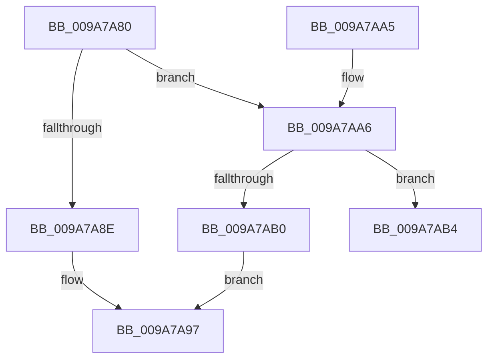

# CcUnpinData

- RVA: `0x009A7A80`–`0x009A7AB8` (길이 `56` bytes)
- VA: `0x00000001409A7A80`
- 실행 섹션: `PAGE`
- PDB 이름 있음: `예`; PDB Function 태그: `예`
- unwind 정보 RVA: `0x0009CC28`
- 디코드: `20`개 명령, `56/56` bytes 표시
- 미해석 바이트: `0` (있으면 어셈블리에 `.byte`로 보존)

> 이 문서는 커널 이미지의 기계어와 PDB 기호를 분석해 생성했습니다. 4번과 5번은 함수 원형과 자료형을 바이너리 사용 방식에서 추정한 C 해석이며 원본 소스 복구 결과는 아닙니다.

## 1. Dependencies

- 직접 호출 지점: **1**; 고유 호출 대상: **1**
- 직접 호출자로 확인된 함수: **8**
- RIP 상대 이미지 참조: **0**

### Outgoing calls
- `0x009A7A9A` → [CcUnpinFileDataEx](../../text/35/CcUnpinFileDataEx_function_00359DEC.md) (function, `0x00359DEC`)

### Direct callers
- [CcUnpinDataForThread](../71/CcUnpinDataForThread_function_00710410.md) at `0x0071043B`
- [CcPinMappedData](../9D/CcPinMappedData_function_009D5B50.md) at `0x009D5D08`
- [CcPreparePinWrite](../A4/CcPreparePinWrite_function_00A4C1C0.md) at `0x00A4C38A`
- [CcPinRead](../A7/CcPinRead_function_00A703B0.md) at `0x00A70586`
- [CcPinMappedData$fin$0](../B1/CcPinMappedData_fin_0_function_00B10B70.md) at `0x00B10B92`
- [CcPreparePinWrite$fin$0](../B1/CcPreparePinWrite_fin_0_function_00B116E6.md) at `0x00B116FE`
- [CcPinRead$fin$0](../B1/CcPinRead_fin_0_function_00B132E1.md) at `0x00B13314`
- [sub_00B2D740](../B2/Unknown_function_00B2D740.md) at `0x00B2D743`

### Static image references
- 디코드된 RIP-relative 메모리 참조가 없습니다.

## 2. Other-region calls and transfers

- 다른 실행 섹션으로 향하는 call: **1**
  - `0x009A7A9A` → [CcUnpinFileDataEx](../../text/35/CcUnpinFileDataEx_function_00359DEC.md) (`PAGE` → `.text`)
- 별도 외부 분기/꼬리 이동을 확인하지 못했습니다.

## 3. Assembly (complete function range)

```asm
009A7A80  40 53                           push rbx
009A7A82  48 83 EC 20                     sub rsp, 0x20
009A7A86  48 8B D9                        mov rbx, rcx
009A7A89  F6 C1 01                        test cl, 1
009A7A8C  74 18                           je 0x1409a7aa6
009A7A8E  48 83 E3 FE                     and rbx, 0xfffffffffffffffe
009A7A92  B2 01                           mov dl, 1
009A7A94  48 8B CB                        mov rcx, rbx
009A7A97  45 33 C0                        xor r8d, r8d
009A7A9A  E8 4D 23 9B FF                  call 0x140359dec
009A7A9F  48 83 C4 20                     add rsp, 0x20
009A7AA3  5B                              pop rbx
009A7AA4  C3                              ret
009A7AA5  CC                              int3
009A7AA6  B8 FA 02 00 00                  mov eax, 0x2fa
009A7AAB  66 39 01                        cmp word ptr [rcx], ax
009A7AAE  74 04                           je 0x1409a7ab4
009A7AB0  33 D2                           xor edx, edx
009A7AB2  EB E3                           jmp 0x1409a7a97
009A7AB4  48 8B 41 10                     mov rax, qword ptr [rcx + 0x10]
```

## 4. C-style interpretation (structured pseudocode)

```c
__int64 __fastcall CcUnpinData(__int64 a1, __int64 a2, int a3)
{
    __int64 result;
    __int64 v_rbx;
    __int64 v_rsp;

    v_rsp = (v_rsp) - (32);
    if ((((unsigned __int8)(a1)) & (1)) == 0) goto loc_009A7AA6;
    v_rbx = (a1) & (-2);
loc_009A7A97:
    a3 = 0;
    result = CcUnpinFileDataEx(v_rbx, 1, a3, a4);
    v_rsp = (v_rsp) + (32);
    return result;
loc_009A7AA6:
    if ((*(unsigned __int16 *)(v_rbx)) == 762) goto loc_009A7AB4;
    a2 = 0;
    goto loc_009A7A97;
loc_009A7AB4:
    return *(unsigned __int64 *)(v_rbx + 16);
}
```

## 5. (Beta) C Style

```c
int64_t CcUnpinData(int64_t Arg1, int64_t Arg2, int32_t Arg3)
{
    int64_t result;
    int64_t local_rbx;
    int64_t local_rsp;

    local_rsp = (local_rsp) - (32);
    if ((((uint8_t)(Arg1)) & (1)) == 0) goto loc_009A7AA6;
    local_rbx = (Arg1) & (-2);
loc_009A7A97:
    Arg3 = 0;
    result = CcUnpinFileDataEx(local_rbx, 1, Arg3, a4);
    local_rsp = (local_rsp) + (32);
    return result;
loc_009A7AA6:
    if ((*(uint16_t *)(local_rbx)) == 762) goto loc_009A7AB4;
    Arg2 = 0;
    goto loc_009A7A97;
loc_009A7AB4:
    return *(uint64_t *)(local_rbx + 0x10);
}
```

## 6. Execution-region graph

[열기: 2D/3D 그래프와 함수 탐색 컨트롤 패널](../../../control-panel.html?section=page&rva=0x009A7A80&view=graph)

- 2D 그래프는 위에서 아래로 흐르고, 3D 그래프는 빈 공간을 드래그해 회전합니다. Shift+드래그는 이동, 휠은 확대·축소, 함수 노드 선택은 대상 보고서 이동입니다.

### Static fallback


