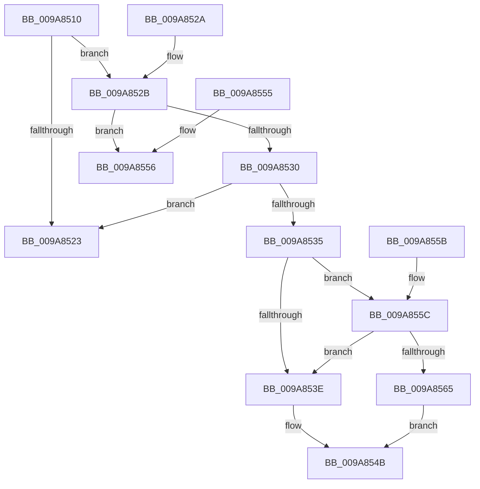

# CmRmIsKCBVisible

- RVA: `0x009A8510`–`0x009A856D` (길이 `93` bytes)
- VA: `0x00000001409A8510`
- 실행 섹션: `PAGE`
- PDB 이름 있음: `예`; PDB Function 태그: `아니요`
- unwind 정보 RVA: `0x0009CEB0`
- 디코드: `33`개 명령, `93/93` bytes 표시
- 미해석 바이트: `0` (있으면 어셈블리에 `.byte`로 보존)

> 이 문서는 커널 이미지의 기계어와 PDB 기호를 분석해 생성했습니다. 4번과 5번은 함수 원형과 자료형을 바이너리 사용 방식에서 추정한 C 해석이며 원본 소스 복구 결과는 아닙니다.

## 1. Dependencies

- 직접 호출 지점: **1**; 고유 호출 대상: **1**
- 직접 호출자로 확인된 함수: **1**
- RIP 상대 이미지 참조: **0**

### Outgoing calls
- `0x009A8546` → [CmpTransUowIsEqual](../70/CmpTransUowIsEqual_function_007049CC.md) (function, `0x007049CC`)

### Direct callers
- [CmpFindSubKeyByNumberEx](../84/CmpFindSubKeyByNumberEx_function_0084F1A0.md) at `0x0084F75F`
- [CmpFindSubKeyByNumberEx](../84/CmpFindSubKeyByNumberEx_function_0084F1A0.md) at `0x0084F909`

### Static image references
- 디코드된 RIP-relative 메모리 참조가 없습니다.

## 2. Other-region calls and transfers

- 다른 실행 섹션으로 향하는 call: **0**
- 별도 외부 분기/꼬리 이동을 확인하지 못했습니다.

## 3. Assembly (complete function range)

```asm
009A8510  48 83 EC 28                     sub rsp, 0x28
009A8514  48 8B C2                        mov rax, rdx
009A8517  48 8B 91 F0 00 00 00            mov rdx, qword ptr [rcx + 0xf0]
009A851E  48 85 D2                        test rdx, rdx
009A8521  75 08                           jne 0x1409a852b
009A8523  B0 01                           mov al, 1
009A8525  48 83 C4 28                     add rsp, 0x28
009A8529  C3                              ret
009A852A  CC                              int3
009A852B  48 85 C0                        test rax, rax
009A852E  74 26                           je 0x1409a8556
009A8530  48 3B C2                        cmp rax, rdx
009A8533  74 EE                           je 0x1409a8523
009A8535  48 8B 48 38                     mov rcx, qword ptr [rax + 0x38]
009A8539  48 85 C9                        test rcx, rcx
009A853C  75 1E                           jne 0x1409a855c
009A853E  48 83 C2 58                     add rdx, 0x58
009A8542  48 8D 48 58                     lea rcx, [rax + 0x58]
009A8546  E8 81 C4 D5 FF                  call 0x1407049cc
009A854B  84 C0                           test al, al
009A854D  0F 95 C0                        setne al
009A8550  48 83 C4 28                     add rsp, 0x28
009A8554  C3                              ret
009A8555  CC                              int3
009A8556  48 83 C4 28                     add rsp, 0x28
009A855A  C3                              ret
009A855B  CC                              int3
009A855C  4C 8B 42 38                     mov r8, qword ptr [rdx + 0x38]
009A8560  4D 85 C0                        test r8, r8
009A8563  74 D9                           je 0x1409a853e
009A8565  49 3B C8                        cmp rcx, r8
009A8568  0F 94 C0                        sete al
009A856B  EB DE                           jmp 0x1409a854b
```

## 4. C-style interpretation (structured pseudocode)

```c
__int64 __fastcall CmRmIsKCBVisible(__int64 a1, __int64 a2)
{
    __int64 result;
    __int64 v_rsp;

    v_rsp = (v_rsp) - (40);
    if (*(unsigned __int64 *)(a1 + 240) != 0) goto loc_009A852B;
loc_009A8523:
    v_rsp = (v_rsp) + (40);
    return 1;
loc_009A852B:
    if (1 == 0) goto loc_009A8556;
    if (1 == (*(unsigned __int64 *)(a1 + 240))) goto loc_009A8523;
    if (*(unsigned __int64 *)(1 + 56) != 0) goto loc_009A855C;
loc_009A853E:
    a2 = (*(unsigned __int64 *)(a1 + 240)) + (88);
    result = CmpTransUowIsEqual(1 + 88, a2, a3, a4);
loc_009A854B:
    result = ((unsigned __int8)(result) != 0) ? 1 : 0;
    v_rsp = (v_rsp) + (40);
    return result;
loc_009A8556:
    v_rsp = (v_rsp) + (40);
    return result;
loc_009A855C:
    if (*(unsigned __int64 *)(a2 + 56) == 0) goto loc_009A853E;
    result = ((1 + 88) == (*(unsigned __int64 *)(a2 + 56))) ? 1 : 0;
    goto loc_009A854B;
}
```

## 5. (Beta) C Style

```c
int64_t CmRmIsKCBVisible(void *Arg1, int64_t Arg2)
{
    uint8_t *arg1 = (uint8_t *)Arg1;

    int64_t result;
    int64_t local_rsp;

    local_rsp = (local_rsp) - (40);
    if (*(uint64_t *)(arg1 + 0xF0) != 0) goto loc_009A852B;
loc_009A8523:
    local_rsp = (local_rsp) + (40);
    return 1;
loc_009A852B:
    if (1 == 0) goto loc_009A8556;
    if (1 == (*(uint64_t *)(arg1 + 0xF0))) goto loc_009A8523;
    if (*(uint64_t *)(1 + 0x38) != 0) goto loc_009A855C;
loc_009A853E:
    Arg2 = (*(uint64_t *)(arg1 + 0xF0)) + (88);
    result = CmpTransUowIsEqual(1 + 88, Arg2, a3, a4);
loc_009A854B:
    result = ((uint8_t)(result) != 0) ? 1 : 0;
    local_rsp = (local_rsp) + (40);
    return result;
loc_009A8556:
    local_rsp = (local_rsp) + (40);
    return result;
loc_009A855C:
    if (*(uint64_t *)(Arg2 + 0x38) == 0) goto loc_009A853E;
    result = ((1 + 88) == (*(uint64_t *)(Arg2 + 0x38))) ? 1 : 0;
    goto loc_009A854B;
}
```

### 관측된 메모리 오프셋

구조체 형식이 확인되지 않은 접근은 인자 기준의 오프셋으로만 기록했습니다.

| 기준 인자 | 오프셋 표현 | 폭 (bit) | 접근 |
|---|---:|---:|---|
| `Arg1` | `+ 0xF0` | `64` | `R` |

## 6. Execution-region graph

[열기: 2D/3D 그래프와 함수 탐색 컨트롤 패널](../../../control-panel.html?section=page&rva=0x009A8510&view=graph)

- 2D 그래프는 위에서 아래로 흐르고, 3D 그래프는 빈 공간을 드래그해 회전합니다. Shift+드래그는 이동, 휠은 확대·축소, 함수 노드 선택은 대상 보고서 이동입니다.

### Static fallback


