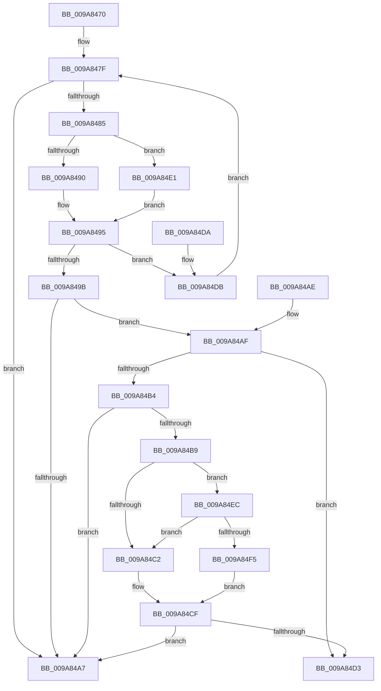

# CmRmIsKcbStackVisible

- RVA: `0x009A8470`–`0x009A84FD` (길이 `141` bytes)
- VA: `0x00000001409A8470`
- 실행 섹션: `PAGE`
- PDB 이름 있음: `예`; PDB Function 태그: `아니요`
- unwind 정보 RVA: `0x0009CEA0`
- 디코드: `46`개 명령, `141/141` bytes 표시
- 미해석 바이트: `0` (있으면 어셈블리에 `.byte`로 보존)

> 이 문서는 커널 이미지의 기계어와 PDB 기호를 분석해 생성했습니다. 4번과 5번은 함수 원형과 자료형을 바이너리 사용 방식에서 추정한 C 해석이며 원본 소스 복구 결과는 아닙니다.

## 1. Dependencies

- 직접 호출 지점: **1**; 고유 호출 대상: **1**
- 직접 호출자로 확인된 함수: **1**
- RIP 상대 이미지 참조: **0**

### Outgoing calls
- `0x009A84CA` → [CmpTransUowIsEqual](../70/CmpTransUowIsEqual_function_007049CC.md) (function, `0x007049CC`)

### Direct callers
- [CmpDoParseKey](../85/CmpDoParseKey_function_0085F750.md) at `0x008607C8`
- [CmpDoParseKey](../85/CmpDoParseKey_function_0085F750.md) at `0x00860F9F`
- [CmpDoParseKey](../85/CmpDoParseKey_function_0085F750.md) at `0x00861281`
- [CmpDoParseKey](../85/CmpDoParseKey_function_0085F750.md) at `0x008612CB`

### Static image references
- 디코드된 RIP-relative 메모리 참조가 없습니다.

## 2. Other-region calls and transfers

- 다른 실행 섹션으로 향하는 call: **0**
- 별도 외부 분기/꼬리 이동을 확인하지 못했습니다.

## 3. Assembly (complete function range)

```asm
009A8470  48 83 EC 28                     sub rsp, 0x28
009A8474  44 0F B7 41 02                  movzx r8d, word ptr [rcx + 2]
009A8479  4C 8B D2                        mov r10, rdx
009A847C  4C 8B C9                        mov r9, rcx
009A847F  66 45 85 C0                     test r8w, r8w
009A8483  78 22                           js 0x1409a84a7
009A8485  49 0F BF C8                     movsx rcx, r8w
009A8489  66 41 83 F8 02                  cmp r8w, 2
009A848E  7D 51                           jge 0x1409a84e1
009A8490  49 8B 4C C9 08                  mov rcx, qword ptr [r9 + rcx*8 + 8]
009A8495  83 79 28 FF                     cmp dword ptr [rcx + 0x28], -1
009A8499  74 40                           je 0x1409a84db
009A849B  48 8B 91 F0 00 00 00            mov rdx, qword ptr [rcx + 0xf0]
009A84A2  48 85 D2                        test rdx, rdx
009A84A5  75 08                           jne 0x1409a84af
009A84A7  B0 01                           mov al, 1
009A84A9  48 83 C4 28                     add rsp, 0x28
009A84AD  C3                              ret
009A84AE  CC                              int3
009A84AF  4D 85 D2                        test r10, r10
009A84B2  74 1F                           je 0x1409a84d3
009A84B4  4C 3B D2                        cmp r10, rdx
009A84B7  74 EE                           je 0x1409a84a7
009A84B9  49 8B 42 38                     mov rax, qword ptr [r10 + 0x38]
009A84BD  48 85 C0                        test rax, rax
009A84C0  75 2A                           jne 0x1409a84ec
009A84C2  48 83 C2 58                     add rdx, 0x58
009A84C6  49 8D 4A 58                     lea rcx, [r10 + 0x58]
009A84CA  E8 FD C4 D5 FF                  call 0x1407049cc
009A84CF  84 C0                           test al, al
009A84D1  75 D4                           jne 0x1409a84a7
009A84D3  32 C0                           xor al, al
009A84D5  48 83 C4 28                     add rsp, 0x28
009A84D9  C3                              ret
009A84DA  CC                              int3
009A84DB  66 41 FF C8                     dec r8w
009A84DF  EB 9E                           jmp 0x1409a847f
009A84E1  49 8B 41 18                     mov rax, qword ptr [r9 + 0x18]
009A84E5  48 8B 4C C8 F0                  mov rcx, qword ptr [rax + rcx*8 - 0x10]
009A84EA  EB A9                           jmp 0x1409a8495
009A84EC  48 8B 4A 38                     mov rcx, qword ptr [rdx + 0x38]
009A84F0  48 85 C9                        test rcx, rcx
009A84F3  74 CD                           je 0x1409a84c2
009A84F5  48 3B C1                        cmp rax, rcx
009A84F8  0F 94 C0                        sete al
009A84FB  EB D2                           jmp 0x1409a84cf
```

## 4. C-style interpretation (structured pseudocode)

```c
__int64 __fastcall CmRmIsKcbStackVisible(__int64 a1, __int64 a2)
{
    __int64 result;
    __int64 v_rsp;

    v_rsp = (v_rsp) - (40);
loc_009A847F:
    if (sign_flag) goto loc_009A84A7;
    if (((unsigned __int16)(*(unsigned __int16 *)(a1 + 2))) >= 2) goto loc_009A84E1;
loc_009A8495:
    if ((*(unsigned int *)(*(unsigned __int64 *)(a1 + (__int16)((unsigned __int16)(*(unsigned __int16 *)(a1 + 2))) * 8 + 8) + 40)) == -1) goto loc_009A84DB;
    if (*(unsigned __int64 *)(*(unsigned __int64 *)(a1 + (__int16)((unsigned __int16)(*(unsigned __int16 *)(a1 + 2))) * 8 + 8) + 240) != 0) goto loc_009A84AF;
loc_009A84A7:
    v_rsp = (v_rsp) + (40);
    return 1;
loc_009A84AF:
    if (a2 == 0) goto loc_009A84D3;
    if (a2 == (*(unsigned __int64 *)(*(unsigned __int64 *)(a1 + (__int16)((unsigned __int16)(*(unsigned __int16 *)(a1 + 2))) * 8 + 8) + 240))) goto loc_009A84A7;
    if (*(unsigned __int64 *)(a2 + 56) != 0) goto loc_009A84EC;
loc_009A84C2:
    a2 = (*(unsigned __int64 *)(*(unsigned __int64 *)(a1 + (__int16)((unsigned __int16)(*(unsigned __int16 *)(a1 + 2))) * 8 + 8) + 240)) + (88);
    result = CmpTransUowIsEqual(a2 + 88, a2, *(unsigned __int16 *)(a1 + 2), a1);
loc_009A84CF:
    if ((unsigned __int8)(result) != 0) goto loc_009A84A7;
loc_009A84D3:
    result = 0;
    v_rsp = (v_rsp) + (40);
    return result;
loc_009A84DB:
    a3 = (unsigned __int16)((*(unsigned __int16 *)(a1 + 2)) - 1);
    goto loc_009A847F;
loc_009A84E1:
    goto loc_009A8495;
loc_009A84EC:
    if (*(unsigned __int64 *)(a2 + 56) == 0) goto loc_009A84C2;
    result = ((*(unsigned __int64 *)(a1 + 24)) == (*(unsigned __int64 *)(a2 + 56))) ? 1 : 0;
    goto loc_009A84CF;
}
```

## 5. (Beta) C Style

```c
int64_t CmRmIsKcbStackVisible(void *Arg1, int64_t Arg2)
{
    uint8_t *arg1 = (uint8_t *)Arg1;

    int64_t result;
    int64_t local_rsp;

    local_rsp = (local_rsp) - (40);
loc_009A847F:
    if (sign_flag) goto loc_009A84A7;
    if (((uint16_t)(*(uint16_t *)(arg1 + 0x2))) >= 2) goto loc_009A84E1;
loc_009A8495:
    if ((*(uint32_t *)(*(uint64_t *)(arg1 + (int16_t)((uint16_t)(*(uint16_t *)(arg1 + 0x2))) * 8 + 0x8) + 0x28)) == -1) goto loc_009A84DB;
    if (*(uint64_t *)(*(uint64_t *)(arg1 + (int16_t)((uint16_t)(*(uint16_t *)(arg1 + 0x2))) * 8 + 0x8) + 0xF0) != 0) goto loc_009A84AF;
loc_009A84A7:
    local_rsp = (local_rsp) + (40);
    return 1;
loc_009A84AF:
    if (Arg2 == 0) goto loc_009A84D3;
    if (Arg2 == (*(uint64_t *)(*(uint64_t *)(arg1 + (int16_t)((uint16_t)(*(uint16_t *)(arg1 + 0x2))) * 8 + 0x8) + 0xF0))) goto loc_009A84A7;
    if (*(uint64_t *)(Arg2 + 0x38) != 0) goto loc_009A84EC;
loc_009A84C2:
    Arg2 = (*(uint64_t *)(*(uint64_t *)(arg1 + (int16_t)((uint16_t)(*(uint16_t *)(arg1 + 0x2))) * 8 + 0x8) + 0xF0)) + (88);
    result = CmpTransUowIsEqual(Arg2 + 88, Arg2, *(uint16_t *)(arg1 + 0x2), Arg1);
loc_009A84CF:
    if ((uint8_t)(result) != 0) goto loc_009A84A7;
loc_009A84D3:
    result = 0;
    local_rsp = (local_rsp) + (40);
    return result;
loc_009A84DB:
    a3 = (uint16_t)((*(uint16_t *)(arg1 + 0x2)) - 1);
    goto loc_009A847F;
loc_009A84E1:
    goto loc_009A8495;
loc_009A84EC:
    if (*(uint64_t *)(Arg2 + 0x38) == 0) goto loc_009A84C2;
    result = ((*(uint64_t *)(arg1 + 0x18)) == (*(uint64_t *)(Arg2 + 0x38))) ? 1 : 0;
    goto loc_009A84CF;
}
```

### 관측된 메모리 오프셋

구조체 형식이 확인되지 않은 접근은 인자 기준의 오프셋으로만 기록했습니다.

| 기준 인자 | 오프셋 표현 | 폭 (bit) | 접근 |
|---|---:|---:|---|
| `Arg1` | `+ 0x2` | `16` | `R` |
| `Arg1` | `+ 0x8 + rcx*8` | `64` | `R` |
| `Arg1` | `+ 0x18` | `64` | `R` |

## 6. Execution-region graph

[열기: 2D/3D 그래프와 함수 탐색 컨트롤 패널](../../../control-panel.html?section=page&rva=0x009A8470&view=graph)

- 2D 그래프는 위에서 아래로 흐르고, 3D 그래프는 빈 공간을 드래그해 회전합니다. Shift+드래그는 이동, 휠은 확대·축소, 함수 노드 선택은 대상 보고서 이동입니다.

### Static fallback


