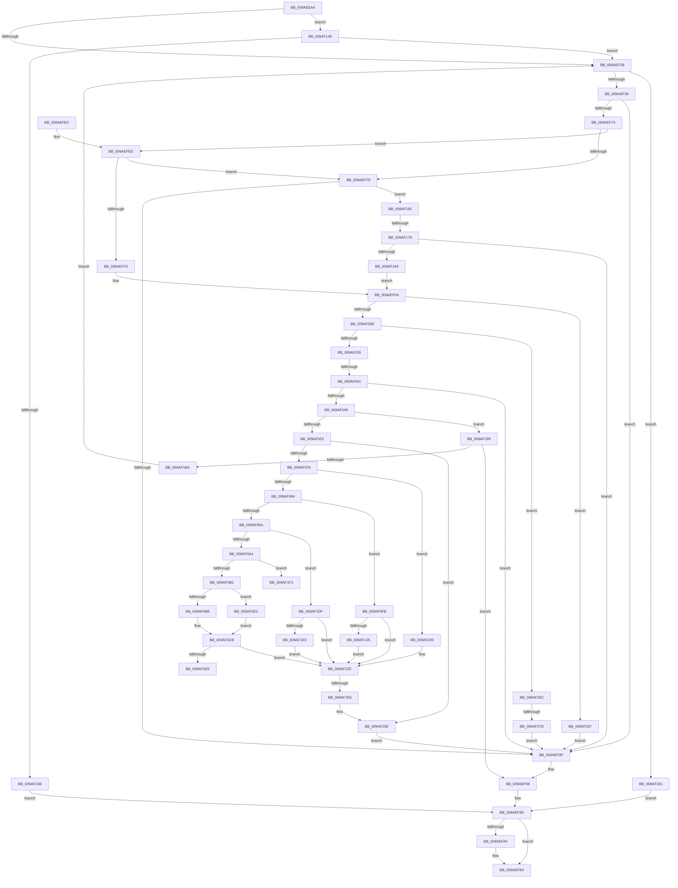

# CmSetKeyFlags

- RVA: `0x009AEEA4`–`0x009AF29B` (길이 `1,015` bytes)
- VA: `0x00000001409AEEA4`
- 실행 섹션: `PAGE`
- PDB 이름 있음: `예`; PDB Function 태그: `예`
- unwind 정보 RVA: `0x0009E048`
- 디코드: `254`개 명령, `1,015/1,015` bytes 표시
- 미해석 바이트: `0` (있으면 어셈블리에 `.byte`로 보존)

> 이 문서는 커널 이미지의 기계어와 PDB 기호를 분석해 생성했습니다. 4번과 5번은 함수 원형과 자료형을 바이너리 사용 방식에서 추정한 C 해석이며 원본 소스 복구 결과는 아닙니다.

## 1. Dependencies

- 직접 호출 지점: **27**; 고유 호출 대상: **24**
- 직접 호출자로 확인된 함수: **1**
- RIP 상대 이미지 참조: **1**

### Outgoing calls
- `0x009AEF0B` → [HvpGetCellContextInitialize](../85/HvpGetCellContextInitialize_function_00855F10.md) (function, `0x00855F10`)
- `0x009AEF1C` → [CmpAttachToRegistryProcess](../../pagecmrc/BC/CmpAttachToRegistryProcess_function_00BC98E0.md) (function, `0x00BC98E0`)
- `0x009AEF2B` → [CmpIsShutdownRundownActive](../../pagecmrc/BC/CmpIsShutdownRundownActive_function_00BC9C20.md) (function, `0x00BC9C20`)
- `0x009AEF45` → [CmpLockRegistry](../../pagecmrc/BC/CmpLockRegistry_function_00BC9B34.md) (function, `0x00BC9B34`)
- `0x009AEF55` → [CmpStartKcbStackForTopLayerKcb](../84/CmpStartKcbStackForTopLayerKcb_function_00848390.md) (function, `0x00848390`)
- `0x009AEF5E` → [CmpLockKcbStackTopExclusiveRestShared](../84/CmpLockKcbStackTopExclusiveRestShared_function_00846B04.md) (function, `0x00846B04`)
- `0x009AEF68` → [CmpPerformKeyBodyDeletionCheck](../../pagecmrc/BC/CmpPerformKeyBodyDeletionCheck_function_00BC97D0.md) (function, `0x00BC97D0`)
- `0x009AEF80` → [CmpTransSearchAddTransFromKeyBody](../87/CmpTransSearchAddTransFromKeyBody_function_008736B8.md) (function, `0x008736B8`)
- `0x009AEF93` → [CmpUnlockKcbStack](../84/CmpUnlockKcbStack_function_00848460.md) (function, `0x00848460`)
- `0x009AEF98` → [CmpUnlockRegistry](../../pagecmrc/BC/CmpUnlockRegistry_function_00BC9A84.md) (function, `0x00BC9A84`)
- `0x009AEFA1` → [CmpDetachFromRegistryProcess](../../pagecmrc/BC/CmpDetachFromRegistryProcess_function_00BC9920.md) (function, `0x00BC9920`)
- `0x009AEFAF` → [CmSiFreeMemory](../../text/47/CmSiFreeMemory_function_00475D80.md) (function, `0x00475D80`)
- `0x009AEFB8` → [CmpCleanupRollbackPacket](../9B/CmpCleanupRollbackPacket_function_009B014C.md) (function, `0x009B014C`)
- `0x009AEFC6` → [_security_check_cookie](../../text/6A/_security_check_cookie_function_006AC640.md) (function, `0x006AC640`)
- `0x009AF000` → [CmpGetEffectiveKcbSemantics](../84/CmpGetEffectiveKcbSemantics_function_00848E20.md) (function, `0x00848E20`)
- `0x009AF02F` → [CmpTryAcquireKcbIXLocks](../9B/CmpTryAcquireKcbIXLocks_function_009B056C.md) (function, `0x009B056C`)
- `0x009AF057` → [HvLockHiveFlusherShared](../84/HvLockHiveFlusherShared_function_0084F95C.md) (function, `0x0084F95C`)
- `0x009AF069` → [HvpMarkCellDirty](../85/HvpMarkCellDirty_function_00858080.md) (function, `0x00858080`)
- `0x009AF082` → [CmpGetKeyNodeForKcb](../85/CmpGetKeyNodeForKcb_function_00856480.md) (function, `0x00856480`)
- `0x009AF182` → [CmpPerformKeyBodyDeletionCheck](../../pagecmrc/BC/CmpPerformKeyBodyDeletionCheck_function_00BC97D0.md) (function, `0x00BC97D0`)
- `0x009AF19D` → [CmpUnlockKcbStack](../84/CmpUnlockKcbStack_function_00848460.md) (function, `0x00848460`)
- `0x009AF1AB` → [CmpPromoteKey](../84/CmpPromoteKey_function_00844388.md) (function, `0x00844388`)
- `0x009AF1BA` → [CmpUnlockRegistry](../../pagecmrc/BC/CmpUnlockRegistry_function_00BC9A84.md) (function, `0x00BC9A84`)
- `0x009AF1C3` → [CmpCleanupKcbStack](../94/CmpCleanupKcbStack_function_009470A0.md) (function, `0x009470A0`)
- `0x009AF259` → [HvpReleaseCellFlat](../85/HvpReleaseCellFlat_function_0085CC20.md) (function, `0x0085CC20`)
- `0x009AF262` → [HvUnlockHiveFlusherShared](../84/HvUnlockHiveFlusherShared_function_00848738.md) (function, `0x00848738`)
- `0x009AF26C` → [CmpAllocateUnitOfWork](../84/CmpAllocateUnitOfWork_function_00844BB0.md) (function, `0x00844BB0`)

### Direct callers
- [sub_00B16010](../B1/Unknown_function_00B16010.md) at `0x00B1601B`

### Static image references
- `0x009AEEC7` → RVA `0x00E0A740` (`.data`; read)

## 2. Other-region calls and transfers

- 다른 실행 섹션으로 향하는 call: **10**
  - `0x009AEF1C` → [CmpAttachToRegistryProcess](../../pagecmrc/BC/CmpAttachToRegistryProcess_function_00BC98E0.md) (`PAGE` → `PAGECMRC`)
  - `0x009AEF2B` → [CmpIsShutdownRundownActive](../../pagecmrc/BC/CmpIsShutdownRundownActive_function_00BC9C20.md) (`PAGE` → `PAGECMRC`)
  - `0x009AEF45` → [CmpLockRegistry](../../pagecmrc/BC/CmpLockRegistry_function_00BC9B34.md) (`PAGE` → `PAGECMRC`)
  - `0x009AEF68` → [CmpPerformKeyBodyDeletionCheck](../../pagecmrc/BC/CmpPerformKeyBodyDeletionCheck_function_00BC97D0.md) (`PAGE` → `PAGECMRC`)
  - `0x009AEF98` → [CmpUnlockRegistry](../../pagecmrc/BC/CmpUnlockRegistry_function_00BC9A84.md) (`PAGE` → `PAGECMRC`)
  - `0x009AEFA1` → [CmpDetachFromRegistryProcess](../../pagecmrc/BC/CmpDetachFromRegistryProcess_function_00BC9920.md) (`PAGE` → `PAGECMRC`)
  - `0x009AEFAF` → [CmSiFreeMemory](../../text/47/CmSiFreeMemory_function_00475D80.md) (`PAGE` → `.text`)
  - `0x009AEFC6` → [_security_check_cookie](../../text/6A/_security_check_cookie_function_006AC640.md) (`PAGE` → `.text`)
  - `0x009AF182` → [CmpPerformKeyBodyDeletionCheck](../../pagecmrc/BC/CmpPerformKeyBodyDeletionCheck_function_00BC97D0.md) (`PAGE` → `PAGECMRC`)
  - `0x009AF1BA` → [CmpUnlockRegistry](../../pagecmrc/BC/CmpUnlockRegistry_function_00BC9A84.md) (`PAGE` → `PAGECMRC`)
- call이 아닌 외부 분기/꼬리 이동: **6**
  - `0x009AF03B` → [sub_00B2D804](../B2/Unknown_function_00B2D804.md) (`tail-transfer`)
  - `0x009AF0DE` → [sub_00B2D804 + 0x59](../B2/Unknown_function_00B2D804.md) (`tail-transfer`)
  - `0x009AF172` → [sub_00B2D804 + 0xFE](../B2/Unknown_function_00B2D804.md) (`tail-transfer`)
  - `0x009AF1FE` → [sub_00B2D804 + 0x59](../B2/Unknown_function_00B2D804.md) (`tail-transfer`)
  - `0x009AF253` → [sub_00B2D804 + 0x65](../B2/Unknown_function_00B2D804.md) (`tail-transfer`)
  - `0x009AF277` → [sub_00B2D804 + 0x70](../B2/Unknown_function_00B2D804.md) (`tail-transfer`)

## 3. Assembly (complete function range)

```asm
009AEEA4  48 8B C4                        mov rax, rsp
009AEEA7  48 89 58 10                     mov qword ptr [rax + 0x10], rbx
009AEEAB  48 89 70 18                     mov qword ptr [rax + 0x18], rsi
009AEEAF  48 89 78 20                     mov qword ptr [rax + 0x20], rdi
009AEEB3  55                              push rbp
009AEEB4  41 54                           push r12
009AEEB6  41 55                           push r13
009AEEB8  41 56                           push r14
009AEEBA  41 57                           push r15
009AEEBC  48 8D 68 A1                     lea rbp, [rax - 0x5f]
009AEEC0  48 81 EC B0 00 00 00            sub rsp, 0xb0
009AEEC7  48 8B 05 72 B8 45 00            mov rax, qword ptr [rip + 0x45b872]
009AEECE  48 33 C4                        xor rax, rsp
009AEED1  48 89 45 2F                     mov qword ptr [rbp + 0x2f], rax
009AEED5  0F 57 C0                        xorps xmm0, xmm0
009AEED8  4C 8B E9                        mov r13, rcx
009AEEDB  45 33 FF                        xor r15d, r15d
009AEEDE  48 8D 4D BF                     lea rcx, [rbp - 0x41]
009AEEE2  83 C8 FF                        or eax, 0xffffffff
009AEEE5  4C 89 7D BF                     mov qword ptr [rbp - 0x41], r15
009AEEE9  0F 11 45 DF                     movups xmmword ptr [rbp - 0x21], xmm0
009AEEED  66 89 45 E1                     mov word ptr [rbp - 0x1f], ax
009AEEF1  45 8B E0                        mov r12d, r8d
009AEEF4  44 8B F2                        mov r14d, edx
009AEEF7  4C 89 7D B7                     mov qword ptr [rbp - 0x49], r15
009AEEFB  0F 11 45 FF                     movups xmmword ptr [rbp - 1], xmm0
009AEEFF  0F 11 45 0F                     movups xmmword ptr [rbp + 0xf], xmm0
009AEF03  0F 11 45 1F                     movups xmmword ptr [rbp + 0x1f], xmm0
009AEF07  0F 11 45 EF                     movups xmmword ptr [rbp - 0x11], xmm0
009AEF0B  E8 00 70 EA FF                  call 0x140855f10
009AEF10  48 8D 4D FF                     lea rcx, [rbp - 1]
009AEF14  44 89 7D C7                     mov dword ptr [rbp - 0x39], r15d
009AEF18  0F 11 45 CF                     movups xmmword ptr [rbp - 0x31], xmm0
009AEF1C  E8 BF A9 21 00                  call 0x140bc98e0
009AEF21  41 83 FE 01                     cmp r14d, 1
009AEF25  0F 84 23 02 00 00               je 0x1409af14e
009AEF2B  E8 F0 AC 21 00                  call 0x140bc9c20
009AEF30  84 C0                           test al, al
009AEF32  0F 85 59 03 00 00               jne 0x1409af291
009AEF38  48 BB 14 00 00 00 80 F7 FF FF   movabs rbx, 0xfffff78000000014
009AEF42  48 8B 1B                        mov rbx, qword ptr [rbx]
009AEF45  E8 EA AB 21 00                  call 0x140bc9b34
009AEF4A  49 8B 75 08                     mov rsi, qword ptr [r13 + 8]
009AEF4E  48 8D 4D DF                     lea rcx, [rbp - 0x21]
009AEF52  48 8B D6                        mov rdx, rsi
009AEF55  E8 36 94 E9 FF                  call 0x140848390
009AEF5A  48 8D 4D DF                     lea rcx, [rbp - 0x21]
009AEF5E  E8 A1 7B E9 FF                  call 0x140846b04
009AEF63  33 D2                           xor edx, edx
009AEF65  49 8B CD                        mov rcx, r13
009AEF68  E8 63 A8 21 00                  call 0x140bc97d0
009AEF6D  8B F8                           mov edi, eax
009AEF6F  85 C0                           test eax, eax
009AEF71  78 1C                           js 0x1409aef8f
009AEF73  4D 39 7D 38                     cmp qword ptr [r13 + 0x38], r15
009AEF77  74 74                           je 0x1409aefed
009AEF79  48 8D 55 B7                     lea rdx, [rbp - 0x49]
009AEF7D  49 8B CD                        mov rcx, r13
009AEF80  E8 33 47 EC FF                  call 0x1408736b8
009AEF85  8B F8                           mov edi, eax
009AEF87  85 C0                           test eax, eax
009AEF89  0F 89 D6 01 00 00               jns 0x1409af165
009AEF8F  48 8D 4D DF                     lea rcx, [rbp - 0x21]
009AEF93  E8 C8 94 E9 FF                  call 0x140848460
009AEF98  E8 E7 AA 21 00                  call 0x140bc9a84
009AEF9D  48 8D 4D FF                     lea rcx, [rbp - 1]
009AEFA1  E8 7A A9 21 00                  call 0x140bc9920
009AEFA6  48 8B 4D F7                     mov rcx, qword ptr [rbp - 9]
009AEFAA  48 85 C9                        test rcx, rcx
009AEFAD  74 05                           je 0x1409aefb4
009AEFAF  E8 CC 6D AC FF                  call 0x140475d80
009AEFB4  48 8D 4D CF                     lea rcx, [rbp - 0x31]
009AEFB8  E8 8F 11 00 00                  call 0x1409b014c
009AEFBD  8B C7                           mov eax, edi
009AEFBF  48 8B 4D 2F                     mov rcx, qword ptr [rbp + 0x2f]
009AEFC3  48 33 CC                        xor rcx, rsp
009AEFC6  E8 75 D6 CF FF                  call 0x1406ac640
009AEFCB  4C 8D 9C 24 B0 00 00 00         lea r11, [rsp + 0xb0]
009AEFD3  49 8B 5B 38                     mov rbx, qword ptr [r11 + 0x38]
009AEFD7  49 8B 73 40                     mov rsi, qword ptr [r11 + 0x40]
009AEFDB  49 8B 7B 48                     mov rdi, qword ptr [r11 + 0x48]
009AEFDF  49 8B E3                        mov rsp, r11
009AEFE2  41 5F                           pop r15
009AEFE4  41 5E                           pop r14
009AEFE6  41 5D                           pop r13
009AEFE8  41 5C                           pop r12
009AEFEA  5D                              pop rbp
009AEFEB  C3                              ret
009AEFEC  CC                              int3
009AEFED  4D 39 7D 40                     cmp qword ptr [r13 + 0x40], r15
009AEFF1  75 86                           jne 0x1409aef79
009AEFF3  4C 8B 7D B7                     mov r15, qword ptr [rbp - 0x49]
009AEFF7  45 33 C9                        xor r9d, r9d
009AEFFA  49 8B D5                        mov rdx, r13
009AEFFD  48 8B CE                        mov rcx, rsi
009AF000  E8 1B 9E E9 FF                  call 0x140848e20
009AF005  83 F8 01                        cmp eax, 1
009AF008  0F 84 79 02 00 00               je 0x1409af287
009AF00E  41 8D 46 FE                     lea eax, [r14 - 2]
009AF012  83 F8 02                        cmp eax, 2
009AF015  4D 0F 46 F9                     cmovbe r15, r9
009AF019  4C 89 7D B7                     mov qword ptr [rbp - 0x49], r15
009AF01D  4D 85 FF                        test r15, r15
009AF020  0F 85 46 02 00 00               jne 0x1409af26c
009AF026  4C 8D 4D CF                     lea r9, [rbp - 0x31]
009AF02A  33 D2                           xor edx, edx
009AF02C  48 8B CE                        mov rcx, rsi
009AF02F  E8 38 15 00 00                  call 0x1409b056c
009AF034  8B F8                           mov edi, eax
009AF036  3D 2D 02 00 C0                  cmp eax, 0xc000022d
009AF03B  0F 84 C3 E7 17 00               je 0x140b2d804
009AF041  85 C0                           test eax, eax
009AF043  0F 88 46 FF FF FF               js 0x1409aef8f
009AF049  83 7E 28 FF                     cmp dword ptr [rsi + 0x28], -1
009AF04D  0F 84 46 01 00 00               je 0x1409af199
009AF053  48 8B 4E 20                     mov rcx, qword ptr [rsi + 0x20]
009AF057  E8 00 09 EA FF                  call 0x14084f95c
009AF05C  8B 56 28                        mov edx, dword ptr [rsi + 0x28]
009AF05F  45 33 C9                        xor r9d, r9d
009AF062  48 8B 4E 20                     mov rcx, qword ptr [rsi + 0x20]
009AF066  45 33 C0                        xor r8d, r8d
009AF069  E8 12 90 EA FF                  call 0x140858080
009AF06E  8B F8                           mov edi, eax
009AF070  85 C0                           test eax, eax
009AF072  0F 88 E6 01 00 00               js 0x1409af25e
009AF078  41 B0 01                        mov r8b, 1
009AF07B  48 8D 55 BF                     lea rdx, [rbp - 0x41]
009AF07F  48 8B CE                        mov rcx, rsi
009AF082  E8 F9 73 EA FF                  call 0x140856480
009AF087  48 8B D0                        mov rdx, rax
009AF08A  41 83 EE 01                     sub r14d, 1
009AF08E  0F 84 6F 01 00 00               je 0x1409af203
009AF094  41 83 EE 01                     sub r14d, 1
009AF098  74 61                           je 0x1409af0fb
009AF09A  41 83 EE 01                     sub r14d, 1
009AF09E  0F 85 3B 01 00 00               jne 0x1409af1df
009AF0A4  0F B7 48 02                     movzx ecx, word ptr [rax + 2]
009AF0A8  41 F6 C4 04                     test r12b, 4
009AF0AC  0F 85 40 01 00 00               jne 0x1409af1f2
009AF0B2  41 F6 C4 01                     test r12b, 1
009AF0B6  74 2B                           je 0x1409af0e3
009AF0B8  B8 00 03 00 00                  mov eax, 0x300
009AF0BD  66 0B C8                        or cx, ax
009AF0C0  66 89 4A 02                     mov word ptr [rdx + 2], cx
009AF0C4  66 09 86 BA 00 00 00            or word ptr [rsi + 0xba], ax
009AF0CB  41 F6 C4 02                     test r12b, 2
009AF0CF  0F 84 5A 01 00 00               je 0x1409af22f
009AF0D5  B8 00 02 00 00                  mov eax, 0x200
009AF0DA  66 09 42 02                     or word ptr [rdx + 2], ax
009AF0DE  E9 7A E7 17 00                  jmp 0x140b2d85d
009AF0E3  41 B8 FF FE 00 00               mov r8d, 0xfeff
009AF0E9  66 41 23 C8                     and cx, r8w
009AF0ED  66 89 48 02                     mov word ptr [rax + 2], cx
009AF0F1  66 44 21 86 BA 00 00 00         and word ptr [rsi + 0xba], r8w
009AF0F9  EB D0                           jmp 0x1409af0cb
009AF0FB  8B 40 34                        mov eax, dword ptr [rax + 0x34]
009AF0FE  41 8B CC                        mov ecx, r12d
009AF101  C1 E1 14                        shl ecx, 0x14
009AF104  33 C8                           xor ecx, eax
009AF106  81 E1 00 00 F0 00               and ecx, 0xf00000
009AF10C  33 C8                           xor ecx, eax
009AF10E  89 4A 34                        mov dword ptr [rdx + 0x34], ecx
009AF111  8B 86 B8 00 00 00               mov eax, dword ptr [rsi + 0xb8]
009AF117  0F B7 4A 36                     movzx ecx, word ptr [rdx + 0x36]
009AF11B  33 C8                           xor ecx, eax
009AF11D  81 E1 F0 00 00 00               and ecx, 0xf0
009AF123  33 C8                           xor ecx, eax
009AF125  89 8E B8 00 00 00               mov dword ptr [rsi + 0xb8], ecx
009AF12B  41 F6 C4 02                     test r12b, 2
009AF12F  0F 84 FA 00 00 00               je 0x1409af22f
009AF135  B8 7F FF 00 00                  mov eax, 0xff7f
009AF13A  66 21 42 02                     and word ptr [rdx + 2], ax
009AF13E  0F B7 42 02                     movzx eax, word ptr [rdx + 2]
009AF142  66 89 86 BA 00 00 00            mov word ptr [rsi + 0xba], ax
009AF149  E9 E1 00 00 00                  jmp 0x1409af22f
009AF14E  41 F7 C4 F0 FF FF FF            test r12d, 0xfffffff0
009AF155  0F 84 D0 FD FF FF               je 0x1409aef2b
009AF15B  BF 0D 00 00 C0                  mov edi, 0xc000000d
009AF160  E9 38 FE FF FF                  jmp 0x1409aef9d
009AF165  48 8B 46 20                     mov rax, qword ptr [rsi + 0x20]
009AF169  8B 88 A0 00 00 00               mov ecx, dword ptr [rax + 0xa0]
009AF16F  F6 C1 02                        test cl, 2
009AF172  0F 85 8A E7 17 00               jne 0x140b2d902
009AF178  4C 8B 7D B7                     mov r15, qword ptr [rbp - 0x49]
009AF17C  49 8B CD                        mov rcx, r13
009AF17F  49 8B D7                        mov rdx, r15
009AF182  E8 49 A6 21 00                  call 0x140bc97d0
009AF187  45 33 C9                        xor r9d, r9d
009AF18A  8B F8                           mov edi, eax
009AF18C  85 C0                           test eax, eax
009AF18E  0F 88 FB FD FF FF               js 0x1409aef8f
009AF194  E9 61 FE FF FF                  jmp 0x1409aeffa
009AF199  48 8D 4D DF                     lea rcx, [rbp - 0x21]
009AF19D  E8 BE 92 E9 FF                  call 0x140848460
009AF1A2  45 33 C0                        xor r8d, r8d
009AF1A5  48 8D 4D DF                     lea rcx, [rbp - 0x21]
009AF1A9  33 D2                           xor edx, edx
009AF1AB  E8 D8 51 E9 FF                  call 0x140844388
009AF1B0  8B F8                           mov edi, eax
009AF1B2  85 C0                           test eax, eax
009AF1B4  0F 88 DE FD FF FF               js 0x1409aef98
009AF1BA  E8 C5 A8 21 00                  call 0x140bc9a84
009AF1BF  48 8D 4D DF                     lea rcx, [rbp - 0x21]
009AF1C3  E8 D8 7E F9 FF                  call 0x1409470a0
009AF1C8  0F 57 C0                        xorps xmm0, xmm0
009AF1CB  83 C8 FF                        or eax, 0xffffffff
009AF1CE  0F 11 45 DF                     movups xmmword ptr [rbp - 0x21], xmm0
009AF1D2  66 89 45 E1                     mov word ptr [rbp - 0x1f], ax
009AF1D6  0F 11 45 EF                     movups xmmword ptr [rbp - 0x11], xmm0
009AF1DA  E9 4C FD FF FF                  jmp 0x1409aef2b
009AF1DF  41 83 FE 01                     cmp r14d, 1
009AF1E3  75 4A                           jne 0x1409af22f
009AF1E5  44 88 60 37                     mov byte ptr [rax + 0x37], r12b
009AF1E9  44 88 A6 B9 00 00 00            mov byte ptr [rsi + 0xb9], r12b
009AF1F0  EB 3D                           jmp 0x1409af22f
009AF1F2  B8 80 00 00 00                  mov eax, 0x80
009AF1F7  66 0B C8                        or cx, ax
009AF1FA  66 89 4A 02                     mov word ptr [rdx + 2], cx
009AF1FE  E9 5A E6 17 00                  jmp 0x140b2d85d
009AF203  8B 40 34                        mov eax, dword ptr [rax + 0x34]
009AF206  41 8B CC                        mov ecx, r12d
009AF209  C1 E1 10                        shl ecx, 0x10
009AF20C  33 C8                           xor ecx, eax
009AF20E  81 E1 00 00 0F 00               and ecx, 0xf0000
009AF214  33 C8                           xor ecx, eax
009AF216  89 4A 34                        mov dword ptr [rdx + 0x34], ecx
009AF219  8B 86 B8 00 00 00               mov eax, dword ptr [rsi + 0xb8]
009AF21F  8B C8                           mov ecx, eax
009AF221  41 33 CC                        xor ecx, r12d
009AF224  83 E1 0F                        and ecx, 0xf
009AF227  33 C8                           xor ecx, eax
009AF229  89 8E B8 00 00 00               mov dword ptr [rsi + 0xb8], ecx
009AF22F  48 89 5A 04                     mov qword ptr [rdx + 4], rbx
009AF233  41 8B FF                        mov edi, r15d
009AF236  48 FF 86 30 01 00 00            inc qword ptr [rsi + 0x130]
009AF23D  48 89 9E A8 00 00 00            mov qword ptr [rsi + 0xa8], rbx
009AF244  48 8B 4E 20                     mov rcx, qword ptr [rsi + 0x20]
009AF248  48 8D 55 BF                     lea rdx, [rbp - 0x41]
009AF24C  F6 81 8C 00 00 00 01            test byte ptr [rcx + 0x8c], 1
009AF253  0F 84 10 E6 17 00               je 0x140b2d869
009AF259  E8 C2 D9 EA FF                  call 0x14085cc20
009AF25E  48 8B 4E 20                     mov rcx, qword ptr [rsi + 0x20]
009AF262  E8 D1 94 E9 FF                  call 0x140848738
009AF267  E9 23 FD FF FF                  jmp 0x1409aef8f
009AF26C  E8 3F 59 E9 FF                  call 0x140844bb0
009AF271  48 8B D8                        mov rbx, rax
009AF274  48 85 C0                        test rax, rax
009AF277  0F 85 F7 E5 17 00               jne 0x140b2d874
009AF27D  BF 9A 00 00 C0                  mov edi, 0xc000009a
009AF282  E9 08 FD FF FF                  jmp 0x1409aef8f
009AF287  BF 22 00 00 C0                  mov edi, 0xc0000022
009AF28C  E9 FE FC FF FF                  jmp 0x1409aef8f
009AF291  BF 89 01 00 C0                  mov edi, 0xc0000189
009AF296  E9 02 FD FF FF                  jmp 0x1409aef9d
```

## 4. C-style interpretation (structured pseudocode)

```c
__int64 __fastcall CmSetKeyFlags(__int64 a1, int a2, int a3, int a4)
{
    __int64 result;
    __int64 v_r14;
    __int64 v_r15;
    __int64 v_rsp;
    unsigned __int64 v_stack_m28;

    *(unsigned __int64 *)(v_rsp + 16) = v_rbx;
    *(unsigned __int64 *)(v_rsp + 24) = v_rsi;
    *(unsigned __int64 *)(v_rsp + 32) = v_rdi;
    v_rsp = (v_rsp) - (176);
    result = (*(unsigned __int64 *)(v_rip + 4569202)) ^ (v_rsp);
    *(unsigned __int64 *)(v_rsp - 95 + 47) = result;
    v_r15 = 0;
    result = (unsigned int)((result) | (0xFFFFFFFFULL));
    *(unsigned __int64 *)(v_rsp - 95 - 65) = 0;
    *(unsigned __int64 *)(v_rsp - 95 - 33) = v_xmm0;
    *(unsigned __int16 *)(v_rsp - 95 - 31) = (unsigned __int16)(result);
    *(unsigned __int64 *)(v_rsp - 95 - 73) = 0;
    *(unsigned __int64 *)(v_rsp - 95 - 1) = v_xmm0;
    *(unsigned __int64 *)(v_rsp - 95 + 15) = v_xmm0;
    *(unsigned __int64 *)(v_rsp - 95 + 31) = v_xmm0;
    *(unsigned __int64 *)(v_rsp - 95 - 17) = v_xmm0;
    result = HvpGetCellContextInitialize(v_rsp - 95 - 65, a2, a3, a4);
    *(unsigned int *)(v_rsp - 95 - 57) = 0;
    *(unsigned __int64 *)(v_rsp - 95 - 49) = v_xmm0;
    result = CmpAttachToRegistryProcess(v_rsp - 95 - 1, a2, a3, a4);
    if (((unsigned int)((unsigned int)(a2))) == 1) goto loc_009AF14E;
loc_009AEF2B:
    result = CmpIsShutdownRundownActive(v_rsp - 95 - 1, a2, a3, a4);
    if ((unsigned __int8)(result) != 0) goto loc_009AF291;
    result = CmpLockRegistry(v_rsp - 95 - 1, a2, a3, a4);
    result = CmpStartKcbStackForTopLayerKcb(v_rsp - 95 - 33, *(unsigned __int64 *)(a1 + 8), a3, a4);
    result = CmpLockKcbStackTopExclusiveRestShared(v_rsp - 95 - 33, *(unsigned __int64 *)(a1 + 8), a3, a4);
    a2 = 0;
    result = CmpPerformKeyBodyDeletionCheck(a1, a2, a3, a4);
    if (sign_flag) goto loc_009AEF8F;
    if ((*(unsigned __int64 *)(a1 + 56)) == 0) goto loc_009AEFED;
loc_009AEF79:
    result = CmpTransSearchAddTransFromKeyBody(a1, v_rsp - 95 - 73, a3, a4);
    if (!sign_flag) goto loc_009AF165;
loc_009AEF8F:
    result = CmpUnlockKcbStack(v_rsp - 95 - 33, v_rsp - 95 - 73, a3, a4);
loc_009AEF98:
    result = CmpUnlockRegistry(v_rsp - 95 - 33, v_rsp - 95 - 73, a3, a4);
loc_009AEF9D:
    result = CmpDetachFromRegistryProcess(v_rsp - 95 - 1, v_rsp - 95 - 73, a3, a4);
    if (*(unsigned __int64 *)(v_rsp - 95 - 9) != 0) {
        result = CmSiFreeMemory(*(unsigned __int64 *)(v_rsp - 95 - 9), v_rsp - 95 - 73, a3, a4);
    }
    result = CmpCleanupRollbackPacket(v_rsp - 95 - 49, v_rsp - 95 - 73, a3, a4);
    a1 = (*(unsigned __int64 *)(v_rsp - 95 + 47)) ^ (v_rsp);
    result = _security_check_cookie(a1, v_rsp - 95 - 73, a3, a4);
    return result;
loc_009AEFED:
    if ((*(unsigned __int64 *)(a1 + 64)) != 0) goto loc_009AEF79;
    a4 = 0;
loc_009AEFFA:
    result = CmpGetEffectiveKcbSemantics(*(unsigned __int64 *)(v_stack_m28 + 64), a1, a3, a4);
    if (((unsigned int)(result)) == 1) goto loc_009AF287;
    v_r15 = *(unsigned __int64 *)(v_rsp - 95 - 73);
    if (((unsigned int)((unsigned int)(a2) - 2)) <= 2) { v_r15 = 0; }
    *(unsigned __int64 *)(v_rsp - 95 - 73) = v_r15;
    if (v_r15 != 0) goto loc_009AF26C;
    a2 = 0;
    result = CmpTryAcquireKcbIXLocks(*(unsigned __int64 *)(v_stack_m28 + 64), a2, a3, v_rsp - 95 - 49);
    if (sign_flag) goto loc_009AEF8F;
    if ((*(unsigned int *)(*(unsigned __int64 *)(v_stack_m28 + 64) + 40)) == -1) goto loc_009AF199;
    result = HvLockHiveFlusherShared(*(unsigned __int64 *)(*(unsigned __int64 *)(v_stack_m28 + 64) + 32), a2, a3, v_rsp - 95 - 49);
    a4 = 0;
    a3 = 0;
    result = HvpMarkCellDirty(*(unsigned __int64 *)(*(unsigned __int64 *)(v_stack_m28 + 64) + 32), (unsigned int)(*(unsigned int *)(*(unsigned __int64 *)(v_stack_m28 + 64) + 40)), a3, a4);
    if (sign_flag) goto loc_009AF25E;
    result = CmpGetKeyNodeForKcb(*(unsigned __int64 *)(v_stack_m28 + 64), v_rsp - 95 - 65, 1, a4);
    v_r14 = (unsigned int)(((unsigned int)(a2)) - (1));
    if (condition_is_equal) goto loc_009AF203;
    v_r14 = (unsigned int)((v_r14) - (1));
    if (condition_is_equal) goto loc_009AF0FB;
    v_r14 = (unsigned int)((v_r14) - (1));
    if (condition_is_not_equal) goto loc_009AF1DF;
    if ((((unsigned __int8)((unsigned int)(a3))) & (4)) != 0) goto loc_009AF1F2;
    if ((((unsigned __int8)((unsigned int)(a3))) & (1)) == 0) goto loc_009AF0E3;
    a1 = (unsigned __int16)((*(unsigned __int16 *)(result + 2)) | (768));
    *(unsigned __int16 *)(result + 2) = (unsigned __int16)(a1);
loc_009AF0CB:
    if ((((unsigned __int8)((unsigned int)(a3))) & (2)) == 0) goto loc_009AF22F;
loc_009AF0E3:
    a1 = (unsigned __int16)((a1) & ((unsigned __int16)((unsigned int)(0xFEFFULL))));
    *(unsigned __int16 *)(512 + 2) = (unsigned __int16)(a1);
    goto loc_009AF0CB;
loc_009AF0FB:
    a1 = (unsigned int)(((unsigned int)((unsigned int)((unsigned int)(a3)))) << (20));
    a1 = (unsigned int)((a1) ^ ((unsigned int)((unsigned int)(*(unsigned int *)(512 + 52)))));
    a1 = (unsigned int)((a1) & (0xF00000ULL));
    a1 = (unsigned int)((a1) ^ ((unsigned int)((unsigned int)(*(unsigned int *)(512 + 52)))));
    *(unsigned int *)(result + 52) = (unsigned int)(a1);
    a1 = (unsigned int)((*(unsigned __int16 *)(result + 54)) ^ ((unsigned int)((unsigned int)(*(unsigned int *)(*(unsigned __int64 *)(v_stack_m28 + 64) + 184)))));
    a1 = (unsigned int)((a1) & (240));
    a1 = (unsigned int)((a1) ^ ((unsigned int)((unsigned int)(*(unsigned int *)(*(unsigned __int64 *)(v_stack_m28 + 64) + 184)))));
    *(unsigned int *)(*(unsigned __int64 *)(v_stack_m28 + 64) + 184) = (unsigned int)(a1);
    if ((((unsigned __int8)((unsigned int)(a3))) & (2)) == 0) goto loc_009AF22F;
    *(unsigned __int16 *)(*(unsigned __int64 *)(v_stack_m28 + 64) + 186) = (unsigned __int16)(*(unsigned __int16 *)(result + 2));
    goto loc_009AF22F;
loc_009AF14E:
    if ((((unsigned int)((unsigned int)(a3))) & (0xFFFFFFF0ULL)) == 0) goto loc_009AEF2B;
    goto loc_009AEF9D;
loc_009AF165:
    result = CmpPerformKeyBodyDeletionCheck(a1, *(unsigned __int64 *)(v_rsp - 95 - 73), (unsigned int)(0xFEFFULL), a4);
    a4 = 0;
    if (sign_flag) goto loc_009AEF8F;
    goto loc_009AEFFA;
loc_009AF199:
    result = CmpUnlockKcbStack(v_rsp - 95 - 33, *(unsigned __int64 *)(v_rsp - 95 - 73), (unsigned int)(0xFEFFULL), a4);
    a3 = 0;
    a2 = 0;
    result = CmpPromoteKey(v_rsp - 95 - 33, a2, a3, a4);
    if (sign_flag) goto loc_009AEF98;
    result = CmpUnlockRegistry(v_rsp - 95 - 33, a2, a3, a4);
    result = CmpCleanupKcbStack(v_rsp - 95 - 33, a2, a3, a4);
    result = (unsigned int)((result) | (0xFFFFFFFFULL));
    *(unsigned __int64 *)(v_rsp - 95 - 33) = v_xmm0;
    *(unsigned __int16 *)(v_rsp - 95 - 31) = (unsigned __int16)(result);
    *(unsigned __int64 *)(v_rsp - 95 - 17) = v_xmm0;
    goto loc_009AEF2B;
loc_009AF1DF:
    if (((unsigned int)(v_r14)) != 1) goto loc_009AF22F;
    *(unsigned __int8 *)(result + 55) = (unsigned __int8)((unsigned int)(a3));
    *(unsigned __int8 *)(*(unsigned __int64 *)(v_stack_m28 + 64) + 185) = (unsigned __int8)((unsigned int)(a3));
    goto loc_009AF22F;
loc_009AF1F2:
    a1 = (unsigned __int16)((v_rsp - 95 - 33) | (128));
    *(unsigned __int16 *)(a2 + 2) = (unsigned __int16)(a1);
loc_009AF203:
    a1 = (unsigned int)(((unsigned int)((unsigned int)((unsigned int)(a3)))) << (16));
    a1 = (unsigned int)((a1) ^ ((unsigned int)((unsigned int)(*(unsigned int *)(128 + 52)))));
    a1 = (unsigned int)((a1) & (0xF0000ULL));
    a1 = (unsigned int)((a1) ^ ((unsigned int)((unsigned int)(*(unsigned int *)(128 + 52)))));
    *(unsigned int *)(a2 + 52) = (unsigned int)(a1);
    a1 = (unsigned int)(((unsigned int)((unsigned int)((unsigned int)(*(unsigned int *)(*(unsigned __int64 *)(v_stack_m28 + 64) + 184))))) ^ ((unsigned int)((unsigned int)(a3))));
    a1 = (unsigned int)((a1) & (15));
    a1 = (unsigned int)((a1) ^ ((unsigned int)((unsigned int)(*(unsigned int *)(*(unsigned __int64 *)(v_stack_m28 + 64) + 184)))));
    *(unsigned int *)(*(unsigned __int64 *)(v_stack_m28 + 64) + 184) = (unsigned int)(a1);
loc_009AF22F:
    *(unsigned __int64 *)(a2 + 4) = *(unsigned __int64 *)(v_stack_m28 + 56);
    *(unsigned __int64 *)(*(unsigned __int64 *)(v_stack_m28 + 64) + 168) = *(unsigned __int64 *)(v_stack_m28 + 56);
    result = HvpReleaseCellFlat(*(unsigned __int64 *)(*(unsigned __int64 *)(v_stack_m28 + 64) + 32), v_rsp - 95 - 65, a3, a4);
loc_009AF25E:
    result = HvUnlockHiveFlusherShared(*(unsigned __int64 *)(*(unsigned __int64 *)(v_stack_m28 + 64) + 32), v_rsp - 95 - 65, a3, a4);
    goto loc_009AEF8F;
loc_009AF26C:
    result = CmpAllocateUnitOfWork(*(unsigned __int64 *)(*(unsigned __int64 *)(v_stack_m28 + 64) + 32), v_rsp - 95 - 65, a3, a4);
    goto loc_009AEF8F;
loc_009AF287:
    goto loc_009AEF8F;
loc_009AF291:
    goto loc_009AEF9D;
}
```

## 5. (Beta) C Style

```c
int64_t CmSetKeyFlags(void *Arg1, int32_t Arg2, int32_t Arg3, int32_t Arg4)
{
    uint8_t *arg1 = (uint8_t *)Arg1;

    int64_t result;
    int64_t local_r14;
    int64_t local_r15;
    int64_t local_rsp;
    uint64_t v_stack_m28;

    *(uint64_t *)(local_rsp + 0x10) = local_rbx;
    *(uint64_t *)(local_rsp + 0x18) = local_rsi;
    *(uint64_t *)(local_rsp + 0x20) = local_rdi;
    local_rsp = (local_rsp) - (176);
    result = (*(uint64_t *)(v_rip + 0x45B872)) ^ (local_rsp);
    *(uint64_t *)(local_rsp - 0x5F + 0x2F) = result;
    local_r15 = 0;
    result = (uint32_t)((result) | (0xFFFFFFFFULL));
    *(uint64_t *)(local_rsp - 0x5F - 0x41) = 0;
    *(uint64_t *)(local_rsp - 0x5F - 0x21) = v_xmm0;
    *(uint16_t *)(local_rsp - 0x5F - 0x1F) = (uint16_t)(result);
    *(uint64_t *)(local_rsp - 0x5F - 0x49) = 0;
    *(uint64_t *)(local_rsp - 0x5F - 0x1) = v_xmm0;
    *(uint64_t *)(local_rsp - 0x5F + 0xF) = v_xmm0;
    *(uint64_t *)(local_rsp - 0x5F + 0x1F) = v_xmm0;
    *(uint64_t *)(local_rsp - 0x5F - 0x11) = v_xmm0;
    result = HvpGetCellContextInitialize(local_rsp - 95 - 65, Arg2, Arg3, Arg4);
    *(uint32_t *)(local_rsp - 0x5F - 0x39) = 0;
    *(uint64_t *)(local_rsp - 0x5F - 0x31) = v_xmm0;
    result = CmpAttachToRegistryProcess(local_rsp - 95 - 1, Arg2, Arg3, Arg4);
    if (((uint32_t)((uint32_t)(Arg2))) == 1) goto loc_009AF14E;
loc_009AEF2B:
    result = CmpIsShutdownRundownActive(local_rsp - 95 - 1, Arg2, Arg3, Arg4);
    if ((uint8_t)(result) != 0) goto loc_009AF291;
    result = CmpLockRegistry(local_rsp - 95 - 1, Arg2, Arg3, Arg4);
    result = CmpStartKcbStackForTopLayerKcb(local_rsp - 95 - 33, *(uint64_t *)(arg1 + 0x8), Arg3, Arg4);
    result = CmpLockKcbStackTopExclusiveRestShared(local_rsp - 95 - 33, *(uint64_t *)(arg1 + 0x8), Arg3, Arg4);
    Arg2 = 0;
    result = CmpPerformKeyBodyDeletionCheck(Arg1, Arg2, Arg3, Arg4);
    if (sign_flag) goto loc_009AEF8F;
    if ((*(uint64_t *)(arg1 + 0x38)) == 0) goto loc_009AEFED;
loc_009AEF79:
    result = CmpTransSearchAddTransFromKeyBody(Arg1, local_rsp - 95 - 73, Arg3, Arg4);
    if (!sign_flag) goto loc_009AF165;
loc_009AEF8F:
    result = CmpUnlockKcbStack(local_rsp - 95 - 33, local_rsp - 95 - 73, Arg3, Arg4);
loc_009AEF98:
    result = CmpUnlockRegistry(local_rsp - 95 - 33, local_rsp - 95 - 73, Arg3, Arg4);
loc_009AEF9D:
    result = CmpDetachFromRegistryProcess(local_rsp - 95 - 1, local_rsp - 95 - 73, Arg3, Arg4);
    if (*(uint64_t *)(local_rsp - 0x5F - 0x9) != 0) {
        result = CmSiFreeMemory(*(uint64_t *)(local_rsp - 0x5F - 0x9), local_rsp - 95 - 73, Arg3, Arg4);
    }
    result = CmpCleanupRollbackPacket(local_rsp - 95 - 49, local_rsp - 95 - 73, Arg3, Arg4);
    Arg1 = (*(uint64_t *)(local_rsp - 0x5F + 0x2F)) ^ (local_rsp);
    result = _security_check_cookie(Arg1, local_rsp - 95 - 73, Arg3, Arg4);
    return result;
loc_009AEFED:
    if ((*(uint64_t *)(arg1 + 0x40)) != 0) goto loc_009AEF79;
    Arg4 = 0;
loc_009AEFFA:
    result = CmpGetEffectiveKcbSemantics(*(uint64_t *)(v_stack_m28 + 0x40), Arg1, Arg3, Arg4);
    if (((uint32_t)(result)) == 1) goto loc_009AF287;
    local_r15 = *(uint64_t *)(local_rsp - 0x5F - 0x49);
    if (((uint32_t)((uint32_t)(Arg2) - 2)) <= 2) { local_r15 = 0; }
    *(uint64_t *)(local_rsp - 0x5F - 0x49) = local_r15;
    if (local_r15 != 0) goto loc_009AF26C;
    Arg2 = 0;
    result = CmpTryAcquireKcbIXLocks(*(uint64_t *)(v_stack_m28 + 0x40), Arg2, Arg3, local_rsp - 95 - 49);
    if (sign_flag) goto loc_009AEF8F;
    if ((*(uint32_t *)(*(uint64_t *)(v_stack_m28 + 0x40) + 0x28)) == -1) goto loc_009AF199;
    result = HvLockHiveFlusherShared(*(uint64_t *)(*(uint64_t *)(v_stack_m28 + 0x40) + 0x20), Arg2, Arg3, local_rsp - 95 - 49);
    Arg4 = 0;
    Arg3 = 0;
    result = HvpMarkCellDirty(*(uint64_t *)(*(uint64_t *)(v_stack_m28 + 0x40) + 0x20), (uint32_t)(*(uint32_t *)(*(uint64_t *)(v_stack_m28 + 0x40) + 0x28)), Arg3, Arg4);
    if (sign_flag) goto loc_009AF25E;
    result = CmpGetKeyNodeForKcb(*(uint64_t *)(v_stack_m28 + 0x40), local_rsp - 95 - 65, 1, Arg4);
    local_r14 = (uint32_t)(((uint32_t)(Arg2)) - (1));
    if (condition_is_equal) goto loc_009AF203;
    local_r14 = (uint32_t)((local_r14) - (1));
    if (condition_is_equal) goto loc_009AF0FB;
    local_r14 = (uint32_t)((local_r14) - (1));
    if (condition_is_not_equal) goto loc_009AF1DF;
    if ((((uint8_t)((uint32_t)(Arg3))) & (4)) != 0) goto loc_009AF1F2;
    if ((((uint8_t)((uint32_t)(Arg3))) & (1)) == 0) goto loc_009AF0E3;
    Arg1 = (uint16_t)((*(uint16_t *)(result + 0x2)) | (768));
    *(uint16_t *)(result + 0x2) = (uint16_t)(Arg1);
loc_009AF0CB:
    if ((((uint8_t)((uint32_t)(Arg3))) & (2)) == 0) goto loc_009AF22F;
loc_009AF0E3:
    Arg1 = (uint16_t)((Arg1) & ((uint16_t)((uint32_t)(0xFEFFULL))));
    *(uint16_t *)(512 + 0x2) = (uint16_t)(Arg1);
    goto loc_009AF0CB;
loc_009AF0FB:
    Arg1 = (uint32_t)(((uint32_t)((uint32_t)((uint32_t)(Arg3)))) << (20));
    Arg1 = (uint32_t)((Arg1) ^ ((uint32_t)((uint32_t)(*(uint32_t *)(512 + 0x34)))));
    Arg1 = (uint32_t)((Arg1) & (0xF00000ULL));
    Arg1 = (uint32_t)((Arg1) ^ ((uint32_t)((uint32_t)(*(uint32_t *)(512 + 0x34)))));
    *(uint32_t *)(result + 0x34) = (uint32_t)(Arg1);
    Arg1 = (uint32_t)((*(uint16_t *)(result + 0x36)) ^ ((uint32_t)((uint32_t)(*(uint32_t *)(*(uint64_t *)(v_stack_m28 + 0x40) + 0xB8)))));
    Arg1 = (uint32_t)((Arg1) & (240));
    Arg1 = (uint32_t)((Arg1) ^ ((uint32_t)((uint32_t)(*(uint32_t *)(*(uint64_t *)(v_stack_m28 + 0x40) + 0xB8)))));
    *(uint32_t *)(*(uint64_t *)(v_stack_m28 + 0x40) + 0xB8) = (uint32_t)(Arg1);
    if ((((uint8_t)((uint32_t)(Arg3))) & (2)) == 0) goto loc_009AF22F;
    *(uint16_t *)(*(uint64_t *)(v_stack_m28 + 0x40) + 0xBA) = (uint16_t)(*(uint16_t *)(result + 0x2));
    goto loc_009AF22F;
loc_009AF14E:
    if ((((uint32_t)((uint32_t)(Arg3))) & (0xFFFFFFF0ULL)) == 0) goto loc_009AEF2B;
    goto loc_009AEF9D;
loc_009AF165:
    result = CmpPerformKeyBodyDeletionCheck(Arg1, *(uint64_t *)(local_rsp - 0x5F - 0x49), (uint32_t)(0xFEFFULL), Arg4);
    Arg4 = 0;
    if (sign_flag) goto loc_009AEF8F;
    goto loc_009AEFFA;
loc_009AF199:
    result = CmpUnlockKcbStack(local_rsp - 95 - 33, *(uint64_t *)(local_rsp - 0x5F - 0x49), (uint32_t)(0xFEFFULL), Arg4);
    Arg3 = 0;
    Arg2 = 0;
    result = CmpPromoteKey(local_rsp - 95 - 33, Arg2, Arg3, Arg4);
    if (sign_flag) goto loc_009AEF98;
    result = CmpUnlockRegistry(local_rsp - 95 - 33, Arg2, Arg3, Arg4);
    result = CmpCleanupKcbStack(local_rsp - 95 - 33, Arg2, Arg3, Arg4);
    result = (uint32_t)((result) | (0xFFFFFFFFULL));
    *(uint64_t *)(local_rsp - 0x5F - 0x21) = v_xmm0;
    *(uint16_t *)(local_rsp - 0x5F - 0x1F) = (uint16_t)(result);
    *(uint64_t *)(local_rsp - 0x5F - 0x11) = v_xmm0;
    goto loc_009AEF2B;
loc_009AF1DF:
    if (((uint32_t)(local_r14)) != 1) goto loc_009AF22F;
    *(uint8_t *)(result + 0x37) = (uint8_t)((uint32_t)(Arg3));
    *(uint8_t *)(*(uint64_t *)(v_stack_m28 + 0x40) + 0xB9) = (uint8_t)((uint32_t)(Arg3));
    goto loc_009AF22F;
loc_009AF1F2:
    Arg1 = (uint16_t)((local_rsp - 95 - 33) | (128));
    *(uint16_t *)(Arg2 + 0x2) = (uint16_t)(Arg1);
loc_009AF203:
    Arg1 = (uint32_t)(((uint32_t)((uint32_t)((uint32_t)(Arg3)))) << (16));
    Arg1 = (uint32_t)((Arg1) ^ ((uint32_t)((uint32_t)(*(uint32_t *)(128 + 0x34)))));
    Arg1 = (uint32_t)((Arg1) & (0xF0000ULL));
    Arg1 = (uint32_t)((Arg1) ^ ((uint32_t)((uint32_t)(*(uint32_t *)(128 + 0x34)))));
    *(uint32_t *)(Arg2 + 0x34) = (uint32_t)(Arg1);
    Arg1 = (uint32_t)(((uint32_t)((uint32_t)((uint32_t)(*(uint32_t *)(*(uint64_t *)(v_stack_m28 + 0x40) + 0xB8))))) ^ ((uint32_t)((uint32_t)(Arg3))));
    Arg1 = (uint32_t)((Arg1) & (15));
    Arg1 = (uint32_t)((Arg1) ^ ((uint32_t)((uint32_t)(*(uint32_t *)(*(uint64_t *)(v_stack_m28 + 0x40) + 0xB8)))));
    *(uint32_t *)(*(uint64_t *)(v_stack_m28 + 0x40) + 0xB8) = (uint32_t)(Arg1);
loc_009AF22F:
    *(uint64_t *)(Arg2 + 0x4) = *(uint64_t *)(v_stack_m28 + 0x38);
    *(uint64_t *)(*(uint64_t *)(v_stack_m28 + 0x40) + 0xA8) = *(uint64_t *)(v_stack_m28 + 0x38);
    result = HvpReleaseCellFlat(*(uint64_t *)(*(uint64_t *)(v_stack_m28 + 0x40) + 0x20), local_rsp - 95 - 65, Arg3, Arg4);
loc_009AF25E:
    result = HvUnlockHiveFlusherShared(*(uint64_t *)(*(uint64_t *)(v_stack_m28 + 0x40) + 0x20), local_rsp - 95 - 65, Arg3, Arg4);
    goto loc_009AEF8F;
loc_009AF26C:
    result = CmpAllocateUnitOfWork(*(uint64_t *)(*(uint64_t *)(v_stack_m28 + 0x40) + 0x20), local_rsp - 95 - 65, Arg3, Arg4);
    goto loc_009AEF8F;
loc_009AF287:
    goto loc_009AEF8F;
loc_009AF291:
    goto loc_009AEF9D;
}
```

### 관측된 메모리 오프셋

구조체 형식이 확인되지 않은 접근은 인자 기준의 오프셋으로만 기록했습니다.

| 기준 인자 | 오프셋 표현 | 폭 (bit) | 접근 |
|---|---:|---:|---|
| `Arg1` | `+ 0x8` | `64` | `R` |
| `Arg1` | `+ 0x38` | `64` | `R` |
| `Arg1` | `+ 0x40` | `64` | `R` |

## 6. Execution-region graph

[열기: 2D/3D 그래프와 함수 탐색 컨트롤 패널](../../../control-panel.html?section=page&rva=0x009AEEA4&view=graph)

- 2D 그래프는 위에서 아래로 흐르고, 3D 그래프는 빈 공간을 드래그해 회전합니다. Shift+드래그는 이동, 휠은 확대·축소, 함수 노드 선택은 대상 보고서 이동입니다.

### Static fallback


