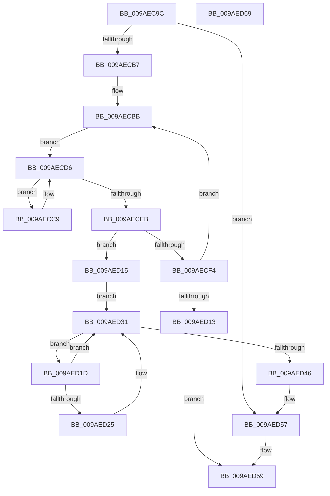

# CmSnapshotRMTxArray

- RVA: `0x009AEC9C`–`0x009AED6A` (길이 `206` bytes)
- VA: `0x00000001409AEC9C`
- 실행 섹션: `PAGE`
- PDB 이름 있음: `예`; PDB Function 태그: `아니요`
- unwind 정보 RVA: `0x0005FD94`
- 디코드: `60`개 명령, `206/206` bytes 표시
- 미해석 바이트: `0` (있으면 어셈블리에 `.byte`로 보존)

> 이 문서는 커널 이미지의 기계어와 PDB 기호를 분석해 생성했습니다. 4번과 5번은 함수 원형과 자료형을 바이너리 사용 방식에서 추정한 C 해석이며 원본 소스 복구 결과는 아닙니다.

## 1. Dependencies

- 직접 호출 지점: **9**; 고유 호출 대상: **6**
- 직접 호출자로 확인된 함수: **2**
- RIP 상대 이미지 참조: **1**

### Outgoing calls
- `0x009AECBB` → [LOCK_TRANSACTION_LIST](../87/LOCK_TRANSACTION_LIST_function_00874AD4.md) (function, `0x00874AD4`)
- `0x009AECE1` → [CmListGetNextElement](../../pagecmrc/BC/CmListGetNextElement_function_00BC9940.md) (function, `0x00BC9940`)
- `0x009AECFB` → [ExReleaseFastMutexUnsafe](../../text/25/ExReleaseFastMutexUnsafe_function_002503A0.md) (function, `0x002503A0`)
- `0x009AED00` → [KeLeaveCriticalRegion](../../text/25/KeLeaveCriticalRegion_function_0025D8B0.md) (function, `0x0025D8B0`)
- `0x009AED0A` → [CmpReserveRollbackPacketSpace](../70/CmpReserveRollbackPacketSpace_function_00703A5C.md) (function, `0x00703A5C`)
- `0x009AED2C` → [CmpAddEnlistmentToRollbackPacket](../7E/CmpAddEnlistmentToRollbackPacket_function_007EFDE8.md) (function, `0x007EFDE8`)
- `0x009AED3C` → [CmListGetNextElement](../../pagecmrc/BC/CmListGetNextElement_function_00BC9940.md) (function, `0x00BC9940`)
- `0x009AED4D` → [ExReleaseFastMutexUnsafe](../../text/25/ExReleaseFastMutexUnsafe_function_002503A0.md) (function, `0x002503A0`)
- `0x009AED52` → [KeLeaveCriticalRegion](../../text/25/KeLeaveCriticalRegion_function_0025D8B0.md) (function, `0x0025D8B0`)

### Direct callers
- [CmpTryToRundownHive](../../text/2A/CmpTryToRundownHive_function_002A4A60.md) at `0x002A4B50`
- [CmpPerformUnloadKey](CmpPerformUnloadKey_function_009AFA28.md) at `0x009AFE26`

### Static image references
- `0x009AECF4` → RVA `0x00EF5820` (`.data`; read)

## 2. Other-region calls and transfers

- 다른 실행 섹션으로 향하는 call: **6**
  - `0x009AECE1` → [CmListGetNextElement](../../pagecmrc/BC/CmListGetNextElement_function_00BC9940.md) (`PAGE` → `PAGECMRC`)
  - `0x009AECFB` → [ExReleaseFastMutexUnsafe](../../text/25/ExReleaseFastMutexUnsafe_function_002503A0.md) (`PAGE` → `.text`)
  - `0x009AED00` → [KeLeaveCriticalRegion](../../text/25/KeLeaveCriticalRegion_function_0025D8B0.md) (`PAGE` → `.text`)
  - `0x009AED3C` → [CmListGetNextElement](../../pagecmrc/BC/CmListGetNextElement_function_00BC9940.md) (`PAGE` → `PAGECMRC`)
  - `0x009AED4D` → [ExReleaseFastMutexUnsafe](../../text/25/ExReleaseFastMutexUnsafe_function_002503A0.md) (`PAGE` → `.text`)
  - `0x009AED52` → [KeLeaveCriticalRegion](../../text/25/KeLeaveCriticalRegion_function_0025D8B0.md) (`PAGE` → `.text`)
- 별도 외부 분기/꼬리 이동을 확인하지 못했습니다.

## 3. Assembly (complete function range)

```asm
009AEC9C  48 89 5C 24 10                  mov qword ptr [rsp + 0x10], rbx
009AECA1  48 89 74 24 18                  mov qword ptr [rsp + 0x18], rsi
009AECA6  57                              push rdi
009AECA7  48 83 EC 20                     sub rsp, 0x20
009AECAB  48 8B FA                        mov rdi, rdx
009AECAE  48 85 C9                        test rcx, rcx
009AECB1  0F 84 A0 00 00 00               je 0x1409aed57
009AECB7  48 8D 71 10                     lea rsi, [rcx + 0x10]
009AECBB  E8 14 5E EC FF                  call 0x140874ad4
009AECC0  33 DB                           xor ebx, ebx
009AECC2  48 21 5C 24 30                  and qword ptr [rsp + 0x30], rbx
009AECC7  EB 0D                           jmp 0x1409aecd6
009AECC9  8B 40 30                        mov eax, dword ptr [rax + 0x30]
009AECCC  A8 08                           test al, 8
009AECCE  8D 43 01                        lea eax, [rbx + 1]
009AECD1  0F 45 C3                        cmovne eax, ebx
009AECD4  8B D8                           mov ebx, eax
009AECD6  45 33 C0                        xor r8d, r8d
009AECD9  48 8D 54 24 30                  lea rdx, [rsp + 0x30]
009AECDE  48 8B CE                        mov rcx, rsi
009AECE1  E8 5A AC 21 00                  call 0x140bc9940
009AECE6  48 85 C0                        test rax, rax
009AECE9  75 DE                           jne 0x1409aecc9
009AECEB  8B 4F 04                        mov ecx, dword ptr [rdi + 4]
009AECEE  2B 0F                           sub ecx, dword ptr [rdi]
009AECF0  3B D9                           cmp ebx, ecx
009AECF2  76 21                           jbe 0x1409aed15
009AECF4  48 8D 0D 25 6B 54 00            lea rcx, [rip + 0x546b25]
009AECFB  E8 A0 16 8A FF                  call 0x1402503a0
009AED00  E8 AB EB 8A FF                  call 0x14025d8b0
009AED05  8B D3                           mov edx, ebx
009AED07  48 8B CF                        mov rcx, rdi
009AED0A  E8 4D 4D D5 FF                  call 0x140703a5c
009AED0F  85 C0                           test eax, eax
009AED11  79 A8                           jns 0x1409aecbb
009AED13  EB 44                           jmp 0x1409aed59
009AED15  48 83 64 24 30 00               and qword ptr [rsp + 0x30], 0
009AED1B  EB 14                           jmp 0x1409aed31
009AED1D  8B 48 30                        mov ecx, dword ptr [rax + 0x30]
009AED20  F6 C1 08                        test cl, 8
009AED23  75 0C                           jne 0x1409aed31
009AED25  48 8B 50 48                     mov rdx, qword ptr [rax + 0x48]
009AED29  48 8B CF                        mov rcx, rdi
009AED2C  E8 B7 10 E4 FF                  call 0x1407efde8
009AED31  45 33 C0                        xor r8d, r8d
009AED34  48 8D 54 24 30                  lea rdx, [rsp + 0x30]
009AED39  48 8B CE                        mov rcx, rsi
009AED3C  E8 FF AB 21 00                  call 0x140bc9940
009AED41  48 85 C0                        test rax, rax
009AED44  75 D7                           jne 0x1409aed1d
009AED46  48 8D 0D D3 6A 54 00            lea rcx, [rip + 0x546ad3]
009AED4D  E8 4E 16 8A FF                  call 0x1402503a0
009AED52  E8 59 EB 8A FF                  call 0x14025d8b0
009AED57  33 C0                           xor eax, eax
009AED59  48 8B 5C 24 38                  mov rbx, qword ptr [rsp + 0x38]
009AED5E  48 8B 74 24 40                  mov rsi, qword ptr [rsp + 0x40]
009AED63  48 83 C4 20                     add rsp, 0x20
009AED67  5F                              pop rdi
009AED68  C3                              ret
009AED69  CC                              int3
```

## 4. C-style interpretation (structured pseudocode)

```c
__int64 __fastcall CmSnapshotRMTxArray(__int64 a1, __int64 a2, int a3)
{
    __int64 result;
    __int64 v_rbx;
    __int64 v_rsp;
    unsigned __int64 v_stack_p10;
    unsigned __int64 v_stack_p18;
    unsigned __int64 v_stack_p8;

    v_stack_p10 = v_rbx;
    v_stack_p18 = v_rsi;
    v_rsp = (v_rsp) - (32);
    if (a1 == 0) goto loc_009AED57;
loc_009AECBB:
    result = LOCK_TRANSACTION_LIST(a1, a2, a3, a4);
    v_rbx = 0;
    goto loc_009AECD6;
loc_009AECC9:
    result = v_rbx + 1;
    if ((((unsigned __int8)((unsigned int)(*(unsigned int *)(result + 48)))) & (8)) != 0) { result = 0; }
loc_009AECD6:
    a3 = 0;
    result = CmListGetNextElement(a1 + 16, v_stack_p8, a3, a4);
    if (result != 0) goto loc_009AECC9;
    a1 = (unsigned int)(((unsigned int)(*(unsigned int *)(a2 + 4))) - (*(unsigned int *)(a2)));
    if (((unsigned int)((unsigned int)((unsigned int)(result)))) <= ((unsigned int)(a1))) goto loc_009AED15;
    result = ExReleaseFastMutexUnsafe(v_rip + 5532453, v_stack_p8, a3, a4);
    result = KeLeaveCriticalRegion(v_rip + 5532453, v_stack_p8, a3, a4);
    result = CmpReserveRollbackPacketSpace(a2, (unsigned int)((unsigned int)((unsigned int)((unsigned int)(result)))), a3, a4);
    if (!sign_flag) goto loc_009AECBB;
    goto loc_009AED59;
loc_009AED15:
    goto loc_009AED31;
loc_009AED1D:
    if ((((unsigned __int8)((unsigned int)(*(unsigned int *)(result + 48)))) & (8)) == 0) {
        a2 = *(unsigned __int64 *)(result + 72);
        a1 = a2;
        result = CmpAddEnlistmentToRollbackPacket(a1, a2, a3, a4);
    }
    a3 = 0;
    result = CmListGetNextElement(a1 + 16, v_stack_p8, a3, a4);
    if (result != 0) goto loc_009AED1D;
    result = ExReleaseFastMutexUnsafe(v_rip + 5532371, v_stack_p8, a3, a4);
    result = KeLeaveCriticalRegion(v_rip + 5532371, v_stack_p8, a3, a4);
loc_009AED57:
    result = 0;
loc_009AED59:
    v_rsp = (v_rsp) + (32);
    return result;
}
```

## 5. (Beta) C Style

```c
int64_t CmSnapshotRMTxArray(int64_t Arg1, void *Arg2, int32_t Arg3)
{
    uint8_t *arg2 = (uint8_t *)Arg2;

    int64_t result;
    int64_t local_rbx;
    int64_t local_rsp;
    uint64_t v_stack_p10;
    uint64_t v_stack_p18;
    uint64_t v_stack_p8;

    v_stack_p10 = local_rbx;
    v_stack_p18 = local_rsi;
    local_rsp = (local_rsp) - (32);
    if (Arg1 == 0) goto loc_009AED57;
loc_009AECBB:
    result = LOCK_TRANSACTION_LIST(Arg1, Arg2, Arg3, a4);
    local_rbx = 0;
    goto loc_009AECD6;
loc_009AECC9:
    result = local_rbx + 1;
    if ((((uint8_t)((uint32_t)(*(uint32_t *)(result + 0x30)))) & (8)) != 0) { result = 0; }
loc_009AECD6:
    Arg3 = 0;
    result = CmListGetNextElement(Arg1 + 16, v_stack_p8, Arg3, a4);
    if (result != 0) goto loc_009AECC9;
    Arg1 = (uint32_t)(((uint32_t)(*(uint32_t *)(arg2 + 0x4))) - (*(uint32_t *)(arg2)));
    if (((uint32_t)((uint32_t)((uint32_t)(result)))) <= ((uint32_t)(Arg1))) goto loc_009AED15;
    result = ExReleaseFastMutexUnsafe(v_rip + 5532453, v_stack_p8, Arg3, a4);
    result = KeLeaveCriticalRegion(v_rip + 5532453, v_stack_p8, Arg3, a4);
    result = CmpReserveRollbackPacketSpace(Arg2, (uint32_t)((uint32_t)((uint32_t)((uint32_t)(result)))), Arg3, a4);
    if (!sign_flag) goto loc_009AECBB;
    goto loc_009AED59;
loc_009AED15:
    goto loc_009AED31;
loc_009AED1D:
    if ((((uint8_t)((uint32_t)(*(uint32_t *)(result + 0x30)))) & (8)) == 0) {
        Arg2 = *(uint64_t *)(result + 0x48);
        Arg1 = Arg2;
        result = CmpAddEnlistmentToRollbackPacket(Arg1, Arg2, Arg3, a4);
    }
    Arg3 = 0;
    result = CmListGetNextElement(Arg1 + 16, v_stack_p8, Arg3, a4);
    if (result != 0) goto loc_009AED1D;
    result = ExReleaseFastMutexUnsafe(v_rip + 5532371, v_stack_p8, Arg3, a4);
    result = KeLeaveCriticalRegion(v_rip + 5532371, v_stack_p8, Arg3, a4);
loc_009AED57:
    result = 0;
loc_009AED59:
    local_rsp = (local_rsp) + (32);
    return result;
}
```

### 관측된 메모리 오프셋

구조체 형식이 확인되지 않은 접근은 인자 기준의 오프셋으로만 기록했습니다.

| 기준 인자 | 오프셋 표현 | 폭 (bit) | 접근 |
|---|---:|---:|---|
| `Arg2` | `+ 0x0` | `32` | `R` |
| `Arg2` | `+ 0x4` | `32` | `R` |

## 6. Execution-region graph

[열기: 2D/3D 그래프와 함수 탐색 컨트롤 패널](../../../control-panel.html?section=page&rva=0x009AEC9C&view=graph)

- 2D 그래프는 위에서 아래로 흐르고, 3D 그래프는 빈 공간을 드래그해 회전합니다. Shift+드래그는 이동, 휠은 확대·축소, 함수 노드 선택은 대상 보고서 이동입니다.

### Static fallback


