# CmpBuildAdminInformation

- RVA: `0x009A8884`–`0x009A8BD0` (길이 `844` bytes)
- VA: `0x00000001409A8884`
- 실행 섹션: `PAGE`
- PDB 이름 있음: `예`; PDB Function 태그: `예`
- unwind 정보 RVA: `0x0009CFFC`
- 디코드: `235`개 명령, `844/844` bytes 표시
- 미해석 바이트: `0` (있으면 어셈블리에 `.byte`로 보존)

> 이 문서는 커널 이미지의 기계어와 PDB 기호를 분석해 생성했습니다. 4번과 5번은 함수 원형과 자료형을 바이너리 사용 방식에서 추정한 C 해석이며 원본 소스 복구 결과는 아닙니다.

## 1. Dependencies

- 직접 호출 지점: **9**; 고유 호출 대상: **8**
- 직접 호출자로 확인된 함수: **1**
- RIP 상대 이미지 참조: **1**

### Outgoing calls
- `0x009A88BE` → [SeQueryInformationToken](../8B/SeQueryInformationToken_function_008B5090.md) (function, `0x008B5090`)
- `0x009A890C` → [RtlLengthSid](../../text/45/RtlLengthSid_function_0045D270.md) (function, `0x0045D270`)
- `0x009A8926` → [RtlEqualSid](../../text/40/RtlEqualSid_function_00400AD0.md) (function, `0x00400AD0`)
- `0x009A899E` → [CmpAllocatePool](../../text/3C/CmpAllocatePool_function_003CD504.md) (function, `0x003CD504`)
- `0x009A8A3D` → [RtlCopySidAndAttributesArray](RtlCopySidAndAttributesArray_function_009A8BE0.md) (function, `0x009A8BE0`)
- `0x009A8A82` → [RtlSidHashInitialize](../../text/41/RtlSidHashInitialize_function_00416EA0.md) (function, `0x00416EA0`)
- `0x009A8AD4` → [RtlCopyLuidAndAttributesArray](RtlCopyLuidAndAttributesArray_function_009A8CB0.md) (function, `0x009A8CB0`)
- `0x009A8BBA` → [RtlCopySidAndAttributesArray](RtlCopySidAndAttributesArray_function_009A8BE0.md) (function, `0x009A8BE0`)
- `0x009A8BC6` → [ExFreePoolWithTag](../../poolcode/B8/ExFreePoolWithTag_function_00B82870.md) (function, `0x00B82870`)

### Direct callers
- [CmpCheckAdminAccess](CmpCheckAdminAccess_function_009A87A0.md) at `0x009A87D7`

### Static image references
- `0x009A88F0` → RVA `0x00FD9AA0` (`PAGEDATA`; read)

## 2. Other-region calls and transfers

- 다른 실행 섹션으로 향하는 call: **5**
  - `0x009A890C` → [RtlLengthSid](../../text/45/RtlLengthSid_function_0045D270.md) (`PAGE` → `.text`)
  - `0x009A8926` → [RtlEqualSid](../../text/40/RtlEqualSid_function_00400AD0.md) (`PAGE` → `.text`)
  - `0x009A899E` → [CmpAllocatePool](../../text/3C/CmpAllocatePool_function_003CD504.md) (`PAGE` → `.text`)
  - `0x009A8A82` → [RtlSidHashInitialize](../../text/41/RtlSidHashInitialize_function_00416EA0.md) (`PAGE` → `.text`)
  - `0x009A8BC6` → [ExFreePoolWithTag](../../poolcode/B8/ExFreePoolWithTag_function_00B82870.md) (`PAGE` → `POOLCODE`)
- call이 아닌 외부 분기/꼬리 이동: **1**
  - `0x009A8B7E` → [sub_00B2D76A](../B2/Unknown_function_00B2D76A.md) (`tail-transfer`)

## 3. Assembly (complete function range)

```asm
009A8884  48 89 4C 24 08                  mov qword ptr [rsp + 8], rcx
009A8889  55                              push rbp
009A888A  53                              push rbx
009A888B  56                              push rsi
009A888C  57                              push rdi
009A888D  41 54                           push r12
009A888F  41 55                           push r13
009A8891  41 56                           push r14
009A8893  41 57                           push r15
009A8895  48 8B EC                        mov rbp, rsp
009A8898  48 83 EC 78                     sub rsp, 0x78
009A889C  48 8B 0A                        mov rcx, qword ptr [rdx]
009A889F  33 FF                           xor edi, edi
009A88A1  48 89 7D C8                     mov qword ptr [rbp - 0x38], rdi
009A88A5  89 7D 50                        mov dword ptr [rbp + 0x50], edi
009A88A8  48 89 7D 60                     mov qword ptr [rbp + 0x60], rdi
009A88AC  48 85 C9                        test rcx, rcx
009A88AF  75 04                           jne 0x1409a88b5
009A88B1  48 8B 4A 10                     mov rcx, qword ptr [rdx + 0x10]
009A88B5  4C 8D 45 60                     lea r8, [rbp + 0x60]
009A88B9  BA 16 00 00 00                  mov edx, 0x16
009A88BE  E8 CD C7 F0 FF                  call 0x1408b5090
009A88C3  89 45 58                        mov dword ptr [rbp + 0x58], eax
009A88C6  44 8B E8                        mov r13d, eax
009A88C9  85 C0                           test eax, eax
009A88CB  0F 88 13 02 00 00               js 0x1409a8ae4
009A88D1  4C 8B 75 60                     mov r14, qword ptr [rbp + 0x60]
009A88D5  83 CA FF                        or edx, 0xffffffff
009A88D8  33 DB                           xor ebx, ebx
009A88DA  44 8B FA                        mov r15d, edx
009A88DD  8B F2                           mov esi, edx
009A88DF  4D 8B 36                        mov r14, qword ptr [r14]
009A88E2  45 8B 26                        mov r12d, dword ptr [r14]
009A88E5  41 8B FC                        mov edi, r12d
009A88E8  C1 E7 04                        shl edi, 4
009A88EB  45 85 E4                        test r12d, r12d
009A88EE  74 5D                           je 0x1409a894d
009A88F0  48 8B 05 A9 11 63 00            mov rax, qword ptr [rip + 0x6311a9]
009A88F7  4D 8B 76 08                     mov r14, qword ptr [r14 + 8]
009A88FB  4C 8B E8                        mov r13, rax
009A88FE  49 8B 06                        mov rax, qword ptr [r14]
009A8901  48 8B C8                        mov rcx, rax
009A8904  48 89 45 D0                     mov qword ptr [rbp - 0x30], rax
009A8908  48 89 45 C8                     mov qword ptr [rbp - 0x38], rax
009A890C  E8 5F 49 AB FF                  call 0x14045d270
009A8911  03 F8                           add edi, eax
009A8913  83 CA FF                        or edx, 0xffffffff
009A8916  44 3B FA                        cmp r15d, edx
009A8919  75 1B                           jne 0x1409a8936
009A891B  48 8B 55 D0                     mov rdx, qword ptr [rbp - 0x30]
009A891F  49 8B 8D 10 01 00 00            mov rcx, qword ptr [r13 + 0x110]
009A8926  E8 A5 81 A5 FF                  call 0x140400ad0
009A892B  83 CA FF                        or edx, 0xffffffff
009A892E  84 C0                           test al, al
009A8930  0F 85 E0 01 00 00               jne 0x1409a8b16
009A8936  3B F2                           cmp esi, edx
009A8938  0F 84 C8 01 00 00               je 0x1409a8b06
009A893E  FF C3                           inc ebx
009A8940  49 83 C6 10                     add r14, 0x10
009A8944  41 3B DC                        cmp ebx, r12d
009A8947  72 B5                           jb 0x1409a88fe
009A8949  44 8B 6D 58                     mov r13d, dword ptr [rbp + 0x58]
009A894D  33 DB                           xor ebx, ebx
009A894F  44 3B FA                        cmp r15d, edx
009A8952  0F 84 CE 01 00 00               je 0x1409a8b26
009A8958  3B F2                           cmp esi, edx
009A895A  0F 84 E9 01 00 00               je 0x1409a8b49
009A8960  85 DB                           test ebx, ebx
009A8962  0F 85 08 02 00 00               jne 0x1409a8b70
009A8968  48 8B 45 60                     mov rax, qword ptr [rbp + 0x60]
009A896C  44 8D 67 07                     lea r12d, [rdi + 7]
009A8970  41 83 E4 F8                     and r12d, 0xfffffff8
009A8974  41 B8 43 4D 20 20               mov r8d, 0x20204d43
009A897A  48 8B 40 10                     mov rax, qword ptr [rax + 0x10]
009A897E  8B 08                           mov ecx, dword ptr [rax]
009A8980  8D 14 49                        lea edx, [rcx + rcx*2]
009A8983  C1 E2 02                        shl edx, 2
009A8986  8D 8A 98 03 00 00               lea ecx, [rdx + 0x398]
009A898C  41 03 CC                        add ecx, r12d
009A898F  85 D2                           test edx, edx
009A8991  8D 41 F4                        lea eax, [rcx - 0xc]
009A8994  0F 44 C1                        cmove eax, ecx
009A8997  B9 00 01 00 00                  mov ecx, 0x100
009A899C  8B D0                           mov edx, eax
009A899E  E8 61 4B A2 FF                  call 0x1403cd504
009A89A3  4C 8B F0                        mov r14, rax
009A89A6  48 85 C0                        test rax, rax
009A89A9  0F 84 6F 01 00 00               je 0x1409a8b1e
009A89AF  48 8B 45 60                     mov rax, qword ptr [rbp + 0x60]
009A89B3  49 8D 7E 58                     lea rdi, [r14 + 0x58]
009A89B7  4C 8D 8F 10 01 00 00            lea r9, [rdi + 0x110]
009A89BE  45 8B C4                        mov r8d, r12d
009A89C1  48 8B 48 18                     mov rcx, qword ptr [rax + 0x18]
009A89C5  49 89 4E 18                     mov qword ptr [r14 + 0x18], rcx
009A89C9  48 8B 45 60                     mov rax, qword ptr [rbp + 0x60]
009A89CD  8B 48 20                        mov ecx, dword ptr [rax + 0x20]
009A89D0  41 89 4E 20                     mov dword ptr [r14 + 0x20], ecx
009A89D4  48 8B 45 60                     mov rax, qword ptr [rbp + 0x60]
009A89D8  8B 48 24                        mov ecx, dword ptr [rax + 0x24]
009A89DB  41 89 4E 24                     mov dword ptr [r14 + 0x24], ecx
009A89DF  48 8B 45 60                     mov rax, qword ptr [rbp + 0x60]
009A89E3  8B 48 28                        mov ecx, dword ptr [rax + 0x28]
009A89E6  41 89 4E 28                     mov dword ptr [r14 + 0x28], ecx
009A89EA  48 8B 45 60                     mov rax, qword ptr [rbp + 0x60]
009A89EE  8B 48 2C                        mov ecx, dword ptr [rax + 0x2c]
009A89F1  0F BA F1 0E                     btr ecx, 0xe
009A89F5  0F BA E9 0D                     bts ecx, 0xd
009A89F9  41 89 4E 2C                     mov dword ptr [r14 + 0x2c], ecx
009A89FD  48 8B 45 60                     mov rax, qword ptr [rbp + 0x60]
009A8A01  48 8B 08                        mov rcx, qword ptr [rax]
009A8A04  8B 11                           mov edx, dword ptr [rcx]
009A8A06  03 D3                           add edx, ebx
009A8A08  4C 89 4F 08                     mov qword ptr [rdi + 8], r9
009A8A0C  89 17                           mov dword ptr [rdi], edx
009A8A0E  48 8B 45 60                     mov rax, qword ptr [rbp + 0x60]
009A8A12  C1 E2 04                        shl edx, 4
009A8A15  44 2B C2                        sub r8d, edx
009A8A18  48 8B 08                        mov rcx, qword ptr [rax]
009A8A1B  8B C2                           mov eax, edx
009A8A1D  48 8D 55 50                     lea rdx, [rbp + 0x50]
009A8A21  48 89 54 24 30                  mov qword ptr [rsp + 0x30], rdx
009A8A26  49 03 C1                        add rax, r9
009A8A29  48 8D 55 C8                     lea rdx, [rbp - 0x38]
009A8A2D  48 89 54 24 28                  mov qword ptr [rsp + 0x28], rdx
009A8A32  48 8B 51 08                     mov rdx, qword ptr [rcx + 8]
009A8A36  8B 09                           mov ecx, dword ptr [rcx]
009A8A38  48 89 44 24 20                  mov qword ptr [rsp + 0x20], rax
009A8A3D  E8 9E 01 00 00                  call 0x1409a8be0
009A8A42  83 CA FF                        or edx, 0xffffffff
009A8A45  44 3B FA                        cmp r15d, edx
009A8A48  73 12                           jae 0x1409a8a5c
009A8A4A  48 8B 47 08                     mov rax, qword ptr [rdi + 8]
009A8A4E  41 8B CF                        mov ecx, r15d
009A8A51  48 03 C9                        add rcx, rcx
009A8A54  C7 44 C8 08 07 00 00 00         mov dword ptr [rax + rcx*8 + 8], 7
009A8A5C  3B F2                           cmp esi, edx
009A8A5E  73 11                           jae 0x1409a8a71
009A8A60  48 8B 47 08                     mov rax, qword ptr [rdi + 8]
009A8A64  8B CE                           mov ecx, esi
009A8A66  48 03 C9                        add rcx, rcx
009A8A69  C7 44 C8 08 60 00 00 00         mov dword ptr [rax + rcx*8 + 8], 0x60
009A8A71  85 DB                           test ebx, ebx
009A8A73  0F 85 0A 01 00 00               jne 0x1409a8b83
009A8A79  8B 17                           mov edx, dword ptr [rdi]
009A8A7B  4C 8B C7                        mov r8, rdi
009A8A7E  48 8B 4F 08                     mov rcx, qword ptr [rdi + 8]
009A8A82  E8 19 E4 A6 FF                  call 0x140416ea0
009A8A87  49 89 3E                        mov qword ptr [r14], rdi
009A8A8A  41 8B C4                        mov eax, r12d
009A8A8D  48 03 47 08                     add rax, qword ptr [rdi + 8]
009A8A91  33 FF                           xor edi, edi
009A8A93  89 38                           mov dword ptr [rax], edi
009A8A95  48 89 78 08                     mov qword ptr [rax + 8], rdi
009A8A99  49 89 46 08                     mov qword ptr [r14 + 8], rax
009A8A9D  48 05 10 01 00 00               add rax, 0x110
009A8AA3  89 38                           mov dword ptr [rax], edi
009A8AA5  48 8D 98 10 01 00 00            lea rbx, [rax + 0x110]
009A8AAC  48 89 78 08                     mov qword ptr [rax + 8], rdi
009A8AB0  4C 8D 43 04                     lea r8, [rbx + 4]
009A8AB4  49 89 46 40                     mov qword ptr [r14 + 0x40], rax
009A8AB8  49 89 7E 38                     mov qword ptr [r14 + 0x38], rdi
009A8ABC  48 8B 45 60                     mov rax, qword ptr [rbp + 0x60]
009A8AC0  48 8B 48 10                     mov rcx, qword ptr [rax + 0x10]
009A8AC4  8B 09                           mov ecx, dword ptr [rcx]
009A8AC6  89 0B                           mov dword ptr [rbx], ecx
009A8AC8  48 8B 45 60                     mov rax, qword ptr [rbp + 0x60]
009A8ACC  48 8B 50 10                     mov rdx, qword ptr [rax + 0x10]
009A8AD0  48 83 C2 04                     add rdx, 4
009A8AD4  E8 D7 01 00 00                  call 0x1409a8cb0
009A8AD9  48 8B 45 48                     mov rax, qword ptr [rbp + 0x48]
009A8ADD  49 89 5E 10                     mov qword ptr [r14 + 0x10], rbx
009A8AE1  4C 89 30                        mov qword ptr [rax], r14
009A8AE4  48 8B 4D 60                     mov rcx, qword ptr [rbp + 0x60]
009A8AE8  48 85 C9                        test rcx, rcx
009A8AEB  0F 85 D3 00 00 00               jne 0x1409a8bc4
009A8AF1  41 8B C5                        mov eax, r13d
009A8AF4  48 83 C4 78                     add rsp, 0x78
009A8AF8  41 5F                           pop r15
009A8AFA  41 5E                           pop r14
009A8AFC  41 5D                           pop r13
009A8AFE  41 5C                           pop r12
009A8B00  5F                              pop rdi
009A8B01  5E                              pop rsi
009A8B02  5B                              pop rbx
009A8B03  5D                              pop rbp
009A8B04  C3                              ret
009A8B05  CC                              int3
009A8B06  41 8A 46 08                     mov al, byte ptr [r14 + 8]
009A8B0A  24 60                           and al, 0x60
009A8B0C  3C 60                           cmp al, 0x60
009A8B0E  0F 44 F3                        cmove esi, ebx
009A8B11  E9 28 FE FF FF                  jmp 0x1409a893e
009A8B16  44 8B FB                        mov r15d, ebx
009A8B19  E9 20 FE FF FF                  jmp 0x1409a893e
009A8B1E  41 BD 9A 00 00 C0               mov r13d, 0xc000009a
009A8B24  EB BE                           jmp 0x1409a8ae4
009A8B26  48 8B 05 73 0F 63 00            mov rax, qword ptr [rip + 0x630f73]
009A8B2D  BB 01 00 00 00                  mov ebx, 1
009A8B32  C7 45 E0 07 00 00 00            mov dword ptr [rbp - 0x20], 7
009A8B39  48 8B 88 10 01 00 00            mov rcx, qword ptr [rax + 0x110]
009A8B40  48 89 4D D8                     mov qword ptr [rbp - 0x28], rcx
009A8B44  E9 0F FE FF FF                  jmp 0x1409a8958
009A8B49  48 8B 05 50 0F 63 00            mov rax, qword ptr [rip + 0x630f50]
009A8B50  8B D3                           mov edx, ebx
009A8B52  48 03 D2                        add rdx, rdx
009A8B55  FF C3                           inc ebx
009A8B57  48 8B 88 F0 01 00 00            mov rcx, qword ptr [rax + 0x1f0]
009A8B5E  48 89 4C D5 D8                  mov qword ptr [rbp + rdx*8 - 0x28], rcx
009A8B63  C7 44 D5 E0 60 00 00 00         mov dword ptr [rbp + rdx*8 - 0x20], 0x60
009A8B6B  E9 F0 FD FF FF                  jmp 0x1409a8960
009A8B70  8B C3                           mov eax, ebx
009A8B72  44 8B E3                        mov r12d, ebx
009A8B75  C1 E0 04                        shl eax, 4
009A8B78  4C 8D 75 D8                     lea r14, [rbp - 0x28]
009A8B7C  03 F8                           add edi, eax
009A8B7E  E9 E7 4B 18 00                  jmp 0x140b2d76a
009A8B83  48 8B 45 60                     mov rax, qword ptr [rbp + 0x60]
009A8B87  8B CB                           mov ecx, ebx
009A8B89  44 8B 45 50                     mov r8d, dword ptr [rbp + 0x50]
009A8B8D  48 8B 10                        mov rdx, qword ptr [rax]
009A8B90  48 8D 45 50                     lea rax, [rbp + 0x50]
009A8B94  48 89 44 24 30                  mov qword ptr [rsp + 0x30], rax
009A8B99  48 8D 45 C8                     lea rax, [rbp - 0x38]
009A8B9D  48 89 44 24 28                  mov qword ptr [rsp + 0x28], rax
009A8BA2  48 8B 45 C8                     mov rax, qword ptr [rbp - 0x38]
009A8BA6  44 8B 0A                        mov r9d, dword ptr [rdx]
009A8BA9  48 8D 55 D8                     lea rdx, [rbp - 0x28]
009A8BAD  49 C1 E1 04                     shl r9, 4
009A8BB1  4C 03 4F 08                     add r9, qword ptr [rdi + 8]
009A8BB5  48 89 44 24 20                  mov qword ptr [rsp + 0x20], rax
009A8BBA  E8 21 00 00 00                  call 0x1409a8be0
009A8BBF  E9 B5 FE FF FF                  jmp 0x1409a8a79
009A8BC4  33 D2                           xor edx, edx
009A8BC6  E8 A5 9C 1D 00                  call 0x140b82870
009A8BCB  E9 21 FF FF FF                  jmp 0x1409a8af1
```

## 4. C-style interpretation (structured pseudocode)

```c
__int64 __fastcall CmpBuildAdminInformation(__int64 a1, __int64 a2)
{
    __int64 result;
    __int64 v_r12;
    __int64 v_r14;
    __int64 v_rbx;
    __int64 v_rdi;
    __int64 v_rsi;
    __int64 v_rsp;
    unsigned int v_stack_m60;
    unsigned __int64 v_stack_m68;
    unsigned __int64 v_stack_m70;
    unsigned __int64 v_stack_m78;
    unsigned __int64 v_stack_m88;
    unsigned __int64 v_stack_m90;
    unsigned __int64 v_stack_m98;
    unsigned int v_stack_p10;
    unsigned int v_stack_p18;
    unsigned __int64 v_stack_p20;
    unsigned __int64 v_stack_p28;
    unsigned __int64 v_stack_p30;
    unsigned __int64 v_stack_p8;

    v_stack_p8 = a1;
    v_rsp = (v_rsp) - (120);
    v_rdi = 0;
    v_stack_m78 = 0;
    v_stack_p10 = 0;
    v_stack_p20 = 0;
    if (*(unsigned __int64 *)(a2) == 0) {
        a1 = *(unsigned __int64 *)(a2 + 16);
    }
    result = SeQueryInformationToken(a1, 22, v_stack_p20, a4);
    v_stack_p18 = (unsigned int)(result);
    if (sign_flag) goto loc_009A8AE4;
    a2 = (unsigned int)((22) | (0xFFFFFFFFULL));
    v_rbx = 0;
    v_rdi = (unsigned int)(((unsigned int)((unsigned int)((unsigned int)(*(unsigned int *)(*(unsigned __int64 *)(v_stack_p20)))))) << (4));
    if ((unsigned int)((unsigned int)(*(unsigned int *)(*(unsigned __int64 *)(v_stack_p20)))) == 0) goto loc_009A894D;
loc_009A88FE:
    v_stack_m70 = *(unsigned __int64 *)(*(unsigned __int64 *)(*(unsigned __int64 *)(v_stack_p20) + 8));
    v_stack_m78 = *(unsigned __int64 *)(*(unsigned __int64 *)(*(unsigned __int64 *)(v_stack_p20) + 8));
    result = RtlLengthSid(*(unsigned __int64 *)(*(unsigned __int64 *)(*(unsigned __int64 *)(v_stack_p20) + 8)), a2, v_stack_p20, a4);
    v_rdi = (unsigned int)((v_rdi) + ((unsigned int)(result)));
    a2 = (unsigned int)((a2) | (0xFFFFFFFFULL));
    if (((unsigned int)((unsigned int)((unsigned int)(a2)))) != ((unsigned int)(a2))) goto loc_009A8936;
    result = RtlEqualSid(*(unsigned __int64 *)(*(unsigned __int64 *)(v_rip + 6492585) + 272), v_stack_m70, v_stack_p20, a4);
    a2 = (unsigned int)((v_stack_m70) | (0xFFFFFFFFULL));
    if ((unsigned __int8)(result) != 0) goto loc_009A8B16;
loc_009A8936:
    if (((unsigned int)((unsigned int)((unsigned int)(a2)))) == ((unsigned int)(a2))) goto loc_009A8B06;
loc_009A893E:
    v_rbx = (unsigned int)((v_rbx) + 1);
    v_r14 = (*(unsigned __int64 *)(*(unsigned __int64 *)(v_stack_p20) + 8)) + (16);
    if (((unsigned int)(v_rbx)) < ((unsigned int)((unsigned int)(*(unsigned int *)(*(unsigned __int64 *)(v_stack_p20)))))) goto loc_009A88FE;
loc_009A894D:
    v_rbx = 0;
    if (((unsigned int)((unsigned int)((unsigned int)(a2)))) == ((unsigned int)(a2))) goto loc_009A8B26;
loc_009A8958:
    if (((unsigned int)((unsigned int)((unsigned int)(a2)))) == ((unsigned int)(a2))) goto loc_009A8B49;
loc_009A8960:
    if (0 != 0) goto loc_009A8B70;
    v_r12 = (unsigned int)((v_rdi + 7) & (0xFFFFFFF8ULL));
    a2 = (unsigned int)(((unsigned int)(*(unsigned int *)(*(unsigned __int64 *)(v_stack_p20 + 16))) + (unsigned int)(*(unsigned int *)(*(unsigned __int64 *)(v_stack_p20 + 16))) * 2) << (2));
    a1 = (unsigned int)((a2 + 920) + ((unsigned int)(v_r12)));
    result = a1 - 12;
    if ((unsigned int)(a2) == 0) { result = (unsigned int)(a1); }
    result = CmpAllocatePool(256, (unsigned int)((unsigned int)(result)), (unsigned int)(0x20204D43ULL), a4);
    if (result == 0) goto loc_009A8B1E;
    *(unsigned __int64 *)(result + 24) = *(unsigned __int64 *)(v_stack_p20 + 24);
    *(unsigned int *)(result + 32) = (unsigned int)((unsigned int)(*(unsigned int *)(v_stack_p20 + 32)));
    *(unsigned int *)(result + 36) = (unsigned int)((unsigned int)(*(unsigned int *)(v_stack_p20 + 36)));
    *(unsigned int *)(result + 40) = (unsigned int)((unsigned int)(*(unsigned int *)(v_stack_p20 + 40)));
    *(unsigned int *)(result + 44) = (unsigned int)((unsigned int)(*(unsigned int *)(v_stack_p20 + 44)));
    a2 = (unsigned int)(((unsigned int)(*(unsigned int *)(*(unsigned __int64 *)(v_stack_p20)))) + (0));
    *(unsigned __int64 *)(result + 88 + 8) = result + 88 + 272;
    *(unsigned int *)(result + 88) = (unsigned int)(a2);
    a2 = (unsigned int)((a2) << (4));
    a3 = (unsigned int)(((unsigned int)((unsigned int)(v_r12))) - ((unsigned int)(a2)));
    v_stack_m88 = v_stack_p10;
    result = ((unsigned int)((unsigned int)(a2))) + (result + 88 + 272);
    v_stack_m90 = v_stack_m78;
    v_stack_m98 = result;
    result = RtlCopySidAndAttributesArray((unsigned int)(*(unsigned int *)(*(unsigned __int64 *)(v_stack_p20))), *(unsigned __int64 *)(*(unsigned __int64 *)(v_stack_p20) + 8), a3, result + 88 + 272);
    a2 = (unsigned int)((*(unsigned __int64 *)(*(unsigned __int64 *)(v_stack_p20) + 8)) | (0xFFFFFFFFULL));
    if (((unsigned int)((unsigned int)((unsigned int)(a2)))) < ((unsigned int)(a2))) {
        result = *(unsigned __int64 *)(result + 88 + 8);
        a1 = (unsigned int)((unsigned int)((unsigned int)(a2)));
        a1 = (a1) + (a1);
        *(unsigned int *)(result + a1 * 8 + 8) = 7;
    }
    if (((unsigned int)((unsigned int)((unsigned int)(a2)))) < ((unsigned int)(a2))) {
        result = *(unsigned __int64 *)(result + 88 + 8);
        a1 = (unsigned int)((unsigned int)((unsigned int)(a2)));
        a1 = (a1) + (a1);
        *(unsigned int *)(result + a1 * 8 + 8) = 96;
    }
    if (0 != 0) goto loc_009A8B83;
loc_009A8A79:
    result = RtlSidHashInitialize(*(unsigned __int64 *)(result + 88 + 8), (unsigned int)(*(unsigned int *)(result + 88)), result + 88, result + 88 + 272);
    *(unsigned __int64 *)(result) = result + 88;
    result = ((unsigned int)((unsigned int)(v_r12))) + (*(unsigned __int64 *)(result + 88 + 8));
    v_rdi = 0;
    *(unsigned int *)(result) = 0;
    *(unsigned __int64 *)(result + 8) = 0;
    *(unsigned __int64 *)(result + 8) = result;
    result = (result) + (272);
    *(unsigned int *)(result) = 0;
    *(unsigned __int64 *)(result + 8) = 0;
    *(unsigned __int64 *)(result + 64) = result;
    *(unsigned __int64 *)(result + 56) = 0;
    *(unsigned int *)(result + 272) = (unsigned int)((unsigned int)(*(unsigned int *)(*(unsigned __int64 *)(v_stack_p20 + 16))));
    a2 = (*(unsigned __int64 *)(v_stack_p20 + 16)) + (4);
    result = RtlCopyLuidAndAttributesArray((unsigned int)(*(unsigned int *)(*(unsigned __int64 *)(v_stack_p20 + 16))), a2, result + 272 + 4, result + 88 + 272);
    *(unsigned __int64 *)(result + 16) = result + 272;
    *(unsigned __int64 *)(v_stack_p8) = result;
loc_009A8AE4:
    if (v_stack_p20 != 0) goto loc_009A8BC4;
loc_009A8AF1:
    v_rsp = (v_rsp) + (120);
    return (unsigned int)((unsigned int)((unsigned int)(v_stack_p18)));
loc_009A8B06:
    result = (unsigned __int8)((*(unsigned __int8 *)(result + 8)) & (96));
    v_rsi = (unsigned int)((unsigned int)(a2));
    if (((unsigned __int8)(result)) == 96) { v_rsi = (unsigned int)(result + 272); }
    goto loc_009A893E;
loc_009A8B16:
    goto loc_009A893E;
loc_009A8B1E:
    goto loc_009A8AE4;
loc_009A8B26:
    v_stack_m60 = 7;
    v_stack_m68 = *(unsigned __int64 *)(*(unsigned __int64 *)(v_rip + 6492019) + 272);
    goto loc_009A8958;
loc_009A8B49:
    a2 = (1) + (1);
    v_rbx = (unsigned int)((1) + 1);
    *(unsigned __int64 *)(v_rsp + a2 * 8 - 40) = *(unsigned __int64 *)(*(unsigned __int64 *)(v_rip + 6491984) + 496);
    *(unsigned int *)(v_rsp + a2 * 8 - 32) = 96;
    goto loc_009A8960;
loc_009A8B70:
    result = (unsigned int)(((unsigned int)((unsigned int)(v_rbx))) << (4));
    v_rdi = (unsigned int)((v_rdi) + ((unsigned int)(result)));
loc_009A8B83:
    v_stack_p30 = v_stack_p10;
    v_stack_p28 = v_stack_m78;
    a4 = ((unsigned int)(*(unsigned int *)(*(unsigned __int64 *)(v_stack_p20)))) << (4);
    a4 = (a4) + (*(unsigned __int64 *)(v_rdi + 8));
    v_stack_p20 = v_stack_m78;
    result = RtlCopySidAndAttributesArray((unsigned int)((unsigned int)(v_rbx)), v_stack_m68, (unsigned int)(v_stack_p10), a4);
    goto loc_009A8A79;
loc_009A8BC4:
    a2 = 0;
    result = ExFreePoolWithTag((unsigned int)((unsigned int)(v_rbx)), a2, (unsigned int)(v_stack_p10), a4);
    goto loc_009A8AF1;
}
```

## 5. (Beta) C Style

```c
int64_t CmpBuildAdminInformation(int64_t Arg1, void *Arg2)
{
    uint8_t *arg2 = (uint8_t *)Arg2;

    int64_t result;
    int64_t local_r12;
    int64_t local_r14;
    int64_t local_rbx;
    int64_t local_rdi;
    int64_t local_rsi;
    int64_t local_rsp;
    uint32_t v_stack_m60;
    uint64_t v_stack_m68;
    uint64_t v_stack_m70;
    uint64_t v_stack_m78;
    uint64_t v_stack_m88;
    uint64_t v_stack_m90;
    uint64_t v_stack_m98;
    uint32_t v_stack_p10;
    uint32_t v_stack_p18;
    uint64_t v_stack_p20;
    uint64_t v_stack_p28;
    uint64_t v_stack_p30;
    uint64_t v_stack_p8;

    v_stack_p8 = Arg1;
    local_rsp = (local_rsp) - (120);
    local_rdi = 0;
    v_stack_m78 = 0;
    v_stack_p10 = 0;
    v_stack_p20 = 0;
    if (*(uint64_t *)(arg2) == 0) {
        Arg1 = *(uint64_t *)(arg2 + 0x10);
    }
    result = SeQueryInformationToken(Arg1, 22, v_stack_p20, a4);
    v_stack_p18 = (uint32_t)(result);
    if (sign_flag) goto loc_009A8AE4;
    Arg2 = (uint32_t)((22) | (0xFFFFFFFFULL));
    local_rbx = 0;
    local_rdi = (uint32_t)(((uint32_t)((uint32_t)((uint32_t)(*(uint32_t *)(*(uint64_t *)(v_stack_p20)))))) << (4));
    if ((uint32_t)((uint32_t)(*(uint32_t *)(*(uint64_t *)(v_stack_p20)))) == 0) goto loc_009A894D;
loc_009A88FE:
    v_stack_m70 = *(uint64_t *)(*(uint64_t *)(*(uint64_t *)(v_stack_p20) + 0x8));
    v_stack_m78 = *(uint64_t *)(*(uint64_t *)(*(uint64_t *)(v_stack_p20) + 0x8));
    result = RtlLengthSid(*(uint64_t *)(*(uint64_t *)(*(uint64_t *)(v_stack_p20) + 0x8)), Arg2, v_stack_p20, a4);
    local_rdi = (uint32_t)((local_rdi) + ((uint32_t)(result)));
    Arg2 = (uint32_t)((Arg2) | (0xFFFFFFFFULL));
    if (((uint32_t)((uint32_t)((uint32_t)(Arg2)))) != ((uint32_t)(Arg2))) goto loc_009A8936;
    result = RtlEqualSid(*(uint64_t *)(*(uint64_t *)(v_rip + 0x6311A9) + 0x110), v_stack_m70, v_stack_p20, a4);
    Arg2 = (uint32_t)((v_stack_m70) | (0xFFFFFFFFULL));
    if ((uint8_t)(result) != 0) goto loc_009A8B16;
loc_009A8936:
    if (((uint32_t)((uint32_t)((uint32_t)(Arg2)))) == ((uint32_t)(Arg2))) goto loc_009A8B06;
loc_009A893E:
    local_rbx = (uint32_t)((local_rbx) + 1);
    local_r14 = (*(uint64_t *)(*(uint64_t *)(v_stack_p20) + 0x8)) + (16);
    if (((uint32_t)(local_rbx)) < ((uint32_t)((uint32_t)(*(uint32_t *)(*(uint64_t *)(v_stack_p20)))))) goto loc_009A88FE;
loc_009A894D:
    local_rbx = 0;
    if (((uint32_t)((uint32_t)((uint32_t)(Arg2)))) == ((uint32_t)(Arg2))) goto loc_009A8B26;
loc_009A8958:
    if (((uint32_t)((uint32_t)((uint32_t)(Arg2)))) == ((uint32_t)(Arg2))) goto loc_009A8B49;
loc_009A8960:
    if (0 != 0) goto loc_009A8B70;
    local_r12 = (uint32_t)((local_rdi + 7) & (0xFFFFFFF8ULL));
    Arg2 = (uint32_t)(((uint32_t)(*(uint32_t *)(*(uint64_t *)(v_stack_p20 + 0x10))) + (uint32_t)(*(uint32_t *)(*(uint64_t *)(v_stack_p20 + 0x10))) * 2) << (2));
    Arg1 = (uint32_t)((Arg2 + 920) + ((uint32_t)(local_r12)));
    result = Arg1 - 12;
    if ((uint32_t)(Arg2) == 0) { result = (uint32_t)(Arg1); }
    result = CmpAllocatePool(256, (uint32_t)((uint32_t)(result)), (uint32_t)(0x20204D43ULL), a4);
    if (result == 0) goto loc_009A8B1E;
    *(uint64_t *)(result + 0x18) = *(uint64_t *)(v_stack_p20 + 0x18);
    *(uint32_t *)(result + 0x20) = (uint32_t)((uint32_t)(*(uint32_t *)(v_stack_p20 + 0x20)));
    *(uint32_t *)(result + 0x24) = (uint32_t)((uint32_t)(*(uint32_t *)(v_stack_p20 + 0x24)));
    *(uint32_t *)(result + 0x28) = (uint32_t)((uint32_t)(*(uint32_t *)(v_stack_p20 + 0x28)));
    *(uint32_t *)(result + 0x2C) = (uint32_t)((uint32_t)(*(uint32_t *)(v_stack_p20 + 0x2C)));
    Arg2 = (uint32_t)(((uint32_t)(*(uint32_t *)(*(uint64_t *)(v_stack_p20)))) + (0));
    *(uint64_t *)(result + 0x58 + 0x8) = result + 88 + 272;
    *(uint32_t *)(result + 0x58) = (uint32_t)(Arg2);
    Arg2 = (uint32_t)((Arg2) << (4));
    a3 = (uint32_t)(((uint32_t)((uint32_t)(local_r12))) - ((uint32_t)(Arg2)));
    v_stack_m88 = v_stack_p10;
    result = ((uint32_t)((uint32_t)(Arg2))) + (result + 88 + 272);
    v_stack_m90 = v_stack_m78;
    v_stack_m98 = result;
    result = RtlCopySidAndAttributesArray((uint32_t)(*(uint32_t *)(*(uint64_t *)(v_stack_p20))), *(uint64_t *)(*(uint64_t *)(v_stack_p20) + 0x8), a3, result + 88 + 272);
    Arg2 = (uint32_t)((*(uint64_t *)(*(uint64_t *)(v_stack_p20) + 0x8)) | (0xFFFFFFFFULL));
    if (((uint32_t)((uint32_t)((uint32_t)(Arg2)))) < ((uint32_t)(Arg2))) {
        result = *(uint64_t *)(result + 0x58 + 0x8);
        Arg1 = (uint32_t)((uint32_t)((uint32_t)(Arg2)));
        Arg1 = (Arg1) + (Arg1);
        *(uint32_t *)(result + Arg1 * 8 + 0x8) = 7;
    }
    if (((uint32_t)((uint32_t)((uint32_t)(Arg2)))) < ((uint32_t)(Arg2))) {
        result = *(uint64_t *)(result + 0x58 + 0x8);
        Arg1 = (uint32_t)((uint32_t)((uint32_t)(Arg2)));
        Arg1 = (Arg1) + (Arg1);
        *(uint32_t *)(result + Arg1 * 8 + 0x8) = 96;
    }
    if (0 != 0) goto loc_009A8B83;
loc_009A8A79:
    result = RtlSidHashInitialize(*(uint64_t *)(result + 0x58 + 0x8), (uint32_t)(*(uint32_t *)(result + 0x58)), result + 88, result + 88 + 272);
    *(uint64_t *)(result) = result + 88;
    result = ((uint32_t)((uint32_t)(local_r12))) + (*(uint64_t *)(result + 0x58 + 0x8));
    local_rdi = 0;
    *(uint32_t *)(result) = 0;
    *(uint64_t *)(result + 0x8) = 0;
    *(uint64_t *)(result + 0x8) = result;
    result = (result) + (272);
    *(uint32_t *)(result) = 0;
    *(uint64_t *)(result + 0x8) = 0;
    *(uint64_t *)(result + 0x40) = result;
    *(uint64_t *)(result + 0x38) = 0;
    *(uint32_t *)(result + 0x110) = (uint32_t)((uint32_t)(*(uint32_t *)(*(uint64_t *)(v_stack_p20 + 0x10))));
    Arg2 = (*(uint64_t *)(v_stack_p20 + 0x10)) + (4);
    result = RtlCopyLuidAndAttributesArray((uint32_t)(*(uint32_t *)(*(uint64_t *)(v_stack_p20 + 0x10))), Arg2, result + 272 + 4, result + 88 + 272);
    *(uint64_t *)(result + 0x10) = result + 272;
    *(uint64_t *)(v_stack_p8) = result;
loc_009A8AE4:
    if (v_stack_p20 != 0) goto loc_009A8BC4;
loc_009A8AF1:
    local_rsp = (local_rsp) + (120);
    return (uint32_t)((uint32_t)((uint32_t)(v_stack_p18)));
loc_009A8B06:
    result = (uint8_t)((*(uint8_t *)(result + 0x8)) & (96));
    local_rsi = (uint32_t)((uint32_t)(Arg2));
    if (((uint8_t)(result)) == 96) { local_rsi = (uint32_t)(result + 272); }
    goto loc_009A893E;
loc_009A8B16:
    goto loc_009A893E;
loc_009A8B1E:
    goto loc_009A8AE4;
loc_009A8B26:
    v_stack_m60 = 7;
    v_stack_m68 = *(uint64_t *)(*(uint64_t *)(v_rip + 0x630F73) + 0x110);
    goto loc_009A8958;
loc_009A8B49:
    Arg2 = (1) + (1);
    local_rbx = (uint32_t)((1) + 1);
    *(uint64_t *)(local_rsp + arg2 * 8 - 0x28) = *(uint64_t *)(*(uint64_t *)(v_rip + 0x630F50) + 0x1F0);
    *(uint32_t *)(local_rsp + arg2 * 8 - 0x20) = 96;
    goto loc_009A8960;
loc_009A8B70:
    result = (uint32_t)(((uint32_t)((uint32_t)(local_rbx))) << (4));
    local_rdi = (uint32_t)((local_rdi) + ((uint32_t)(result)));
loc_009A8B83:
    v_stack_p30 = v_stack_p10;
    v_stack_p28 = v_stack_m78;
    a4 = ((uint32_t)(*(uint32_t *)(*(uint64_t *)(v_stack_p20)))) << (4);
    a4 = (a4) + (*(uint64_t *)(local_rdi + 0x8));
    v_stack_p20 = v_stack_m78;
    result = RtlCopySidAndAttributesArray((uint32_t)((uint32_t)(local_rbx)), v_stack_m68, (uint32_t)(v_stack_p10), a4);
    goto loc_009A8A79;
loc_009A8BC4:
    Arg2 = 0;
    result = ExFreePoolWithTag((uint32_t)((uint32_t)(local_rbx)), Arg2, (uint32_t)(v_stack_p10), a4);
    goto loc_009A8AF1;
}
```

### 관측된 메모리 오프셋

구조체 형식이 확인되지 않은 접근은 인자 기준의 오프셋으로만 기록했습니다.

| 기준 인자 | 오프셋 표현 | 폭 (bit) | 접근 |
|---|---:|---:|---|
| `Arg2` | `+ 0x0` | `64` | `R` |
| `Arg2` | `+ 0x10` | `64` | `R` |

## 6. Execution-region graph

[열기: 2D/3D 그래프와 함수 탐색 컨트롤 패널](../../../control-panel.html?section=page&rva=0x009A8884&view=graph)

- 2D 그래프는 위에서 아래로 흐르고, 3D 그래프는 빈 공간을 드래그해 회전합니다. Shift+드래그는 이동, 휠은 확대·축소, 함수 노드 선택은 대상 보고서 이동입니다.

### Static fallback

```mermaid
flowchart TD
  bb_009A8884[BB_009A8884]
  bb_009A88B1[BB_009A88B1]
  bb_009A88B5[BB_009A88B5]
  bb_009A88D1[BB_009A88D1]
  bb_009A88F0[BB_009A88F0]
  bb_009A88FE[BB_009A88FE]
  bb_009A891B[BB_009A891B]
  bb_009A8936[BB_009A8936]
  bb_009A893E[BB_009A893E]
  bb_009A8949[BB_009A8949]
  bb_009A894D[BB_009A894D]
  bb_009A8958[BB_009A8958]
  bb_009A8960[BB_009A8960]
  bb_009A8968[BB_009A8968]
  bb_009A89AF[BB_009A89AF]
  bb_009A8A4A[BB_009A8A4A]
  bb_009A8A5C[BB_009A8A5C]
  bb_009A8A60[BB_009A8A60]
  bb_009A8A71[BB_009A8A71]
  bb_009A8A79[BB_009A8A79]
  bb_009A8AE4[BB_009A8AE4]
  bb_009A8AF1[BB_009A8AF1]
  bb_009A8B05[BB_009A8B05]
  bb_009A8B06[BB_009A8B06]
  bb_009A8B16[BB_009A8B16]
  bb_009A8B1E[BB_009A8B1E]
  bb_009A8B26[BB_009A8B26]
  bb_009A8B49[BB_009A8B49]
  bb_009A8B70[BB_009A8B70]
  bb_009A8B83[BB_009A8B83]
  bb_009A8BC4[BB_009A8BC4]
  bb_009A8884 -->|branch| bb_009A88B5
  bb_009A8884 -->|fallthrough| bb_009A88B1
  bb_009A88B1 -->|flow| bb_009A88B5
  bb_009A88B5 -->|branch| bb_009A8AE4
  bb_009A88B5 -->|fallthrough| bb_009A88D1
  bb_009A88D1 -->|branch| bb_009A894D
  bb_009A88D1 -->|fallthrough| bb_009A88F0
  bb_009A88F0 -->|flow| bb_009A88FE
  bb_009A88FE -->|branch| bb_009A8936
  bb_009A88FE -->|fallthrough| bb_009A891B
  bb_009A891B -->|branch| bb_009A8B16
  bb_009A891B -->|fallthrough| bb_009A8936
  bb_009A8936 -->|branch| bb_009A8B06
  bb_009A8936 -->|fallthrough| bb_009A893E
  bb_009A893E -->|branch| bb_009A88FE
  bb_009A893E -->|fallthrough| bb_009A8949
  bb_009A8949 -->|flow| bb_009A894D
  bb_009A894D -->|branch| bb_009A8B26
  bb_009A894D -->|fallthrough| bb_009A8958
  bb_009A8958 -->|branch| bb_009A8B49
  bb_009A8958 -->|fallthrough| bb_009A8960
  bb_009A8960 -->|branch| bb_009A8B70
  bb_009A8960 -->|fallthrough| bb_009A8968
  bb_009A8968 -->|branch| bb_009A8B1E
  bb_009A8968 -->|fallthrough| bb_009A89AF
  bb_009A89AF -->|branch| bb_009A8A5C
  bb_009A89AF -->|fallthrough| bb_009A8A4A
  bb_009A8A4A -->|flow| bb_009A8A5C
  bb_009A8A5C -->|branch| bb_009A8A71
  bb_009A8A5C -->|fallthrough| bb_009A8A60
  bb_009A8A60 -->|flow| bb_009A8A71
  bb_009A8A71 -->|branch| bb_009A8B83
  bb_009A8A71 -->|fallthrough| bb_009A8A79
  bb_009A8A79 -->|flow| bb_009A8AE4
  bb_009A8AE4 -->|branch| bb_009A8BC4
  bb_009A8AE4 -->|fallthrough| bb_009A8AF1
  bb_009A8B05 -->|flow| bb_009A8B06
  bb_009A8B06 -->|branch| bb_009A893E
  bb_009A8B16 -->|branch| bb_009A893E
  bb_009A8B1E -->|branch| bb_009A8AE4
  bb_009A8B26 -->|branch| bb_009A8958
  bb_009A8B49 -->|branch| bb_009A8960
  bb_009A8B83 -->|branch| bb_009A8A79
  bb_009A8BC4 -->|branch| bb_009A8AF1
```


