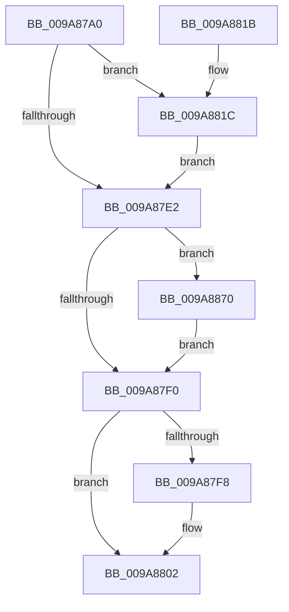

# CmpCheckAdminAccess

- RVA: `0x009A87A0`–`0x009A887C` (길이 `220` bytes)
- VA: `0x00000001409A87A0`
- 실행 섹션: `PAGE`
- PDB 이름 있음: `예`; PDB Function 태그: `아니요`
- unwind 정보 RVA: `0x0009CFE4`
- 디코드: `57`개 명령, `220/220` bytes 표시
- 미해석 바이트: `0` (있으면 어셈블리에 `.byte`로 보존)

> 이 문서는 커널 이미지의 기계어와 PDB 기호를 분석해 생성했습니다. 4번과 5번은 함수 원형과 자료형을 바이너리 사용 방식에서 추정한 C 해석이며 원본 소스 복구 결과는 아닙니다.

## 1. Dependencies

- 직접 호출 지점: **4**; 고유 호출 대상: **4**
- 직접 호출자로 확인된 함수: **3**
- RIP 상대 이미지 참조: **1**

### Outgoing calls
- `0x009A87D7` → [CmpBuildAdminInformation](CmpBuildAdminInformation_function_009A8884.md) (function, `0x009A8884`)
- `0x009A87FD` → [CmSiFreeMemory](../../text/47/CmSiFreeMemory_function_00475D80.md) (function, `0x00475D80`)
- `0x009A8862` → [SeAccessCheckFromState](../../text/3A/SeAccessCheckFromState_function_003A6650.md) (function, `0x003A6650`)
- `0x009A8872` → [ExFreePoolWithTag](../../poolcode/B8/ExFreePoolWithTag_function_00B82870.md) (function, `0x00B82870`)

### Direct callers
- [CmKeyBodyReplicateToVirtual](../84/CmKeyBodyReplicateToVirtual_function_00843FE4.md) at `0x0084415B`
- [CmpCheckOpenAccessOnKeyBody](../87/CmpCheckOpenAccessOnKeyBody_function_00870000.md) at `0x0087073F`
- [sub_00B37F04](../B3/Unknown_function_00B37F04.md) at `0x00B37F90`

### Static image references
- `0x009A881C` → RVA `0x00FC6AC0` (`ALMOSTRO`; read)

## 2. Other-region calls and transfers

- 다른 실행 섹션으로 향하는 call: **3**
  - `0x009A87FD` → [CmSiFreeMemory](../../text/47/CmSiFreeMemory_function_00475D80.md) (`PAGE` → `.text`)
  - `0x009A8862` → [SeAccessCheckFromState](../../text/3A/SeAccessCheckFromState_function_003A6650.md) (`PAGE` → `.text`)
  - `0x009A8872` → [ExFreePoolWithTag](../../poolcode/B8/ExFreePoolWithTag_function_00B82870.md) (`PAGE` → `POOLCODE`)
- 별도 외부 분기/꼬리 이동을 확인하지 못했습니다.

## 3. Assembly (complete function range)

```asm
009A87A0  48 8B C4                        mov rax, rsp
009A87A3  48 89 68 08                     mov qword ptr [rax + 8], rbp
009A87A7  48 89 70 10                     mov qword ptr [rax + 0x10], rsi
009A87AB  48 89 78 18                     mov qword ptr [rax + 0x18], rdi
009A87AF  41 56                           push r14
009A87B1  48 83 EC 70                     sub rsp, 0x70
009A87B5  83 60 DC 00                     and dword ptr [rax - 0x24], 0
009A87B9  48 8B EA                        mov rbp, rdx
009A87BC  83 60 D8 00                     and dword ptr [rax - 0x28], 0
009A87C0  44 8B F1                        mov r14d, ecx
009A87C3  48 83 60 E0 00                  and qword ptr [rax - 0x20], 0
009A87C8  48 8D 48 E0                     lea rcx, [rax - 0x20]
009A87CC  48 83 60 E8 00                  and qword ptr [rax - 0x18], 0
009A87D1  49 8B D0                        mov rdx, r8
009A87D4  49 8B F1                        mov rsi, r9
009A87D7  E8 A8 00 00 00                  call 0x1409a8884
009A87DC  8B F8                           mov edi, eax
009A87DE  85 C0                           test eax, eax
009A87E0  79 3A                           jns 0x1409a881c
009A87E2  48 8B 4C 24 60                  mov rcx, qword ptr [rsp + 0x60]
009A87E7  48 85 C9                        test rcx, rcx
009A87EA  0F 85 80 00 00 00               jne 0x1409a8870
009A87F0  48 83 7C 24 58 00               cmp qword ptr [rsp + 0x58], 0
009A87F6  74 0A                           je 0x1409a8802
009A87F8  48 8B 4C 24 58                  mov rcx, qword ptr [rsp + 0x58]
009A87FD  E8 7E D5 AC FF                  call 0x140475d80
009A8802  4C 8D 5C 24 70                  lea r11, [rsp + 0x70]
009A8807  8B C7                           mov eax, edi
009A8809  49 8B 6B 10                     mov rbp, qword ptr [r11 + 0x10]
009A880D  49 8B 73 18                     mov rsi, qword ptr [r11 + 0x18]
009A8811  49 8B 7B 20                     mov rdi, qword ptr [r11 + 0x20]
009A8815  49 8B E3                        mov rsp, r11
009A8818  41 5E                           pop r14
009A881A  C3                              ret
009A881B  CC                              int3
009A881C  48 8B 05 9D E2 61 00            mov rax, qword ptr [rip + 0x61e29d]
009A8823  48 8D 4C 24 50                  lea rcx, [rsp + 0x50]
009A8828  48 8B 54 24 58                  mov rdx, qword ptr [rsp + 0x58]
009A882D  48 83 C0 4C                     add rax, 0x4c
009A8831  48 89 4C 24 48                  mov qword ptr [rsp + 0x48], rcx
009A8836  45 8B CE                        mov r9d, r14d
009A8839  48 8D 4C 24 54                  lea rcx, [rsp + 0x54]
009A883E  45 33 C0                        xor r8d, r8d
009A8841  48 89 4C 24 40                  mov qword ptr [rsp + 0x40], rcx
009A8846  48 8B CD                        mov rcx, rbp
009A8849  C6 44 24 38 01                  mov byte ptr [rsp + 0x38], 1
009A884E  48 89 44 24 30                  mov qword ptr [rsp + 0x30], rax
009A8853  48 8D 44 24 60                  lea rax, [rsp + 0x60]
009A8858  48 89 44 24 28                  mov qword ptr [rsp + 0x28], rax
009A885D  83 64 24 20 00                  and dword ptr [rsp + 0x20], 0
009A8862  E8 E9 DD 9F FF                  call 0x1403a6650
009A8867  88 06                           mov byte ptr [rsi], al
009A8869  33 FF                           xor edi, edi
009A886B  E9 72 FF FF FF                  jmp 0x1409a87e2
009A8870  33 D2                           xor edx, edx
009A8872  E8 F9 9F 1D 00                  call 0x140b82870
009A8877  E9 74 FF FF FF                  jmp 0x1409a87f0
```

## 4. C-style interpretation (structured pseudocode)

```c
__int64 __fastcall CmpCheckAdminAccess(int a1, __int64 a2, __int64 a3, __int64 a4)
{
    __int64 result;
    __int64 v_rdi;
    __int64 v_rsp;
    unsigned __int64 v_stack_m10;
    unsigned __int64 v_stack_m18;
    unsigned __int64 v_stack_m1C;
    unsigned __int64 v_stack_m20;
    unsigned __int64 v_stack_m28;
    unsigned __int64 v_stack_m30;
    unsigned __int8 v_stack_m38;
    unsigned __int64 v_stack_m40;
    unsigned __int64 v_stack_m48;
    unsigned int v_stack_m50;
    unsigned __int64 v_stack_m8;

    *(unsigned __int64 *)(v_rsp + 8) = v_rbp;
    *(unsigned __int64 *)(v_rsp + 16) = v_rsi;
    *(unsigned __int64 *)(v_rsp + 24) = v_rdi;
    v_rsp = (v_rsp) - (112);
    result = CmpBuildAdminInformation(v_rsp - 32, a3, a3, a4);
    if (!sign_flag) goto loc_009A881C;
loc_009A87E2:
    if (v_stack_m18 != 0) goto loc_009A8870;
loc_009A87F0:
    if (v_stack_m20 != 0) {
        a1 = v_stack_m20;
        result = CmSiFreeMemory(a1, a3, a3, a4);
    }
    return (unsigned int)((unsigned int)((unsigned int)((unsigned int)(result))));
loc_009A881C:
    result = (*(unsigned __int64 *)(v_rip + 6415005)) + (76);
    v_stack_m28 = v_stack_m20;
    a3 = 0;
    v_stack_m30 = v_stack_m1C;
    v_stack_m38 = 1;
    v_stack_m40 = result;
    v_stack_m48 = v_stack_m10;
    result = SeAccessCheckFromState(*(unsigned __int64 *)(v_stack_m8 + 16), v_stack_m18, a3, (unsigned int)((unsigned int)((unsigned int)(a1))));
    *(unsigned __int8 *)(*(unsigned __int64 *)(v_stack_m8 + 24)) = (unsigned __int8)(result);
    v_rdi = 0;
    goto loc_009A87E2;
loc_009A8870:
    a2 = 0;
    result = ExFreePoolWithTag(*(unsigned __int64 *)(v_stack_m8 + 16), a2, a3, (unsigned int)((unsigned int)((unsigned int)(a1))));
    goto loc_009A87F0;
}
```

## 5. (Beta) C Style

```c
int64_t CmpCheckAdminAccess(int32_t Arg1, int64_t Arg2, int64_t Arg3, void *Arg4)
{
    uint8_t *arg4 = (uint8_t *)Arg4;

    int64_t result;
    int64_t local_rdi;
    int64_t local_rsp;
    uint64_t v_stack_m10;
    uint64_t v_stack_m18;
    uint64_t v_stack_m1C;
    uint64_t v_stack_m20;
    uint64_t v_stack_m28;
    uint64_t v_stack_m30;
    uint8_t v_stack_m38;
    uint64_t v_stack_m40;
    uint64_t v_stack_m48;
    uint32_t v_stack_m50;
    uint64_t v_stack_m8;

    *(uint64_t *)(local_rsp + 0x8) = local_rbp;
    *(uint64_t *)(local_rsp + 0x10) = local_rsi;
    *(uint64_t *)(local_rsp + 0x18) = local_rdi;
    local_rsp = (local_rsp) - (112);
    result = CmpBuildAdminInformation(local_rsp - 32, Arg3, Arg3, Arg4);
    if (!sign_flag) goto loc_009A881C;
loc_009A87E2:
    if (v_stack_m18 != 0) goto loc_009A8870;
loc_009A87F0:
    if (v_stack_m20 != 0) {
        Arg1 = v_stack_m20;
        result = CmSiFreeMemory(Arg1, Arg3, Arg3, Arg4);
    }
    return (uint32_t)((uint32_t)((uint32_t)((uint32_t)(result))));
loc_009A881C:
    result = (*(uint64_t *)(v_rip + 0x61E29D)) + (76);
    v_stack_m28 = v_stack_m20;
    Arg3 = 0;
    v_stack_m30 = v_stack_m1C;
    v_stack_m38 = 1;
    v_stack_m40 = result;
    v_stack_m48 = v_stack_m10;
    result = SeAccessCheckFromState(*(uint64_t *)(v_stack_m8 + 0x10), v_stack_m18, Arg3, (uint32_t)((uint32_t)((uint32_t)(Arg1))));
    *(uint8_t *)(*(uint64_t *)(v_stack_m8 + 0x18)) = (uint8_t)(result);
    local_rdi = 0;
    goto loc_009A87E2;
loc_009A8870:
    Arg2 = 0;
    result = ExFreePoolWithTag(*(uint64_t *)(v_stack_m8 + 0x10), Arg2, Arg3, (uint32_t)((uint32_t)((uint32_t)(Arg1))));
    goto loc_009A87F0;
}
```

### 관측된 메모리 오프셋

구조체 형식이 확인되지 않은 접근은 인자 기준의 오프셋으로만 기록했습니다.

| 기준 인자 | 오프셋 표현 | 폭 (bit) | 접근 |
|---|---:|---:|---|
| `Arg4` | `+ 0x0` | `8` | `W` |

## 6. Execution-region graph

[열기: 2D/3D 그래프와 함수 탐색 컨트롤 패널](../../../control-panel.html?section=page&rva=0x009A87A0&view=graph)

- 2D 그래프는 위에서 아래로 흐르고, 3D 그래프는 빈 공간을 드래그해 회전합니다. Shift+드래그는 이동, 휠은 확대·축소, 함수 노드 선택은 대상 보고서 이동입니다.

### Static fallback


