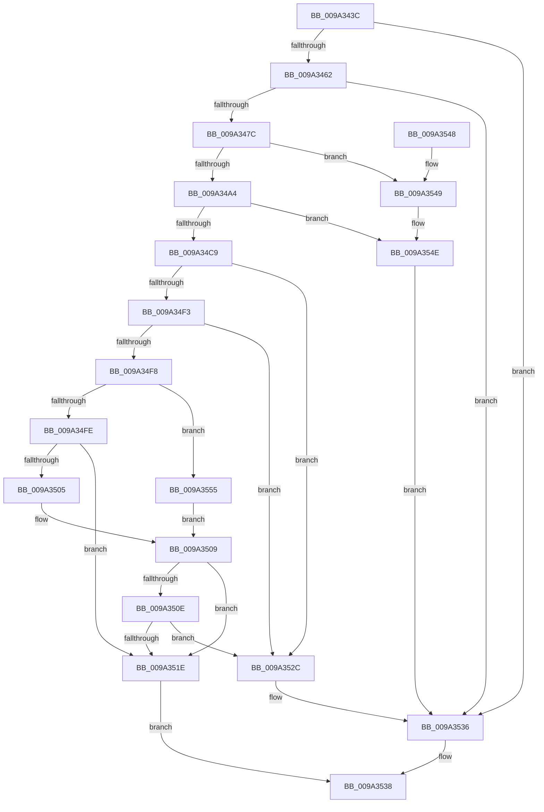

# CmpCheckExeOwnerForPca

- RVA: `0x009A343C`–`0x009A355B` (길이 `287` bytes)
- VA: `0x00000001409A343C`
- 실행 섹션: `PAGE`
- PDB 이름 있음: `예`; PDB Function 태그: `아니요`
- unwind 정보 RVA: `0x0009C368`
- 디코드: `78`개 명령, `287/287` bytes 표시
- 미해석 바이트: `0` (있으면 어셈블리에 `.byte`로 보존)

> 이 문서는 커널 이미지의 기계어와 PDB 기호를 분석해 생성했습니다. 4번과 5번은 함수 원형과 자료형을 바이너리 사용 방식에서 추정한 C 해석이며 원본 소스 복구 결과는 아닙니다.

## 1. Dependencies

- 직접 호출 지점: **10**; 고유 호출 대상: **7**
- 직접 호출자로 확인된 함수: **1**
- RIP 상대 이미지 참조: **1**

### Outgoing calls
- `0x009A3462` → [PsGetCurrentThreadProcess](../../text/47/PsGetCurrentThreadProcess_function_0047C7E0.md) (function, `0x0047C7E0`)
- `0x009A346F` → [PsReferenceProcessFilePointer](../8D/PsReferenceProcessFilePointer_function_008D6870.md) (function, `0x008D6870`)
- `0x009A3494` → [ObQuerySecurityObject](ObQuerySecurityObject_function_009A3564.md) (function, `0x009A3564`)
- `0x009A34B3` → [ExAllocatePool2](../../poolcode/B8/ExAllocatePool2_function_00B820F0.md) (function, `0x00B820F0`)
- `0x009A34DE` → [ObQuerySecurityObject](ObQuerySecurityObject_function_009A3564.md) (function, `0x009A3564`)
- `0x009A34EA` → [ObfDereferenceObject](../../text/2F/ObfDereferenceObject_function_002F9350.md) (function, `0x002F9350`)
- `0x009A3515` → [RtlEqualSid](../../text/40/RtlEqualSid_function_00400AD0.md) (function, `0x00400AD0`)
- `0x009A3523` → [ExFreePoolWithTag](../../poolcode/B8/ExFreePoolWithTag_function_00B82870.md) (function, `0x00B82870`)
- `0x009A3531` → [ExFreePoolWithTag](../../poolcode/B8/ExFreePoolWithTag_function_00B82870.md) (function, `0x00B82870`)
- `0x009A354E` → [ObfDereferenceObject](../../text/2F/ObfDereferenceObject_function_002F9350.md) (function, `0x002F9350`)

### Direct callers
- [CmpDoParseKey](../85/CmpDoParseKey_function_0085F750.md) at `0x00860B8F`

### Static image references
- `0x009A344E` → RVA `0x00FD8070` (`PAGEDATA`; read)

## 2. Other-region calls and transfers

- 다른 실행 섹션으로 향하는 call: **7**
  - `0x009A3462` → [PsGetCurrentThreadProcess](../../text/47/PsGetCurrentThreadProcess_function_0047C7E0.md) (`PAGE` → `.text`)
  - `0x009A34B3` → [ExAllocatePool2](../../poolcode/B8/ExAllocatePool2_function_00B820F0.md) (`PAGE` → `POOLCODE`)
  - `0x009A34EA` → [ObfDereferenceObject](../../text/2F/ObfDereferenceObject_function_002F9350.md) (`PAGE` → `.text`)
  - `0x009A3515` → [RtlEqualSid](../../text/40/RtlEqualSid_function_00400AD0.md) (`PAGE` → `.text`)
  - `0x009A3523` → [ExFreePoolWithTag](../../poolcode/B8/ExFreePoolWithTag_function_00B82870.md) (`PAGE` → `POOLCODE`)
  - `0x009A3531` → [ExFreePoolWithTag](../../poolcode/B8/ExFreePoolWithTag_function_00B82870.md) (`PAGE` → `POOLCODE`)
  - `0x009A354E` → [ObfDereferenceObject](../../text/2F/ObfDereferenceObject_function_002F9350.md) (`PAGE` → `.text`)
- 별도 외부 분기/꼬리 이동을 확인하지 못했습니다.

## 3. Assembly (complete function range)

```asm
009A343C  48 8B C4                        mov rax, rsp
009A343F  48 89 58 18                     mov qword ptr [rax + 0x18], rbx
009A3443  48 89 68 20                     mov qword ptr [rax + 0x20], rbp
009A3447  57                              push rdi
009A3448  48 83 EC 30                     sub rsp, 0x30
009A344C  33 ED                           xor ebp, ebp
009A344E  48 39 2D 1B 4C 63 00            cmp qword ptr [rip + 0x634c1b], rbp
009A3455  48 89 68 10                     mov qword ptr [rax + 0x10], rbp
009A3459  89 68 08                        mov dword ptr [rax + 8], ebp
009A345C  0F 84 D4 00 00 00               je 0x1409a3536
009A3462  E8 79 93 AD FF                  call 0x14047c7e0
009A3467  48 8B C8                        mov rcx, rax
009A346A  48 8D 54 24 48                  lea rdx, [rsp + 0x48]
009A346F  E8 FC 33 F3 FF                  call 0x1408d6870
009A3474  85 C0                           test eax, eax
009A3476  0F 88 BA 00 00 00               js 0x1409a3536
009A347C  48 8B 4C 24 48                  mov rcx, qword ptr [rsp + 0x48]
009A3481  48 8D 44 24 40                  lea rax, [rsp + 0x40]
009A3486  45 33 C9                        xor r9d, r9d
009A3489  48 89 44 24 20                  mov qword ptr [rsp + 0x20], rax
009A348E  45 33 C0                        xor r8d, r8d
009A3491  8D 55 01                        lea edx, [rbp + 1]
009A3494  E8 CB 00 00 00                  call 0x1409a3564
009A3499  3D 23 00 00 C0                  cmp eax, 0xc0000023
009A349E  0F 85 A5 00 00 00               jne 0x1409a3549
009A34A4  8B 54 24 40                     mov edx, dword ptr [rsp + 0x40]
009A34A8  B9 00 01 00 00                  mov ecx, 0x100
009A34AD  41 B8 43 4D 20 20               mov r8d, 0x20204d43
009A34B3  E8 38 EC 1D 00                  call 0x140b820f0
009A34B8  48 8B 4C 24 48                  mov rcx, qword ptr [rsp + 0x48]
009A34BD  48 8B F8                        mov rdi, rax
009A34C0  48 85 C0                        test rax, rax
009A34C3  0F 84 85 00 00 00               je 0x1409a354e
009A34C9  44 8B 4C 24 40                  mov r9d, dword ptr [rsp + 0x40]
009A34CE  48 8D 44 24 40                  lea rax, [rsp + 0x40]
009A34D3  4C 8B C7                        mov r8, rdi
009A34D6  48 89 44 24 20                  mov qword ptr [rsp + 0x20], rax
009A34DB  8D 55 01                        lea edx, [rbp + 1]
009A34DE  E8 81 00 00 00                  call 0x1409a3564
009A34E3  48 8B 4C 24 48                  mov rcx, qword ptr [rsp + 0x48]
009A34E8  8B D8                           mov ebx, eax
009A34EA  E8 61 5E 95 FF                  call 0x1402f9350
009A34EF  85 DB                           test ebx, ebx
009A34F1  78 39                           js 0x1409a352c
009A34F3  80 3F 01                        cmp byte ptr [rdi], 1
009A34F6  75 34                           jne 0x1409a352c
009A34F8  66 39 6F 02                     cmp word ptr [rdi + 2], bp
009A34FC  7D 57                           jge 0x1409a3555
009A34FE  8B 47 04                        mov eax, dword ptr [rdi + 4]
009A3501  85 C0                           test eax, eax
009A3503  74 19                           je 0x1409a351e
009A3505  48 8D 14 07                     lea rdx, [rdi + rax]
009A3509  48 85 D2                        test rdx, rdx
009A350C  74 10                           je 0x1409a351e
009A350E  48 8B 0D 5B 4B 63 00            mov rcx, qword ptr [rip + 0x634b5b]
009A3515  E8 B6 D5 A5 FF                  call 0x140400ad0
009A351A  84 C0                           test al, al
009A351C  75 0E                           jne 0x1409a352c
009A351E  33 D2                           xor edx, edx
009A3520  48 8B CF                        mov rcx, rdi
009A3523  E8 48 F3 1D 00                  call 0x140b82870
009A3528  B0 01                           mov al, 1
009A352A  EB 0C                           jmp 0x1409a3538
009A352C  33 D2                           xor edx, edx
009A352E  48 8B CF                        mov rcx, rdi
009A3531  E8 3A F3 1D 00                  call 0x140b82870
009A3536  32 C0                           xor al, al
009A3538  48 8B 5C 24 50                  mov rbx, qword ptr [rsp + 0x50]
009A353D  48 8B 6C 24 58                  mov rbp, qword ptr [rsp + 0x58]
009A3542  48 83 C4 30                     add rsp, 0x30
009A3546  5F                              pop rdi
009A3547  C3                              ret
009A3548  CC                              int3
009A3549  48 8B 4C 24 48                  mov rcx, qword ptr [rsp + 0x48]
009A354E  E8 FD 5D 95 FF                  call 0x1402f9350
009A3553  EB E1                           jmp 0x1409a3536
009A3555  48 8B 57 08                     mov rdx, qword ptr [rdi + 8]
009A3559  EB AE                           jmp 0x1409a3509
```

## 4. C-style interpretation (structured pseudocode)

```c
__int64 __fastcall CmpCheckExeOwnerForPca(__int64 a1, __int64 a2, int a3, int a4)
{
    __int64 result;
    __int64 v_rbp;
    __int64 v_rsp;
    unsigned __int64 v_stack_m18;
    unsigned __int64 v_stack_p10;
    unsigned __int64 v_stack_p18;
    unsigned __int64 v_stack_p20;
    unsigned __int64 v_stack_p48;
    unsigned __int64 v_stack_p8;

    *(unsigned __int64 *)(v_rsp + 24) = v_rbx;
    *(unsigned __int64 *)(v_rsp + 32) = v_rbp;
    v_rsp = (v_rsp) - (48);
    v_rbp = 0;
    *(unsigned __int64 *)(v_rsp + 16) = 0;
    *(unsigned int *)(v_rsp + 8) = 0;
    if ((*(unsigned __int64 *)(v_rip + 6507547)) == 0) goto loc_009A3536;
    result = PsGetCurrentThreadProcess(a1, a2, a3, a4);
    result = PsReferenceProcessFilePointer(result, v_stack_p10, a3, a4);
    if (sign_flag) goto loc_009A3536;
    a4 = 0;
    v_stack_m18 = v_stack_p8;
    a3 = 0;
    result = ObQuerySecurityObject(v_stack_p10, v_rbp + 1, a3, a4);
    if (((unsigned int)(result)) != 0xC0000023ULL) goto loc_009A3549;
    result = ExAllocatePool2(256, (unsigned int)(v_stack_p8), (unsigned int)(0x20204D43ULL), a4);
    if (result == 0) goto loc_009A354E;
    v_stack_m18 = v_stack_p8;
    result = ObQuerySecurityObject(v_stack_p10, v_rbp + 1, result, (unsigned int)(v_stack_p8));
    result = ObfDereferenceObject(v_stack_p10, v_rbp + 1, result, (unsigned int)(v_stack_p8));
    if (sign_flag) goto loc_009A352C;
    if ((*(unsigned __int8 *)(result)) != 1) goto loc_009A352C;
    if ((*(unsigned __int16 *)(result + 2)) >= 0) goto loc_009A3555;
    if ((unsigned int)((unsigned int)(*(unsigned int *)(result + 4))) == 0) goto loc_009A351E;
loc_009A3509:
    if (result + (unsigned int)(*(unsigned int *)(result + 4)) * 1 == 0) goto loc_009A351E;
    result = RtlEqualSid(*(unsigned __int64 *)(v_rip + 6507355), result + (unsigned int)(*(unsigned int *)(result + 4)) * 1, result, (unsigned int)(v_stack_p8));
    if ((unsigned __int8)(result) != 0) goto loc_009A352C;
loc_009A351E:
    a2 = 0;
    result = ExFreePoolWithTag(result, a2, result, (unsigned int)(v_stack_p8));
    goto loc_009A3538;
loc_009A352C:
    a2 = 0;
    result = ExFreePoolWithTag(result, a2, result, (unsigned int)(v_stack_p8));
loc_009A3536:
    result = 0;
loc_009A3538:
    v_rsp = (v_rsp) + (48);
    return result;
loc_009A3549:
loc_009A354E:
    result = ObfDereferenceObject(v_stack_p48, a2, result, (unsigned int)(v_stack_p8));
    goto loc_009A3536;
loc_009A3555:
    goto loc_009A3509;
}
```

## 5. (Beta) C Style

```c
int64_t CmpCheckExeOwnerForPca(int64_t Arg1, int64_t Arg2, int32_t Arg3, int32_t Arg4)
{
    int64_t result;
    int64_t local_rbp;
    int64_t local_rsp;
    uint64_t v_stack_m18;
    uint64_t v_stack_p10;
    uint64_t v_stack_p18;
    uint64_t v_stack_p20;
    uint64_t v_stack_p48;
    uint64_t v_stack_p8;

    *(uint64_t *)(local_rsp + 0x18) = local_rbx;
    *(uint64_t *)(local_rsp + 0x20) = local_rbp;
    local_rsp = (local_rsp) - (48);
    local_rbp = 0;
    *(uint64_t *)(local_rsp + 0x10) = 0;
    *(uint32_t *)(local_rsp + 0x8) = 0;
    if ((*(uint64_t *)(v_rip + 0x634C1B)) == 0) goto loc_009A3536;
    result = PsGetCurrentThreadProcess(Arg1, Arg2, Arg3, Arg4);
    result = PsReferenceProcessFilePointer(result, v_stack_p10, Arg3, Arg4);
    if (sign_flag) goto loc_009A3536;
    Arg4 = 0;
    v_stack_m18 = v_stack_p8;
    Arg3 = 0;
    result = ObQuerySecurityObject(v_stack_p10, local_rbp + 1, Arg3, Arg4);
    if (((uint32_t)(result)) != 0xC0000023ULL) goto loc_009A3549;
    result = ExAllocatePool2(256, (uint32_t)(v_stack_p8), (uint32_t)(0x20204D43ULL), Arg4);
    if (result == 0) goto loc_009A354E;
    v_stack_m18 = v_stack_p8;
    result = ObQuerySecurityObject(v_stack_p10, local_rbp + 1, result, (uint32_t)(v_stack_p8));
    result = ObfDereferenceObject(v_stack_p10, local_rbp + 1, result, (uint32_t)(v_stack_p8));
    if (sign_flag) goto loc_009A352C;
    if ((*(uint8_t *)(result)) != 1) goto loc_009A352C;
    if ((*(uint16_t *)(result + 0x2)) >= 0) goto loc_009A3555;
    if ((uint32_t)((uint32_t)(*(uint32_t *)(result + 0x4))) == 0) goto loc_009A351E;
loc_009A3509:
    if (result + (uint32_t)(*(uint32_t *)(result + 0x4)) * 1 == 0) goto loc_009A351E;
    result = RtlEqualSid(*(uint64_t *)(v_rip + 0x634B5B), result + (uint32_t)(*(uint32_t *)(result + 0x4)) * 1, result, (uint32_t)(v_stack_p8));
    if ((uint8_t)(result) != 0) goto loc_009A352C;
loc_009A351E:
    Arg2 = 0;
    result = ExFreePoolWithTag(result, Arg2, result, (uint32_t)(v_stack_p8));
    goto loc_009A3538;
loc_009A352C:
    Arg2 = 0;
    result = ExFreePoolWithTag(result, Arg2, result, (uint32_t)(v_stack_p8));
loc_009A3536:
    result = 0;
loc_009A3538:
    local_rsp = (local_rsp) + (48);
    return result;
loc_009A3549:
loc_009A354E:
    result = ObfDereferenceObject(v_stack_p48, Arg2, result, (uint32_t)(v_stack_p8));
    goto loc_009A3536;
loc_009A3555:
    goto loc_009A3509;
}
```

## 6. Execution-region graph

[열기: 2D/3D 그래프와 함수 탐색 컨트롤 패널](../../../control-panel.html?section=page&rva=0x009A343C&view=graph)

- 2D 그래프는 위에서 아래로 흐르고, 3D 그래프는 빈 공간을 드래그해 회전합니다. Shift+드래그는 이동, 휠은 확대·축소, 함수 노드 선택은 대상 보고서 이동입니다.

### Static fallback


