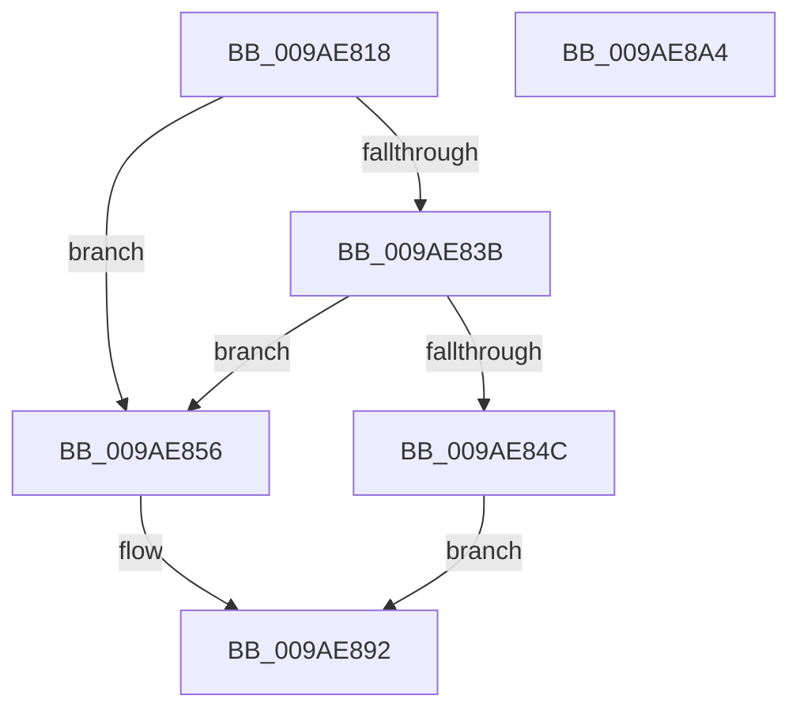

# CmpFreezeHive

- RVA: `0x009AE818`–`0x009AE8A5` (길이 `141` bytes)
- VA: `0x00000001409AE818`
- 실행 섹션: `PAGE`
- PDB 이름 있음: `예`; PDB Function 태그: `아니요`
- unwind 정보 RVA: `0x00086C28`
- 디코드: `38`개 명령, `141/141` bytes 표시
- 미해석 바이트: `0` (있으면 어셈블리에 `.byte`로 보존)

> 이 문서는 커널 이미지의 기계어와 PDB 기호를 분석해 생성했습니다. 4번과 5번은 함수 원형과 자료형을 바이너리 사용 방식에서 추정한 C 해석이며 원본 소스 복구 결과는 아닙니다.

## 1. Dependencies

- 직접 호출 지점: **4**; 고유 호출 대상: **4**
- 직접 호출자로 확인된 함수: **1**
- RIP 상대 이미지 참조: **1**

### Outgoing calls
- `0x009AE831` → [CmpReferenceKeyControlBlockUnsafe](../87/CmpReferenceKeyControlBlockUnsafe_function_00874DA0.md) (function, `0x00874DA0`)
- `0x009AE841` → [CmpRecordUnloadEventForHive](../7E/CmpRecordUnloadEventForHive_function_007EA6CC.md) (function, `0x007EA6CC`)
- `0x009AE84F` → [CmpDereferenceKeyControlBlockUnsafe](../99/CmpDereferenceKeyControlBlockUnsafe_function_0099F960.md) (function, `0x0099F960`)
- `0x009AE878` → [CmpEnumerateAllOpenSubKeys](../9B/CmpEnumerateAllOpenSubKeys_function_009B031C.md) (function, `0x009B031C`)

### Direct callers
- [CmpPerformUnloadKey](CmpPerformUnloadKey_function_009AFA28.md) at `0x009AFF5C`

### Static image references
- `0x009AE867` → RVA `0x007EB1E0` (`CmpSearchAndTagNoDelayCloseWorker`; read)

## 2. Other-region calls and transfers

- 다른 실행 섹션으로 향하는 call: **0**
- 별도 외부 분기/꼬리 이동을 확인하지 못했습니다.

## 3. Assembly (complete function range)

```asm
009AE818  48 89 5C 24 08                  mov qword ptr [rsp + 8], rbx
009AE81D  48 89 74 24 10                  mov qword ptr [rsp + 0x10], rsi
009AE822  57                              push rdi
009AE823  48 83 EC 40                     sub rsp, 0x40
009AE827  48 8B 71 20                     mov rsi, qword ptr [rcx + 0x20]
009AE82B  48 8B FA                        mov rdi, rdx
009AE82E  48 8B D9                        mov rbx, rcx
009AE831  E8 6A 65 EC FF                  call 0x140874da0
009AE836  48 85 FF                        test rdi, rdi
009AE839  74 1B                           je 0x1409ae856
009AE83B  48 8B D7                        mov rdx, rdi
009AE83E  48 8B CE                        mov rcx, rsi
009AE841  E8 86 BE E3 FF                  call 0x1407ea6cc
009AE846  8B F8                           mov edi, eax
009AE848  85 C0                           test eax, eax
009AE84A  79 0A                           jns 0x1409ae856
009AE84C  48 8B CB                        mov rcx, rbx
009AE84F  E8 0C 11 FF FF                  call 0x14099f960
009AE854  EB 3C                           jmp 0x1409ae892
009AE856  48 83 64 24 28 00               and qword ptr [rsp + 0x28], 0
009AE85C  4C 8D 4C 24 20                  lea r9, [rsp + 0x20]
009AE861  48 83 64 24 30 00               and qword ptr [rsp + 0x30], 0
009AE867  4C 8D 05 72 C9 E3 FF            lea r8, [rip - 0x1c368e]
009AE86E  33 D2                           xor edx, edx
009AE870  48 89 5C 24 20                  mov qword ptr [rsp + 0x20], rbx
009AE875  48 8B CB                        mov rcx, rbx
009AE878  E8 9F 1A 00 00                  call 0x1409b031c
009AE87D  66 83 4B 08 20                  or word ptr [rbx + 8], 0x20
009AE882  33 FF                           xor edi, edi
009AE884  C6 86 80 0B 00 00 01            mov byte ptr [rsi + 0xb80], 1
009AE88B  48 89 9E 78 0B 00 00            mov qword ptr [rsi + 0xb78], rbx
009AE892  48 8B 5C 24 50                  mov rbx, qword ptr [rsp + 0x50]
009AE897  8B C7                           mov eax, edi
009AE899  48 8B 74 24 58                  mov rsi, qword ptr [rsp + 0x58]
009AE89E  48 83 C4 40                     add rsp, 0x40
009AE8A2  5F                              pop rdi
009AE8A3  C3                              ret
009AE8A4  CC                              int3
```

## 4. C-style interpretation (structured pseudocode)

```c
__int64 __fastcall CmpFreezeHive(__int64 a1, __int64 a2)
{
    __int64 result;
    __int64 v_rdi;
    __int64 v_rsp;
    unsigned __int64 v_stack_m18;
    unsigned __int64 v_stack_m20;
    unsigned __int64 v_stack_m28;
    unsigned __int64 v_stack_p10;
    unsigned __int64 v_stack_p8;

    v_stack_p8 = v_rbx;
    v_stack_p10 = v_rsi;
    v_rsp = (v_rsp) - (64);
    result = CmpReferenceKeyControlBlockUnsafe(a1, a2, a3, a4);
    if (a2 == 0) goto loc_009AE856;
    result = CmpRecordUnloadEventForHive(*(unsigned __int64 *)(a1 + 32), a2, a3, a4);
    if (!sign_flag) goto loc_009AE856;
    result = CmpDereferenceKeyControlBlockUnsafe(a1, a2, a3, a4);
    goto loc_009AE892;
loc_009AE856:
    a2 = 0;
    v_stack_m28 = a1;
    result = CmpEnumerateAllOpenSubKeys(a1, a2, v_rip - 1848974, v_stack_m28);
    v_rdi = 0;
    *(unsigned __int8 *)(*(unsigned __int64 *)(a1 + 32) + 2944) = 1;
    *(unsigned __int64 *)(*(unsigned __int64 *)(a1 + 32) + 2936) = a1;
loc_009AE892:
    v_rsp = (v_rsp) + (64);
    return 0;
}
```

## 5. (Beta) C Style

```c
int64_t CmpFreezeHive(void *Arg1, int64_t Arg2)
{
    uint8_t *arg1 = (uint8_t *)Arg1;

    int64_t result;
    int64_t local_rdi;
    int64_t local_rsp;
    uint64_t v_stack_m18;
    uint64_t v_stack_m20;
    uint64_t v_stack_m28;
    uint64_t v_stack_p10;
    uint64_t v_stack_p8;

    v_stack_p8 = local_rbx;
    v_stack_p10 = local_rsi;
    local_rsp = (local_rsp) - (64);
    result = CmpReferenceKeyControlBlockUnsafe(Arg1, Arg2, a3, a4);
    if (Arg2 == 0) goto loc_009AE856;
    result = CmpRecordUnloadEventForHive(*(uint64_t *)(arg1 + 0x20), Arg2, a3, a4);
    if (!sign_flag) goto loc_009AE856;
    result = CmpDereferenceKeyControlBlockUnsafe(Arg1, Arg2, a3, a4);
    goto loc_009AE892;
loc_009AE856:
    Arg2 = 0;
    v_stack_m28 = Arg1;
    result = CmpEnumerateAllOpenSubKeys(Arg1, Arg2, v_rip - 1848974, v_stack_m28);
    local_rdi = 0;
    *(uint8_t *)(*(uint64_t *)(arg1 + 0x20) + 0xB80) = 1;
    *(void **)(*(uint64_t *)(arg1 + 0x20) + 0xB78) = Arg1;
loc_009AE892:
    local_rsp = (local_rsp) + (64);
    return 0;
}
```

### 관측된 메모리 오프셋

구조체 형식이 확인되지 않은 접근은 인자 기준의 오프셋으로만 기록했습니다.

| 기준 인자 | 오프셋 표현 | 폭 (bit) | 접근 |
|---|---:|---:|---|
| `Arg1` | `+ 0x8` | `16` | `R/W` |
| `Arg1` | `+ 0x20` | `64` | `R` |

## 6. Execution-region graph

[열기: 2D/3D 그래프와 함수 탐색 컨트롤 패널](../../../control-panel.html?section=page&rva=0x009AE818&view=graph)

- 2D 그래프는 위에서 아래로 흐르고, 3D 그래프는 빈 공간을 드래그해 회전합니다. Shift+드래그는 이동, 휠은 확대·축소, 함수 노드 선택은 대상 보고서 이동입니다.

### Static fallback


