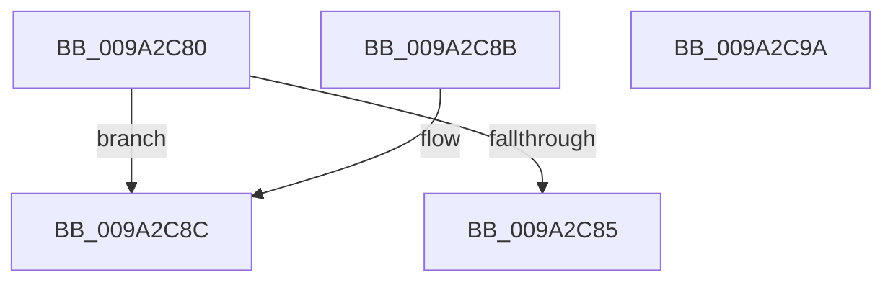

# CmpGetComponentHashAtIndex

- RVA: `0x009A2C80`–`0x009A2C9B` (길이 `27` bytes)
- VA: `0x00000001409A2C80`
- 실행 섹션: `PAGE`
- PDB 이름 있음: `예`; PDB Function 태그: `아니요`
- unwind 정보 RVA: `0x000DB714`
- 디코드: `11`개 명령, `27/27` bytes 표시
- 미해석 바이트: `0` (있으면 어셈블리에 `.byte`로 보존)

> 이 문서는 커널 이미지의 기계어와 PDB 기호를 분석해 생성했습니다. 4번과 5번은 함수 원형과 자료형을 바이너리 사용 방식에서 추정한 C 해석이며 원본 소스 복구 결과는 아닙니다.

## 1. Dependencies

- 직접 호출 지점: **0**; 고유 호출 대상: **0**
- 직접 호출자로 확인된 함수: **1**
- RIP 상대 이미지 참조: **0**

### Outgoing calls
- 직접 디코드된 call 명령이 없습니다.

### Direct callers
- [CmpDoParseKey](../85/CmpDoParseKey_function_0085F750.md) at `0x008614C1`

### Static image references
- 디코드된 RIP-relative 메모리 참조가 없습니다.

## 2. Other-region calls and transfers

- 다른 실행 섹션으로 향하는 call: **0**
- 별도 외부 분기/꼬리 이동을 확인하지 못했습니다.

## 3. Assembly (complete function range)

```asm
009A2C80  83 FA 08                        cmp edx, 8
009A2C83  73 07                           jae 0x1409a2c8c
009A2C85  8B C2                           mov eax, edx
009A2C87  8B 04 81                        mov eax, dword ptr [rcx + rax*4]
009A2C8A  C3                              ret
009A2C8B  CC                              int3
009A2C8C  48 8B 81 A0 00 00 00            mov rax, qword ptr [rcx + 0xa0]
009A2C93  83 C2 F8                        add edx, -8
009A2C96  8B 04 90                        mov eax, dword ptr [rax + rdx*4]
009A2C99  C3                              ret
009A2C9A  CC                              int3
```

## 4. C-style interpretation (structured pseudocode)

```c
__int64 __fastcall CmpGetComponentHashAtIndex(__int64 a1, int a2)
{
    if (a2 >= 8) goto loc_009A2C8C;
    return (unsigned int)(*(unsigned int *)(a1 + (unsigned int)(a2) * 4));
loc_009A2C8C:
    a2 = (unsigned int)((a2) + (-8));
    return (unsigned int)(*(unsigned int *)(*(unsigned __int64 *)(a1 + 160) + a2 * 4));
}
```

## 5. (Beta) C Style

```c
int64_t CmpGetComponentHashAtIndex(void *Arg1, int32_t Arg2)
{
    uint8_t *arg1 = (uint8_t *)Arg1;

    if (Arg2 >= 8) goto loc_009A2C8C;
    return (uint32_t)(*(uint32_t *)(arg1 + (uint32_t)(Arg2) * 4));
loc_009A2C8C:
    Arg2 = (uint32_t)((Arg2) + (-8));
    return (uint32_t)(*(uint32_t *)(*(uint64_t *)(arg1 + 0xA0) + Arg2 * 4));
}
```

### 관측된 메모리 오프셋

구조체 형식이 확인되지 않은 접근은 인자 기준의 오프셋으로만 기록했습니다.

| 기준 인자 | 오프셋 표현 | 폭 (bit) | 접근 |
|---|---:|---:|---|
| `Arg1` | `+ 0x0 + rax*4` | `32` | `R` |
| `Arg1` | `+ 0xA0` | `64` | `R` |

## 6. Execution-region graph

[열기: 2D/3D 그래프와 함수 탐색 컨트롤 패널](../../../control-panel.html?section=page&rva=0x009A2C80&view=graph)

- 2D 그래프는 위에서 아래로 흐르고, 3D 그래프는 빈 공간을 드래그해 회전합니다. Shift+드래그는 이동, 휠은 확대·축소, 함수 노드 선택은 대상 보고서 이동입니다.

### Static fallback


