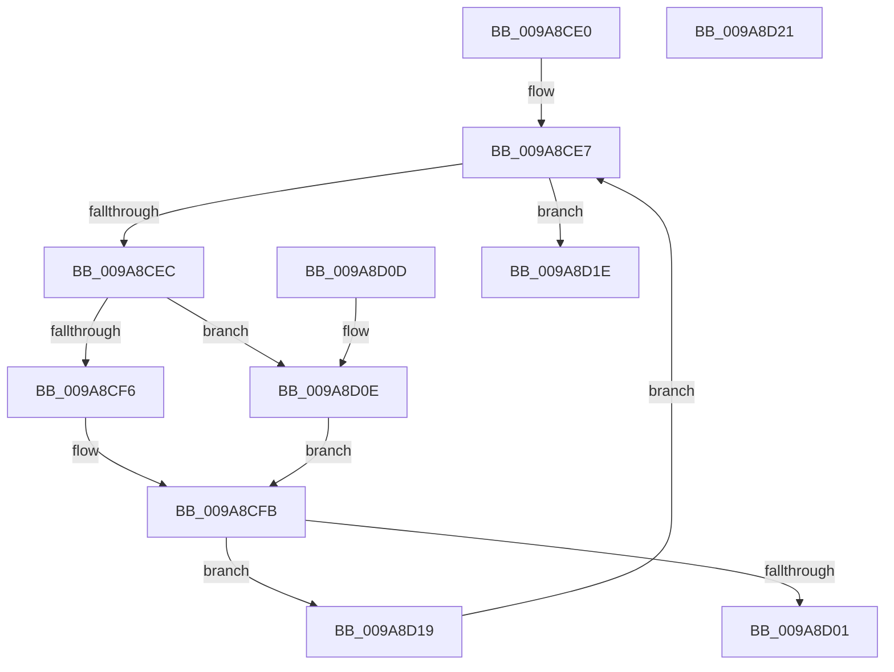

# CmpIsKeyStackSymlink

- RVA: `0x009A8CE0`–`0x009A8D22` (길이 `66` bytes)
- VA: `0x00000001409A8CE0`
- 실행 섹션: `PAGE`
- PDB 이름 있음: `예`; PDB Function 태그: `아니요`
- unwind 정보 RVA: `0x000DB714`
- 디코드: `23`개 명령, `66/66` bytes 표시
- 미해석 바이트: `0` (있으면 어셈블리에 `.byte`로 보존)

> 이 문서는 커널 이미지의 기계어와 PDB 기호를 분석해 생성했습니다. 4번과 5번은 함수 원형과 자료형을 바이너리 사용 방식에서 추정한 C 해석이며 원본 소스 복구 결과는 아닙니다.

## 1. Dependencies

- 직접 호출 지점: **0**; 고유 호출 대상: **0**
- 직접 호출자로 확인된 함수: **2**
- RIP 상대 이미지 참조: **0**

### Outgoing calls
- 직접 디코드된 call 명령이 없습니다.

### Direct callers
- [CmQueryLayeredKey](../../text/46/CmQueryLayeredKey_function_0046A930.md) at `0x0046AC1C`
- [CmpDoParseKey](../85/CmpDoParseKey_function_0085F750.md) at `0x0085FF96`
- [CmpDoParseKey](../85/CmpDoParseKey_function_0085F750.md) at `0x00860803`
- [CmpDoParseKey](../85/CmpDoParseKey_function_0085F750.md) at `0x00861D00`

### Static image references
- 디코드된 RIP-relative 메모리 참조가 없습니다.

## 2. Other-region calls and transfers

- 다른 실행 섹션으로 향하는 call: **0**
- 별도 외부 분기/꼬리 이동을 확인하지 못했습니다.

## 3. Assembly (complete function range)

```asm
009A8CE0  0F B7 41 02                     movzx eax, word ptr [rcx + 2]
009A8CE4  4C 8B C1                        mov r8, rcx
009A8CE7  66 85 C0                        test ax, ax
009A8CEA  78 32                           js 0x1409a8d1e
009A8CEC  48 0F BF D0                     movsx rdx, ax
009A8CF0  66 83 F8 02                     cmp ax, 2
009A8CF4  7D 18                           jge 0x1409a8d0e
009A8CF6  49 8B 54 D0 08                  mov rdx, qword ptr [r8 + rdx*8 + 8]
009A8CFB  83 7A 28 FF                     cmp dword ptr [rdx + 0x28], -1
009A8CFF  74 18                           je 0x1409a8d19
009A8D01  8B 82 B8 00 00 00               mov eax, dword ptr [rdx + 0xb8]
009A8D07  C1 E8 14                        shr eax, 0x14
009A8D0A  24 01                           and al, 1
009A8D0C  C3                              ret
009A8D0D  CC                              int3
009A8D0E  49 8B 48 18                     mov rcx, qword ptr [r8 + 0x18]
009A8D12  48 8B 54 D1 F0                  mov rdx, qword ptr [rcx + rdx*8 - 0x10]
009A8D17  EB E2                           jmp 0x1409a8cfb
009A8D19  66 FF C8                        dec ax
009A8D1C  EB C9                           jmp 0x1409a8ce7
009A8D1E  32 C0                           xor al, al
009A8D20  C3                              ret
009A8D21  CC                              int3
```

## 4. C-style interpretation (structured pseudocode)

```c
__int64 __fastcall CmpIsKeyStackSymlink(__int64 a1)
{
    __int64 result;

loc_009A8CE7:
    if (sign_flag) goto loc_009A8D1E;
    if (((unsigned __int16)(*(unsigned __int16 *)(a1 + 2))) >= 2) goto loc_009A8D0E;
loc_009A8CFB:
    if ((*(unsigned int *)(*(unsigned __int64 *)(a1 + (__int16)((unsigned __int16)(*(unsigned __int16 *)(a1 + 2))) * 8 + 8) + 40)) == -1) goto loc_009A8D19;
    result = (unsigned int)(((unsigned int)(*(unsigned int *)(*(unsigned __int64 *)(a1 + (__int16)((unsigned __int16)(*(unsigned __int16 *)(a1 + 2))) * 8 + 8) + 184))) >> (20));
    result = (unsigned __int8)((result) & (1));
    return result;
loc_009A8D0E:
    goto loc_009A8CFB;
loc_009A8D19:
    result = (unsigned __int16)((result) - 1);
    goto loc_009A8CE7;
loc_009A8D1E:
    result = 0;
    return result;
}
```

## 5. (Beta) C Style

```c
int64_t CmpIsKeyStackSymlink(void *Arg1)
{
    uint8_t *arg1 = (uint8_t *)Arg1;

    int64_t result;

loc_009A8CE7:
    if (sign_flag) goto loc_009A8D1E;
    if (((uint16_t)(*(uint16_t *)(arg1 + 0x2))) >= 2) goto loc_009A8D0E;
loc_009A8CFB:
    if ((*(uint32_t *)(*(uint64_t *)(arg1 + (int16_t)((uint16_t)(*(uint16_t *)(arg1 + 0x2))) * 8 + 0x8) + 0x28)) == -1) goto loc_009A8D19;
    result = (uint32_t)(((uint32_t)(*(uint32_t *)(*(uint64_t *)(arg1 + (int16_t)((uint16_t)(*(uint16_t *)(arg1 + 0x2))) * 8 + 0x8) + 0xB8))) >> (20));
    result = (uint8_t)((result) & (1));
    return result;
loc_009A8D0E:
    goto loc_009A8CFB;
loc_009A8D19:
    result = (uint16_t)((result) - 1);
    goto loc_009A8CE7;
loc_009A8D1E:
    result = 0;
    return result;
}
```

### 관측된 메모리 오프셋

구조체 형식이 확인되지 않은 접근은 인자 기준의 오프셋으로만 기록했습니다.

| 기준 인자 | 오프셋 표현 | 폭 (bit) | 접근 |
|---|---:|---:|---|
| `Arg1` | `+ 0x2` | `16` | `R` |
| `Arg1` | `+ 0x8 + rdx*8` | `64` | `R` |
| `Arg1` | `+ 0x18` | `64` | `R` |

## 6. Execution-region graph

[열기: 2D/3D 그래프와 함수 탐색 컨트롤 패널](../../../control-panel.html?section=page&rva=0x009A8CE0&view=graph)

- 2D 그래프는 위에서 아래로 흐르고, 3D 그래프는 빈 공간을 드래그해 회전합니다. Shift+드래그는 이동, 휠은 확대·축소, 함수 노드 선택은 대상 보고서 이동입니다.

### Static fallback


