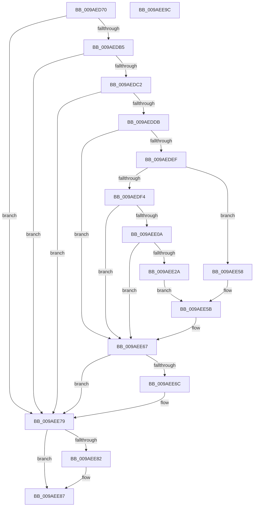

# CmpLogTransactionAbortedWithChildName

- RVA: `0x009AED70`–`0x009AEE9D` (길이 `301` bytes)
- VA: `0x00000001409AED70`
- 실행 섹션: `PAGE`
- PDB 이름 있음: `예`; PDB Function 태그: `아니요`
- unwind 정보 RVA: `0x0009E030`
- 디코드: `79`개 명령, `301/301` bytes 표시
- 미해석 바이트: `0` (있으면 어셈블리에 `.byte`로 보존)

> 이 문서는 커널 이미지의 기계어와 PDB 기호를 분석해 생성했습니다. 4번과 5번은 함수 원형과 자료형을 바이너리 사용 방식에서 추정한 C 해석이며 원본 소스 복구 결과는 아닙니다.

## 1. Dependencies

- 직접 호출 지점: **10**; 고유 호출 대상: **10**
- 직접 호출자로 확인된 함수: **10**
- RIP 상대 이미지 참조: **2**

### Outgoing calls
- `0x009AEDA6` → [RtlInitUnicodeString](../../text/42/RtlInitUnicodeString_function_0042A780.md) (function, `0x0042A780`)
- `0x009AEDCE` → [tlgKeywordOn](../../text/42/tlgKeywordOn_function_0042EAA0.md) (function, `0x0042EAA0`)
- `0x009AEDE2` → [CmpConstructNameFromKcbNameBlocks](../84/CmpConstructNameFromKcbNameBlocks_function_0084D510.md) (function, `0x0084D510`)
- `0x009AEE1C` → [CmpAllocatePool](../../text/3C/CmpAllocatePool_function_003CD504.md) (function, `0x003CD504`)
- `0x009AEE31` → [RtlUnicodeStringCopy](../../text/3D/RtlUnicodeStringCopy_function_003D4130.md) (function, `0x003D4130`)
- `0x009AEE41` → [RtlUnicodeStringCatString](../../text/41/RtlUnicodeStringCatString_function_0041CD30.md) (function, `0x0041CD30`)
- `0x009AEE4D` → [RtlUnicodeStringCat](../../text/3E/RtlUnicodeStringCat_function_003E6030.md) (function, `0x003E6030`)
- `0x009AEE62` → [CmpLogTransactionAbortedByName](../7E/CmpLogTransactionAbortedByName_function_007EFF20.md) (function, `0x007EFF20`)
- `0x009AEE74` → [CmpFreePoolWithTag](../../text/44/CmpFreePoolWithTag_function_004489E0.md) (function, `0x004489E0`)
- `0x009AEE82` → [CmSiFreeMemory](../../text/47/CmSiFreeMemory_function_00475D80.md) (function, `0x00475D80`)

### Direct callers
- [CmpSaveBootControlSet](../7D/CmpSaveBootControlSet_function_007DC744.md) at `0x007DCA52`
- [CmRestoreKey](../7D/CmRestoreKey_function_007DCF04.md) at `0x007DD3A9`
- [CmRestoreKey](../7D/CmRestoreKey_function_007DCF04.md) at `0x007DD47C`
- [CmRenameKey](../7E/CmRenameKey_function_007E8F48.md) at `0x007E95EA`
- [CmRenameKey](../7E/CmRenameKey_function_007E8F48.md) at `0x007E9671`
- [CmSetLastWriteTimeKey](../84/CmSetLastWriteTimeKey_function_00843368.md) at `0x008434CC`
- [CmSetValueKey](../84/CmSetValueKey_function_008457C0.md) at `0x00846658`
- [CmDeleteValueKey](../84/CmDeleteValueKey_function_008476E8.md) at `0x00847FB7`
- [CmDeleteValueKey](../84/CmDeleteValueKey_function_008476E8.md) at `0x008482C6`
- [CmpLogTransactionAbortedForRollbackPacket](CmpLogTransactionAbortedForRollbackPacket_function_009AE7F4.md) at `0x009AE804`
- [CmpPerformUnloadKey](CmpPerformUnloadKey_function_009AFA28.md) at `0x009AFDEF`
- [CmpPerformUnloadKey](CmpPerformUnloadKey_function_009AFA28.md) at `0x009AFE45`
- [CmpPerformUnloadKey](CmpPerformUnloadKey_function_009AFA28.md) at `0x009AFF1A`
- [sub_00B258D8](../B2/Unknown_function_00B258D8.md) at `0x00B25AD9`
- [sub_00B258D8](../B2/Unknown_function_00B258D8.md) at `0x00B25B25`
- [sub_00B258D8](../B2/Unknown_function_00B258D8.md) at `0x00B25B71`
- [sub_00B258D8](../B2/Unknown_function_00B258D8.md) at `0x00B25BBA`
- [sub_00B2D804](../B2/Unknown_function_00B2D804.md) at `0x00B2D814`

### Static image references
- `0x009AEDB5` → RVA `0x00E09F58` (`.data`; read)
- `0x009AEE36` → RVA `0x00AFC990` (` ?? ::NNGAKEGL::`string'`; read)

## 2. Other-region calls and transfers

- 다른 실행 섹션으로 향하는 call: **8**
  - `0x009AEDA6` → [RtlInitUnicodeString](../../text/42/RtlInitUnicodeString_function_0042A780.md) (`PAGE` → `.text`)
  - `0x009AEDCE` → [tlgKeywordOn](../../text/42/tlgKeywordOn_function_0042EAA0.md) (`PAGE` → `.text`)
  - `0x009AEE1C` → [CmpAllocatePool](../../text/3C/CmpAllocatePool_function_003CD504.md) (`PAGE` → `.text`)
  - `0x009AEE31` → [RtlUnicodeStringCopy](../../text/3D/RtlUnicodeStringCopy_function_003D4130.md) (`PAGE` → `.text`)
  - `0x009AEE41` → [RtlUnicodeStringCatString](../../text/41/RtlUnicodeStringCatString_function_0041CD30.md) (`PAGE` → `.text`)
  - `0x009AEE4D` → [RtlUnicodeStringCat](../../text/3E/RtlUnicodeStringCat_function_003E6030.md) (`PAGE` → `.text`)
  - `0x009AEE74` → [CmpFreePoolWithTag](../../text/44/CmpFreePoolWithTag_function_004489E0.md) (`PAGE` → `.text`)
  - `0x009AEE82` → [CmSiFreeMemory](../../text/47/CmSiFreeMemory_function_00475D80.md) (`PAGE` → `.text`)
- 별도 외부 분기/꼬리 이동을 확인하지 못했습니다.

## 3. Assembly (complete function range)

```asm
009AED70  48 8B C4                        mov rax, rsp
009AED73  48 89 58 08                     mov qword ptr [rax + 8], rbx
009AED77  48 89 78 10                     mov qword ptr [rax + 0x10], rdi
009AED7B  4C 89 70 18                     mov qword ptr [rax + 0x18], r14
009AED7F  4C 89 48 20                     mov qword ptr [rax + 0x20], r9
009AED83  55                              push rbp
009AED84  48 8B EC                        mov rbp, rsp
009AED87  48 83 EC 30                     sub rsp, 0x30
009AED8B  48 83 65 28 00                  and qword ptr [rbp + 0x28], 0
009AED90  48 8B FA                        mov rdi, rdx
009AED93  48 8B D9                        mov rbx, rcx
009AED96  0F 57 C0                        xorps xmm0, xmm0
009AED99  33 D2                           xor edx, edx
009AED9B  48 8D 4D F0                     lea rcx, [rbp - 0x10]
009AED9F  0F 11 45 F0                     movups xmmword ptr [rbp - 0x10], xmm0
009AEDA3  45 8B F0                        mov r14d, r8d
009AEDA6  E8 D5 B9 A7 FF                  call 0x14042a780
009AEDAB  83 7D 30 00                     cmp dword ptr [rbp + 0x30], 0
009AEDAF  0F 84 C4 00 00 00               je 0x1409aee79
009AEDB5  83 3D 9C B1 45 00 04            cmp dword ptr [rip + 0x45b19c], 4
009AEDBC  0F 86 B7 00 00 00               jbe 0x1409aee79
009AEDC2  BA 01 00 00 00                  mov edx, 1
009AEDC7  48 8D 0D 8A B1 45 00            lea rcx, [rip + 0x45b18a]
009AEDCE  E8 CD FC A7 FF                  call 0x14042eaa0
009AEDD3  84 C0                           test al, al
009AEDD5  0F 84 9E 00 00 00               je 0x1409aee79
009AEDDB  48 8D 55 28                     lea rdx, [rbp + 0x28]
009AEDDF  48 8B CB                        mov rcx, rbx
009AEDE2  E8 29 E7 E9 FF                  call 0x14084d510
009AEDE7  48 8B 5D 28                     mov rbx, qword ptr [rbp + 0x28]
009AEDEB  85 C0                           test eax, eax
009AEDED  78 78                           js 0x1409aee67
009AEDEF  48 85 FF                        test rdi, rdi
009AEDF2  74 64                           je 0x1409aee58
009AEDF4  0F B7 0B                        movzx ecx, word ptr [rbx]
009AEDF7  0F B7 17                        movzx edx, word ptr [rdi]
009AEDFA  48 83 C1 02                     add rcx, 2
009AEDFE  48 03 D1                        add rdx, rcx
009AEE01  48 81 FA FF FF 00 00            cmp rdx, 0xffff
009AEE08  77 5D                           ja 0x1409aee67
009AEE0A  0F B7 D2                        movzx edx, dx
009AEE0D  B9 00 01 00 00                  mov ecx, 0x100
009AEE12  41 B8 43 4D 4E 62               mov r8d, 0x624e4d43
009AEE18  66 89 55 F2                     mov word ptr [rbp - 0xe], dx
009AEE1C  E8 E3 E6 A1 FF                  call 0x1403cd504
009AEE21  48 89 45 F8                     mov qword ptr [rbp - 8], rax
009AEE25  48 85 C0                        test rax, rax
009AEE28  74 3D                           je 0x1409aee67
009AEE2A  48 8B D3                        mov rdx, rbx
009AEE2D  48 8D 4D F0                     lea rcx, [rbp - 0x10]
009AEE31  E8 FA 52 A2 FF                  call 0x1403d4130
009AEE36  48 8D 15 53 DB 14 00            lea rdx, [rip + 0x14db53]
009AEE3D  48 8D 4D F0                     lea rcx, [rbp - 0x10]
009AEE41  E8 EA DE A6 FF                  call 0x14041cd30
009AEE46  48 8B D7                        mov rdx, rdi
009AEE49  48 8D 4D F0                     lea rcx, [rbp - 0x10]
009AEE4D  E8 DE 71 A3 FF                  call 0x1403e6030
009AEE52  48 8D 4D F0                     lea rcx, [rbp - 0x10]
009AEE56  EB 03                           jmp 0x1409aee5b
009AEE58  48 8B CB                        mov rcx, rbx
009AEE5B  44 8B 4D 30                     mov r9d, dword ptr [rbp + 0x30]
009AEE5F  41 8B D6                        mov edx, r14d
009AEE62  E8 B9 10 E4 FF                  call 0x1407eff20
009AEE67  48 85 DB                        test rbx, rbx
009AEE6A  74 0D                           je 0x1409aee79
009AEE6C  BA 43 4D 4E 62                  mov edx, 0x624e4d43
009AEE71  48 8B CB                        mov rcx, rbx
009AEE74  E8 67 9B A9 FF                  call 0x1404489e0
009AEE79  48 8B 4D F8                     mov rcx, qword ptr [rbp - 8]
009AEE7D  48 85 C9                        test rcx, rcx
009AEE80  74 05                           je 0x1409aee87
009AEE82  E8 F9 6E AC FF                  call 0x140475d80
009AEE87  48 8B 5C 24 40                  mov rbx, qword ptr [rsp + 0x40]
009AEE8C  48 8B 7C 24 48                  mov rdi, qword ptr [rsp + 0x48]
009AEE91  4C 8B 74 24 50                  mov r14, qword ptr [rsp + 0x50]
009AEE96  48 83 C4 30                     add rsp, 0x30
009AEE9A  5D                              pop rbp
009AEE9B  C3                              ret
009AEE9C  CC                              int3
```

## 4. C-style interpretation (structured pseudocode)

```c
__int64 __fastcall CmpLogTransactionAbortedWithChildName(__int64 a1, __int64 a2, int a3, __int64 a4, unsigned int a5)
{
    __int64 result;
    __int64 v_rsp;
    unsigned __int64 v_stack_m10;
    unsigned __int16 v_stack_m16;
    unsigned __int64 v_stack_m18;
    unsigned __int64 v_stack_p10;
    unsigned __int64 v_stack_p18;
    unsigned __int64 v_stack_p20;
    unsigned __int64 v_stack_p8;

    *(unsigned __int64 *)(v_rsp + 8) = v_rbx;
    *(unsigned __int64 *)(v_rsp + 16) = v_rdi;
    *(unsigned __int64 *)(v_rsp + 24) = v_r14;
    *(unsigned __int64 *)(v_rsp + 32) = a4;
    v_rsp = (v_rsp) - (48);
    a2 = 0;
    v_stack_m18 = v_xmm0;
    result = RtlInitUnicodeString(v_stack_m18, a2, a3, a4);
    if (a5 == 0) goto loc_009AEE79;
    if ((*(unsigned int *)(v_rip + 4567452)) <= 4) goto loc_009AEE79;
    result = tlgKeywordOn(v_rip + 4567434, 1, a3, a4);
    if ((unsigned __int8)(result) == 0) goto loc_009AEE79;
    result = CmpConstructNameFromKcbNameBlocks(a1, v_stack_p20, a3, a4);
    if (sign_flag) goto loc_009AEE67;
    if (0 == 0) goto loc_009AEE58;
    a1 = (*(unsigned __int16 *)(v_stack_p20)) + (2);
    a2 = (*(unsigned __int16 *)(a2)) + (a1);
    if (a2 > 0xFFFFULL) goto loc_009AEE67;
    v_stack_m16 = (unsigned __int16)((unsigned __int16)(a2));
    result = CmpAllocatePool(256, (unsigned __int16)(a2), (unsigned int)(0x624E4D43ULL), a4);
    v_stack_m10 = result;
    if (result == 0) goto loc_009AEE67;
    result = RtlUnicodeStringCopy(v_stack_m18, v_stack_p20, (unsigned int)(0x624E4D43ULL), a4);
    result = RtlUnicodeStringCatString(v_stack_m18, v_rip + 1366867, (unsigned int)(0x624E4D43ULL), a4);
    result = RtlUnicodeStringCat(v_stack_m18, a2, (unsigned int)(0x624E4D43ULL), a4);
    goto loc_009AEE5B;
loc_009AEE58:
loc_009AEE5B:
    result = CmpLogTransactionAbortedByName(v_stack_p20, (unsigned int)((unsigned int)((unsigned int)(a3))), (unsigned int)(0x624E4D43ULL), (unsigned int)(a5));
loc_009AEE67:
    if (v_stack_p20 != 0) {
        a2 = 0x624E4D43ULL;
        a1 = v_stack_p20;
        result = CmpFreePoolWithTag(a1, a2, (unsigned int)(0x624E4D43ULL), (unsigned int)(a5));
    }
    if (v_stack_m10 != 0) {
        result = CmSiFreeMemory(v_stack_m10, a2, (unsigned int)(0x624E4D43ULL), (unsigned int)(a5));
    }
    v_rsp = (v_rsp) + (48);
    return result;
}
```

## 5. (Beta) C Style

```c
int64_t CmpLogTransactionAbortedWithChildName(int64_t Arg1, int64_t Arg2, int32_t Arg3, int64_t Arg4, uint32_t Arg5)
{
    int64_t result;
    int64_t local_rsp;
    uint64_t v_stack_m10;
    uint16_t v_stack_m16;
    uint64_t v_stack_m18;
    uint64_t v_stack_p10;
    uint64_t v_stack_p18;
    uint64_t v_stack_p20;
    uint64_t v_stack_p8;

    *(uint64_t *)(local_rsp + 0x8) = local_rbx;
    *(uint64_t *)(local_rsp + 0x10) = local_rdi;
    *(uint64_t *)(local_rsp + 0x18) = local_r14;
    *(uint64_t *)(local_rsp + 0x20) = Arg4;
    local_rsp = (local_rsp) - (48);
    Arg2 = 0;
    v_stack_m18 = v_xmm0;
    result = RtlInitUnicodeString(v_stack_m18, Arg2, Arg3, Arg4);
    if (Arg5 == 0) goto loc_009AEE79;
    if ((*(uint32_t *)(v_rip + 0x45B19C)) <= 4) goto loc_009AEE79;
    result = tlgKeywordOn(v_rip + 4567434, 1, Arg3, Arg4);
    if ((uint8_t)(result) == 0) goto loc_009AEE79;
    result = CmpConstructNameFromKcbNameBlocks(Arg1, v_stack_p20, Arg3, Arg4);
    if (sign_flag) goto loc_009AEE67;
    if (0 == 0) goto loc_009AEE58;
    Arg1 = (*(uint16_t *)(v_stack_p20)) + (2);
    Arg2 = (*(uint16_t *)(Arg2)) + (Arg1);
    if (Arg2 > 0xFFFFULL) goto loc_009AEE67;
    v_stack_m16 = (uint16_t)((uint16_t)(Arg2));
    result = CmpAllocatePool(256, (uint16_t)(Arg2), (uint32_t)(0x624E4D43ULL), Arg4);
    v_stack_m10 = result;
    if (result == 0) goto loc_009AEE67;
    result = RtlUnicodeStringCopy(v_stack_m18, v_stack_p20, (uint32_t)(0x624E4D43ULL), Arg4);
    result = RtlUnicodeStringCatString(v_stack_m18, v_rip + 1366867, (uint32_t)(0x624E4D43ULL), Arg4);
    result = RtlUnicodeStringCat(v_stack_m18, Arg2, (uint32_t)(0x624E4D43ULL), Arg4);
    goto loc_009AEE5B;
loc_009AEE58:
loc_009AEE5B:
    result = CmpLogTransactionAbortedByName(v_stack_p20, (uint32_t)((uint32_t)((uint32_t)(Arg3))), (uint32_t)(0x624E4D43ULL), (uint32_t)(Arg5));
loc_009AEE67:
    if (v_stack_p20 != 0) {
        Arg2 = 0x624E4D43ULL;
        Arg1 = v_stack_p20;
        result = CmpFreePoolWithTag(Arg1, Arg2, (uint32_t)(0x624E4D43ULL), (uint32_t)(Arg5));
    }
    if (v_stack_m10 != 0) {
        result = CmSiFreeMemory(v_stack_m10, Arg2, (uint32_t)(0x624E4D43ULL), (uint32_t)(Arg5));
    }
    local_rsp = (local_rsp) + (48);
    return result;
}
```

## 6. Execution-region graph

[열기: 2D/3D 그래프와 함수 탐색 컨트롤 패널](../../../control-panel.html?section=page&rva=0x009AED70&view=graph)

- 2D 그래프는 위에서 아래로 흐르고, 3D 그래프는 빈 공간을 드래그해 회전합니다. Shift+드래그는 이동, 휠은 확대·축소, 함수 노드 선택은 대상 보고서 이동입니다.

### Static fallback


