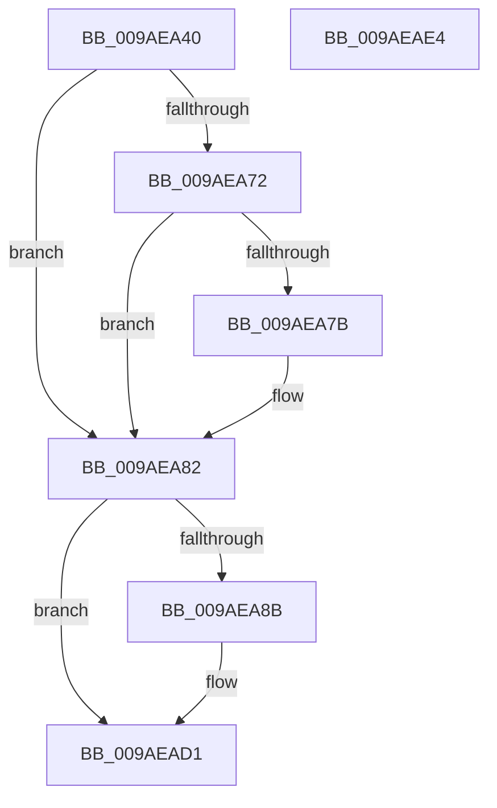

# CmpLogUnsupportedOperation

- RVA: `0x009AEA40`–`0x009AEAE5` (길이 `165` bytes)
- VA: `0x00000001409AEA40`
- 실행 섹션: `PAGE`
- PDB 이름 있음: `예`; PDB Function 태그: `아니요`
- unwind 정보 RVA: `0x0009DFE8`
- 디코드: `40`개 명령, `165/165` bytes 표시
- 미해석 바이트: `0` (있으면 어셈블리에 `.byte`로 보존)

> 이 문서는 커널 이미지의 기계어와 PDB 기호를 분석해 생성했습니다. 4번과 5번은 함수 원형과 자료형을 바이너리 사용 방식에서 추정한 C 해석이며 원본 소스 복구 결과는 아닙니다.

## 1. Dependencies

- 직접 호출 지점: **3**; 고유 호출 대상: **3**
- 직접 호출자로 확인된 함수: **8**
- RIP 상대 이미지 참조: **4**

### Outgoing calls
- `0x009AEA7D` → [CmpSendUnsupportedOperationTelemetryEvent](../7F/CmpSendUnsupportedOperationTelemetryEvent_function_007F180C.md) (function, `0x007F180C`)
- `0x009AEACC` → [tlgWriteTransfer_EtwWriteTransfer](../../text/42/tlgWriteTransfer_EtwWriteTransfer_function_004260E0.md) (function, `0x004260E0`)
- `0x009AEAD9` → [_security_check_cookie](../../text/6A/_security_check_cookie_function_006AC640.md) (function, `0x006AC640`)

### Direct callers
- [CmRestoreKey](../7D/CmRestoreKey_function_007DCF04.md) at `0x007DD0F2`
- [CmSaveKey](../7D/CmSaveKey_function_007DDBDC.md) at `0x007DDDB9`
- [CmSaveMergedKeys](../7D/CmSaveMergedKeys_function_007DE040.md) at `0x007DE45E`
- [NtCompactKeys](../7D/NtCompactKeys_function_007DF730.md) at `0x007DF931`
- [CmRenameKey](../7E/CmRenameKey_function_007E8F48.md) at `0x007EA049`
- [CmpDoParseKey](../85/CmpDoParseKey_function_0085F750.md) at `0x008609ED`
- [CmpCreateChild](../94/CmpCreateChild_function_0094817C.md) at `0x00948F7F`
- [CmpCreateChild](../94/CmpCreateChild_function_0094817C.md) at `0x00948FA4`
- [CmpPerformUnloadKey](CmpPerformUnloadKey_function_009AFA28.md) at `0x009AFEFB`

### Static image references
- `0x009AEA46` → RVA `0x00E0A740` (`.data`; read)
- `0x009AEA5D` → RVA `0x00EF5560` (`.data`; read)
- `0x009AEA82` → RVA `0x00E09F58` (`.data`; read)
- `0x009AEA9A` → RVA `0x000573E8` (`.rdata`; read)

## 2. Other-region calls and transfers

- 다른 실행 섹션으로 향하는 call: **2**
  - `0x009AEACC` → [tlgWriteTransfer_EtwWriteTransfer](../../text/42/tlgWriteTransfer_EtwWriteTransfer_function_004260E0.md) (`PAGE` → `.text`)
  - `0x009AEAD9` → [_security_check_cookie](../../text/6A/_security_check_cookie_function_006AC640.md) (`PAGE` → `.text`)
- 별도 외부 분기/꼬리 이동을 확인하지 못했습니다.

## 3. Assembly (complete function range)

```asm
009AEA40  40 53                           push rbx
009AEA42  48 83 EC 70                     sub rsp, 0x70
009AEA46  48 8B 05 F3 BC 45 00            mov rax, qword ptr [rip + 0x45bcf3]
009AEA4D  48 33 C4                        xor rax, rsp
009AEA50  48 89 44 24 68                  mov qword ptr [rsp + 0x68], rax
009AEA55  48 63 D9                        movsxd rbx, ecx
009AEA58  B8 01 00 00 00                  mov eax, 1
009AEA5D  48 8D 0D FC 6A 54 00            lea rcx, [rip + 0x546afc]
009AEA64  F0 0F C1 04 99                  lock xadd dword ptr [rcx + rbx*4], eax
009AEA69  FF C0                           inc eax
009AEA6B  3D FF FF FF 7F                  cmp eax, 0x7fffffff
009AEA70  75 10                           jne 0x1409aea82
009AEA72  33 D2                           xor edx, edx
009AEA74  87 14 99                        xchg dword ptr [rcx + rbx*4], edx
009AEA77  85 D2                           test edx, edx
009AEA79  74 07                           je 0x1409aea82
009AEA7B  8B CB                           mov ecx, ebx
009AEA7D  E8 8A 2D E4 FF                  call 0x1407f180c
009AEA82  83 3D CF B4 45 00 05            cmp dword ptr [rip + 0x45b4cf], 5
009AEA89  76 46                           jbe 0x1409aead1
009AEA8B  83 64 24 64 00                  and dword ptr [rsp + 0x64], 0
009AEA90  48 8D 44 24 30                  lea rax, [rsp + 0x30]
009AEA95  48 89 44 24 58                  mov qword ptr [rsp + 0x58], rax
009AEA9A  48 8D 15 47 89 6A FF            lea rdx, [rip - 0x9576b9]
009AEAA1  48 8D 44 24 38                  lea rax, [rsp + 0x38]
009AEAA6  89 5C 24 30                     mov dword ptr [rsp + 0x30], ebx
009AEAAA  48 89 44 24 28                  mov qword ptr [rsp + 0x28], rax
009AEAAF  48 8D 0D A2 B4 45 00            lea rcx, [rip + 0x45b4a2]
009AEAB6  45 33 C9                        xor r9d, r9d
009AEAB9  C7 44 24 20 03 00 00 00         mov dword ptr [rsp + 0x20], 3
009AEAC1  45 33 C0                        xor r8d, r8d
009AEAC4  C7 44 24 60 04 00 00 00         mov dword ptr [rsp + 0x60], 4
009AEACC  E8 0F 76 A7 FF                  call 0x1404260e0
009AEAD1  48 8B 4C 24 68                  mov rcx, qword ptr [rsp + 0x68]
009AEAD6  48 33 CC                        xor rcx, rsp
009AEAD9  E8 62 DB CF FF                  call 0x1406ac640
009AEADE  48 83 C4 70                     add rsp, 0x70
009AEAE2  5B                              pop rbx
009AEAE3  C3                              ret
009AEAE4  CC                              int3
```

## 4. C-style interpretation (structured pseudocode)

```c
__int64 __fastcall CmpLogUnsupportedOperation(int a1, int a2, int a3, int a4)
{
    __int64 result;
    __int64 v_rsp;
    unsigned __int64 v_stack_m10;
    unsigned int v_stack_m14;
    unsigned int v_stack_m18;
    unsigned __int64 v_stack_m20;
    unsigned __int64 v_stack_m40;
    unsigned __int64 v_stack_m48;
    unsigned __int64 v_stack_m50;
    unsigned int v_stack_m58;

    v_rsp = (v_rsp) - (112);
    result = (*(unsigned __int64 *)(v_rip + 4570355)) ^ (v_rsp);
    v_stack_m10 = result;
    result = (unsigned int)((1) + 1);
    if (((unsigned int)(result)) != 0x7FFFFFFFULL) goto loc_009AEA82;
    a2 = 0;
    if (0 != 0) {
        a1 = (unsigned int)((int)(a1));
        result = CmpSendUnsupportedOperationTelemetryEvent(a1, a2, a3, a4);
    }
    if ((*(unsigned int *)(v_rip + 4568271)) >= = 5) {
        result = v_stack_m48;
        v_stack_m20 = result;
        a2 = v_rip - 9795257;
        result = v_stack_m40;
        v_stack_m48 = (unsigned int)((int)(a1));
        v_stack_m50 = result;
        a1 = v_rip + 4568226;
        a4 = 0;
        v_stack_m58 = 3;
        a3 = 0;
        v_stack_m18 = 4;
        result = tlgWriteTransfer_EtwWriteTransfer(a1, a2, a3, a4);
    }
    a1 = (v_stack_m10) ^ (v_rsp);
    result = _security_check_cookie(a1, a2, a3, a4);
    v_rsp = (v_rsp) + (112);
    return result;
}
```

## 5. (Beta) C Style

```c
int64_t CmpLogUnsupportedOperation(int32_t Arg1, int32_t Arg2, int32_t Arg3, int32_t Arg4)
{
    int64_t result;
    int64_t local_rsp;
    uint64_t v_stack_m10;
    uint32_t v_stack_m14;
    uint32_t v_stack_m18;
    uint64_t v_stack_m20;
    uint64_t v_stack_m40;
    uint64_t v_stack_m48;
    uint64_t v_stack_m50;
    uint32_t v_stack_m58;

    local_rsp = (local_rsp) - (112);
    result = (*(uint64_t *)(v_rip + 0x45BCF3)) ^ (local_rsp);
    v_stack_m10 = result;
    result = (uint32_t)((1) + 1);
    if (((uint32_t)(result)) != 0x7FFFFFFFULL) goto loc_009AEA82;
    Arg2 = 0;
    if (0 != 0) {
        Arg1 = (uint32_t)((int32_t)(Arg1));
        result = CmpSendUnsupportedOperationTelemetryEvent(Arg1, Arg2, Arg3, Arg4);
    }
    if ((*(uint32_t *)(v_rip + 0x45B4CF)) >= = 5) {
        result = v_stack_m48;
        v_stack_m20 = result;
        Arg2 = v_rip - 9795257;
        result = v_stack_m40;
        v_stack_m48 = (uint32_t)((int32_t)(Arg1));
        v_stack_m50 = result;
        Arg1 = v_rip + 4568226;
        Arg4 = 0;
        v_stack_m58 = 3;
        Arg3 = 0;
        v_stack_m18 = 4;
        result = tlgWriteTransfer_EtwWriteTransfer(Arg1, Arg2, Arg3, Arg4);
    }
    Arg1 = (v_stack_m10) ^ (local_rsp);
    result = _security_check_cookie(Arg1, Arg2, Arg3, Arg4);
    local_rsp = (local_rsp) + (112);
    return result;
}
```

## 6. Execution-region graph

[열기: 2D/3D 그래프와 함수 탐색 컨트롤 패널](../../../control-panel.html?section=page&rva=0x009AEA40&view=graph)

- 2D 그래프는 위에서 아래로 흐르고, 3D 그래프는 빈 공간을 드래그해 회전합니다. Shift+드래그는 이동, 휠은 확대·축소, 함수 노드 선택은 대상 보고서 이동입니다.

### Static fallback


