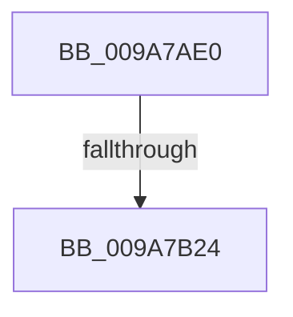

# CmpPopulateKeyBasicInformation

- RVA: `0x009A7AE0`–`0x009A7B31` (길이 `81` bytes)
- VA: `0x00000001409A7AE0`
- 실행 섹션: `PAGE`
- PDB 이름 있음: `예`; PDB Function 태그: `아니요`
- unwind 정보 RVA: `0x0009CC94`
- 디코드: `21`개 명령, `81/81` bytes 표시
- 미해석 바이트: `0` (있으면 어셈블리에 `.byte`로 보존)

> 이 문서는 커널 이미지의 기계어와 PDB 기호를 분석해 생성했습니다. 4번과 5번은 함수 원형과 자료형을 바이너리 사용 방식에서 추정한 C 해석이며 원본 소스 복구 결과는 아닙니다.

## 1. Dependencies

- 직접 호출 지점: **0**; 고유 호출 대상: **0**
- 직접 호출자로 확인된 함수: **1**
- RIP 상대 이미지 참조: **0**

### Outgoing calls
- 직접 디코드된 call 명령이 없습니다.

### Direct callers
- [CmpQueryKeyDataFromKeyNodeStack](../../text/46/CmpQueryKeyDataFromKeyNodeStack_function_0046AC40.md) at `0x0046B05F`

### Static image references
- 디코드된 RIP-relative 메모리 참조가 없습니다.

## 2. Other-region calls and transfers

- 다른 실행 섹션으로 향하는 call: **0**
- call이 아닌 외부 분기/꼬리 이동: **1**
  - `0x009A7B1E` → [sub_009A7BB1](Unknown_function_009A7BB1.md) (`tail-transfer`)

## 3. Assembly (complete function range)

```asm
009A7AE0  48 89 5C 24 10                  mov qword ptr [rsp + 0x10], rbx
009A7AE5  48 89 6C 24 18                  mov qword ptr [rsp + 0x18], rbp
009A7AEA  56                              push rsi
009A7AEB  48 83 EC 20                     sub rsp, 0x20
009A7AEF  44 0F B7 5A 48                  movzx r11d, word ptr [rdx + 0x48]
009A7AF4  49 8B D8                        mov rbx, r8
009A7AF7  48 8B 44 24 50                  mov rax, qword ptr [rsp + 0x50]
009A7AFC  45 0F B7 D3                     movzx r10d, r11w
009A7B00  66 45 03 D2                     add r10w, r10w
009A7B04  41 8B F1                        mov esi, r9d
009A7B07  F6 42 02 20                     test byte ptr [rdx + 2], 0x20
009A7B0B  66 45 0F 44 D3                  cmove r10w, r11w
009A7B10  45 0F B7 C2                     movzx r8d, r10w
009A7B14  41 8D 68 10                     lea ebp, [r8 + 0x10]
009A7B18  89 28                           mov dword ptr [rax], ebp
009A7B1A  41 83 F9 10                     cmp r9d, 0x10
009A7B1E  0F 82 8D 00 00 00               jb 0x1409a7bb1
009A7B24  48 8B 01                        mov rax, qword ptr [rcx]
009A7B27  41 83 C1 F0                     add r9d, -0x10
009A7B2B  48 89 03                        mov qword ptr [rbx], rax
009A7B2E  8B 41 08                        mov eax, dword ptr [rcx + 8]
```

## 4. C-style interpretation (structured pseudocode)

```c
__int64 __fastcall CmpPopulateKeyBasicInformation(__int64 a1, __int64 a2, __int64 a3, int a4, __int64 a5)
{
    __int64 v_r10;
    __int64 v_rsp;
    unsigned __int64 v_stack_p10;
    unsigned __int64 v_stack_p18;

    v_stack_p10 = v_rbx;
    v_stack_p18 = v_rbp;
    v_rsp = (v_rsp) - (32);
    v_r10 = (unsigned __int16)(((unsigned __int16)(*(unsigned __int16 *)(a2 + 72))) + ((unsigned __int16)((unsigned __int16)(*(unsigned __int16 *)(a2 + 72)))));
    if (((*(unsigned __int8 *)(a2 + 2)) & (32)) == 0) { v_r10 = (unsigned __int16)(*(unsigned __int16 *)(a2 + 72)); }
    *(unsigned int *)(a5) = (unsigned int)((unsigned __int16)(v_r10) + 16);
    a4 = (unsigned int)((a4) + (-16));
    *(unsigned __int64 *)(a3) = *(unsigned __int64 *)(a1);
    return (unsigned int)(*(unsigned int *)(a1 + 8));
}
```

## 5. (Beta) C Style

```c
int64_t CmpPopulateKeyBasicInformation(void *Arg1, void *Arg2, void *Arg3, int32_t Arg4, void *Arg5)
{
    uint8_t *arg1 = (uint8_t *)Arg1;
    uint8_t *arg2 = (uint8_t *)Arg2;
    uint8_t *arg3 = (uint8_t *)Arg3;
    uint8_t *arg5 = (uint8_t *)Arg5;

    int64_t local_r10;
    int64_t local_rsp;
    uint64_t v_stack_p10;
    uint64_t v_stack_p18;

    v_stack_p10 = local_rbx;
    v_stack_p18 = local_rbp;
    local_rsp = (local_rsp) - (32);
    local_r10 = (uint16_t)(((uint16_t)(*(uint16_t *)(arg2 + 0x48))) + ((uint16_t)((uint16_t)(*(uint16_t *)(arg2 + 0x48)))));
    if (((*(uint8_t *)(arg2 + 0x2)) & (32)) == 0) { local_r10 = (uint16_t)(*(uint16_t *)(arg2 + 0x48)); }
    *(uint32_t *)(arg5) = (uint32_t)((uint16_t)(local_r10) + 16);
    Arg4 = (uint32_t)((Arg4) + (-16));
    *(uint64_t *)(arg3) = *(uint64_t *)(arg1);
    return (uint32_t)(*(uint32_t *)(arg1 + 0x8));
}
```

### 관측된 메모리 오프셋

구조체 형식이 확인되지 않은 접근은 인자 기준의 오프셋으로만 기록했습니다.

| 기준 인자 | 오프셋 표현 | 폭 (bit) | 접근 |
|---|---:|---:|---|
| `Arg1` | `+ 0x0` | `64` | `R` |
| `Arg1` | `+ 0x8` | `32` | `R` |
| `Arg2` | `+ 0x2` | `8` | `R` |
| `Arg2` | `+ 0x48` | `16` | `R` |
| `Arg3` | `+ 0x0` | `64` | `W` |
| `Arg5` | `+ 0x0` | `32` | `W` |

## 6. Execution-region graph

[열기: 2D/3D 그래프와 함수 탐색 컨트롤 패널](../../../control-panel.html?section=page&rva=0x009A7AE0&view=graph)

- 2D 그래프는 위에서 아래로 흐르고, 3D 그래프는 빈 공간을 드래그해 회전합니다. Shift+드래그는 이동, 휠은 확대·축소, 함수 노드 선택은 대상 보고서 이동입니다.

### Static fallback


