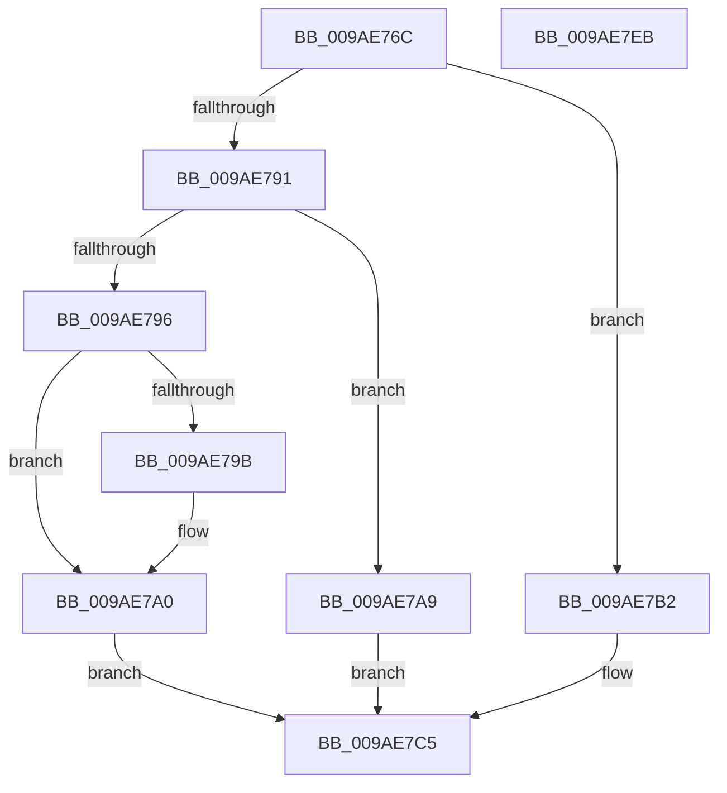

# CmpSearchForOpenSubKeys

- RVA: `0x009AE76C`–`0x009AE7EC` (길이 `128` bytes)
- VA: `0x00000001409AE76C`
- 실행 섹션: `PAGE`
- PDB 이름 있음: `예`; PDB Function 태그: `아니요`
- unwind 정보 RVA: `0x000718AC`
- 디코드: `38`개 명령, `128/128` bytes 표시
- 미해석 바이트: `0` (있으면 어셈블리에 `.byte`로 보존)

> 이 문서는 커널 이미지의 기계어와 PDB 기호를 분석해 생성했습니다. 4번과 5번은 함수 원형과 자료형을 바이너리 사용 방식에서 추정한 C 해석이며 원본 소스 복구 결과는 아닙니다.

## 1. Dependencies

- 직접 호출 지점: **2**; 고유 호출 대상: **2**
- 직접 호출자로 확인된 함수: **3**
- RIP 상대 이미지 참조: **3**

### Outgoing calls
- `0x009AE7C0` → [CmpDumpKeyBodyList](../7E/CmpDumpKeyBodyList_function_007EAB20.md) (function, `0x007EAB20`)
- `0x009AE7D2` → [CmpEnumerateAllOpenSubKeys](../9B/CmpEnumerateAllOpenSubKeys_function_009B031C.md) (function, `0x009B031C`)

### Direct callers
- [NtQueryOpenSubKeys](../7D/NtQueryOpenSubKeys_function_007DFF80.md) at `0x007E00DA`
- [NtQueryOpenSubKeysEx](../7E/NtQueryOpenSubKeysEx_function_007E0190.md) at `0x007E03B4`
- [CmRenameKey](../7E/CmRenameKey_function_007E8F48.md) at `0x007E9FE2`

### Static image references
- `0x009AE7A0` → RVA `0x007EB1E0` (`CmpSearchAndTagNoDelayCloseWorker`; read)
- `0x009AE7A9` → RVA `0x007EB1A0` (`CmpSearchAndRehashWorker`; read)
- `0x009AE7B9` → RVA `0x007EB180` (`CmpSearchAndCountWorker`; read)

## 2. Other-region calls and transfers

- 다른 실행 섹션으로 향하는 call: **0**
- 별도 외부 분기/꼬리 이동을 확인하지 못했습니다.

## 3. Assembly (complete function range)

```asm
009AE76C  48 8B C4                        mov rax, rsp
009AE76F  48 89 58 08                     mov qword ptr [rax + 8], rbx
009AE773  48 89 70 10                     mov qword ptr [rax + 0x10], rsi
009AE777  57                              push rdi
009AE778  48 83 EC 40                     sub rsp, 0x40
009AE77C  33 DB                           xor ebx, ebx
009AE77E  48 89 48 D8                     mov qword ptr [rax - 0x28], rcx
009AE782  48 89 58 E0                     mov qword ptr [rax - 0x20], rbx
009AE786  48 8B F1                        mov rsi, rcx
009AE789  4C 89 40 E8                     mov qword ptr [rax - 0x18], r8
009AE78D  85 D2                           test edx, edx
009AE78F  74 21                           je 0x1409ae7b2
009AE791  83 EA 01                        sub edx, 1
009AE794  74 13                           je 0x1409ae7a9
009AE796  83 FA 01                        cmp edx, 1
009AE799  74 05                           je 0x1409ae7a0
009AE79B  8D 4B 05                        lea ecx, [rbx + 5]
009AE79E  CD 29                           int 0x29
009AE7A0  48 8D 3D 39 CA E3 FF            lea rdi, [rip - 0x1c35c7]
009AE7A7  EB 1C                           jmp 0x1409ae7c5
009AE7A9  48 8D 3D F0 C9 E3 FF            lea rdi, [rip - 0x1c3610]
009AE7B0  EB 13                           jmp 0x1409ae7c5
009AE7B2  48 8D 54 24 28                  lea rdx, [rsp + 0x28]
009AE7B7  B3 01                           mov bl, 1
009AE7B9  48 8D 3D C0 C9 E3 FF            lea rdi, [rip - 0x1c3640]
009AE7C0  E8 5B C3 E3 FF                  call 0x1407eab20
009AE7C5  4C 8D 4C 24 20                  lea r9, [rsp + 0x20]
009AE7CA  4C 8B C7                        mov r8, rdi
009AE7CD  8A D3                           mov dl, bl
009AE7CF  48 8B CE                        mov rcx, rsi
009AE7D2  E8 45 1B 00 00                  call 0x1409b031c
009AE7D7  8B 44 24 28                     mov eax, dword ptr [rsp + 0x28]
009AE7DB  48 8B 5C 24 50                  mov rbx, qword ptr [rsp + 0x50]
009AE7E0  48 8B 74 24 58                  mov rsi, qword ptr [rsp + 0x58]
009AE7E5  48 83 C4 40                     add rsp, 0x40
009AE7E9  5F                              pop rdi
009AE7EA  C3                              ret
009AE7EB  CC                              int3
```

## 4. C-style interpretation (structured pseudocode)

```c
__int64 __fastcall CmpSearchForOpenSubKeys(__int64 a1, int a2, __int64 a3)
{
    __int64 result;
    __int64 v_rbx;
    __int64 v_rsp;
    unsigned __int64 v_stack_m20;
    unsigned __int64 v_stack_m28;
    unsigned __int64 v_stack_p10;
    unsigned __int64 v_stack_p8;

    *(unsigned __int64 *)(v_rsp + 8) = v_rbx;
    *(unsigned __int64 *)(v_rsp + 16) = v_rsi;
    v_rsp = (v_rsp) - (64);
    v_rbx = 0;
    *(unsigned __int64 *)(v_rsp - 40) = a1;
    *(unsigned __int64 *)(v_rsp - 32) = 0;
    *(unsigned __int64 *)(v_rsp - 24) = a3;
    if (a2 == 0) goto loc_009AE7B2;
    a2 = (unsigned int)((a2) - (1));
    if (condition_is_equal) goto loc_009AE7A9;
    if (a2 != 1) {
        a1 = v_rbx + 5;
    }
    goto loc_009AE7C5;
loc_009AE7A9:
    goto loc_009AE7C5;
loc_009AE7B2:
    result = CmpDumpKeyBodyList(a1, v_stack_m20, a3, a4);
loc_009AE7C5:
    result = CmpEnumerateAllOpenSubKeys(a1, 1, v_rip - 1848896, v_stack_m28);
    v_rsp = (v_rsp) + (64);
    return (unsigned int)(v_stack_m20);
}
```

## 5. (Beta) C Style

```c
int64_t CmpSearchForOpenSubKeys(int64_t Arg1, int32_t Arg2, int64_t Arg3)
{
    int64_t result;
    int64_t local_rbx;
    int64_t local_rsp;
    uint64_t v_stack_m20;
    uint64_t v_stack_m28;
    uint64_t v_stack_p10;
    uint64_t v_stack_p8;

    *(uint64_t *)(local_rsp + 0x8) = local_rbx;
    *(uint64_t *)(local_rsp + 0x10) = local_rsi;
    local_rsp = (local_rsp) - (64);
    local_rbx = 0;
    *(uint64_t *)(local_rsp - 0x28) = Arg1;
    *(uint64_t *)(local_rsp - 0x20) = 0;
    *(uint64_t *)(local_rsp - 0x18) = Arg3;
    if (Arg2 == 0) goto loc_009AE7B2;
    Arg2 = (uint32_t)((Arg2) - (1));
    if (condition_is_equal) goto loc_009AE7A9;
    if (Arg2 != 1) {
        Arg1 = local_rbx + 5;
    }
    goto loc_009AE7C5;
loc_009AE7A9:
    goto loc_009AE7C5;
loc_009AE7B2:
    result = CmpDumpKeyBodyList(Arg1, v_stack_m20, Arg3, a4);
loc_009AE7C5:
    result = CmpEnumerateAllOpenSubKeys(Arg1, 1, v_rip - 1848896, v_stack_m28);
    local_rsp = (local_rsp) + (64);
    return (uint32_t)(v_stack_m20);
}
```

## 6. Execution-region graph

[열기: 2D/3D 그래프와 함수 탐색 컨트롤 패널](../../../control-panel.html?section=page&rva=0x009AE76C&view=graph)

- 2D 그래프는 위에서 아래로 흐르고, 3D 그래프는 빈 공간을 드래그해 회전합니다. Shift+드래그는 이동, 휠은 확대·축소, 함수 노드 선택은 대상 보고서 이동입니다.

### Static fallback


