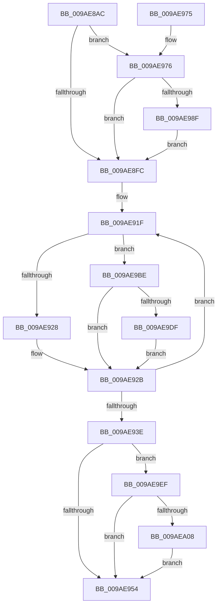

# CmpTransMgrCommit

- RVA: `0x009AE8AC`–`0x009AEA37` (길이 `395` bytes)
- VA: `0x00000001409AE8AC`
- 실행 섹션: `PAGE`
- PDB 이름 있음: `예`; PDB Function 태그: `아니요`
- unwind 정보 RVA: `0x0009DFC8`
- 디코드: `93`개 명령, `395/395` bytes 표시
- 미해석 바이트: `0` (있으면 어셈블리에 `.byte`로 보존)

> 이 문서는 커널 이미지의 기계어와 PDB 기호를 분석해 생성했습니다. 4번과 5번은 함수 원형과 자료형을 바이너리 사용 방식에서 추정한 C 해석이며 원본 소스 복구 결과는 아닙니다.

## 1. Dependencies

- 직접 호출 지점: **9**; 고유 호출 대상: **7**
- 직접 호출자로 확인된 함수: **3**
- RIP 상대 이미지 참조: **4**

### Outgoing calls
- `0x009AE900` → [CmpAttachToRegistryProcess](../../pagecmrc/BC/CmpAttachToRegistryProcess_function_00BC98E0.md) (function, `0x00BC98E0`)
- `0x009AE933` → [CmpCommitLightWeightTransaction](../9B/CmpCommitLightWeightTransaction_function_009B0868.md) (function, `0x009B0868`)
- `0x009AE942` → [CmpDetachFromRegistryProcess](../../pagecmrc/BC/CmpDetachFromRegistryProcess_function_00BC9920.md) (function, `0x00BC9920`)
- `0x009AE95D` → [_security_check_cookie](../../text/6A/_security_check_cookie_function_006AC640.md) (function, `0x006AC640`)
- `0x009AE982` → [tlgKeywordOn](../../text/42/tlgKeywordOn_function_0042EAA0.md) (function, `0x0042EAA0`)
- `0x009AE9B4` → [tlgWriteTransfer_EtwWriteTransfer](../../text/42/tlgWriteTransfer_EtwWriteTransfer_function_004260E0.md) (function, `0x004260E0`)
- `0x009AE9C6` → [KeDelayExecutionThread](../../text/20/KeDelayExecutionThread_function_00209550.md) (function, `0x00209550`)
- `0x009AE9FB` → [tlgKeywordOn](../../text/42/tlgKeywordOn_function_0042EAA0.md) (function, `0x0042EAA0`)
- `0x009AEA2D` → [tlgWriteTransfer_EtwWriteTransfer](../../text/42/tlgWriteTransfer_EtwWriteTransfer_function_004260E0.md) (function, `0x004260E0`)

### Direct callers
- [CmpLazyCommitWorker](../7E/CmpLazyCommitWorker_function_007EE030.md) at `0x007EE0D6`
- [CmpRmUnDoPhase](../7F/CmpRmUnDoPhase_function_007F0968.md) at `0x007F0A51`
- [CmKtmNotification](../9B/CmKtmNotification_function_009B1950.md) at `0x009B1C78`

### Static image references
- `0x009AE8C0` → RVA `0x00E0A740` (`.data`; read)
- `0x009AE8DA` → RVA `0x00E09F58` (`.data`; read)
- `0x009AE99B` → RVA `0x0005720C` (`.rdata`; read)
- `0x009AEA14` → RVA `0x000571EA` (`.rdata`; read)

## 2. Other-region calls and transfers

- 다른 실행 섹션으로 향하는 call: **8**
  - `0x009AE900` → [CmpAttachToRegistryProcess](../../pagecmrc/BC/CmpAttachToRegistryProcess_function_00BC98E0.md) (`PAGE` → `PAGECMRC`)
  - `0x009AE942` → [CmpDetachFromRegistryProcess](../../pagecmrc/BC/CmpDetachFromRegistryProcess_function_00BC9920.md) (`PAGE` → `PAGECMRC`)
  - `0x009AE95D` → [_security_check_cookie](../../text/6A/_security_check_cookie_function_006AC640.md) (`PAGE` → `.text`)
  - `0x009AE982` → [tlgKeywordOn](../../text/42/tlgKeywordOn_function_0042EAA0.md) (`PAGE` → `.text`)
  - `0x009AE9B4` → [tlgWriteTransfer_EtwWriteTransfer](../../text/42/tlgWriteTransfer_EtwWriteTransfer_function_004260E0.md) (`PAGE` → `.text`)
  - `0x009AE9C6` → [KeDelayExecutionThread](../../text/20/KeDelayExecutionThread_function_00209550.md) (`PAGE` → `.text`)
  - `0x009AE9FB` → [tlgKeywordOn](../../text/42/tlgKeywordOn_function_0042EAA0.md) (`PAGE` → `.text`)
  - `0x009AEA2D` → [tlgWriteTransfer_EtwWriteTransfer](../../text/42/tlgWriteTransfer_EtwWriteTransfer_function_004260E0.md) (`PAGE` → `.text`)
- 별도 외부 분기/꼬리 이동을 확인하지 못했습니다.

## 3. Assembly (complete function range)

```asm
009AE8AC  48 89 5C 24 08                  mov qword ptr [rsp + 8], rbx
009AE8B1  55                              push rbp
009AE8B2  56                              push rsi
009AE8B3  57                              push rdi
009AE8B4  48 8D 6C 24 B9                  lea rbp, [rsp - 0x47]
009AE8B9  48 81 EC B0 00 00 00            sub rsp, 0xb0
009AE8C0  48 8B 05 79 BE 45 00            mov rax, qword ptr [rip + 0x45be79]
009AE8C7  48 33 C4                        xor rax, rsp
009AE8CA  48 89 45 3F                     mov qword ptr [rbp + 0x3f], rax
009AE8CE  83 4D CB FF                     or dword ptr [rbp - 0x35], 0xffffffff
009AE8D2  33 C0                           xor eax, eax
009AE8D4  41 21 00                        and dword ptr [r8], eax
009AE8D7  0F 57 C0                        xorps xmm0, xmm0
009AE8DA  83 3D 77 B6 45 00 05            cmp dword ptr [rip + 0x45b677], 5
009AE8E1  48 8B DA                        mov rbx, rdx
009AE8E4  89 45 D3                        mov dword ptr [rbp - 0x2d], eax
009AE8E7  0F 11 45 EF                     movups xmmword ptr [rbp - 0x11], xmm0
009AE8EB  C7 45 C7 C0 BD F0 FF            mov dword ptr [rbp - 0x39], 0xfff0bdc0
009AE8F2  0F 11 45 FF                     movups xmmword ptr [rbp - 1], xmm0
009AE8F6  0F 11 45 0F                     movups xmmword ptr [rbp + 0xf], xmm0
009AE8FA  77 7A                           ja 0x1409ae976
009AE8FC  48 8D 4D EF                     lea rcx, [rbp - 0x11]
009AE900  E8 DB AF 21 00                  call 0x140bc98e0
009AE905  0F 57 C0                        xorps xmm0, xmm0
009AE908  40 B6 01                        mov sil, 1
009AE90B  0F 11 45 DF                     movups xmmword ptr [rbp - 0x21], xmm0
009AE90F  48 89 5D DF                     mov qword ptr [rbp - 0x21], rbx
009AE913  48 8B 5D C7                     mov rbx, qword ptr [rbp - 0x39]
009AE917  0F 11 45 CF                     movups xmmword ptr [rbp - 0x31], xmm0
009AE91B  C6 45 E7 01                     mov byte ptr [rbp - 0x19], 1
009AE91F  40 84 F6                        test sil, sil
009AE922  0F 84 96 00 00 00               je 0x1409ae9be
009AE928  40 32 F6                        xor sil, sil
009AE92B  83 65 CF 00                     and dword ptr [rbp - 0x31], 0
009AE92F  48 8D 4D CF                     lea rcx, [rbp - 0x31]
009AE933  E8 30 1F 00 00                  call 0x1409b0868
009AE938  8B F8                           mov edi, eax
009AE93A  85 C0                           test eax, eax
009AE93C  78 E1                           js 0x1409ae91f
009AE93E  48 8D 4D EF                     lea rcx, [rbp - 0x11]
009AE942  E8 D9 AF 21 00                  call 0x140bc9920
009AE947  83 3D 0A B6 45 00 05            cmp dword ptr [rip + 0x45b60a], 5
009AE94E  0F 87 9B 00 00 00               ja 0x1409ae9ef
009AE954  8B C7                           mov eax, edi
009AE956  48 8B 4D 3F                     mov rcx, qword ptr [rbp + 0x3f]
009AE95A  48 33 CC                        xor rcx, rsp
009AE95D  E8 DE DC CF FF                  call 0x1406ac640
009AE962  48 8B 9C 24 D0 00 00 00         mov rbx, qword ptr [rsp + 0xd0]
009AE96A  48 81 C4 B0 00 00 00            add rsp, 0xb0
009AE971  5F                              pop rdi
009AE972  5E                              pop rsi
009AE973  5D                              pop rbp
009AE974  C3                              ret
009AE975  CC                              int3
009AE976  BA 01 00 00 00                  mov edx, 1
009AE97B  48 8D 0D D6 B5 45 00            lea rcx, [rip + 0x45b5d6]
009AE982  E8 19 01 A8 FF                  call 0x14042eaa0
009AE987  84 C0                           test al, al
009AE989  0F 84 6D FF FF FF               je 0x1409ae8fc
009AE98F  48 8D 45 1F                     lea rax, [rbp + 0x1f]
009AE993  45 33 C9                        xor r9d, r9d
009AE996  48 89 44 24 28                  mov qword ptr [rsp + 0x28], rax
009AE99B  48 8D 15 6A 88 6A FF            lea rdx, [rip - 0x957796]
009AE9A2  45 33 C0                        xor r8d, r8d
009AE9A5  C7 44 24 20 02 00 00 00         mov dword ptr [rsp + 0x20], 2
009AE9AD  48 8D 0D A4 B5 45 00            lea rcx, [rip + 0x45b5a4]
009AE9B4  E8 27 77 A7 FF                  call 0x1404260e0
009AE9B9  E9 3E FF FF FF                  jmp 0x1409ae8fc
009AE9BE  4C 8D 45 C7                     lea r8, [rbp - 0x39]
009AE9C2  33 D2                           xor edx, edx
009AE9C4  33 C9                           xor ecx, ecx
009AE9C6  E8 85 AB 85 FF                  call 0x140209550
009AE9CB  48 03 DB                        add rbx, rbx
009AE9CE  48 89 5D C7                     mov qword ptr [rbp - 0x39], rbx
009AE9D2  48 81 FB 00 5D 1E EE            cmp rbx, -0x11e1a300
009AE9D9  0F 8E 4C FF FF FF               jle 0x1409ae92b
009AE9DF  48 C7 C3 00 5D 1E EE            mov rbx, 0xffffffffee1e5d00
009AE9E6  48 89 5D C7                     mov qword ptr [rbp - 0x39], rbx
009AE9EA  E9 3C FF FF FF                  jmp 0x1409ae92b
009AE9EF  BA 01 00 00 00                  mov edx, 1
009AE9F4  48 8D 0D 5D B5 45 00            lea rcx, [rip + 0x45b55d]
009AE9FB  E8 A0 00 A8 FF                  call 0x14042eaa0
009AEA00  84 C0                           test al, al
009AEA02  0F 84 4C FF FF FF               je 0x1409ae954
009AEA08  48 8D 45 1F                     lea rax, [rbp + 0x1f]
009AEA0C  45 33 C9                        xor r9d, r9d
009AEA0F  48 89 44 24 28                  mov qword ptr [rsp + 0x28], rax
009AEA14  48 8D 15 CF 87 6A FF            lea rdx, [rip - 0x957831]
009AEA1B  45 33 C0                        xor r8d, r8d
009AEA1E  C7 44 24 20 02 00 00 00         mov dword ptr [rsp + 0x20], 2
009AEA26  48 8D 0D 2B B5 45 00            lea rcx, [rip + 0x45b52b]
009AEA2D  E8 AE 76 A7 FF                  call 0x1404260e0
009AEA32  E9 1D FF FF FF                  jmp 0x1409ae954
```

## 4. C-style interpretation (structured pseudocode)

```c
__int64 __fastcall CmpTransMgrCommit(__int64 a1, __int64 a2, __int64 a3, int a4)
{
    __int64 result;
    __int64 v_rbx;
    __int64 v_rsi;
    __int64 v_rsp;
    unsigned __int64 v_stack_m20;
    unsigned __int64 v_stack_m40;
    unsigned __int64 v_stack_m50;
    unsigned __int64 v_stack_m5F;
    unsigned __int64 v_stack_m60;
    unsigned __int64 v_stack_m70;
    unsigned __int8 v_stack_m78;
    unsigned __int64 v_stack_m80;
    unsigned int v_stack_m8C;
    unsigned __int64 v_stack_m90;
    unsigned int v_stack_m94;
    unsigned int v_stack_m98;
    unsigned int v_stack_p20;
    unsigned __int64 v_stack_p28;
    unsigned __int64 v_stack_p8;

    v_stack_p8 = v_rbx;
    v_rsp = (v_rsp) - (176);
    result = (*(unsigned __int64 *)(v_rip + 4570745)) ^ (v_rsp);
    v_stack_m20 = result;
    result = 0;
    v_stack_m8C = 0;
    v_stack_m70 = v_xmm0;
    v_stack_m98 = 0xFFF0BDC0ULL;
    v_stack_m60 = v_xmm0;
    v_stack_m50 = v_xmm0;
    if ((*(unsigned int *)(v_rip + 4568695)) > 5) goto loc_009AE976;
loc_009AE8FC:
    result = CmpAttachToRegistryProcess(v_stack_m70, a2, a3, a4);
    v_stack_m80 = v_xmm0;
    v_stack_m80 = a2;
    v_stack_m90 = v_xmm0;
    v_stack_m78 = 1;
loc_009AE91F:
    if (1 == 0) goto loc_009AE9BE;
    v_rsi = 0;
loc_009AE92B:
    result = CmpCommitLightWeightTransaction(v_stack_m90, a2, a3, a4);
    if (sign_flag) goto loc_009AE91F;
    result = CmpDetachFromRegistryProcess(v_stack_m70, a2, a3, a4);
    if ((*(unsigned int *)(v_rip + 4568586)) > 5) goto loc_009AE9EF;
loc_009AE954:
    a1 = (v_stack_m20) ^ (v_rsp);
    result = _security_check_cookie(a1, a2, a3, a4);
    v_rsp = (v_rsp) + (176);
    return result;
loc_009AE976:
    result = tlgKeywordOn(v_rip + 4568534, 1, a3, a4);
    if ((unsigned __int8)(result) == 0) goto loc_009AE8FC;
    a4 = 0;
    v_stack_p28 = v_stack_m40;
    a3 = 0;
    v_stack_p20 = 2;
    result = tlgWriteTransfer_EtwWriteTransfer(v_rip + 4568484, v_rip - 9795478, a3, a4);
    goto loc_009AE8FC;
loc_009AE9BE:
    a2 = 0;
    a1 = 0;
    result = KeDelayExecutionThread(a1, a2, v_stack_m98, a4);
    v_rbx = (v_stack_p8) + (v_stack_p8);
    v_stack_m98 = v_rbx;
    if (v_rbx <= 0xFFFFFFFFEE1E5D00ULL) goto loc_009AE92B;
    v_stack_m98 = 0xFFFFFFFFEE1E5D00ULL;
    goto loc_009AE92B;
loc_009AE9EF:
    result = tlgKeywordOn(v_rip + 4568413, 1, v_stack_m98, a4);
    if ((unsigned __int8)(result) == 0) goto loc_009AE954;
    a4 = 0;
    v_stack_p28 = v_stack_m40;
    a3 = 0;
    v_stack_p20 = 2;
    result = tlgWriteTransfer_EtwWriteTransfer(v_rip + 4568363, v_rip - 9795633, a3, a4);
    goto loc_009AE954;
}
```

## 5. (Beta) C Style

```c
int64_t CmpTransMgrCommit(int64_t Arg1, int64_t Arg2, void *Arg3, int32_t Arg4)
{
    uint8_t *arg3 = (uint8_t *)Arg3;

    int64_t result;
    int64_t local_rbx;
    int64_t local_rsi;
    int64_t local_rsp;
    uint64_t v_stack_m20;
    uint64_t v_stack_m40;
    uint64_t v_stack_m50;
    uint64_t v_stack_m5F;
    uint64_t v_stack_m60;
    uint64_t v_stack_m70;
    uint8_t v_stack_m78;
    uint64_t v_stack_m80;
    uint32_t v_stack_m8C;
    uint64_t v_stack_m90;
    uint32_t v_stack_m94;
    uint32_t v_stack_m98;
    uint32_t v_stack_p20;
    uint64_t v_stack_p28;
    uint64_t v_stack_p8;

    v_stack_p8 = local_rbx;
    local_rsp = (local_rsp) - (176);
    result = (*(uint64_t *)(v_rip + 0x45BE79)) ^ (local_rsp);
    v_stack_m20 = result;
    result = 0;
    v_stack_m8C = 0;
    v_stack_m70 = v_xmm0;
    v_stack_m98 = 0xFFF0BDC0ULL;
    v_stack_m60 = v_xmm0;
    v_stack_m50 = v_xmm0;
    if ((*(uint32_t *)(v_rip + 0x45B677)) > 5) goto loc_009AE976;
loc_009AE8FC:
    result = CmpAttachToRegistryProcess(v_stack_m70, Arg2, Arg3, Arg4);
    v_stack_m80 = v_xmm0;
    v_stack_m80 = Arg2;
    v_stack_m90 = v_xmm0;
    v_stack_m78 = 1;
loc_009AE91F:
    if (1 == 0) goto loc_009AE9BE;
    local_rsi = 0;
loc_009AE92B:
    result = CmpCommitLightWeightTransaction(v_stack_m90, Arg2, Arg3, Arg4);
    if (sign_flag) goto loc_009AE91F;
    result = CmpDetachFromRegistryProcess(v_stack_m70, Arg2, Arg3, Arg4);
    if ((*(uint32_t *)(v_rip + 0x45B60A)) > 5) goto loc_009AE9EF;
loc_009AE954:
    Arg1 = (v_stack_m20) ^ (local_rsp);
    result = _security_check_cookie(Arg1, Arg2, Arg3, Arg4);
    local_rsp = (local_rsp) + (176);
    return result;
loc_009AE976:
    result = tlgKeywordOn(v_rip + 4568534, 1, Arg3, Arg4);
    if ((uint8_t)(result) == 0) goto loc_009AE8FC;
    Arg4 = 0;
    v_stack_p28 = v_stack_m40;
    Arg3 = 0;
    v_stack_p20 = 2;
    result = tlgWriteTransfer_EtwWriteTransfer(v_rip + 4568484, v_rip - 9795478, Arg3, Arg4);
    goto loc_009AE8FC;
loc_009AE9BE:
    Arg2 = 0;
    Arg1 = 0;
    result = KeDelayExecutionThread(Arg1, Arg2, v_stack_m98, Arg4);
    local_rbx = (v_stack_p8) + (v_stack_p8);
    v_stack_m98 = local_rbx;
    if (local_rbx <= 0xFFFFFFFFEE1E5D00ULL) goto loc_009AE92B;
    v_stack_m98 = 0xFFFFFFFFEE1E5D00ULL;
    goto loc_009AE92B;
loc_009AE9EF:
    result = tlgKeywordOn(v_rip + 4568413, 1, v_stack_m98, Arg4);
    if ((uint8_t)(result) == 0) goto loc_009AE954;
    Arg4 = 0;
    v_stack_p28 = v_stack_m40;
    Arg3 = 0;
    v_stack_p20 = 2;
    result = tlgWriteTransfer_EtwWriteTransfer(v_rip + 4568363, v_rip - 9795633, Arg3, Arg4);
    goto loc_009AE954;
}
```

### 관측된 메모리 오프셋

구조체 형식이 확인되지 않은 접근은 인자 기준의 오프셋으로만 기록했습니다.

| 기준 인자 | 오프셋 표현 | 폭 (bit) | 접근 |
|---|---:|---:|---|
| `Arg3` | `+ 0x0` | `32` | `R/W` |

## 6. Execution-region graph

[열기: 2D/3D 그래프와 함수 탐색 컨트롤 패널](../../../control-panel.html?section=page&rva=0x009AE8AC&view=graph)

- 2D 그래프는 위에서 아래로 흐르고, 3D 그래프는 빈 공간을 드래그해 회전합니다. Shift+드래그는 이동, 휠은 확대·축소, 함수 노드 선택은 대상 보고서 이동입니다.

### Static fallback


