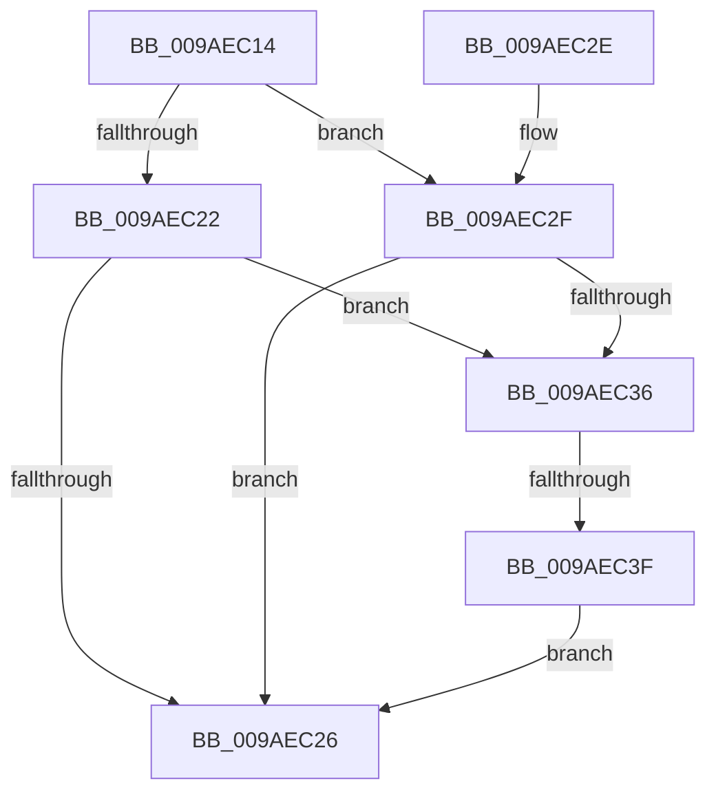

# CmpTryAcquireIXLockWithRollbackPacket

- RVA: `0x009AEC14`–`0x009AEC46` (길이 `50` bytes)
- VA: `0x00000001409AEC14`
- 실행 섹션: `PAGE`
- PDB 이름 있음: `예`; PDB Function 태그: `예`
- unwind 정보 RVA: `0x0009D0AC`
- 디코드: `20`개 명령, `50/50` bytes 표시
- 미해석 바이트: `0` (있으면 어셈블리에 `.byte`로 보존)

> 이 문서는 커널 이미지의 기계어와 PDB 기호를 분석해 생성했습니다. 4번과 5번은 함수 원형과 자료형을 바이너리 사용 방식에서 추정한 C 해석이며 원본 소스 복구 결과는 아닙니다.

## 1. Dependencies

- 직접 호출 지점: **0**; 고유 호출 대상: **0**
- 직접 호출자로 확인된 함수: **1**
- RIP 상대 이미지 참조: **0**

### Outgoing calls
- 직접 디코드된 call 명령이 없습니다.

### Direct callers
- [CmpTryAcquireKcbIXLocks](../9B/CmpTryAcquireKcbIXLocks_function_009B056C.md) at `0x009B058B`
- [CmpTryAcquireKcbIXLocks](../9B/CmpTryAcquireKcbIXLocks_function_009B056C.md) at `0x009B059E`

### Static image references
- 디코드된 RIP-relative 메모리 참조가 없습니다.

## 2. Other-region calls and transfers

- 다른 실행 섹션으로 향하는 call: **0**
- call이 아닌 외부 분기/꼬리 이동: **1**
  - `0x009AEC39` → [sub_00B2D7EA](../B2/Unknown_function_00B2D7EA.md) (`tail-transfer`)

## 3. Assembly (complete function range)

```asm
009AEC14  40 53                           push rbx
009AEC16  48 83 EC 20                     sub rsp, 0x20
009AEC1A  8B 01                           mov eax, dword ptr [rcx]
009AEC1C  33 DB                           xor ebx, ebx
009AEC1E  84 D2                           test dl, dl
009AEC20  74 0D                           je 0x1409aec2f
009AEC22  85 C0                           test eax, eax
009AEC24  75 10                           jne 0x1409aec36
009AEC26  8B C3                           mov eax, ebx
009AEC28  48 83 C4 20                     add rsp, 0x20
009AEC2C  5B                              pop rbx
009AEC2D  C3                              ret
009AEC2E  CC                              int3
009AEC2F  C1 E8 1F                        shr eax, 0x1f
009AEC32  34 01                           xor al, 1
009AEC34  75 F0                           jne 0x1409aec26
009AEC36  4D 85 C0                        test r8, r8
009AEC39  0F 85 AB EB 17 00               jne 0x140b2d7ea
009AEC3F  BB 01 00 19 C0                  mov ebx, 0xc0190001
009AEC44  EB E0                           jmp 0x1409aec26
```

## 4. C-style interpretation (structured pseudocode)

```c
__int64 __fastcall CmpTryAcquireIXLockWithRollbackPacket(__int64 a1, unsigned __int8 a2, __int64 a3)
{
    __int64 result;
    __int64 v_rbx;
    __int64 v_rsp;

    v_rsp = (v_rsp) - (32);
    v_rbx = 0;
    if (a2 == 0) goto loc_009AEC2F;
    if ((unsigned int)((unsigned int)(*(unsigned int *)(a1))) != 0) goto loc_009AEC36;
loc_009AEC26:
    v_rsp = (v_rsp) + (32);
    return 0;
loc_009AEC2F:
    result = (unsigned int)((0) >> (31));
    result = (unsigned __int8)((result) ^ (1));
    if (condition_is_not_equal) goto loc_009AEC26;
loc_009AEC36:
    goto loc_009AEC26;
}
```

## 5. (Beta) C Style

```c
int64_t CmpTryAcquireIXLockWithRollbackPacket(void *Arg1, uint8_t Arg2, int64_t Arg3)
{
    uint8_t *arg1 = (uint8_t *)Arg1;

    int64_t result;
    int64_t local_rbx;
    int64_t local_rsp;

    local_rsp = (local_rsp) - (32);
    local_rbx = 0;
    if (Arg2 == 0) goto loc_009AEC2F;
    if ((uint32_t)((uint32_t)(*(uint32_t *)(arg1))) != 0) goto loc_009AEC36;
loc_009AEC26:
    local_rsp = (local_rsp) + (32);
    return 0;
loc_009AEC2F:
    result = (uint32_t)((0) >> (31));
    result = (uint8_t)((result) ^ (1));
    if (condition_is_not_equal) goto loc_009AEC26;
loc_009AEC36:
    goto loc_009AEC26;
}
```

### 관측된 메모리 오프셋

구조체 형식이 확인되지 않은 접근은 인자 기준의 오프셋으로만 기록했습니다.

| 기준 인자 | 오프셋 표현 | 폭 (bit) | 접근 |
|---|---:|---:|---|
| `Arg1` | `+ 0x0` | `32` | `R` |

## 6. Execution-region graph

[열기: 2D/3D 그래프와 함수 탐색 컨트롤 패널](../../../control-panel.html?section=page&rva=0x009AEC14&view=graph)

- 2D 그래프는 위에서 아래로 흐르고, 3D 그래프는 빈 공간을 드래그해 회전합니다. Shift+드래그는 이동, 휠은 확대·축소, 함수 노드 선택은 대상 보고서 이동입니다.

### Static fallback


