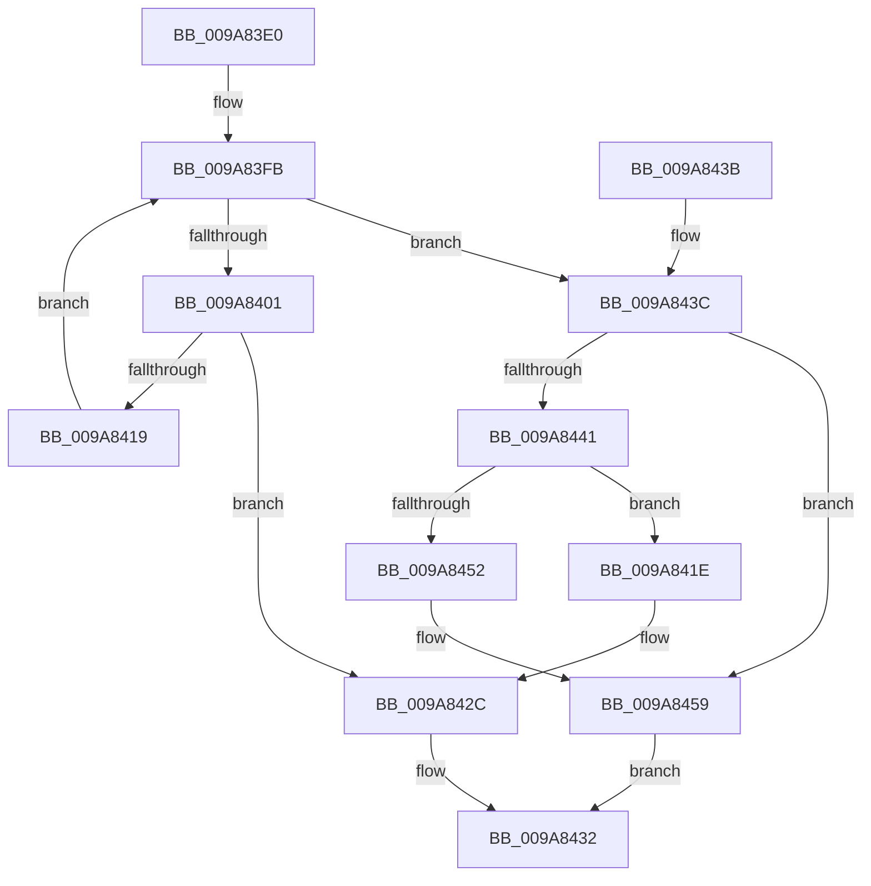

# EnlistKeyBodyWithKCB

- RVA: `0x009A83E0`–`0x009A8461` (길이 `129` bytes)
- VA: `0x00000001409A83E0`
- 실행 섹션: `PAGE`
- PDB 이름 있음: `예`; PDB Function 태그: `아니요`
- unwind 정보 RVA: `0x0009CE94`
- 디코드: `38`개 명령, `129/129` bytes 표시
- 미해석 바이트: `0` (있으면 어셈블리에 `.byte`로 보존)

> 이 문서는 커널 이미지의 기계어와 PDB 기호를 분석해 생성했습니다. 4번과 5번은 함수 원형과 자료형을 바이너리 사용 방식에서 추정한 C 해석이며 원본 소스 복구 결과는 아닙니다.

## 1. Dependencies

- 직접 호출 지점: **0**; 고유 호출 대상: **0**
- 직접 호출자로 확인된 함수: **1**
- RIP 상대 이미지 참조: **0**

### Outgoing calls
- 직접 디코드된 call 명령이 없습니다.

### Direct callers
- [CmpCreateRegistryRoot](../../init/C5/CmpCreateRegistryRoot_function_00C57880.md) at `0x00C579DF`

### Static image references
- 디코드된 RIP-relative 메모리 참조가 없습니다.

## 2. Other-region calls and transfers

- 다른 실행 섹션으로 향하는 call: **0**
- 별도 외부 분기/꼬리 이동을 확인하지 못했습니다.

## 3. Assembly (complete function range)

```asm
009A83E0  48 89 5C 24 08                  mov qword ptr [rsp + 8], rbx
009A83E5  4C 8D 51 20                     lea r10, [rcx + 0x20]
009A83E9  45 33 DB                        xor r11d, r11d
009A83EC  4D 89 52 08                     mov qword ptr [r10 + 8], r10
009A83F0  45 8B C3                        mov r8d, r11d
009A83F3  4D 89 12                        mov qword ptr [r10], r10
009A83F6  8B DA                           mov ebx, edx
009A83F8  4C 8B C9                        mov r9, rcx
009A83FB  41 83 F8 04                     cmp r8d, 4
009A83FF  73 3B                           jae 0x1409a843c
009A8401  49 8B 41 08                     mov rax, qword ptr [r9 + 8]
009A8405  41 8B C8                        mov ecx, r8d
009A8408  48 8D 14 C8                     lea rdx, [rax + rcx*8]
009A840C  33 C0                           xor eax, eax
009A840E  F0 4C 0F B1 8A 88 00 00 00      lock cmpxchg qword ptr [rdx + 0x88], r9
009A8417  74 13                           je 0x1409a842c
009A8419  41 FF C0                        inc r8d
009A841C  EB DD                           jmp 0x1409a83fb
009A841E  49 89 02                        mov qword ptr [r10], rax
009A8421  49 89 4A 08                     mov qword ptr [r10 + 8], rcx
009A8425  4C 89 11                        mov qword ptr [rcx], r10
009A8428  4C 89 50 08                     mov qword ptr [rax + 8], r10
009A842C  66 41 83 49 30 40               or word ptr [r9 + 0x30], 0x40
009A8432  48 8B 5C 24 08                  mov rbx, qword ptr [rsp + 8]
009A8437  41 8B C3                        mov eax, r11d
009A843A  C3                              ret
009A843B  CC                              int3
009A843C  F6 C3 02                        test bl, 2
009A843F  74 18                           je 0x1409a8459
009A8441  49 8B 41 08                     mov rax, qword ptr [r9 + 8]
009A8445  48 83 C0 78                     add rax, 0x78
009A8449  48 8B 48 08                     mov rcx, qword ptr [rax + 8]
009A844D  48 39 01                        cmp qword ptr [rcx], rax
009A8450  74 CC                           je 0x1409a841e
009A8452  B9 03 00 00 00                  mov ecx, 3
009A8457  CD 29                           int 0x29
009A8459  41 BB 2D 02 00 C0               mov r11d, 0xc000022d
009A845F  EB D1                           jmp 0x1409a8432
```

## 4. C-style interpretation (structured pseudocode)

```c
__int64 __fastcall EnlistKeyBodyWithKCB(__int64 a1, int a2)
{
    __int64 result;
    __int64 v_r11;
    unsigned __int64 v_stack_p8;

    v_stack_p8 = v_rbx;
    v_r11 = 0;
    *(unsigned __int64 *)(a1 + 32 + 8) = a1 + 32;
    *(unsigned __int64 *)(a1 + 32) = a1 + 32;
loc_009A83FB:
    if (0 >= 4) goto loc_009A843C;
    result = 0;
    if (condition_is_equal) goto loc_009A842C;
    a3 = (unsigned int)((0) + 1);
    goto loc_009A83FB;
loc_009A841E:
    *(unsigned __int64 *)(a1 + 32) = 0;
    *(unsigned __int64 *)(a1 + 32 + 8) = 0;
    *(unsigned __int64 *)(0) = a1 + 32;
    *(unsigned __int64 *)(result + 8) = a1 + 32;
loc_009A842C:
loc_009A8432:
    return 0;
loc_009A843C:
    if ((((unsigned __int8)(v_stack_p8)) & (2)) == 0) goto loc_009A8459;
    result = (*(unsigned __int64 *)(a1 + 8)) + (120);
    if ((*(unsigned __int64 *)(*(unsigned __int64 *)(result + 8))) == result) goto loc_009A841E;
loc_009A8459:
    goto loc_009A8432;
}
```

## 5. (Beta) C Style

```c
int64_t EnlistKeyBodyWithKCB(void *Arg1, int32_t Arg2)
{
    uint8_t *arg1 = (uint8_t *)Arg1;

    int64_t result;
    int64_t local_r11;
    uint64_t v_stack_p8;

    v_stack_p8 = local_rbx;
    local_r11 = 0;
    *(void **)(arg1 + 0x20 + 0x8) = Arg1 + 32;
    *(void **)(arg1 + 0x20) = Arg1 + 32;
loc_009A83FB:
    if (0 >= 4) goto loc_009A843C;
    result = 0;
    if (condition_is_equal) goto loc_009A842C;
    a3 = (uint32_t)((0) + 1);
    goto loc_009A83FB;
loc_009A841E:
    *(uint64_t *)(arg1 + 0x20) = 0;
    *(uint64_t *)(arg1 + 0x20 + 0x8) = 0;
    *(void **)(0) = Arg1 + 32;
    *(void **)(result + 0x8) = Arg1 + 32;
loc_009A842C:
loc_009A8432:
    return 0;
loc_009A843C:
    if ((((uint8_t)(v_stack_p8)) & (2)) == 0) goto loc_009A8459;
    result = (*(uint64_t *)(arg1 + 0x8)) + (120);
    if ((*(uint64_t *)(*(uint64_t *)(result + 0x8))) == result) goto loc_009A841E;
loc_009A8459:
    goto loc_009A8432;
}
```

### 관측된 메모리 오프셋

구조체 형식이 확인되지 않은 접근은 인자 기준의 오프셋으로만 기록했습니다.

| 기준 인자 | 오프셋 표현 | 폭 (bit) | 접근 |
|---|---:|---:|---|
| `Arg1` | `+ 0x0` | `64` | `W` |
| `Arg1` | `+ 0x8` | `64` | `R` |
| `Arg1` | `+ 0x8` | `64` | `W` |
| `Arg1` | `+ 0x20` | `64` | `R` |
| `Arg1` | `+ 0x30` | `16` | `R/W` |

## 6. Execution-region graph

[열기: 2D/3D 그래프와 함수 탐색 컨트롤 패널](../../../control-panel.html?section=page&rva=0x009A83E0&view=graph)

- 2D 그래프는 위에서 아래로 흐르고, 3D 그래프는 빈 공간을 드래그해 회전합니다. Shift+드래그는 이동, 휠은 확대·축소, 함수 노드 선택은 대상 보고서 이동입니다.

### Static fallback


