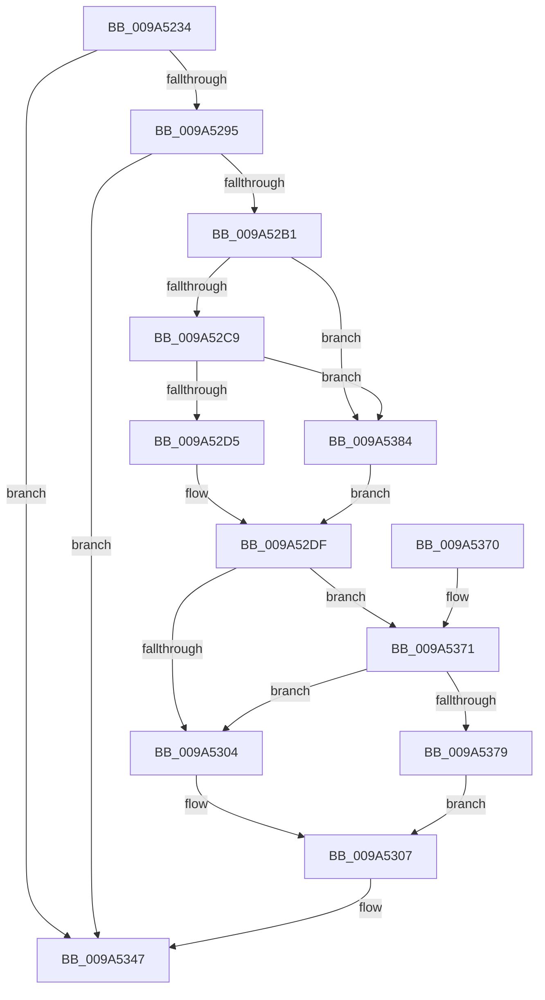

# EtwTiLogDeviceObjectLoadUnload

- RVA: `0x009A5234`–`0x009A5392` (길이 `350` bytes)
- VA: `0x00000001409A5234`
- 실행 섹션: `PAGE`
- PDB 이름 있음: `예`; PDB Function 태그: `아니요`
- unwind 정보 RVA: `0x0009C5D8`
- 디코드: `87`개 명령, `350/350` bytes 표시
- 미해석 바이트: `0` (있으면 어셈블리에 `.byte`로 보존)

> 이 문서는 커널 이미지의 기계어와 PDB 기호를 분석해 생성했습니다. 4번과 5번은 함수 원형과 자료형을 바이너리 사용 방식에서 추정한 C 해석이며 원본 소스 복구 결과는 아닙니다.

## 1. Dependencies

- 직접 호출 지점: **4**; 고유 호출 대상: **4**
- 직접 호출자로 확인된 함수: **2**
- RIP 상대 이미지 참조: **5**

### Outgoing calls
- `0x009A5288` → [EtwEventEnabled](../../text/39/EtwEventEnabled_function_00392450.md) (function, `0x00392450`)
- `0x009A52A4` → [EtwProviderEnabled](../../text/3B/EtwProviderEnabled_function_003BA250.md) (function, `0x003BA250`)
- `0x009A5342` → [EtwWrite](../../text/41/EtwWrite_function_0041C720.md) (function, `0x0041C720`)
- `0x009A534E` → [_security_check_cookie](../../text/6A/_security_check_cookie_function_006AC640.md) (function, `0x006AC640`)

### Direct callers
- [IoDeleteDevice](../../text/26/IoDeleteDevice_function_0026FE90.md) at `0x0026FEC2`
- [IoCreateDevice](IoCreateDevice_function_009A4B00.md) at `0x009A4EB6`

### Static image references
- `0x009A5253` → RVA `0x00E0A740` (`.data`; read)
- `0x009A5261` → RVA `0x000135B8` (`.rdata`; read)
- `0x009A526E` → RVA `0x000135C8` (`.rdata`; read)
- `0x009A527A` → RVA `0x00EFFA30` (`.data`; read)
- `0x009A52B5` → RVA `0x00B076E0` (` ?? ::NNGAKEGL::`string'`; read)

## 2. Other-region calls and transfers

- 다른 실행 섹션으로 향하는 call: **4**
  - `0x009A5288` → [EtwEventEnabled](../../text/39/EtwEventEnabled_function_00392450.md) (`PAGE` → `.text`)
  - `0x009A52A4` → [EtwProviderEnabled](../../text/3B/EtwProviderEnabled_function_003BA250.md) (`PAGE` → `.text`)
  - `0x009A5342` → [EtwWrite](../../text/41/EtwWrite_function_0041C720.md) (`PAGE` → `.text`)
  - `0x009A534E` → [_security_check_cookie](../../text/6A/_security_check_cookie_function_006AC640.md) (`PAGE` → `.text`)
- 별도 외부 분기/꼬리 이동을 확인하지 못했습니다.

## 3. Assembly (complete function range)

```asm
009A5234  48 8B C4                        mov rax, rsp
009A5237  48 89 58 08                     mov qword ptr [rax + 8], rbx
009A523B  48 89 70 10                     mov qword ptr [rax + 0x10], rsi
009A523F  48 89 78 18                     mov qword ptr [rax + 0x18], rdi
009A5243  4C 89 70 20                     mov qword ptr [rax + 0x20], r14
009A5247  55                              push rbp
009A5248  48 8D 68 A1                     lea rbp, [rax - 0x5f]
009A524C  48 81 EC 90 00 00 00            sub rsp, 0x90
009A5253  48 8B 05 E6 54 46 00            mov rax, qword ptr [rip + 0x4654e6]
009A525A  48 33 C4                        xor rax, rsp
009A525D  48 89 45 47                     mov qword ptr [rbp + 0x47], rax
009A5261  48 8D 05 50 E3 66 FF            lea rax, [rip - 0x991cb0]
009A5268  48 8B DA                        mov rbx, rdx
009A526B  45 33 F6                        xor r14d, r14d
009A526E  48 8D 35 53 E3 66 FF            lea rsi, [rip - 0x991cad]
009A5275  84 C9                           test cl, cl
009A5277  49 8B F8                        mov rdi, r8
009A527A  48 8B 0D AF A7 55 00            mov rcx, qword ptr [rip + 0x55a7af]
009A5281  48 0F 44 F0                     cmove rsi, rax
009A5285  48 8B D6                        mov rdx, rsi
009A5288  E8 C3 D1 9E FF                  call 0x140392450
009A528D  84 C0                           test al, al
009A528F  0F 84 B2 00 00 00               je 0x1409a5347
009A5295  48 8B 0D 94 A7 55 00            mov rcx, qword ptr [rip + 0x55a794]
009A529C  33 D2                           xor edx, edx
009A529E  41 B8 00 00 00 80               mov r8d, 0x80000000
009A52A4  E8 A7 4F A1 FF                  call 0x1403ba250
009A52A9  84 C0                           test al, al
009A52AB  0F 84 96 00 00 00               je 0x1409a5347
009A52B1  41 8D 4E 0C                     lea ecx, [r14 + 0xc]
009A52B5  48 8D 15 24 24 16 00            lea rdx, [rip + 0x162424]
009A52BC  45 8D 56 06                     lea r10d, [r14 + 6]
009A52C0  48 85 DB                        test rbx, rbx
009A52C3  0F 84 BB 00 00 00               je 0x1409a5384
009A52C9  0F B7 03                        movzx eax, word ptr [rbx]
009A52CC  66 85 C0                        test ax, ax
009A52CF  0F 84 AF 00 00 00               je 0x1409a5384
009A52D5  4C 8B 4B 08                     mov r9, qword ptr [rbx + 8]
009A52D9  44 8B C0                        mov r8d, eax
009A52DC  66 D1 E8                        shr ax, 1
009A52DF  66 89 45 F7                     mov word ptr [rbp - 9], ax
009A52E3  48 8D 45 F7                     lea rax, [rbp - 9]
009A52E7  48 89 45 07                     mov qword ptr [rbp + 7], rax
009A52EB  48 C7 45 0F 02 00 00 00         mov qword ptr [rbp + 0xf], 2
009A52F3  4C 89 4D 17                     mov qword ptr [rbp + 0x17], r9
009A52F7  44 89 45 1F                     mov dword ptr [rbp + 0x1f], r8d
009A52FB  44 89 75 23                     mov dword ptr [rbp + 0x23], r14d
009A52FF  48 85 FF                        test rdi, rdi
009A5302  75 6D                           jne 0x1409a5371
009A5304  41 8B C2                        mov eax, r10d
009A5307  66 89 45 FB                     mov word ptr [rbp - 5], ax
009A530B  41 B9 04 00 00 00               mov r9d, 4
009A5311  48 8D 45 FB                     lea rax, [rbp - 5]
009A5315  48 89 55 37                     mov qword ptr [rbp + 0x37], rdx
009A5319  48 89 45 27                     mov qword ptr [rbp + 0x27], rax
009A531D  45 33 C0                        xor r8d, r8d
009A5320  48 8D 45 07                     lea rax, [rbp + 7]
009A5324  89 4D 3F                        mov dword ptr [rbp + 0x3f], ecx
009A5327  48 8B 0D 02 A7 55 00            mov rcx, qword ptr [rip + 0x55a702]
009A532E  48 8B D6                        mov rdx, rsi
009A5331  48 89 44 24 20                  mov qword ptr [rsp + 0x20], rax
009A5336  48 C7 45 2F 02 00 00 00         mov qword ptr [rbp + 0x2f], 2
009A533E  44 89 75 43                     mov dword ptr [rbp + 0x43], r14d
009A5342  E8 D9 73 A7 FF                  call 0x14041c720
009A5347  48 8B 4D 47                     mov rcx, qword ptr [rbp + 0x47]
009A534B  48 33 CC                        xor rcx, rsp
009A534E  E8 ED 72 D0 FF                  call 0x1406ac640
009A5353  4C 8D 9C 24 90 00 00 00         lea r11, [rsp + 0x90]
009A535B  49 8B 5B 10                     mov rbx, qword ptr [r11 + 0x10]
009A535F  49 8B 73 18                     mov rsi, qword ptr [r11 + 0x18]
009A5363  49 8B 7B 20                     mov rdi, qword ptr [r11 + 0x20]
009A5367  4D 8B 73 28                     mov r14, qword ptr [r11 + 0x28]
009A536B  49 8B E3                        mov rsp, r11
009A536E  5D                              pop rbp
009A536F  C3                              ret
009A5370  CC                              int3
009A5371  0F B7 07                        movzx eax, word ptr [rdi]
009A5374  66 85 C0                        test ax, ax
009A5377  74 8B                           je 0x1409a5304
009A5379  48 8B 57 08                     mov rdx, qword ptr [rdi + 8]
009A537D  8B C8                           mov ecx, eax
009A537F  66 D1 E8                        shr ax, 1
009A5382  EB 83                           jmp 0x1409a5307
009A5384  44 8B C1                        mov r8d, ecx
009A5387  4C 8B CA                        mov r9, rdx
009A538A  41 8B C2                        mov eax, r10d
009A538D  E9 4D FF FF FF                  jmp 0x1409a52df
```

## 4. C-style interpretation (structured pseudocode)

```c
__int64 __fastcall EtwTiLogDeviceObjectLoadUnload(unsigned __int8 a1, __int64 a2, __int64 a3)
{
    __int64 result;
    __int64 v_r14;
    __int64 v_rsi;
    __int64 v_rsp;
    unsigned __int64 v_stack_m78;
    unsigned __int64 v_stack_m8;

    *(unsigned __int64 *)(v_rsp + 8) = v_rbx;
    *(unsigned __int64 *)(v_rsp + 16) = v_rsi;
    *(unsigned __int64 *)(v_rsp + 24) = v_rdi;
    *(unsigned __int64 *)(v_rsp + 32) = v_r14;
    v_rsp = (v_rsp) - (144);
    result = (*(unsigned __int64 *)(v_rip + 4609254)) ^ (v_rsp);
    *(unsigned __int64 *)(v_rsp - 95 + 71) = result;
    v_r14 = 0;
    v_rsi = v_rip - 10034349;
    if (a1 == 0) { v_rsi = v_rip - 10034352; }
    result = EtwEventEnabled(*(unsigned __int64 *)(v_rip + 5613487), v_rsi, a3, a4);
    if ((unsigned __int8)(result) == 0) goto loc_009A5347;
    a2 = 0;
    result = EtwProviderEnabled(*(unsigned __int64 *)(v_rip + 5613460), a2, (unsigned int)(0x80000000ULL), a4);
    if ((unsigned __int8)(result) == 0) goto loc_009A5347;
    if (0 == 0) goto loc_009A5384;
    if ((unsigned __int16)(*(unsigned __int16 *)(a2)) == 0) goto loc_009A5384;
    result = (unsigned __int16)((*(unsigned __int16 *)(a2)) >> (1));
loc_009A52DF:
    *(unsigned __int16 *)(v_rsp - 95 - 9) = (unsigned __int16)(result);
    *(unsigned __int64 *)(v_rsp - 95 + 7) = v_rsp - 95 - 9;
    *(unsigned __int64 *)(v_rsp - 95 + 15) = 2;
    *(unsigned __int64 *)(v_rsp - 95 + 23) = *(unsigned __int64 *)(a2 + 8);
    *(unsigned int *)(v_rsp - 95 + 31) = (unsigned int)((unsigned int)((unsigned int)(*(unsigned __int16 *)(a2))));
    *(unsigned int *)(v_rsp - 95 + 35) = 0;
    if (a3 != 0) goto loc_009A5371;
loc_009A5304:
loc_009A5307:
    *(unsigned __int16 *)(v_rsp - 95 - 5) = (unsigned __int16)((unsigned int)((unsigned int)(v_r14 + 6)));
    *(unsigned __int64 *)(v_rsp - 95 + 55) = v_rip + 1451044;
    *(unsigned __int64 *)(v_rsp - 95 + 39) = v_rsp - 95 - 5;
    a3 = 0;
    *(unsigned int *)(v_rsp - 95 + 63) = (unsigned int)(v_r14 + 12);
    v_stack_m78 = v_rsp - 95 + 7;
    *(unsigned __int64 *)(v_rsp - 95 + 47) = 2;
    *(unsigned int *)(v_rsp - 95 + 67) = 0;
    result = EtwWrite(*(unsigned __int64 *)(v_rip + 5613314), v_rsi, a3, 4);
loc_009A5347:
    a1 = (*(unsigned __int64 *)(v_rsp - 95 + 71)) ^ (v_rsp);
    result = _security_check_cookie(a1, v_rsi, a3, 4);
    return result;
loc_009A5371:
    if ((unsigned __int16)(*(unsigned __int16 *)(*(unsigned __int64 *)(v_stack_m8 + 32))) == 0) goto loc_009A5304;
    result = (unsigned __int16)((*(unsigned __int16 *)(*(unsigned __int64 *)(v_stack_m8 + 32))) >> (1));
    goto loc_009A5307;
loc_009A5384:
    goto loc_009A52DF;
}
```

## 5. (Beta) C Style

```c
int64_t EtwTiLogDeviceObjectLoadUnload(uint8_t Arg1, int64_t Arg2, int64_t Arg3)
{
    int64_t result;
    int64_t local_r14;
    int64_t local_rsi;
    int64_t local_rsp;
    uint64_t v_stack_m78;
    uint64_t v_stack_m8;

    *(uint64_t *)(local_rsp + 0x8) = local_rbx;
    *(uint64_t *)(local_rsp + 0x10) = local_rsi;
    *(uint64_t *)(local_rsp + 0x18) = local_rdi;
    *(uint64_t *)(local_rsp + 0x20) = local_r14;
    local_rsp = (local_rsp) - (144);
    result = (*(uint64_t *)(v_rip + 0x4654E6)) ^ (local_rsp);
    *(uint64_t *)(local_rsp - 0x5F + 0x47) = result;
    local_r14 = 0;
    local_rsi = v_rip - 10034349;
    if (Arg1 == 0) { local_rsi = v_rip - 10034352; }
    result = EtwEventEnabled(*(uint64_t *)(v_rip + 0x55A7AF), local_rsi, Arg3, a4);
    if ((uint8_t)(result) == 0) goto loc_009A5347;
    Arg2 = 0;
    result = EtwProviderEnabled(*(uint64_t *)(v_rip + 0x55A794), Arg2, (uint32_t)(0x80000000ULL), a4);
    if ((uint8_t)(result) == 0) goto loc_009A5347;
    if (0 == 0) goto loc_009A5384;
    if ((uint16_t)(*(uint16_t *)(Arg2)) == 0) goto loc_009A5384;
    result = (uint16_t)((*(uint16_t *)(Arg2)) >> (1));
loc_009A52DF:
    *(uint16_t *)(local_rsp - 0x5F - 0x9) = (uint16_t)(result);
    *(uint64_t *)(local_rsp - 0x5F + 0x7) = local_rsp - 95 - 9;
    *(uint64_t *)(local_rsp - 0x5F + 0xF) = 2;
    *(uint64_t *)(local_rsp - 0x5F + 0x17) = *(uint64_t *)(Arg2 + 0x8);
    *(uint32_t *)(local_rsp - 0x5F + 0x1F) = (uint32_t)((uint32_t)((uint32_t)(*(uint16_t *)(Arg2))));
    *(uint32_t *)(local_rsp - 0x5F + 0x23) = 0;
    if (Arg3 != 0) goto loc_009A5371;
loc_009A5304:
loc_009A5307:
    *(uint16_t *)(local_rsp - 0x5F - 0x5) = (uint16_t)((uint32_t)((uint32_t)(local_r14 + 6)));
    *(uint64_t *)(local_rsp - 0x5F + 0x37) = v_rip + 1451044;
    *(uint64_t *)(local_rsp - 0x5F + 0x27) = local_rsp - 95 - 5;
    Arg3 = 0;
    *(uint32_t *)(local_rsp - 0x5F + 0x3F) = (uint32_t)(local_r14 + 12);
    v_stack_m78 = local_rsp - 95 + 7;
    *(uint64_t *)(local_rsp - 0x5F + 0x2F) = 2;
    *(uint32_t *)(local_rsp - 0x5F + 0x43) = 0;
    result = EtwWrite(*(uint64_t *)(v_rip + 0x55A702), local_rsi, Arg3, 4);
loc_009A5347:
    Arg1 = (*(uint64_t *)(local_rsp - 0x5F + 0x47)) ^ (local_rsp);
    result = _security_check_cookie(Arg1, local_rsi, Arg3, 4);
    return result;
loc_009A5371:
    if ((uint16_t)(*(uint16_t *)(*(uint64_t *)(v_stack_m8 + 0x20))) == 0) goto loc_009A5304;
    result = (uint16_t)((*(uint16_t *)(*(uint64_t *)(v_stack_m8 + 0x20))) >> (1));
    goto loc_009A5307;
loc_009A5384:
    goto loc_009A52DF;
}
```

## 6. Execution-region graph

[열기: 2D/3D 그래프와 함수 탐색 컨트롤 패널](../../../control-panel.html?section=page&rva=0x009A5234&view=graph)

- 2D 그래프는 위에서 아래로 흐르고, 3D 그래프는 빈 공간을 드래그해 회전합니다. Shift+드래그는 이동, 휠은 확대·축소, 함수 노드 선택은 대상 보고서 이동입니다.

### Static fallback


