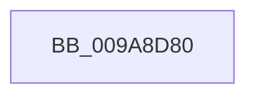

# EtwpGetSidExtendedHeaderItem

- RVA: `0x009A8D80`–`0x009A8DAB` (길이 `43` bytes)
- VA: `0x00000001409A8D80`
- 실행 섹션: `PAGE`
- PDB 이름 있음: `예`; PDB Function 태그: `아니요`
- unwind 정보 RVA: `0x0009D1A0`
- 디코드: `12`개 명령, `43/43` bytes 표시
- 미해석 바이트: `0` (있으면 어셈블리에 `.byte`로 보존)

> 이 문서는 커널 이미지의 기계어와 PDB 기호를 분석해 생성했습니다. 4번과 5번은 함수 원형과 자료형을 바이너리 사용 방식에서 추정한 C 해석이며 원본 소스 복구 결과는 아닙니다.

## 1. Dependencies

- 직접 호출 지점: **0**; 고유 호출 대상: **0**
- 직접 호출자로 확인된 함수: **2**
- RIP 상대 이미지 참조: **1**

### Outgoing calls
- 직접 디코드된 call 명령이 없습니다.

### Direct callers
- [EtwpEventWriteFull](../../text/22/EtwpEventWriteFull_function_00225C10.md) at `0x002263D3`
- [EtwpWriteUserEvent](../AF/EtwpWriteUserEvent_function_00AF2FEC.md) at `0x00AF34FE`

### Static image references
- `0x009A8D8E` → RVA `0x00E0A740` (`.data`; read)

## 2. Other-region calls and transfers

- 다른 실행 섹션으로 향하는 call: **0**
- 별도 외부 분기/꼬리 이동을 확인하지 못했습니다.

## 3. Assembly (complete function range)

```asm
009A8D80  40 53                           push rbx
009A8D82  55                              push rbp
009A8D83  56                              push rsi
009A8D84  57                              push rdi
009A8D85  41 54                           push r12
009A8D87  48 81 EC 80 00 00 00            sub rsp, 0x80
009A8D8E  48 8B 05 AB 19 46 00            mov rax, qword ptr [rip + 0x4619ab]
009A8D95  48 33 C4                        xor rax, rsp
009A8D98  48 89 44 24 70                  mov qword ptr [rsp + 0x70], rax
009A8D9D  65 48 8B 1C 25 88 01 00 00      mov rbx, qword ptr gs:[0x188]
009A8DA6  0F 57 C0                        xorps xmm0, xmm0
009A8DA9  33 C0                           xor eax, eax
```

## 4. C-style interpretation (structured pseudocode)

```c
__int64 __fastcall EtwpGetSidExtendedHeaderItem(void)
{
    __int64 result;
    __int64 v_rsp;
    unsigned __int64 v_stack_m38;

    v_rsp = (v_rsp) - (128);
    result = (*(unsigned __int64 *)(v_rip + 4594091)) ^ (v_rsp);
    v_stack_m38 = result;
    result = 0;
    return result;
}
```

## 5. (Beta) C Style

```c
void EtwpGetSidExtendedHeaderItem(void)
{
    int64_t result;
    int64_t local_rsp;
    uint64_t v_stack_m38;

    local_rsp = (local_rsp) - (128);
    result = (*(uint64_t *)(v_rip + 0x4619AB)) ^ (local_rsp);
    v_stack_m38 = result;
    result = 0;
    return result;
}
```

## 6. Execution-region graph

[열기: 2D/3D 그래프와 함수 탐색 컨트롤 패널](../../../control-panel.html?section=page&rva=0x009A8D80&view=graph)

- 2D 그래프는 위에서 아래로 흐르고, 3D 그래프는 빈 공간을 드래그해 회전합니다. Shift+드래그는 이동, 휠은 확대·축소, 함수 노드 선택은 대상 보고서 이동입니다.

### Static fallback


