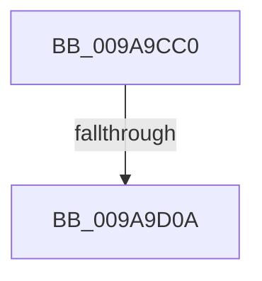

# EtwpGetTraceGroupInfo

- RVA: `0x009A9CC0`–`0x009A9D0F` (길이 `79` bytes)
- VA: `0x00000001409A9CC0`
- 실행 섹션: `PAGE`
- PDB 이름 있음: `예`; PDB Function 태그: `아니요`
- unwind 정보 RVA: `0x0009D820`
- 디코드: `23`개 명령, `79/79` bytes 표시
- 미해석 바이트: `0` (있으면 어셈블리에 `.byte`로 보존)

> 이 문서는 커널 이미지의 기계어와 PDB 기호를 분석해 생성했습니다. 4번과 5번은 함수 원형과 자료형을 바이너리 사용 방식에서 추정한 C 해석이며 원본 소스 복구 결과는 아닙니다.

## 1. Dependencies

- 직접 호출 지점: **1**; 고유 호출 대상: **1**
- 직접 호출자로 확인된 함수: **1**
- RIP 상대 이미지 참조: **0**

### Outgoing calls
- `0x009A9CF4` → [EtwpFindGuidEntryByGuid](../8C/EtwpFindGuidEntryByGuid_function_008C1DB0.md) (function, `0x008C1DB0`)

### Direct callers
- [NtTraceControl](../A9/NtTraceControl_function_00A9ED40.md) at `0x00A9F5C2`

### Static image references
- 디코드된 RIP-relative 메모리 참조가 없습니다.

## 2. Other-region calls and transfers

- 다른 실행 섹션으로 향하는 call: **0**
- call이 아닌 외부 분기/꼬리 이동: **1**
  - `0x009A9D04` → [sub_009AA233](Unknown_function_009AA233.md) (`tail-transfer`)

## 3. Assembly (complete function range)

```asm
009A9CC0  4C 89 4C 24 20                  mov qword ptr [rsp + 0x20], r9
009A9CC5  4C 89 44 24 18                  mov qword ptr [rsp + 0x18], r8
009A9CCA  53                              push rbx
009A9CCB  56                              push rsi
009A9CCC  57                              push rdi
009A9CCD  41 54                           push r12
009A9CCF  41 57                           push r15
009A9CD1  48 83 EC 40                     sub rsp, 0x40
009A9CD5  45 8B 21                        mov r12d, dword ptr [r9]
009A9CD8  49 8B F0                        mov rsi, r8
009A9CDB  45 33 C0                        xor r8d, r8d
009A9CDE  49 8B D9                        mov rbx, r9
009A9CE1  44 89 44 24 24                  mov dword ptr [rsp + 0x24], r8d
009A9CE6  45 8B F8                        mov r15d, r8d
009A9CE9  44 89 44 24 20                  mov dword ptr [rsp + 0x20], r8d
009A9CEE  41 B8 02 00 00 00               mov r8d, 2
009A9CF4  E8 B7 80 F1 FF                  call 0x1408c1db0
009A9CF9  48 89 44 24 28                  mov qword ptr [rsp + 0x28], rax
009A9CFE  48 8B F8                        mov rdi, rax
009A9D01  48 85 C0                        test rax, rax
009A9D04  0F 84 29 05 00 00               je 0x1409aa233
009A9D0A  44 8B 03                        mov r8d, dword ptr [rbx]
009A9D0D  33 D2                           xor edx, edx
```

## 4. C-style interpretation (structured pseudocode)

```c
__int64 __fastcall EtwpGetTraceGroupInfo(__int64 a1, int a2, __int64 a3, __int64 a4)
{
    __int64 result;
    __int64 v_rsp;
    unsigned __int64 v_stack_m40;
    unsigned int v_stack_m44;
    unsigned int v_stack_m48;
    unsigned __int64 v_stack_p18;
    unsigned __int64 v_stack_p20;

    v_stack_p20 = a4;
    v_stack_p18 = a3;
    v_rsp = (v_rsp) - (64);
    a3 = 0;
    v_stack_m44 = 0;
    v_stack_m48 = 0;
    result = EtwpFindGuidEntryByGuid(a1, a2, 2, a4);
    v_stack_m40 = result;
    a2 = 0;
    return result;
}
```

## 5. (Beta) C Style

```c
int64_t EtwpGetTraceGroupInfo(int64_t Arg1, int32_t Arg2, int64_t Arg3, void *Arg4)
{
    uint8_t *arg4 = (uint8_t *)Arg4;

    int64_t result;
    int64_t local_rsp;
    uint64_t v_stack_m40;
    uint32_t v_stack_m44;
    uint32_t v_stack_m48;
    uint64_t v_stack_p18;
    uint64_t v_stack_p20;

    v_stack_p20 = Arg4;
    v_stack_p18 = Arg3;
    local_rsp = (local_rsp) - (64);
    Arg3 = 0;
    v_stack_m44 = 0;
    v_stack_m48 = 0;
    result = EtwpFindGuidEntryByGuid(Arg1, Arg2, 2, Arg4);
    v_stack_m40 = result;
    Arg2 = 0;
    return result;
}
```

### 관측된 메모리 오프셋

구조체 형식이 확인되지 않은 접근은 인자 기준의 오프셋으로만 기록했습니다.

| 기준 인자 | 오프셋 표현 | 폭 (bit) | 접근 |
|---|---:|---:|---|
| `Arg4` | `+ 0x0` | `32` | `R` |

## 6. Execution-region graph

[열기: 2D/3D 그래프와 함수 탐색 컨트롤 패널](../../../control-panel.html?section=page&rva=0x009A9CC0&view=graph)

- 2D 그래프는 위에서 아래로 흐르고, 3D 그래프는 빈 공간을 드래그해 회전합니다. Shift+드래그는 이동, 휠은 확대·축소, 함수 노드 선택은 대상 보고서 이동입니다.

### Static fallback


