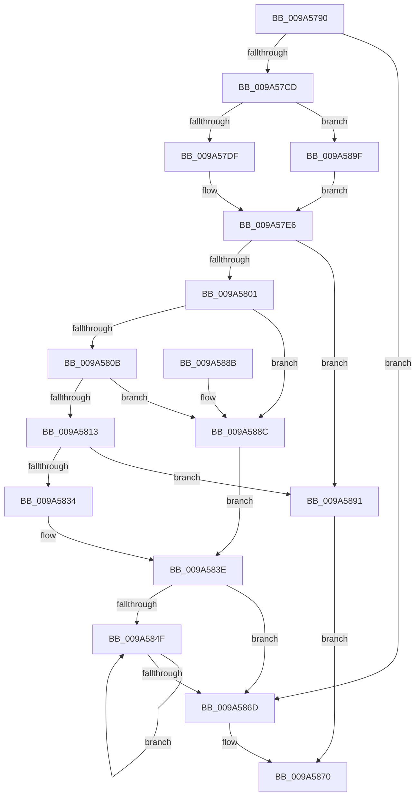

# ExAllocateCacheAwareRundownProtection

- RVA: `0x009A5790`–`0x009A58A9` (길이 `281` bytes)
- VA: `0x00000001409A5790`
- 실행 섹션: `PAGE`
- PDB 이름 있음: `예`; PDB Function 태그: `아니요`
- unwind 정보 RVA: `0x0009C638`
- 디코드: `84`개 명령, `281/281` bytes 표시
- 미해석 바이트: `0` (있으면 어셈블리에 `.byte`로 보존)

> 이 문서는 커널 이미지의 기계어와 PDB 기호를 분석해 생성했습니다. 4번과 5번은 함수 원형과 자료형을 바이너리 사용 방식에서 추정한 C 해석이며 원본 소스 복구 결과는 아닙니다.

## 1. Dependencies

- 직접 호출 지점: **6**; 고유 호출 대상: **3**
- 직접 호출자로 확인된 함수: **5**
- RIP 상대 이미지 참조: **1**

### Outgoing calls
- `0x009A57BC` → [ExAllocatePoolWithTag](../../poolcode/B8/ExAllocatePoolWithTag_function_00B82010.md) (function, `0x00B82010`)
- `0x009A57DF` → [KeGetRecommendedSharedDataAlignment](../../text/49/KeGetRecommendedSharedDataAlignment_function_00494040.md) (function, `0x00494040`)
- `0x009A57F3` → [ExAllocatePoolWithTag](../../poolcode/B8/ExAllocatePoolWithTag_function_00B82010.md) (function, `0x00B82010`)
- `0x009A5818` → [ExFreePoolWithTag](../../poolcode/B8/ExFreePoolWithTag_function_00B82870.md) (function, `0x00B82870`)
- `0x009A582A` → [ExAllocatePoolWithTag](../../poolcode/B8/ExAllocatePoolWithTag_function_00B82010.md) (function, `0x00B82010`)
- `0x009A5896` → [ExFreePoolWithTag](../../poolcode/B8/ExFreePoolWithTag_function_00B82870.md) (function, `0x00B82870`)

### Direct callers
- [DifExAllocateCacheAwareRundownProtectionWrapper](../../text/61/DifExAllocateCacheAwareRundownProtectionWrapper_function_0061E1A0.md) at `0x0061E277`
- [PfpPartitionAllocateState](../75/PfpPartitionAllocateState_function_0075200C.md) at `0x0075201F`
- [EtwpPreInitializeSiloState](../7B/EtwpPreInitializeSiloState_function_007B76BC.md) at `0x007B7776`
- [MmCreatePartition](../80/MmCreatePartition_function_0080DC3C.md) at `0x0080DD77`
- [RawInitializeVcb](RawInitializeVcb_function_009A5658.md) at `0x009A56BE`

### Static image references
- `0x009A57CD` → RVA `0x00FC6A80` (`ALMOSTRO`; read)

## 2. Other-region calls and transfers

- 다른 실행 섹션으로 향하는 call: **6**
  - `0x009A57BC` → [ExAllocatePoolWithTag](../../poolcode/B8/ExAllocatePoolWithTag_function_00B82010.md) (`PAGE` → `POOLCODE`)
  - `0x009A57DF` → [KeGetRecommendedSharedDataAlignment](../../text/49/KeGetRecommendedSharedDataAlignment_function_00494040.md) (`PAGE` → `.text`)
  - `0x009A57F3` → [ExAllocatePoolWithTag](../../poolcode/B8/ExAllocatePoolWithTag_function_00B82010.md) (`PAGE` → `POOLCODE`)
  - `0x009A5818` → [ExFreePoolWithTag](../../poolcode/B8/ExFreePoolWithTag_function_00B82870.md) (`PAGE` → `POOLCODE`)
  - `0x009A582A` → [ExAllocatePoolWithTag](../../poolcode/B8/ExAllocatePoolWithTag_function_00B82010.md) (`PAGE` → `POOLCODE`)
  - `0x009A5896` → [ExFreePoolWithTag](../../poolcode/B8/ExFreePoolWithTag_function_00B82870.md) (`PAGE` → `POOLCODE`)
- 별도 외부 분기/꼬리 이동을 확인하지 못했습니다.

## 3. Assembly (complete function range)

```asm
009A5790  48 8B C4                        mov rax, rsp
009A5793  48 89 58 08                     mov qword ptr [rax + 8], rbx
009A5797  48 89 68 10                     mov qword ptr [rax + 0x10], rbp
009A579B  48 89 70 18                     mov qword ptr [rax + 0x18], rsi
009A579F  48 89 78 20                     mov qword ptr [rax + 0x20], rdi
009A57A3  41 56                           push r14
009A57A5  48 83 EC 20                     sub rsp, 0x20
009A57A9  8B E9                           mov ebp, ecx
009A57AB  44 8B F2                        mov r14d, edx
009A57AE  44 8B C2                        mov r8d, edx
009A57B1  0F BA ED 0A                     bts ebp, 0xa
009A57B5  8B CD                           mov ecx, ebp
009A57B7  BA 18 00 00 00                  mov edx, 0x18
009A57BC  E8 4F C8 1D 00                  call 0x140b82010
009A57C1  48 8B D8                        mov rbx, rax
009A57C4  48 85 C0                        test rax, rax
009A57C7  0F 84 A0 00 00 00               je 0x1409a586d
009A57CD  8B 3D AD 12 62 00               mov edi, dword ptr [rip + 0x6212ad]
009A57D3  89 78 14                        mov dword ptr [rax + 0x14], edi
009A57D6  83 FF 01                        cmp edi, 1
009A57D9  0F 86 C0 00 00 00               jbe 0x1409a589f
009A57DF  E8 5C E8 AE FF                  call 0x140494040
009A57E4  8B F0                           mov esi, eax
009A57E6  0F AF FE                        imul edi, esi
009A57E9  45 8B C6                        mov r8d, r14d
009A57EC  8B CD                           mov ecx, ebp
009A57EE  89 73 10                        mov dword ptr [rbx + 0x10], esi
009A57F1  8B D7                           mov edx, edi
009A57F3  E8 18 C8 1D 00                  call 0x140b82010
009A57F8  48 85 C0                        test rax, rax
009A57FB  0F 84 90 00 00 00               je 0x1409a5891
009A5801  83 7B 14 01                     cmp dword ptr [rbx + 0x14], 1
009A5805  0F 86 81 00 00 00               jbe 0x1409a588c
009A580B  8D 7E FF                        lea edi, [rsi - 1]
009A580E  48 85 F8                        test rax, rdi
009A5811  74 79                           je 0x1409a588c
009A5813  33 D2                           xor edx, edx
009A5815  48 8B C8                        mov rcx, rax
009A5818  E8 53 D0 1D 00                  call 0x140b82870
009A581D  8B 53 14                        mov edx, dword ptr [rbx + 0x14]
009A5820  45 8B C6                        mov r8d, r14d
009A5823  FF C2                           inc edx
009A5825  8B CD                           mov ecx, ebp
009A5827  0F AF D6                        imul edx, esi
009A582A  E8 E1 C7 1D 00                  call 0x140b82010
009A582F  48 85 C0                        test rax, rax
009A5832  74 5D                           je 0x1409a5891
009A5834  48 8D 0C 07                     lea rcx, [rdi + rax]
009A5838  48 F7 D7                        not rdi
009A583B  48 23 CF                        and rcx, rdi
009A583E  48 89 0B                        mov qword ptr [rbx], rcx
009A5841  45 33 C0                        xor r8d, r8d
009A5844  8B 4B 14                        mov ecx, dword ptr [rbx + 0x14]
009A5847  48 89 43 08                     mov qword ptr [rbx + 8], rax
009A584B  85 C9                           test ecx, ecx
009A584D  74 1E                           je 0x1409a586d
009A584F  33 D2                           xor edx, edx
009A5851  41 8B C0                        mov eax, r8d
009A5854  F7 F1                           div ecx
009A5856  48 8B 03                        mov rax, qword ptr [rbx]
009A5859  41 FF C0                        inc r8d
009A585C  0F AF 53 10                     imul edx, dword ptr [rbx + 0x10]
009A5860  48 83 24 02 00                  and qword ptr [rdx + rax], 0
009A5865  8B 4B 14                        mov ecx, dword ptr [rbx + 0x14]
009A5868  44 3B C1                        cmp r8d, ecx
009A586B  72 E2                           jb 0x1409a584f
009A586D  48 8B C3                        mov rax, rbx
009A5870  48 8B 5C 24 30                  mov rbx, qword ptr [rsp + 0x30]
009A5875  48 8B 6C 24 38                  mov rbp, qword ptr [rsp + 0x38]
009A587A  48 8B 74 24 40                  mov rsi, qword ptr [rsp + 0x40]
009A587F  48 8B 7C 24 48                  mov rdi, qword ptr [rsp + 0x48]
009A5884  48 83 C4 20                     add rsp, 0x20
009A5888  41 5E                           pop r14
009A588A  C3                              ret
009A588B  CC                              int3
009A588C  48 8B C8                        mov rcx, rax
009A588F  EB AD                           jmp 0x1409a583e
009A5891  33 D2                           xor edx, edx
009A5893  48 8B CB                        mov rcx, rbx
009A5896  E8 D5 CF 1D 00                  call 0x140b82870
009A589B  33 C0                           xor eax, eax
009A589D  EB D1                           jmp 0x1409a5870
009A589F  BE 08 00 00 00                  mov esi, 8
009A58A4  E9 3D FF FF FF                  jmp 0x1409a57e6
```

## 4. C-style interpretation (structured pseudocode)

```c
__int64 __fastcall ExAllocateCacheAwareRundownProtection(int a1, int a2)
{
    __int64 result;
    __int64 v_rdi;
    __int64 v_rsp;
    unsigned __int64 v_stack_p10;
    unsigned __int64 v_stack_p18;
    unsigned __int64 v_stack_p20;
    unsigned __int64 v_stack_p8;

    *(unsigned __int64 *)(v_rsp + 8) = v_rbx;
    *(unsigned __int64 *)(v_rsp + 16) = v_rbp;
    *(unsigned __int64 *)(v_rsp + 24) = v_rsi;
    *(unsigned __int64 *)(v_rsp + 32) = v_rdi;
    v_rsp = (v_rsp) - (32);
    result = ExAllocatePoolWithTag((unsigned int)((unsigned int)((unsigned int)(a1))), 24, (unsigned int)(a2), a4);
    if (result == 0) goto loc_009A586D;
    *(unsigned int *)(result + 20) = (unsigned int)((unsigned int)(*(unsigned int *)(v_rip + 6427309)));
    if (((unsigned int)((unsigned int)(*(unsigned int *)(v_rip + 6427309)))) <= 1) goto loc_009A589F;
    result = KeGetRecommendedSharedDataAlignment((unsigned int)((unsigned int)((unsigned int)(a1))), 24, (unsigned int)(a2), a4);
loc_009A57E6:
    v_rdi = (unsigned int)(((unsigned int)(*(unsigned int *)(v_rip + 6427309))) * ((unsigned int)((unsigned int)((unsigned int)(result)))));
    *(unsigned int *)(result + 16) = (unsigned int)((unsigned int)((unsigned int)(result)));
    result = ExAllocatePoolWithTag((unsigned int)((unsigned int)((unsigned int)(a1))), (unsigned int)((unsigned int)(v_rdi)), (unsigned int)((unsigned int)((unsigned int)(a2))), a4);
    if (result == 0) goto loc_009A5891;
    if ((*(unsigned int *)(result + 20)) <= 1) goto loc_009A588C;
    if (((result) & ((unsigned int)((unsigned int)(result)) - 1)) == 0) goto loc_009A588C;
    a2 = 0;
    result = ExFreePoolWithTag(result, a2, (unsigned int)((unsigned int)((unsigned int)(a2))), a4);
    a2 = (unsigned int)(((unsigned int)(*(unsigned int *)(result + 20))) + 1);
    a2 = (unsigned int)((a2) * ((unsigned int)((unsigned int)((unsigned int)(result)))));
    result = ExAllocatePoolWithTag((unsigned int)((unsigned int)((unsigned int)(a1))), a2, (unsigned int)((unsigned int)((unsigned int)(a2))), a4);
    if (result == 0) goto loc_009A5891;
    v_rdi = ~((unsigned int)((unsigned int)(result)) - 1);
    a1 = ((unsigned int)((unsigned int)(result)) - 1 + result * 1) & (v_rdi);
loc_009A583E:
    *(unsigned __int64 *)(result) = a1;
    a3 = 0;
    *(unsigned __int64 *)(result + 8) = result;
    if ((unsigned int)((unsigned int)(*(unsigned int *)(result + 20))) == 0) goto loc_009A586D;
loc_009A584F:
    a2 = 0;
    a3 = (unsigned int)((a3) + 1);
    a2 = (unsigned int)((a2) * (*(unsigned int *)(result + 16)));
    if (((unsigned int)(a3)) < ((unsigned int)((unsigned int)(*(unsigned int *)(result + 20))))) goto loc_009A584F;
loc_009A586D:
loc_009A5870:
    v_rsp = (v_rsp) + (32);
    return result;
loc_009A588C:
    goto loc_009A583E;
loc_009A5891:
    a2 = 0;
    result = ExFreePoolWithTag(v_stack_p8, a2, a3, a4);
    result = 0;
    goto loc_009A5870;
loc_009A589F:
    goto loc_009A57E6;
}
```

## 5. (Beta) C Style

```c
int64_t ExAllocateCacheAwareRundownProtection(int32_t Arg1, int32_t Arg2)
{
    int64_t result;
    int64_t local_rdi;
    int64_t local_rsp;
    uint64_t v_stack_p10;
    uint64_t v_stack_p18;
    uint64_t v_stack_p20;
    uint64_t v_stack_p8;

    *(uint64_t *)(local_rsp + 0x8) = local_rbx;
    *(uint64_t *)(local_rsp + 0x10) = local_rbp;
    *(uint64_t *)(local_rsp + 0x18) = local_rsi;
    *(uint64_t *)(local_rsp + 0x20) = local_rdi;
    local_rsp = (local_rsp) - (32);
    result = ExAllocatePoolWithTag((uint32_t)((uint32_t)((uint32_t)(Arg1))), 24, (uint32_t)(Arg2), a4);
    if (result == 0) goto loc_009A586D;
    *(uint32_t *)(result + 0x14) = (uint32_t)((uint32_t)(*(uint32_t *)(v_rip + 0x6212AD)));
    if (((uint32_t)((uint32_t)(*(uint32_t *)(v_rip + 0x6212AD)))) <= 1) goto loc_009A589F;
    result = KeGetRecommendedSharedDataAlignment((uint32_t)((uint32_t)((uint32_t)(Arg1))), 24, (uint32_t)(Arg2), a4);
loc_009A57E6:
    local_rdi = (uint32_t)(((uint32_t)(*(uint32_t *)(v_rip + 0x6212AD))) * ((uint32_t)((uint32_t)((uint32_t)(result)))));
    *(uint32_t *)(result + 0x10) = (uint32_t)((uint32_t)((uint32_t)(result)));
    result = ExAllocatePoolWithTag((uint32_t)((uint32_t)((uint32_t)(Arg1))), (uint32_t)((uint32_t)(local_rdi)), (uint32_t)((uint32_t)((uint32_t)(Arg2))), a4);
    if (result == 0) goto loc_009A5891;
    if ((*(uint32_t *)(result + 0x14)) <= 1) goto loc_009A588C;
    if (((result) & ((uint32_t)((uint32_t)(result)) - 1)) == 0) goto loc_009A588C;
    Arg2 = 0;
    result = ExFreePoolWithTag(result, Arg2, (uint32_t)((uint32_t)((uint32_t)(Arg2))), a4);
    Arg2 = (uint32_t)(((uint32_t)(*(uint32_t *)(result + 0x14))) + 1);
    Arg2 = (uint32_t)((Arg2) * ((uint32_t)((uint32_t)((uint32_t)(result)))));
    result = ExAllocatePoolWithTag((uint32_t)((uint32_t)((uint32_t)(Arg1))), Arg2, (uint32_t)((uint32_t)((uint32_t)(Arg2))), a4);
    if (result == 0) goto loc_009A5891;
    local_rdi = ~((uint32_t)((uint32_t)(result)) - 1);
    Arg1 = ((uint32_t)((uint32_t)(result)) - 1 + result * 1) & (local_rdi);
loc_009A583E:
    *(uint64_t *)(result) = Arg1;
    a3 = 0;
    *(uint64_t *)(result + 0x8) = result;
    if ((uint32_t)((uint32_t)(*(uint32_t *)(result + 0x14))) == 0) goto loc_009A586D;
loc_009A584F:
    Arg2 = 0;
    a3 = (uint32_t)((a3) + 1);
    Arg2 = (uint32_t)((Arg2) * (*(uint32_t *)(result + 0x10)));
    if (((uint32_t)(a3)) < ((uint32_t)((uint32_t)(*(uint32_t *)(result + 0x14))))) goto loc_009A584F;
loc_009A586D:
loc_009A5870:
    local_rsp = (local_rsp) + (32);
    return result;
loc_009A588C:
    goto loc_009A583E;
loc_009A5891:
    Arg2 = 0;
    result = ExFreePoolWithTag(v_stack_p8, Arg2, a3, a4);
    result = 0;
    goto loc_009A5870;
loc_009A589F:
    goto loc_009A57E6;
}
```

## 6. Execution-region graph

[열기: 2D/3D 그래프와 함수 탐색 컨트롤 패널](../../../control-panel.html?section=page&rva=0x009A5790&view=graph)

- 2D 그래프는 위에서 아래로 흐르고, 3D 그래프는 빈 공간을 드래그해 회전합니다. Shift+드래그는 이동, 휠은 확대·축소, 함수 노드 선택은 대상 보고서 이동입니다.

### Static fallback


