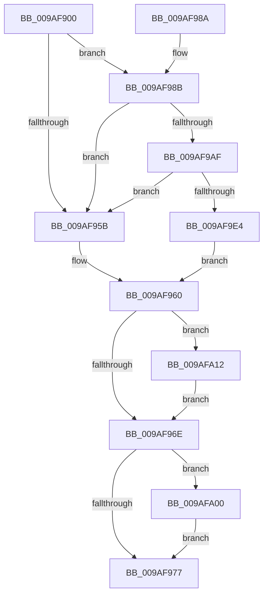

# ExWnfHiveUnloaded

- RVA: `0x009AF900`–`0x009AFA21` (길이 `289` bytes)
- VA: `0x00000001409AF900`
- 실행 섹션: `PAGE`
- PDB 이름 있음: `예`; PDB Function 태그: `아니요`
- unwind 정보 RVA: `0x0009E0BC`
- 디코드: `77`개 명령, `289/289` bytes 표시
- 미해석 바이트: `0` (있으면 어셈블리에 `.byte`로 보존)

> 이 문서는 커널 이미지의 기계어와 PDB 기호를 분석해 생성했습니다. 4번과 5번은 함수 원형과 자료형을 바이너리 사용 방식에서 추정한 C 해석이며 원본 소스 복구 결과는 아닙니다.

## 1. Dependencies

- 직접 호출 지점: **9**; 고유 호출 대상: **8**
- 직접 호출자로 확인된 함수: **1**
- RIP 상대 이미지 참조: **1**

### Outgoing calls
- `0x009AF952` → [RtlPrefixUnicodeString](../8F/RtlPrefixUnicodeString_function_008F4F70.md) (function, `0x008F4F70`)
- `0x009AF960` → [KeLeaveCriticalRegion](../../text/25/KeLeaveCriticalRegion_function_0025D8B0.md) (function, `0x0025D8B0`)
- `0x009AF9A2` → [ExAllocatePool2](../../poolcode/B8/ExAllocatePool2_function_00B820F0.md) (function, `0x00B820F0`)
- `0x009AF9C2` → [memcpy](../../text/6C/memcpy_function_006C6840.md) (function, `0x006C6840`)
- `0x009AF9D7` → [SeConvertStringSidToSid](../../text/4C/SeConvertStringSidToSid_function_004C6710.md) (function, `0x004C6710`)
- `0x009AF9EC` → [RtlLengthSid](../../text/45/RtlLengthSid_function_0045D270.md) (function, `0x0045D270`)
- `0x009AF9F6` → [ExpWnfInvalidateDataStores](../AB/ExpWnfInvalidateDataStores_function_00AB6E08.md) (function, `0x00AB6E08`)
- `0x009AFA08` → [ExFreePoolWithTag](../../poolcode/B8/ExFreePoolWithTag_function_00B82870.md) (function, `0x00B82870`)
- `0x009AFA17` → [ExFreePoolWithTag](../../poolcode/B8/ExFreePoolWithTag_function_00B82870.md) (function, `0x00B82870`)

### Direct callers
- [CmUnloadKey](CmUnloadKey_function_009AF2FC.md) at `0x009AF690`

### Static image references
- `0x009AF943` → RVA `0x00B08A20` (` ?? ::NNGAKEGL::`string'`; read)

## 2. Other-region calls and transfers

- 다른 실행 섹션으로 향하는 call: **7**
  - `0x009AF960` → [KeLeaveCriticalRegion](../../text/25/KeLeaveCriticalRegion_function_0025D8B0.md) (`PAGE` → `.text`)
  - `0x009AF9A2` → [ExAllocatePool2](../../poolcode/B8/ExAllocatePool2_function_00B820F0.md) (`PAGE` → `POOLCODE`)
  - `0x009AF9C2` → [memcpy](../../text/6C/memcpy_function_006C6840.md) (`PAGE` → `.text`)
  - `0x009AF9D7` → [SeConvertStringSidToSid](../../text/4C/SeConvertStringSidToSid_function_004C6710.md) (`PAGE` → `.text`)
  - `0x009AF9EC` → [RtlLengthSid](../../text/45/RtlLengthSid_function_0045D270.md) (`PAGE` → `.text`)
  - `0x009AFA08` → [ExFreePoolWithTag](../../poolcode/B8/ExFreePoolWithTag_function_00B82870.md) (`PAGE` → `POOLCODE`)
  - `0x009AFA17` → [ExFreePoolWithTag](../../poolcode/B8/ExFreePoolWithTag_function_00B82870.md) (`PAGE` → `POOLCODE`)
- 별도 외부 분기/꼬리 이동을 확인하지 못했습니다.

## 3. Assembly (complete function range)

```asm
009AF900  4C 8B DC                        mov r11, rsp
009AF903  49 89 5B 08                     mov qword ptr [r11 + 8], rbx
009AF907  49 89 6B 18                     mov qword ptr [r11 + 0x18], rbp
009AF90B  56                              push rsi
009AF90C  57                              push rdi
009AF90D  41 56                           push r14
009AF90F  48 83 EC 30                     sub rsp, 0x30
009AF913  65 48 8B 04 25 88 01 00 00      mov rax, qword ptr gs:[0x188]
009AF91C  45 33 F6                        xor r14d, r14d
009AF91F  48 8B E9                        mov rbp, rcx
009AF922  4D 89 73 10                     mov qword ptr [r11 + 0x10], r14
009AF926  48 8B D1                        mov rdx, rcx
009AF929  49 C7 43 D8 22 00 24 00         mov qword ptr [r11 - 0x28], 0x240022
009AF931  41 B0 01                        mov r8b, 1
009AF934  49 8D 4B D8                     lea rcx, [r11 - 0x28]
009AF938  66 FF 88 E4 01 00 00            dec word ptr [rax + 0x1e4]
009AF93F  41 8D 5E 22                     lea ebx, [r14 + 0x22]
009AF943  48 8D 05 D6 90 15 00            lea rax, [rip + 0x1590d6]
009AF94A  41 8B FE                        mov edi, r14d
009AF94D  49 89 43 E0                     mov qword ptr [r11 - 0x20], rax
009AF951  90                              nop
009AF952  E8 19 56 F4 FF                  call 0x1408f4f70
009AF957  84 C0                           test al, al
009AF959  75 30                           jne 0x1409af98b
009AF95B  48 8B 5C 24 58                  mov rbx, qword ptr [rsp + 0x58]
009AF960  E8 4B DF 8A FF                  call 0x14025d8b0
009AF965  48 85 DB                        test rbx, rbx
009AF968  0F 85 A4 00 00 00               jne 0x1409afa12
009AF96E  48 85 FF                        test rdi, rdi
009AF971  0F 85 89 00 00 00               jne 0x1409afa00
009AF977  48 8B 5C 24 50                  mov rbx, qword ptr [rsp + 0x50]
009AF97C  48 8B 6C 24 60                  mov rbp, qword ptr [rsp + 0x60]
009AF981  48 83 C4 30                     add rsp, 0x30
009AF985  41 5E                           pop r14
009AF987  5F                              pop rdi
009AF988  5E                              pop rsi
009AF989  C3                              ret
009AF98A  CC                              int3
009AF98B  8D 73 FC                        lea esi, [rbx - 4]
009AF98E  B9 00 01 00 00                  mov ecx, 0x100
009AF993  0F B7 5D 00                     movzx ebx, word ptr [rbp]
009AF997  41 B8 57 6E 66 20               mov r8d, 0x20666e57
009AF99D  2B DE                           sub ebx, esi
009AF99F  8D 53 02                        lea edx, [rbx + 2]
009AF9A2  E8 49 27 1D 00                  call 0x140b820f0
009AF9A7  48 8B F8                        mov rdi, rax
009AF9AA  48 85 C0                        test rax, rax
009AF9AD  74 AC                           je 0x1409af95b
009AF9AF  48 8B 4D 08                     mov rcx, qword ptr [rbp + 8]
009AF9B3  44 8B C3                        mov r8d, ebx
009AF9B6  8B D6                           mov edx, esi
009AF9B8  48 D1 EA                        shr rdx, 1
009AF9BB  48 8D 14 51                     lea rdx, [rcx + rdx*2]
009AF9BF  48 8B C8                        mov rcx, rax
009AF9C2  E8 79 6E D1 FF                  call 0x1406c6840
009AF9C7  48 D1 EB                        shr rbx, 1
009AF9CA  48 8D 54 24 58                  lea rdx, [rsp + 0x58]
009AF9CF  48 8B CF                        mov rcx, rdi
009AF9D2  66 44 89 34 5F                  mov word ptr [rdi + rbx*2], r14w
009AF9D7  E8 34 6D B1 FF                  call 0x1404c6710
009AF9DC  85 C0                           test eax, eax
009AF9DE  0F 88 77 FF FF FF               js 0x1409af95b
009AF9E4  48 8B 5C 24 58                  mov rbx, qword ptr [rsp + 0x58]
009AF9E9  48 8B CB                        mov rcx, rbx
009AF9EC  E8 7F D8 AA FF                  call 0x14045d270
009AF9F1  8B D0                           mov edx, eax
009AF9F3  48 8B CB                        mov rcx, rbx
009AF9F6  E8 0D 74 10 00                  call 0x140ab6e08
009AF9FB  E9 60 FF FF FF                  jmp 0x1409af960
009AFA00  BA 57 6E 66 20                  mov edx, 0x20666e57
009AFA05  48 8B CF                        mov rcx, rdi
009AFA08  E8 63 2E 1D 00                  call 0x140b82870
009AFA0D  E9 65 FF FF FF                  jmp 0x1409af977
009AFA12  33 D2                           xor edx, edx
009AFA14  48 8B CB                        mov rcx, rbx
009AFA17  E8 54 2E 1D 00                  call 0x140b82870
009AFA1C  E9 4D FF FF FF                  jmp 0x1409af96e
```

## 4. C-style interpretation (structured pseudocode)

```c
__int64 __fastcall ExWnfHiveUnloaded(__int64 a1)
{
    __int64 result;
    __int64 v_r14;
    __int64 v_rbx;
    __int64 v_rsp;
    unsigned __int64 v_stack_p10;
    unsigned __int64 v_stack_p18;
    unsigned __int64 v_stack_p58;
    unsigned __int64 v_stack_p8;

    *(unsigned __int64 *)(v_rsp + 8) = v_rbx;
    *(unsigned __int64 *)(v_rsp + 24) = v_rbp;
    v_rsp = (v_rsp) - (48);
    v_r14 = 0;
    *(unsigned __int64 *)(v_rsp + 16) = 0;
    *(unsigned __int64 *)(v_rsp - 40) = 0x240022ULL;
    *(unsigned __int64 *)(v_rsp - 32) = v_rip + 1413334;
    result = RtlPrefixUnicodeString(v_rsp - 40, a1, 1, a4);
    if ((unsigned __int8)(result) != 0) goto loc_009AF98B;
loc_009AF95B:
loc_009AF960:
    result = KeLeaveCriticalRegion(v_rsp - 40, a1, 1, a4);
    if (v_stack_p10 != 0) goto loc_009AFA12;
loc_009AF96E:
    if (0 != 0) goto loc_009AFA00;
loc_009AF977:
    v_rsp = (v_rsp) + (48);
    return result;
loc_009AF98B:
    v_rbx = (unsigned int)((*(unsigned __int16 *)(v_stack_p18)) - ((unsigned int)(v_stack_p8 - 4)));
    result = ExAllocatePool2(256, v_rbx + 2, (unsigned int)(0x20666E57ULL), a4);
    if (result == 0) goto loc_009AF95B;
    a2 = ((unsigned int)((unsigned int)(v_stack_p8 - 4))) >> (1);
    result = memcpy(result, *(unsigned __int64 *)(v_stack_p18 + 8) + a2 * 2, (unsigned int)((unsigned int)(v_rbx)), a4);
    v_rbx = (v_rbx) >> (1);
    *(unsigned __int16 *)(result + v_rbx * 2) = 0;
    result = SeConvertStringSidToSid(result, v_stack_p58, (unsigned int)((unsigned int)(v_rbx)), a4);
    if (sign_flag) goto loc_009AF95B;
    result = RtlLengthSid(v_stack_p58, v_stack_p58, (unsigned int)((unsigned int)(v_rbx)), a4);
    result = ExpWnfInvalidateDataStores(v_stack_p58, (unsigned int)((unsigned int)(result)), (unsigned int)((unsigned int)(v_rbx)), a4);
    goto loc_009AF960;
loc_009AFA00:
    result = ExFreePoolWithTag(result, (unsigned int)(0x20666E57ULL), (unsigned int)((unsigned int)(v_rbx)), a4);
    goto loc_009AF977;
loc_009AFA12:
    a2 = 0;
    result = ExFreePoolWithTag(v_stack_p58, a2, (unsigned int)((unsigned int)(v_rbx)), a4);
    goto loc_009AF96E;
}
```

## 5. (Beta) C Style

```c
int64_t ExWnfHiveUnloaded(void *Arg1)
{
    uint8_t *arg1 = (uint8_t *)Arg1;

    int64_t result;
    int64_t local_r14;
    int64_t local_rbx;
    int64_t local_rsp;
    uint64_t v_stack_p10;
    uint64_t v_stack_p18;
    uint64_t v_stack_p58;
    uint64_t v_stack_p8;

    *(uint64_t *)(local_rsp + 0x8) = local_rbx;
    *(uint64_t *)(local_rsp + 0x18) = local_rbp;
    local_rsp = (local_rsp) - (48);
    local_r14 = 0;
    *(uint64_t *)(local_rsp + 0x10) = 0;
    *(uint64_t *)(local_rsp - 0x28) = 0x240022ULL;
    *(uint64_t *)(local_rsp - 0x20) = v_rip + 1413334;
    result = RtlPrefixUnicodeString(local_rsp - 40, Arg1, 1, a4);
    if ((uint8_t)(result) != 0) goto loc_009AF98B;
loc_009AF95B:
loc_009AF960:
    result = KeLeaveCriticalRegion(local_rsp - 40, Arg1, 1, a4);
    if (v_stack_p10 != 0) goto loc_009AFA12;
loc_009AF96E:
    if (0 != 0) goto loc_009AFA00;
loc_009AF977:
    local_rsp = (local_rsp) + (48);
    return result;
loc_009AF98B:
    local_rbx = (uint32_t)((*(uint16_t *)(v_stack_p18)) - ((uint32_t)(v_stack_p8 - 4)));
    result = ExAllocatePool2(256, local_rbx + 2, (uint32_t)(0x20666E57ULL), a4);
    if (result == 0) goto loc_009AF95B;
    a2 = ((uint32_t)((uint32_t)(v_stack_p8 - 4))) >> (1);
    result = memcpy(result, *(uint64_t *)(v_stack_p18 + 0x8) + a2 * 2, (uint32_t)((uint32_t)(local_rbx)), a4);
    local_rbx = (local_rbx) >> (1);
    *(uint16_t *)(result + local_rbx * 2) = 0;
    result = SeConvertStringSidToSid(result, v_stack_p58, (uint32_t)((uint32_t)(local_rbx)), a4);
    if (sign_flag) goto loc_009AF95B;
    result = RtlLengthSid(v_stack_p58, v_stack_p58, (uint32_t)((uint32_t)(local_rbx)), a4);
    result = ExpWnfInvalidateDataStores(v_stack_p58, (uint32_t)((uint32_t)(result)), (uint32_t)((uint32_t)(local_rbx)), a4);
    goto loc_009AF960;
loc_009AFA00:
    result = ExFreePoolWithTag(result, (uint32_t)(0x20666E57ULL), (uint32_t)((uint32_t)(local_rbx)), a4);
    goto loc_009AF977;
loc_009AFA12:
    a2 = 0;
    result = ExFreePoolWithTag(v_stack_p58, a2, (uint32_t)((uint32_t)(local_rbx)), a4);
    goto loc_009AF96E;
}
```

### 관측된 메모리 오프셋

구조체 형식이 확인되지 않은 접근은 인자 기준의 오프셋으로만 기록했습니다.

| 기준 인자 | 오프셋 표현 | 폭 (bit) | 접근 |
|---|---:|---:|---|
| `Arg1` | `+ 0x0` | `16` | `R` |
| `Arg1` | `+ 0x8` | `64` | `R` |

## 6. Execution-region graph

[열기: 2D/3D 그래프와 함수 탐색 컨트롤 패널](../../../control-panel.html?section=page&rva=0x009AF900&view=graph)

- 2D 그래프는 위에서 아래로 흐르고, 3D 그래프는 빈 공간을 드래그해 회전합니다. Shift+드래그는 이동, 휠은 확대·축소, 함수 노드 선택은 대상 보고서 이동입니다.

### Static fallback


