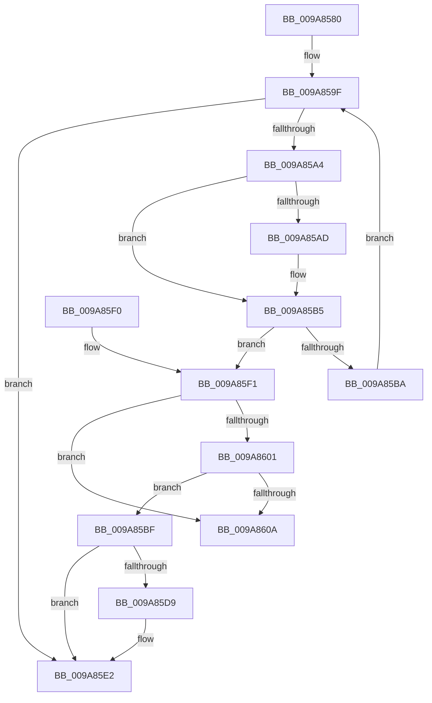

# FsRtlRemoveExtraCreateParameter

- RVA: `0x009A8580`–`0x009A8611` (길이 `145` bytes)
- VA: `0x00000001409A8580`
- 실행 섹션: `PAGE`
- PDB 이름 있음: `예`; PDB Function 태그: `아니요`
- unwind 정보 RVA: `0x0009CEFC`
- 디코드: `45`개 명령, `145/145` bytes 표시
- 미해석 바이트: `0` (있으면 어셈블리에 `.byte`로 보존)

> 이 문서는 커널 이미지의 기계어와 PDB 기호를 분석해 생성했습니다. 4번과 5번은 함수 원형과 자료형을 바이너리 사용 방식에서 추정한 C 해석이며 원본 소스 복구 결과는 아닙니다.

## 1. Dependencies

- 직접 호출 지점: **0**; 고유 호출 대상: **0**
- 직접 호출자로 확인된 함수: **2**
- RIP 상대 이미지 참조: **0**

### Outgoing calls
- 직접 디코드된 call 명령이 없습니다.

### Direct callers
- [sub_0041DDC3](../../text/41/Unknown_function_0041DDC3.md) at `0x0041DE22`
- [IopSymlinkRemoveECP](../../text/44/IopSymlinkRemoveECP_function_00446480.md) at `0x00446491`

### Static image references
- 디코드된 RIP-relative 메모리 참조가 없습니다.

## 2. Other-region calls and transfers

- 다른 실행 섹션으로 향하는 call: **0**
- 별도 외부 분기/꼬리 이동을 확인하지 못했습니다.

## 3. Assembly (complete function range)

```asm
009A8580  48 89 5C 24 08                  mov qword ptr [rsp + 8], rbx
009A8585  48 89 7C 24 10                  mov qword ptr [rsp + 0x10], rdi
009A858A  33 FF                           xor edi, edi
009A858C  4C 8D 51 08                     lea r10, [rcx + 8]
009A8590  49 89 38                        mov qword ptr [r8], rdi
009A8593  48 8B DA                        mov rbx, rdx
009A8596  49 8B 02                        mov rax, qword ptr [r10]
009A8599  41 BB 25 02 00 C0               mov r11d, 0xc0000225
009A859F  49 3B C2                        cmp rax, r10
009A85A2  74 3E                           je 0x1409a85e2
009A85A4  48 8B 50 10                     mov rdx, qword ptr [rax + 0x10]
009A85A8  48 2B 13                        sub rdx, qword ptr [rbx]
009A85AB  75 08                           jne 0x1409a85b5
009A85AD  48 8B 50 18                     mov rdx, qword ptr [rax + 0x18]
009A85B1  48 2B 53 08                     sub rdx, qword ptr [rbx + 8]
009A85B5  48 85 D2                        test rdx, rdx
009A85B8  74 37                           je 0x1409a85f1
009A85BA  48 8B 00                        mov rax, qword ptr [rax]
009A85BD  EB E0                           jmp 0x1409a859f
009A85BF  48 89 0A                        mov qword ptr [rdx], rcx
009A85C2  48 89 51 08                     mov qword ptr [rcx + 8], rdx
009A85C6  48 8D 48 40                     lea rcx, [rax + 0x40]
009A85CA  48 89 78 08                     mov qword ptr [rax + 8], rdi
009A85CE  48 89 38                        mov qword ptr [rax], rdi
009A85D1  49 89 08                        mov qword ptr [r8], rcx
009A85D4  4D 85 C9                        test r9, r9
009A85D7  74 09                           je 0x1409a85e2
009A85D9  8B 48 2C                        mov ecx, dword ptr [rax + 0x2c]
009A85DC  83 E9 48                        sub ecx, 0x48
009A85DF  41 89 09                        mov dword ptr [r9], ecx
009A85E2  48 8B 5C 24 08                  mov rbx, qword ptr [rsp + 8]
009A85E7  41 8B C3                        mov eax, r11d
009A85EA  48 8B 7C 24 10                  mov rdi, qword ptr [rsp + 0x10]
009A85EF  C3                              ret
009A85F0  CC                              int3
009A85F1  83 48 28 04                     or dword ptr [rax + 0x28], 4
009A85F5  44 8B DF                        mov r11d, edi
009A85F8  48 8B 08                        mov rcx, qword ptr [rax]
009A85FB  48 39 41 08                     cmp qword ptr [rcx + 8], rax
009A85FF  75 09                           jne 0x1409a860a
009A8601  48 8B 50 08                     mov rdx, qword ptr [rax + 8]
009A8605  48 39 02                        cmp qword ptr [rdx], rax
009A8608  74 B5                           je 0x1409a85bf
009A860A  B9 03 00 00 00                  mov ecx, 3
009A860F  CD 29                           int 0x29
```

## 4. C-style interpretation (structured pseudocode)

```c
__int64 __fastcall FsRtlRemoveExtraCreateParameter(__int64 a1, __int64 a2, __int64 a3, __int64 a4)
{
    __int64 v_rdi;
    unsigned __int64 v_stack_p10;
    unsigned __int64 v_stack_p8;

    v_stack_p8 = v_rbx;
    v_stack_p10 = v_rdi;
    v_rdi = 0;
    *(unsigned __int64 *)(a3) = 0;
loc_009A859F:
    if ((*(unsigned __int64 *)(a1 + 8)) == (a1 + 8)) goto loc_009A85E2;
    a2 = (*(unsigned __int64 *)(*(unsigned __int64 *)(a1 + 8) + 16)) - (*(unsigned __int64 *)(a2));
    if (!(condition_is_not_equal)) {
        a2 = *(unsigned __int64 *)(*(unsigned __int64 *)(a1 + 8) + 24);
        a2 = (a2) - (*(unsigned __int64 *)(a2 + 8));
    }
    if (a2 == 0) goto loc_009A85F1;
    goto loc_009A859F;
loc_009A85BF:
    *(unsigned __int64 *)(a2) = a1;
    *(unsigned __int64 *)(a1 + 8) = a2;
    *(unsigned __int64 *)(*(unsigned __int64 *)(*(unsigned __int64 *)(a1 + 8)) + 8) = 0;
    *(unsigned __int64 *)(*(unsigned __int64 *)(*(unsigned __int64 *)(a1 + 8))) = 0;
    *(unsigned __int64 *)(a3) = *(unsigned __int64 *)(*(unsigned __int64 *)(a1 + 8)) + 64;
    if (a4 != 0) {
        a1 = *(unsigned int *)(*(unsigned __int64 *)(*(unsigned __int64 *)(a1 + 8)) + 44);
        a1 = (unsigned int)((a1) - (72));
        *(unsigned int *)(a4) = (unsigned int)(a1);
    }
    return (unsigned int)((unsigned int)((unsigned int)(0xC0000225ULL)));
loc_009A85F1:
    if ((*(unsigned __int64 *)(*(unsigned __int64 *)((unsigned int)((unsigned int)((unsigned int)(0xC0000225ULL)))) + 8)) != ((unsigned int)((unsigned int)((unsigned int)(0xC0000225ULL))))) goto loc_009A860A;
    if ((*(unsigned __int64 *)(*(unsigned __int64 *)((unsigned int)((unsigned int)((unsigned int)(0xC0000225ULL))) + 8))) == ((unsigned int)((unsigned int)((unsigned int)(0xC0000225ULL))))) goto loc_009A85BF;
loc_009A860A:
    return (unsigned int)((unsigned int)((unsigned int)(0xC0000225ULL)));
}
```

## 5. (Beta) C Style

```c
int64_t FsRtlRemoveExtraCreateParameter(void *Arg1, void *Arg2, void *Arg3, int64_t Arg4)
{
    uint8_t *arg1 = (uint8_t *)Arg1;
    uint8_t *arg2 = (uint8_t *)Arg2;
    uint8_t *arg3 = (uint8_t *)Arg3;

    int64_t local_rdi;
    uint64_t v_stack_p10;
    uint64_t v_stack_p8;

    v_stack_p8 = local_rbx;
    v_stack_p10 = local_rdi;
    local_rdi = 0;
    *(uint64_t *)(arg3) = 0;
loc_009A859F:
    if ((*(uint64_t *)(arg1 + 0x8)) == (Arg1 + 8)) goto loc_009A85E2;
    Arg2 = (*(uint64_t *)(*(uint64_t *)(arg1 + 0x8) + 0x10)) - (*(uint64_t *)(arg2));
    if (!(condition_is_not_equal)) {
        Arg2 = *(uint64_t *)(*(uint64_t *)(arg1 + 0x8) + 0x18);
        Arg2 = (Arg2) - (*(uint64_t *)(arg2 + 0x8));
    }
    if (Arg2 == NULL) goto loc_009A85F1;
    goto loc_009A859F;
loc_009A85BF:
    *(void **)(arg2) = Arg1;
    *(void **)(arg1 + 0x8) = Arg2;
    *(uint64_t *)(*(uint64_t *)(*(uint64_t *)(arg1 + 0x8)) + 0x8) = 0;
    *(uint64_t *)(*(uint64_t *)(*(uint64_t *)(arg1 + 0x8))) = 0;
    *(uint64_t *)(arg3) = *(uint64_t *)(*(uint64_t *)(arg1 + 0x8)) + 64;
    if (Arg4 != 0) {
        Arg1 = *(uint32_t *)(*(uint64_t *)(*(uint64_t *)(arg1 + 0x8)) + 0x2C);
        Arg1 = (uint32_t)((Arg1) - (72));
        *(uint32_t *)(Arg4) = (uint32_t)(Arg1);
    }
    return (uint32_t)((uint32_t)((uint32_t)(0xC0000225ULL)));
loc_009A85F1:
    if ((*(uint64_t *)(*(uint64_t *)((uint32_t)((uint32_t)((uint32_t)(0xC0000225ULL)))) + 0x8)) != ((uint32_t)((uint32_t)((uint32_t)(0xC0000225ULL))))) goto loc_009A860A;
    if ((*(uint64_t *)(*(uint64_t *)((uint32_t)((uint32_t)((uint32_t)(0xC0000225ULL))) + 0x8))) == ((uint32_t)((uint32_t)((uint32_t)(0xC0000225ULL))))) goto loc_009A85BF;
loc_009A860A:
    return (uint32_t)((uint32_t)((uint32_t)(0xC0000225ULL)));
}
```

### 관측된 메모리 오프셋

구조체 형식이 확인되지 않은 접근은 인자 기준의 오프셋으로만 기록했습니다.

| 기준 인자 | 오프셋 표현 | 폭 (bit) | 접근 |
|---|---:|---:|---|
| `Arg1` | `+ 0x0` | `64` | `R` |
| `Arg1` | `+ 0x8` | `64` | `R` |
| `Arg2` | `+ 0x0` | `64` | `R` |
| `Arg2` | `+ 0x8` | `64` | `R` |
| `Arg3` | `+ 0x0` | `64` | `W` |

## 6. Execution-region graph

[열기: 2D/3D 그래프와 함수 탐색 컨트롤 패널](../../../control-panel.html?section=page&rva=0x009A8580&view=graph)

- 2D 그래프는 위에서 아래로 흐르고, 3D 그래프는 빈 공간을 드래그해 회전합니다. Shift+드래그는 이동, 휠은 확대·축소, 함수 노드 선택은 대상 보고서 이동입니다.

### Static fallback


