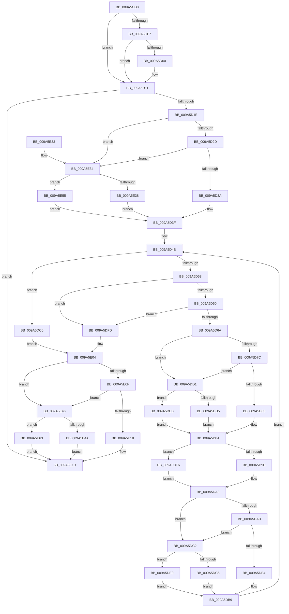

# FsRtlTeardownPerStreamContexts

- RVA: `0x009A5CD0`–`0x009A5E6E` (길이 `414` bytes)
- VA: `0x00000001409A5CD0`
- 실행 섹션: `PAGE`
- PDB 이름 있음: `예`; PDB Function 태그: `아니요`
- unwind 정보 RVA: `0x0009C700`
- 디코드: `116`개 명령, `414/414` bytes 표시
- 미해석 바이트: `0` (있으면 어셈블리에 `.byte`로 보존)

> 이 문서는 커널 이미지의 기계어와 PDB 기호를 분석해 생성했습니다. 4번과 5번은 함수 원형과 자료형을 바이너리 사용 방식에서 추정한 C 해석이며 원본 소스 복구 결과는 아닙니다.

## 1. Dependencies

- 직접 호출 지점: **15**; 고유 호출 대상: **8**
- 직접 호출자로 확인된 함수: **1**
- RIP 상대 이미지 참조: **1**

### Outgoing calls
- `0x009A5D04` → [guard_dispatch_icall](../../text/6B/guard_dispatch_icall_function_006BAAD0.md) (function, `0x006BAAD0`)
- `0x009A5D3A` → [FsRtlAcquireAutoExpandPushLockExclusive](../../text/26/FsRtlAcquireAutoExpandPushLockExclusive_function_0026539C.md) (function, `0x0026539C`)
- `0x009A5D85` → [FsRtlReleaseAutoExpandPushLockExclusive](../../text/26/FsRtlReleaseAutoExpandPushLockExclusive_function_00265B5C.md) (function, `0x00265B5C`)
- `0x009A5D9B` → [ExFreePool](../../poolcode/B8/ExFreePool_function_00B82850.md) (function, `0x00B82850`)
- `0x009A5DB4` → [FsRtlAcquireAutoExpandPushLockExclusive](../../text/26/FsRtlAcquireAutoExpandPushLockExclusive_function_0026539C.md) (function, `0x0026539C`)
- `0x009A5DCA` → [FsRtlAcquirePushLockExclusive](../../text/4A/FsRtlAcquirePushLockExclusive_function_004A05F4.md) (function, `0x004A05F4`)
- `0x009A5DD9` → [FsRtlReleasePushLock](../../text/26/FsRtlReleasePushLock_function_00265D7C.md) (function, `0x00265D7C`)
- `0x009A5DE4` → [ExAcquireFastMutex](../../text/20/ExAcquireFastMutex_function_0020E5A0.md) (function, `0x0020E5A0`)
- `0x009A5DEF` → [ExReleaseFastMutex](../../text/25/ExReleaseFastMutex_function_002519C0.md) (function, `0x002519C0`)
- `0x009A5DF6` → [guard_dispatch_icall](../../text/6B/guard_dispatch_icall_function_006BAAD0.md) (function, `0x006BAAD0`)
- `0x009A5E18` → [FsRtlReleaseAutoExpandPushLockExclusive](../../text/26/FsRtlReleaseAutoExpandPushLockExclusive_function_00265B5C.md) (function, `0x00265B5C`)
- `0x009A5E3C` → [FsRtlAcquirePushLockExclusive](../../text/4A/FsRtlAcquirePushLockExclusive_function_004A05F4.md) (function, `0x004A05F4`)
- `0x009A5E4E` → [FsRtlReleasePushLock](../../text/26/FsRtlReleasePushLock_function_00265D7C.md) (function, `0x00265D7C`)
- `0x009A5E59` → [ExAcquireFastMutex](../../text/20/ExAcquireFastMutex_function_0020E5A0.md) (function, `0x0020E5A0`)
- `0x009A5E67` → [ExReleaseFastMutex](../../text/25/ExReleaseFastMutex_function_002519C0.md) (function, `0x002519C0`)

### Direct callers
- [RawCleanupVcb](RawCleanupVcb_function_009A5C44.md) at `0x009A5C79`

### Static image references
- `0x009A5D44` → RVA `0x00B82850` (`ExFreePool`; read)

## 2. Other-region calls and transfers

- 다른 실행 섹션으로 향하는 call: **15**
  - `0x009A5D04` → [guard_dispatch_icall](../../text/6B/guard_dispatch_icall_function_006BAAD0.md) (`PAGE` → `.text`)
  - `0x009A5D3A` → [FsRtlAcquireAutoExpandPushLockExclusive](../../text/26/FsRtlAcquireAutoExpandPushLockExclusive_function_0026539C.md) (`PAGE` → `.text`)
  - `0x009A5D85` → [FsRtlReleaseAutoExpandPushLockExclusive](../../text/26/FsRtlReleaseAutoExpandPushLockExclusive_function_00265B5C.md) (`PAGE` → `.text`)
  - `0x009A5D9B` → [ExFreePool](../../poolcode/B8/ExFreePool_function_00B82850.md) (`PAGE` → `POOLCODE`)
  - `0x009A5DB4` → [FsRtlAcquireAutoExpandPushLockExclusive](../../text/26/FsRtlAcquireAutoExpandPushLockExclusive_function_0026539C.md) (`PAGE` → `.text`)
  - `0x009A5DCA` → [FsRtlAcquirePushLockExclusive](../../text/4A/FsRtlAcquirePushLockExclusive_function_004A05F4.md) (`PAGE` → `.text`)
  - `0x009A5DD9` → [FsRtlReleasePushLock](../../text/26/FsRtlReleasePushLock_function_00265D7C.md) (`PAGE` → `.text`)
  - `0x009A5DE4` → [ExAcquireFastMutex](../../text/20/ExAcquireFastMutex_function_0020E5A0.md) (`PAGE` → `.text`)
  - `0x009A5DEF` → [ExReleaseFastMutex](../../text/25/ExReleaseFastMutex_function_002519C0.md) (`PAGE` → `.text`)
  - `0x009A5DF6` → [guard_dispatch_icall](../../text/6B/guard_dispatch_icall_function_006BAAD0.md) (`PAGE` → `.text`)
  - `0x009A5E18` → [FsRtlReleaseAutoExpandPushLockExclusive](../../text/26/FsRtlReleaseAutoExpandPushLockExclusive_function_00265B5C.md) (`PAGE` → `.text`)
  - `0x009A5E3C` → [FsRtlAcquirePushLockExclusive](../../text/4A/FsRtlAcquirePushLockExclusive_function_004A05F4.md) (`PAGE` → `.text`)
  - `0x009A5E4E` → [FsRtlReleasePushLock](../../text/26/FsRtlReleasePushLock_function_00265D7C.md) (`PAGE` → `.text`)
  - `0x009A5E59` → [ExAcquireFastMutex](../../text/20/ExAcquireFastMutex_function_0020E5A0.md) (`PAGE` → `.text`)
  - `0x009A5E67` → [ExReleaseFastMutex](../../text/25/ExReleaseFastMutex_function_002519C0.md) (`PAGE` → `.text`)
- 별도 외부 분기/꼬리 이동을 확인하지 못했습니다.

## 3. Assembly (complete function range)

```asm
009A5CD0  48 89 5C 24 10                  mov qword ptr [rsp + 0x10], rbx
009A5CD5  48 89 74 24 18                  mov qword ptr [rsp + 0x18], rsi
009A5CDA  48 89 7C 24 20                  mov qword ptr [rsp + 0x20], rdi
009A5CDF  48 89 4C 24 08                  mov qword ptr [rsp + 8], rcx
009A5CE4  41 56                           push r14
009A5CE6  48 83 EC 30                     sub rsp, 0x30
009A5CEA  48 8B D9                        mov rbx, rcx
009A5CED  0F B6 41 07                     movzx eax, byte ptr [rcx + 7]
009A5CF1  24 F0                           and al, 0xf0
009A5CF3  3C 50                           cmp al, 0x50
009A5CF5  72 1A                           jb 0x1409a5d11
009A5CF7  48 8B 49 70                     mov rcx, qword ptr [rcx + 0x70]
009A5CFB  48 85 C9                        test rcx, rcx
009A5CFE  74 11                           je 0x1409a5d11
009A5D00  48 8B 41 20                     mov rax, qword ptr [rcx + 0x20]
009A5D04  E8 C7 4D D1 FF                  call 0x1406baad0
009A5D09  48 C7 43 70 00 00 00 00         mov qword ptr [rbx + 0x70], 0
009A5D11  48 8D 7B 38                     lea rdi, [rbx + 0x38]
009A5D15  48 39 3F                        cmp qword ptr [rdi], rdi
009A5D18  0F 84 FF 00 00 00               je 0x1409a5e1d
009A5D1E  0F B6 43 07                     movzx eax, byte ptr [rbx + 7]
009A5D22  C0 E8 04                        shr al, 4
009A5D25  3C 03                           cmp al, 3
009A5D27  0F 82 07 01 00 00               jb 0x1409a5e34
009A5D2D  48 8B 4B 60                     mov rcx, qword ptr [rbx + 0x60]
009A5D31  48 85 C9                        test rcx, rcx
009A5D34  0F 84 FA 00 00 00               je 0x1409a5e34
009A5D3A  E8 5D F6 8B FF                  call 0x14026539c
009A5D3F  C6 44 24 20 01                  mov byte ptr [rsp + 0x20], 1
009A5D44  4C 8D 35 05 CB 1D 00            lea r14, [rip + 0x1dcb05]
009A5D4B  48 8B 37                        mov rsi, qword ptr [rdi]
009A5D4E  48 3B F7                        cmp rsi, rdi
009A5D51  74 6D                           je 0x1409a5dc0
009A5D53  48 8B 06                        mov rax, qword ptr [rsi]
009A5D56  48 39 7E 08                     cmp qword ptr [rsi + 8], rdi
009A5D5A  0F 85 9D 00 00 00               jne 0x1409a5dfd
009A5D60  48 39 70 08                     cmp qword ptr [rax + 8], rsi
009A5D64  0F 85 93 00 00 00               jne 0x1409a5dfd
009A5D6A  48 89 07                        mov qword ptr [rdi], rax
009A5D6D  48 89 78 08                     mov qword ptr [rax + 8], rdi
009A5D71  0F B6 43 07                     movzx eax, byte ptr [rbx + 7]
009A5D75  C0 E8 04                        shr al, 4
009A5D78  3C 03                           cmp al, 3
009A5D7A  72 55                           jb 0x1409a5dd1
009A5D7C  48 8B 4B 60                     mov rcx, qword ptr [rbx + 0x60]
009A5D80  48 85 C9                        test rcx, rcx
009A5D83  74 4C                           je 0x1409a5dd1
009A5D85  E8 D2 FD 8B FF                  call 0x140265b5c
009A5D8A  C6 44 24 20 00                  mov byte ptr [rsp + 0x20], 0
009A5D8F  48 8B 46 20                     mov rax, qword ptr [rsi + 0x20]
009A5D93  48 8B CE                        mov rcx, rsi
009A5D96  49 3B C6                        cmp rax, r14
009A5D99  75 5B                           jne 0x1409a5df6
009A5D9B  E8 B0 CA 1D 00                  call 0x140b82850
009A5DA0  0F B6 43 07                     movzx eax, byte ptr [rbx + 7]
009A5DA4  C0 E8 04                        shr al, 4
009A5DA7  3C 03                           cmp al, 3
009A5DA9  72 17                           jb 0x1409a5dc2
009A5DAB  48 8B 4B 60                     mov rcx, qword ptr [rbx + 0x60]
009A5DAF  48 85 C9                        test rcx, rcx
009A5DB2  74 0E                           je 0x1409a5dc2
009A5DB4  E8 E3 F5 8B FF                  call 0x14026539c
009A5DB9  C6 44 24 20 01                  mov byte ptr [rsp + 0x20], 1
009A5DBE  EB 8B                           jmp 0x1409a5d4b
009A5DC0  EB 42                           jmp 0x1409a5e04
009A5DC2  3C 01                           cmp al, 1
009A5DC4  72 1A                           jb 0x1409a5de0
009A5DC6  48 8D 4B 48                     lea rcx, [rbx + 0x48]
009A5DCA  E8 25 A8 AF FF                  call 0x1404a05f4
009A5DCF  EB E8                           jmp 0x1409a5db9
009A5DD1  3C 01                           cmp al, 1
009A5DD3  72 16                           jb 0x1409a5deb
009A5DD5  48 8D 4B 48                     lea rcx, [rbx + 0x48]
009A5DD9  E8 9E FF 8B FF                  call 0x140265d7c
009A5DDE  EB AA                           jmp 0x1409a5d8a
009A5DE0  48 8B 4B 30                     mov rcx, qword ptr [rbx + 0x30]
009A5DE4  E8 B7 87 86 FF                  call 0x14020e5a0
009A5DE9  EB CE                           jmp 0x1409a5db9
009A5DEB  48 8B 4B 30                     mov rcx, qword ptr [rbx + 0x30]
009A5DEF  E8 CC BB 8A FF                  call 0x1402519c0
009A5DF4  EB 94                           jmp 0x1409a5d8a
009A5DF6  E8 D5 4C D1 FF                  call 0x1406baad0
009A5DFB  EB A3                           jmp 0x1409a5da0
009A5DFD  B9 03 00 00 00                  mov ecx, 3
009A5E02  CD 29                           int 0x29
009A5E04  0F B6 43 07                     movzx eax, byte ptr [rbx + 7]
009A5E08  C0 E8 04                        shr al, 4
009A5E0B  3C 03                           cmp al, 3
009A5E0D  72 37                           jb 0x1409a5e46
009A5E0F  48 8B 4B 60                     mov rcx, qword ptr [rbx + 0x60]
009A5E13  48 85 C9                        test rcx, rcx
009A5E16  74 2E                           je 0x1409a5e46
009A5E18  E8 3F FD 8B FF                  call 0x140265b5c
009A5E1D  48 8B 5C 24 48                  mov rbx, qword ptr [rsp + 0x48]
009A5E22  48 8B 74 24 50                  mov rsi, qword ptr [rsp + 0x50]
009A5E27  48 8B 7C 24 58                  mov rdi, qword ptr [rsp + 0x58]
009A5E2C  48 83 C4 30                     add rsp, 0x30
009A5E30  41 5E                           pop r14
009A5E32  C3                              ret
009A5E33  CC                              int3
009A5E34  3C 01                           cmp al, 1
009A5E36  72 1D                           jb 0x1409a5e55
009A5E38  48 8D 4B 48                     lea rcx, [rbx + 0x48]
009A5E3C  E8 B3 A7 AF FF                  call 0x1404a05f4
009A5E41  E9 F9 FE FF FF                  jmp 0x1409a5d3f
009A5E46  3C 01                           cmp al, 1
009A5E48  72 19                           jb 0x1409a5e63
009A5E4A  48 8D 4B 48                     lea rcx, [rbx + 0x48]
009A5E4E  E8 29 FF 8B FF                  call 0x140265d7c
009A5E53  EB C8                           jmp 0x1409a5e1d
009A5E55  48 8B 4B 30                     mov rcx, qword ptr [rbx + 0x30]
009A5E59  E8 42 87 86 FF                  call 0x14020e5a0
009A5E5E  E9 DC FE FF FF                  jmp 0x1409a5d3f
009A5E63  48 8B 4B 30                     mov rcx, qword ptr [rbx + 0x30]
009A5E67  E8 54 BB 8A FF                  call 0x1402519c0
009A5E6C  EB AF                           jmp 0x1409a5e1d
```

## 4. C-style interpretation (structured pseudocode)

```c
__int64 __fastcall FsRtlTeardownPerStreamContexts(__int64 a1)
{
    __int64 result;
    __int64 v_rsp;
    unsigned __int8 v_stack_m18;
    unsigned __int64 v_stack_p10;
    unsigned __int64 v_stack_p18;
    unsigned __int64 v_stack_p20;
    unsigned __int64 v_stack_p8;

    v_stack_p10 = v_rbx;
    v_stack_p18 = v_rsi;
    v_stack_p20 = v_rdi;
    v_stack_p8 = a1;
    v_rsp = (v_rsp) - (48);
    result = (unsigned __int8)((*(unsigned __int8 *)(a1 + 7)) & (240));
    if (((unsigned __int8)(result)) < 80) goto loc_009A5D11;
    if (*(unsigned __int64 *)(a1 + 112) != 0) {
        result = *(unsigned __int64 *)(*(unsigned __int64 *)(a1 + 112) + 32);
        result = guard_dispatch_icall(*(unsigned __int64 *)(a1 + 112), a2, a3, a4);
        *(unsigned __int64 *)(a1 + 112) = 0;
    }
    if ((*(unsigned __int64 *)(a1 + 56)) == (a1 + 56)) goto loc_009A5E1D;
    result = (unsigned __int8)((*(unsigned __int8 *)(a1 + 7)) >> (4));
    if (((unsigned __int8)(result)) < 3) goto loc_009A5E34;
    if (*(unsigned __int64 *)(a1 + 96) == 0) goto loc_009A5E34;
    result = FsRtlAcquireAutoExpandPushLockExclusive(*(unsigned __int64 *)(a1 + 96), a2, a3, a4);
loc_009A5D3F:
    v_stack_m18 = 1;
loc_009A5D4B:
    if ((*(unsigned __int64 *)(a1 + 56)) == (a1 + 56)) goto loc_009A5DC0;
    if ((*(unsigned __int64 *)(*(unsigned __int64 *)(a1 + 56) + 8)) != (a1 + 56)) goto loc_009A5DFD;
    if ((*(unsigned __int64 *)(*(unsigned __int64 *)(*(unsigned __int64 *)(a1 + 56)) + 8)) != (*(unsigned __int64 *)(a1 + 56))) goto loc_009A5DFD;
    *(unsigned __int64 *)(a1 + 56) = *(unsigned __int64 *)(*(unsigned __int64 *)(a1 + 56));
    *(unsigned __int64 *)(*(unsigned __int64 *)(*(unsigned __int64 *)(a1 + 56)) + 8) = a1 + 56;
    result = (unsigned __int8)((*(unsigned __int8 *)(a1 + 7)) >> (4));
    if (((unsigned __int8)(result)) < 3) goto loc_009A5DD1;
    if (*(unsigned __int64 *)(a1 + 96) == 0) goto loc_009A5DD1;
    result = FsRtlReleaseAutoExpandPushLockExclusive(*(unsigned __int64 *)(a1 + 96), a2, a3, a4);
loc_009A5D8A:
    v_stack_m18 = 0;
    if ((*(unsigned __int64 *)(*(unsigned __int64 *)(a1 + 56) + 32)) != (v_rip + 1952517)) goto loc_009A5DF6;
    result = ExFreePool(*(unsigned __int64 *)(a1 + 56), a2, a3, a4);
loc_009A5DA0:
    result = (unsigned __int8)((*(unsigned __int8 *)(a1 + 7)) >> (4));
    if (((unsigned __int8)(result)) < 3) goto loc_009A5DC2;
    if (*(unsigned __int64 *)(a1 + 96) == 0) goto loc_009A5DC2;
    result = FsRtlAcquireAutoExpandPushLockExclusive(*(unsigned __int64 *)(a1 + 96), a2, a3, a4);
loc_009A5DB9:
    v_stack_m18 = 1;
    goto loc_009A5D4B;
loc_009A5DC0:
    goto loc_009A5E04;
loc_009A5DC2:
    if (((unsigned __int8)(result)) < 1) goto loc_009A5DE0;
    result = FsRtlAcquirePushLockExclusive(a1 + 72, a2, a3, a4);
    goto loc_009A5DB9;
loc_009A5DD1:
    if (((unsigned __int8)(result)) < 1) goto loc_009A5DEB;
    result = FsRtlReleasePushLock(a1 + 72, a2, a3, a4);
    goto loc_009A5D8A;
loc_009A5DE0:
    result = ExAcquireFastMutex(*(unsigned __int64 *)(a1 + 48), a2, a3, a4);
    goto loc_009A5DB9;
loc_009A5DEB:
    result = ExReleaseFastMutex(*(unsigned __int64 *)(a1 + 48), a2, a3, a4);
    goto loc_009A5D8A;
loc_009A5DF6:
    result = guard_dispatch_icall(*(unsigned __int64 *)(a1 + 48), a2, a3, a4);
    goto loc_009A5DA0;
loc_009A5DFD:
loc_009A5E04:
    result = (unsigned __int8)((*(unsigned __int8 *)(a1 + 7)) >> (4));
    if (((unsigned __int8)(result)) < 3) goto loc_009A5E46;
    if (*(unsigned __int64 *)(a1 + 96) == 0) goto loc_009A5E46;
    result = FsRtlReleaseAutoExpandPushLockExclusive(*(unsigned __int64 *)(a1 + 96), a2, a3, a4);
loc_009A5E1D:
    v_rsp = (v_rsp) + (48);
    return result;
loc_009A5E34:
    if (((unsigned __int8)(result)) < 1) goto loc_009A5E55;
    result = FsRtlAcquirePushLockExclusive(v_stack_p10 + 72, a2, a3, a4);
    goto loc_009A5D3F;
loc_009A5E46:
    if (((unsigned __int8)(result)) < 1) goto loc_009A5E63;
    result = FsRtlReleasePushLock(v_stack_p10 + 72, a2, a3, a4);
    goto loc_009A5E1D;
loc_009A5E55:
    result = ExAcquireFastMutex(*(unsigned __int64 *)(v_stack_p10 + 48), a2, a3, a4);
    goto loc_009A5D3F;
loc_009A5E63:
    result = ExReleaseFastMutex(*(unsigned __int64 *)(v_stack_p10 + 48), a2, a3, a4);
    goto loc_009A5E1D;
}
```

## 5. (Beta) C Style

```c
int64_t FsRtlTeardownPerStreamContexts(void *Arg1)
{
    uint8_t *arg1 = (uint8_t *)Arg1;

    int64_t result;
    int64_t local_rsp;
    uint8_t v_stack_m18;
    uint64_t v_stack_p10;
    uint64_t v_stack_p18;
    uint64_t v_stack_p20;
    uint64_t v_stack_p8;

    v_stack_p10 = local_rbx;
    v_stack_p18 = local_rsi;
    v_stack_p20 = local_rdi;
    v_stack_p8 = Arg1;
    local_rsp = (local_rsp) - (48);
    result = (uint8_t)((*(uint8_t *)(arg1 + 0x7)) & (240));
    if (((uint8_t)(result)) < 80) goto loc_009A5D11;
    if (*(uint64_t *)(arg1 + 0x70) != 0) {
        result = *(uint64_t *)(*(uint64_t *)(arg1 + 0x70) + 0x20);
        result = guard_dispatch_icall(*(uint64_t *)(arg1 + 0x70), a2, a3, a4);
        *(uint64_t *)(arg1 + 0x70) = 0;
    }
    if ((*(uint64_t *)(arg1 + 0x38)) == (Arg1 + 56)) goto loc_009A5E1D;
    result = (uint8_t)((*(uint8_t *)(arg1 + 0x7)) >> (4));
    if (((uint8_t)(result)) < 3) goto loc_009A5E34;
    if (*(uint64_t *)(arg1 + 0x60) == 0) goto loc_009A5E34;
    result = FsRtlAcquireAutoExpandPushLockExclusive(*(uint64_t *)(arg1 + 0x60), a2, a3, a4);
loc_009A5D3F:
    v_stack_m18 = 1;
loc_009A5D4B:
    if ((*(uint64_t *)(arg1 + 0x38)) == (Arg1 + 56)) goto loc_009A5DC0;
    if ((*(uint64_t *)(*(uint64_t *)(arg1 + 0x38) + 0x8)) != (Arg1 + 56)) goto loc_009A5DFD;
    if ((*(uint64_t *)(*(uint64_t *)(*(uint64_t *)(arg1 + 0x38)) + 0x8)) != (*(uint64_t *)(arg1 + 0x38))) goto loc_009A5DFD;
    *(uint64_t *)(arg1 + 0x38) = *(uint64_t *)(*(uint64_t *)(arg1 + 0x38));
    *(void **)(*(uint64_t *)(*(uint64_t *)(arg1 + 0x38)) + 0x8) = Arg1 + 56;
    result = (uint8_t)((*(uint8_t *)(arg1 + 0x7)) >> (4));
    if (((uint8_t)(result)) < 3) goto loc_009A5DD1;
    if (*(uint64_t *)(arg1 + 0x60) == 0) goto loc_009A5DD1;
    result = FsRtlReleaseAutoExpandPushLockExclusive(*(uint64_t *)(arg1 + 0x60), a2, a3, a4);
loc_009A5D8A:
    v_stack_m18 = 0;
    if ((*(uint64_t *)(*(uint64_t *)(arg1 + 0x38) + 0x20)) != (v_rip + 1952517)) goto loc_009A5DF6;
    result = ExFreePool(*(uint64_t *)(arg1 + 0x38), a2, a3, a4);
loc_009A5DA0:
    result = (uint8_t)((*(uint8_t *)(arg1 + 0x7)) >> (4));
    if (((uint8_t)(result)) < 3) goto loc_009A5DC2;
    if (*(uint64_t *)(arg1 + 0x60) == 0) goto loc_009A5DC2;
    result = FsRtlAcquireAutoExpandPushLockExclusive(*(uint64_t *)(arg1 + 0x60), a2, a3, a4);
loc_009A5DB9:
    v_stack_m18 = 1;
    goto loc_009A5D4B;
loc_009A5DC0:
    goto loc_009A5E04;
loc_009A5DC2:
    if (((uint8_t)(result)) < 1) goto loc_009A5DE0;
    result = FsRtlAcquirePushLockExclusive(Arg1 + 72, a2, a3, a4);
    goto loc_009A5DB9;
loc_009A5DD1:
    if (((uint8_t)(result)) < 1) goto loc_009A5DEB;
    result = FsRtlReleasePushLock(Arg1 + 72, a2, a3, a4);
    goto loc_009A5D8A;
loc_009A5DE0:
    result = ExAcquireFastMutex(*(uint64_t *)(arg1 + 0x30), a2, a3, a4);
    goto loc_009A5DB9;
loc_009A5DEB:
    result = ExReleaseFastMutex(*(uint64_t *)(arg1 + 0x30), a2, a3, a4);
    goto loc_009A5D8A;
loc_009A5DF6:
    result = guard_dispatch_icall(*(uint64_t *)(arg1 + 0x30), a2, a3, a4);
    goto loc_009A5DA0;
loc_009A5DFD:
loc_009A5E04:
    result = (uint8_t)((*(uint8_t *)(arg1 + 0x7)) >> (4));
    if (((uint8_t)(result)) < 3) goto loc_009A5E46;
    if (*(uint64_t *)(arg1 + 0x60) == 0) goto loc_009A5E46;
    result = FsRtlReleaseAutoExpandPushLockExclusive(*(uint64_t *)(arg1 + 0x60), a2, a3, a4);
loc_009A5E1D:
    local_rsp = (local_rsp) + (48);
    return result;
loc_009A5E34:
    if (((uint8_t)(result)) < 1) goto loc_009A5E55;
    result = FsRtlAcquirePushLockExclusive(v_stack_p10 + 72, a2, a3, a4);
    goto loc_009A5D3F;
loc_009A5E46:
    if (((uint8_t)(result)) < 1) goto loc_009A5E63;
    result = FsRtlReleasePushLock(v_stack_p10 + 72, a2, a3, a4);
    goto loc_009A5E1D;
loc_009A5E55:
    result = ExAcquireFastMutex(*(uint64_t *)(v_stack_p10 + 0x30), a2, a3, a4);
    goto loc_009A5D3F;
loc_009A5E63:
    result = ExReleaseFastMutex(*(uint64_t *)(v_stack_p10 + 0x30), a2, a3, a4);
    goto loc_009A5E1D;
}
```

### 관측된 메모리 오프셋

구조체 형식이 확인되지 않은 접근은 인자 기준의 오프셋으로만 기록했습니다.

| 기준 인자 | 오프셋 표현 | 폭 (bit) | 접근 |
|---|---:|---:|---|
| `Arg1` | `+ 0x0` | `64` | `R` |
| `Arg1` | `+ 0x0` | `64` | `W` |
| `Arg1` | `+ 0x7` | `8` | `R` |
| `Arg1` | `+ 0x30` | `64` | `R` |
| `Arg1` | `+ 0x38` | `64` | `R` |
| `Arg1` | `+ 0x48` | `64` | `R` |
| `Arg1` | `+ 0x60` | `64` | `R` |
| `Arg1` | `+ 0x70` | `64` | `R` |
| `Arg1` | `+ 0x70` | `64` | `W` |

## 6. Execution-region graph

[열기: 2D/3D 그래프와 함수 탐색 컨트롤 패널](../../../control-panel.html?section=page&rva=0x009A5CD0&view=graph)

- 2D 그래프는 위에서 아래로 흐르고, 3D 그래프는 빈 공간을 드래그해 회전합니다. Shift+드래그는 이동, 휠은 확대·축소, 함수 노드 선택은 대상 보고서 이동입니다.

### Static fallback


