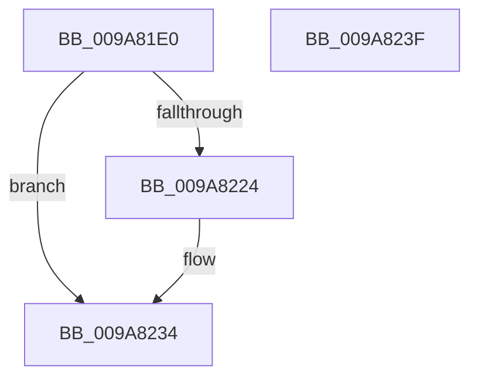

# IoAllocateMiniCompletionPacket

- RVA: `0x009A81E0`–`0x009A8240` (길이 `96` bytes)
- VA: `0x00000001409A81E0`
- 실행 섹션: `PAGE`
- PDB 이름 있음: `예`; PDB Function 태그: `아니요`
- unwind 정보 RVA: `0x000718C0`
- 디코드: `27`개 명령, `96/96` bytes 표시
- 미해석 바이트: `0` (있으면 어셈블리에 `.byte`로 보존)

> 이 문서는 커널 이미지의 기계어와 PDB 기호를 분석해 생성했습니다. 4번과 5번은 함수 원형과 자료형을 바이너리 사용 방식에서 추정한 C 해석이며 원본 소스 복구 결과는 아닙니다.

## 1. Dependencies

- 직접 호출 지점: **1**; 고유 호출 대상: **1**
- 직접 호출자로 확인된 함수: **2**
- RIP 상대 이미지 참조: **0**

### Outgoing calls
- `0x009A821A` → [ExAllocatePool3](../../poolcode/B8/ExAllocatePool3_function_00B84270.md) (function, `0x00B84270`)

### Direct callers
- [NtCreateWorkerFactory](NtCreateWorkerFactory_function_009A7E10.md) at `0x009A7F92`
- [NtSetInformationJobObject](../9F/NtSetInformationJobObject_function_009F84C0.md) at `0x009F8937`

### Static image references
- 디코드된 RIP-relative 메모리 참조가 없습니다.

## 2. Other-region calls and transfers

- 다른 실행 섹션으로 향하는 call: **1**
  - `0x009A821A` → [ExAllocatePool3](../../poolcode/B8/ExAllocatePool3_function_00B84270.md) (`PAGE` → `POOLCODE`)
- 별도 외부 분기/꼬리 이동을 확인하지 못했습니다.

## 3. Assembly (complete function range)

```asm
009A81E0  48 8B C4                        mov rax, rsp
009A81E3  48 89 58 08                     mov qword ptr [rax + 8], rbx
009A81E7  57                              push rdi
009A81E8  48 83 EC 40                     sub rsp, 0x40
009A81EC  48 8B DA                        mov rbx, rdx
009A81EF  C7 40 D8 01 00 00 00            mov dword ptr [rax - 0x28], 1
009A81F6  BA 50 00 00 00                  mov edx, 0x50
009A81FB  4C 8D 48 E8                     lea r9, [rax - 0x18]
009A81FF  0F 57 C0                        xorps xmm0, xmm0
009A8202  48 8B F9                        mov rdi, rcx
009A8205  0F 11 40 E8                     movups xmmword ptr [rax - 0x18], xmm0
009A8209  83 60 F0 00                     and dword ptr [rax - 0x10], 0
009A820D  41 B8 49 63 70 20               mov r8d, 0x20706349
009A8213  8D 4A F0                        lea ecx, [rdx - 0x10]
009A8216  C6 40 E8 01                     mov byte ptr [rax - 0x18], 1
009A821A  E8 51 C0 1D 00                  call 0x140b84270
009A821F  48 85 C0                        test rax, rax
009A8222  74 10                           je 0x1409a8234
009A8224  C6 40 10 04                     mov byte ptr [rax + 0x10], 4
009A8228  48 89 78 38                     mov qword ptr [rax + 0x38], rdi
009A822C  48 89 58 40                     mov qword ptr [rax + 0x40], rbx
009A8230  C6 40 48 01                     mov byte ptr [rax + 0x48], 1
009A8234  48 8B 5C 24 50                  mov rbx, qword ptr [rsp + 0x50]
009A8239  48 83 C4 40                     add rsp, 0x40
009A823D  5F                              pop rdi
009A823E  C3                              ret
009A823F  CC                              int3
```

## 4. C-style interpretation (structured pseudocode)

```c
__int64 __fastcall IoAllocateMiniCompletionPacket(__int64 a1, __int64 a2)
{
    __int64 result;
    __int64 v_rsp;
    unsigned __int64 v_stack_p8;

    *(unsigned __int64 *)(v_rsp + 8) = v_rbx;
    v_rsp = (v_rsp) - (64);
    *(unsigned int *)(v_rsp - 40) = 1;
    *(unsigned __int64 *)(v_rsp - 24) = v_xmm0;
    *(unsigned __int8 *)(v_rsp - 24) = 1;
    result = ExAllocatePool3(80 - 16, 80, (unsigned int)(0x20706349ULL), v_rsp - 24);
    if (result != 0) {
        *(unsigned __int8 *)(result + 16) = 4;
        *(unsigned __int64 *)(result + 56) = a1;
        *(unsigned __int64 *)(result + 64) = a2;
        *(unsigned __int8 *)(result + 72) = 1;
    }
    v_rsp = (v_rsp) + (64);
    return result;
}
```

## 5. (Beta) C Style

```c
int64_t IoAllocateMiniCompletionPacket(int64_t Arg1, int64_t Arg2)
{
    int64_t result;
    int64_t local_rsp;
    uint64_t v_stack_p8;

    *(uint64_t *)(local_rsp + 0x8) = local_rbx;
    local_rsp = (local_rsp) - (64);
    *(uint32_t *)(local_rsp - 0x28) = 1;
    *(uint64_t *)(local_rsp - 0x18) = v_xmm0;
    *(uint8_t *)(local_rsp - 0x18) = 1;
    result = ExAllocatePool3(80 - 16, 80, (uint32_t)(0x20706349ULL), local_rsp - 24);
    if (result != 0) {
        *(uint8_t *)(result + 0x10) = 4;
        *(uint64_t *)(result + 0x38) = Arg1;
        *(uint64_t *)(result + 0x40) = Arg2;
        *(uint8_t *)(result + 0x48) = 1;
    }
    local_rsp = (local_rsp) + (64);
    return result;
}
```

## 6. Execution-region graph

[열기: 2D/3D 그래프와 함수 탐색 컨트롤 패널](../../../control-panel.html?section=page&rva=0x009A81E0&view=graph)

- 2D 그래프는 위에서 아래로 흐르고, 3D 그래프는 빈 공간을 드래그해 회전합니다. Shift+드래그는 이동, 휠은 확대·축소, 함수 노드 선택은 대상 보고서 이동입니다.

### Static fallback


