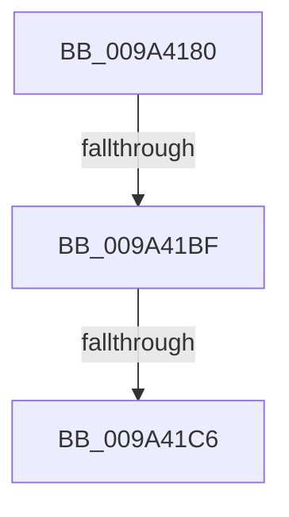

# IoCheckLinkShareAccess

- RVA: `0x009A4180`–`0x009A41D2` (길이 `82` bytes)
- VA: `0x00000001409A4180`
- 실행 섹션: `PAGE`
- PDB 이름 있음: `예`; PDB Function 태그: `아니요`
- unwind 정보 RVA: `0x0009C468`
- 디코드: `26`개 명령, `82/82` bytes 표시
- 미해석 바이트: `0` (있으면 어셈블리에 `.byte`로 보존)

> 이 문서는 커널 이미지의 기계어와 PDB 기호를 분석해 생성했습니다. 4번과 5번은 함수 원형과 자료형을 바이너리 사용 방식에서 추정한 C 해석이며 원본 소스 복구 결과는 아닙니다.

## 1. Dependencies

- 직접 호출 지점: **0**; 고유 호출 대상: **0**
- 직접 호출자로 확인된 함수: **4**
- RIP 상대 이미지 참조: **0**

### Outgoing calls
- 직접 디코드된 call 명령이 없습니다.

### Direct callers
- [FsRtlpCheckSharingAgainstOplockOwner](../../text/4B/FsRtlpCheckSharingAgainstOplockOwner_function_004BA718.md) at `0x004BA798`
- [IoCheckShareAccessEx](../71/IoCheckShareAccessEx_function_0071D090.md) at `0x0071D0C7`
- [RawCreate](RawCreate_function_009A3E5C.md) at `0x009A3F0F`
- [IoCheckShareAccess](IoCheckShareAccess_function_009A4150.md) at `0x009A4167`

### Static image references
- 디코드된 RIP-relative 메모리 참조가 없습니다.

## 2. Other-region calls and transfers

- 다른 실행 섹션으로 향하는 call: **0**
- call이 아닌 외부 분기/꼬리 이동: **2**
  - `0x009A41B9` → [sub_009A4354](Unknown_function_009A4354.md) (`tail-transfer`)
  - `0x009A41C4` → [sub_009A41D2](Unknown_function_009A41D2.md) (`tail-transfer`)

## 3. Assembly (complete function range)

```asm
009A4180  40 53                           push rbx
009A4182  55                              push rbp
009A4183  56                              push rsi
009A4184  57                              push rdi
009A4185  41 56                           push r14
009A4187  48 83 EC 10                     sub rsp, 0x10
009A418B  4D 8B F1                        mov r14, r9
009A418E  44 8B D9                        mov r11d, ecx
009A4191  41 83 E3 21                     and r11d, 0x21
009A4195  8B D9                           mov ebx, ecx
009A4197  44 8B D1                        mov r10d, ecx
009A419A  8B EA                           mov ebp, edx
009A419C  8B 54 24 68                     mov edx, dword ptr [rsp + 0x68]
009A41A0  40 0F 95 C7                     setne dil
009A41A4  83 E3 06                        and ebx, 6
009A41A7  40 0F 95 C6                     setne sil
009A41AB  41 81 E2 00 00 01 00            and r10d, 0x10000
009A41B2  41 0F 95 C1                     setne r9b
009A41B6  4D 85 F6                        test r14, r14
009A41B9  0F 84 95 01 00 00               je 0x1409a4354
009A41BF  8B CA                           mov ecx, edx
009A41C1  83 E1 02                        and ecx, 2
009A41C4  75 0C                           jne 0x1409a41d2
009A41C6  41 88 78 4A                     mov byte ptr [r8 + 0x4a], dil
009A41CA  41 88 70 4B                     mov byte ptr [r8 + 0x4b], sil
009A41CE  45 88 48 4C                     mov byte ptr [r8 + 0x4c], r9b
```

## 4. C-style interpretation (structured pseudocode)

```c
void __fastcall IoCheckLinkShareAccess(int a1, int a2, __int64 a3, __int64 a4, __int64 a5, unsigned int a6)
{
    __int64 v_r10;
    __int64 v_r11;
    __int64 v_rbx;
    __int64 v_rdi;
    __int64 v_rsi;
    __int64 v_rsp;

    v_rsp = (v_rsp) - (16);
    v_r11 = (unsigned int)(((unsigned int)(a1)) & (33));
    v_rdi = (condition_is_not_equal) ? 1 : 0;
    v_rbx = (unsigned int)(((unsigned int)(a1)) & (6));
    v_rsi = (condition_is_not_equal) ? 1 : 0;
    v_r10 = (unsigned int)(((unsigned int)(a1)) & (0x10000ULL));
    a4 = (condition_is_not_equal) ? 1 : 0;
    a1 = (unsigned int)(((unsigned int)((unsigned int)((unsigned int)(a6)))) & (2));
    *(unsigned __int8 *)(a3 + 74) = (unsigned __int8)(v_rdi);
    *(unsigned __int8 *)(a3 + 75) = (unsigned __int8)(v_rsi);
    *(unsigned __int8 *)(a3 + 76) = (unsigned __int8)(a4);
    return;
}
```

## 5. (Beta) C Style

```c
void IoCheckLinkShareAccess(int32_t Arg1, int32_t Arg2, void *Arg3, int64_t Arg4, uint64_t Arg5, uint32_t Arg6)
{
    uint8_t *arg3 = (uint8_t *)Arg3;

    int64_t local_r10;
    int64_t local_r11;
    int64_t local_rbx;
    int64_t local_rdi;
    int64_t local_rsi;
    int64_t local_rsp;

    local_rsp = (local_rsp) - (16);
    local_r11 = (uint32_t)(((uint32_t)(Arg1)) & (33));
    local_rdi = (condition_is_not_equal) ? 1 : 0;
    local_rbx = (uint32_t)(((uint32_t)(Arg1)) & (6));
    local_rsi = (condition_is_not_equal) ? 1 : 0;
    local_r10 = (uint32_t)(((uint32_t)(Arg1)) & (0x10000ULL));
    Arg4 = (condition_is_not_equal) ? 1 : 0;
    Arg1 = (uint32_t)(((uint32_t)((uint32_t)((uint32_t)(Arg6)))) & (2));
    *(uint8_t *)(arg3 + 0x4A) = (uint8_t)(local_rdi);
    *(uint8_t *)(arg3 + 0x4B) = (uint8_t)(local_rsi);
    *(uint8_t *)(arg3 + 0x4C) = (uint8_t)(Arg4);
    return;
}
```

### 관측된 메모리 오프셋

구조체 형식이 확인되지 않은 접근은 인자 기준의 오프셋으로만 기록했습니다.

| 기준 인자 | 오프셋 표현 | 폭 (bit) | 접근 |
|---|---:|---:|---|
| `Arg3` | `+ 0x4A` | `8` | `W` |
| `Arg3` | `+ 0x4B` | `8` | `W` |
| `Arg3` | `+ 0x4C` | `8` | `W` |

## 6. Execution-region graph

[열기: 2D/3D 그래프와 함수 탐색 컨트롤 패널](../../../control-panel.html?section=page&rva=0x009A4180&view=graph)

- 2D 그래프는 위에서 아래로 흐르고, 3D 그래프는 빈 공간을 드래그해 회전합니다. Shift+드래그는 이동, 휠은 확대·축소, 함수 노드 선택은 대상 보고서 이동입니다.

### Static fallback


