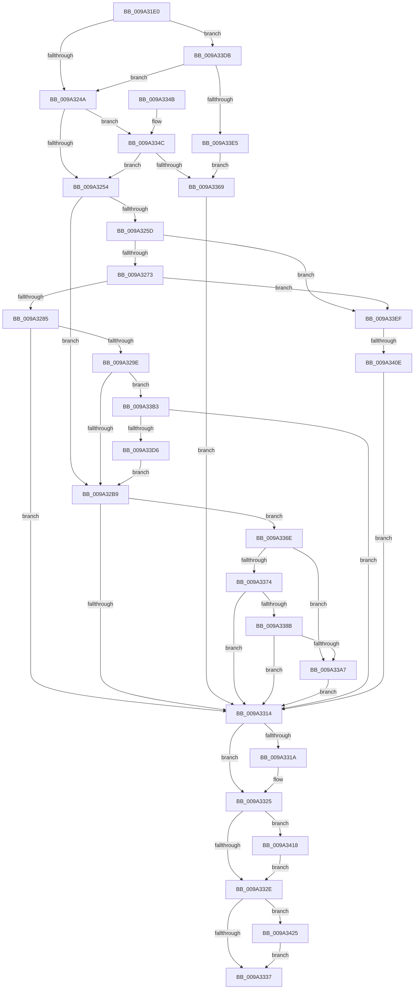

# IoCreateDeviceSecure

- RVA: `0x009A31E0`–`0x009A3434` (길이 `596` bytes)
- VA: `0x00000001409A31E0`
- 실행 섹션: `PAGE`
- PDB 이름 있음: `예`; PDB Function 태그: `예`
- unwind 정보 RVA: `0x0009C340`
- 디코드: `162`개 명령, `596/596` bytes 표시
- 미해석 바이트: `0` (있으면 어셈블리에 `.byte`로 보존)

> 이 문서는 커널 이미지의 기계어와 PDB 기호를 분석해 생성했습니다. 4번과 5번은 함수 원형과 자료형을 바이너리 사용 방식에서 추정한 C 해석이며 원본 소스 복구 결과는 아닙니다.

## 1. Dependencies

- 직접 호출 지점: **10**; 고유 호출 대상: **9**
- 직접 호출자로 확인된 함수: **0**
- RIP 상대 이미지 참조: **0**

### Outgoing calls
- `0x009A3290` → [SeConvertStringSecurityDescriptorToSecurityDescriptor](../../text/48/SeConvertStringSecurityDescriptorToSecurityDescriptor_function_00480000.md) (function, `0x00480000`)
- `0x009A32FF` → [IoCreateDevice](IoCreateDevice_function_009A4B00.md) (function, `0x009A4B00`)
- `0x009A3320` → [ExFreePoolWithTag](../../poolcode/B8/ExFreePoolWithTag_function_00B82870.md) (function, `0x00B82870`)
- `0x009A3357` → [IopCreateSecureDeviceClassSettings](IopCreateSecureDeviceClassSettings_function_009A30D8.md) (function, `0x009A30D8`)
- `0x009A3380` → [IopGetSecurityDescriptorInformation](IopGetSecurityDescriptorInformation_function_009A2FA4.md) (function, `0x009A2FA4`)
- `0x009A3395` → [ObSetSecurityObjectByPointer](../8B/ObSetSecurityObjectByPointer_function_008BAD20.md) (function, `0x008BAD20`)
- `0x009A33C7` → [IopUpdateSecureDeviceClassState](IopUpdateSecureDeviceClassState_function_009A2CE8.md) (function, `0x009A2CE8`)
- `0x009A33FD` → [ExAllocatePool2](../../poolcode/B8/ExAllocatePool2_function_00B820F0.md) (function, `0x00B820F0`)
- `0x009A341B` → [IoDeleteDevice](../../text/26/IoDeleteDevice_function_0026FE90.md) (function, `0x0026FE90`)
- `0x009A342A` → [ExFreePoolWithTag](../../poolcode/B8/ExFreePoolWithTag_function_00B82870.md) (function, `0x00B82870`)

### Direct callers
- 이 함수 시작 RVA로 연결되는 직접 call은 확인되지 않았습니다. 간접 호출은 완전히 역산할 수 없습니다.

### Static image references
- 디코드된 RIP-relative 메모리 참조가 없습니다.

## 2. Other-region calls and transfers

- 다른 실행 섹션으로 향하는 call: **5**
  - `0x009A3290` → [SeConvertStringSecurityDescriptorToSecurityDescriptor](../../text/48/SeConvertStringSecurityDescriptorToSecurityDescriptor_function_00480000.md) (`PAGE` → `.text`)
  - `0x009A3320` → [ExFreePoolWithTag](../../poolcode/B8/ExFreePoolWithTag_function_00B82870.md) (`PAGE` → `POOLCODE`)
  - `0x009A33FD` → [ExAllocatePool2](../../poolcode/B8/ExAllocatePool2_function_00B820F0.md) (`PAGE` → `POOLCODE`)
  - `0x009A341B` → [IoDeleteDevice](../../text/26/IoDeleteDevice_function_0026FE90.md) (`PAGE` → `.text`)
  - `0x009A342A` → [ExFreePoolWithTag](../../poolcode/B8/ExFreePoolWithTag_function_00B82870.md) (`PAGE` → `POOLCODE`)
- call이 아닌 외부 분기/꼬리 이동: **1**
  - `0x009A3408` → [sub_00B2D4D0](../B2/Unknown_function_00B2D4D0.md) (`tail-transfer`)

## 3. Assembly (complete function range)

```asm
009A31E0  48 8B C4                        mov rax, rsp
009A31E3  44 89 48 20                     mov dword ptr [rax + 0x20], r9d
009A31E7  4C 89 40 18                     mov qword ptr [rax + 0x18], r8
009A31EB  89 50 10                        mov dword ptr [rax + 0x10], edx
009A31EE  48 89 48 08                     mov qword ptr [rax + 8], rcx
009A31F2  55                              push rbp
009A31F3  53                              push rbx
009A31F4  56                              push rsi
009A31F5  57                              push rdi
009A31F6  41 55                           push r13
009A31F8  41 56                           push r14
009A31FA  41 57                           push r15
009A31FC  48 8B EC                        mov rbp, rsp
009A31FF  48 81 EC 80 00 00 00            sub rsp, 0x80
009A3206  4C 8B AD 80 00 00 00            mov r13, qword ptr [rbp + 0x80]
009A320D  45 33 D2                        xor r10d, r10d
009A3210  4C 8B 7D 70                     mov r15, qword ptr [rbp + 0x70]
009A3214  48 8B C1                        mov rax, rcx
009A3217  33 C9                           xor ecx, ecx
009A3219  44 88 55 C0                     mov byte ptr [rbp - 0x40], r10b
009A321D  4C 89 55 C8                     mov qword ptr [rbp - 0x38], r10
009A3221  0F 57 C0                        xorps xmm0, xmm0
009A3224  4D 89 55 00                     mov qword ptr [r13], r10
009A3228  41 8B FA                        mov edi, r10d
009A322B  44 89 55 C4                     mov dword ptr [rbp - 0x3c], r10d
009A322F  45 8B F2                        mov r14d, r10d
009A3232  4C 89 95 80 00 00 00            mov qword ptr [rbp + 0x80], r10
009A3239  48 89 4D E0                     mov qword ptr [rbp - 0x20], rcx
009A323D  0F 11 45 D0                     movups xmmword ptr [rbp - 0x30], xmm0
009A3241  4D 85 C0                        test r8, r8
009A3244  0F 84 91 01 00 00               je 0x1409a33db
009A324A  4C 39 55 78                     cmp qword ptr [rbp + 0x78], r10
009A324E  0F 85 F8 00 00 00               jne 0x1409a334c
009A3254  8B 75 D0                        mov esi, dword ptr [rbp - 0x30]
009A3257  40 F6 C6 02                     test sil, 2
009A325B  75 5C                           jne 0x1409a32b9
009A325D  41 0F B7 17                     movzx edx, word ptr [r15]
009A3261  41 0F B7 47 02                  movzx eax, word ptr [r15 + 2]
009A3266  4C 8D 4A 02                     lea r9, [rdx + 2]
009A326A  49 3B C1                        cmp rax, r9
009A326D  0F 85 7C 01 00 00               jne 0x1409a33ef
009A3273  49 8B 4F 08                     mov rcx, qword ptr [r15 + 8]
009A3277  48 D1 EA                        shr rdx, 1
009A327A  66 44 39 14 51                  cmp word ptr [rcx + rdx*2], r10w
009A327F  0F 85 6A 01 00 00               jne 0x1409a33ef
009A3285  45 33 C9                        xor r9d, r9d
009A3288  4C 8D 45 C8                     lea r8, [rbp - 0x38]
009A328C  41 8D 51 01                     lea edx, [r9 + 1]
009A3290  E8 6B CD AD FF                  call 0x140480000
009A3295  45 33 D2                        xor r10d, r10d
009A3298  8B D8                           mov ebx, eax
009A329A  85 C0                           test eax, eax
009A329C  78 76                           js 0x1409a3314
009A329E  48 8B 45 C8                     mov rax, qword ptr [rbp - 0x38]
009A32A2  41 8D 72 02                     lea esi, [r10 + 2]
009A32A6  48 89 45 D8                     mov qword ptr [rbp - 0x28], rax
009A32AA  66 83 48 02 08                  or word ptr [rax + 2], 8
009A32AF  4C 39 55 78                     cmp qword ptr [rbp + 0x78], r10
009A32B3  0F 85 FA 00 00 00               jne 0x1409a33b3
009A32B9  44 8B 4D 58                     mov r9d, dword ptr [rbp + 0x58]
009A32BD  40 F6 C6 01                     test sil, 1
009A32C1  8B 55 60                        mov edx, dword ptr [rbp + 0x60]
009A32C4  44 0F 45 4D D4                  cmovne r9d, dword ptr [rbp - 0x2c]
009A32C9  40 F6 C6 04                     test sil, 4
009A32CD  0F B6 4D 68                     movzx ecx, byte ptr [rbp + 0x68]
009A32D1  0F 45 55 E0                     cmovne edx, dword ptr [rbp - 0x20]
009A32D5  40 F6 C6 08                     test sil, 8
009A32D9  0F B6 45 E4                     movzx eax, byte ptr [rbp - 0x1c]
009A32DD  4C 8B 45 50                     mov r8, qword ptr [rbp + 0x50]
009A32E1  0F 45 C8                        cmovne ecx, eax
009A32E4  48 8D 85 80 00 00 00            lea rax, [rbp + 0x80]
009A32EB  48 89 44 24 30                  mov qword ptr [rsp + 0x30], rax
009A32F0  88 4C 24 28                     mov byte ptr [rsp + 0x28], cl
009A32F4  48 8B 4D 40                     mov rcx, qword ptr [rbp + 0x40]
009A32F8  89 54 24 20                     mov dword ptr [rsp + 0x20], edx
009A32FC  8B 55 48                        mov edx, dword ptr [rbp + 0x48]
009A32FF  E8 FC 17 00 00                  call 0x1409a4b00
009A3304  48 8B BD 80 00 00 00            mov rdi, qword ptr [rbp + 0x80]
009A330B  45 33 D2                        xor r10d, r10d
009A330E  8B D8                           mov ebx, eax
009A3310  85 C0                           test eax, eax
009A3312  79 5A                           jns 0x1409a336e
009A3314  40 F6 C6 02                     test sil, 2
009A3318  74 0B                           je 0x1409a3325
009A331A  48 8B 4D D8                     mov rcx, qword ptr [rbp - 0x28]
009A331E  33 D2                           xor edx, edx
009A3320  E8 4B F5 1D 00                  call 0x140b82870
009A3325  48 85 FF                        test rdi, rdi
009A3328  0F 85 EA 00 00 00               jne 0x1409a3418
009A332E  4D 85 F6                        test r14, r14
009A3331  0F 85 EE 00 00 00               jne 0x1409a3425
009A3337  8B C3                           mov eax, ebx
009A3339  48 81 C4 80 00 00 00            add rsp, 0x80
009A3340  41 5F                           pop r15
009A3342  41 5E                           pop r14
009A3344  41 5D                           pop r13
009A3346  5F                              pop rdi
009A3347  5E                              pop rsi
009A3348  5B                              pop rbx
009A3349  5D                              pop rbp
009A334A  C3                              ret
009A334B  CC                              int3
009A334C  48 8B 4D 78                     mov rcx, qword ptr [rbp + 0x78]
009A3350  4C 8D 45 D0                     lea r8, [rbp - 0x30]
009A3354  48 8B D0                        mov rdx, rax
009A3357  E8 7C FD FF FF                  call 0x1409a30d8
009A335C  45 33 D2                        xor r10d, r10d
009A335F  8B D8                           mov ebx, eax
009A3361  85 C0                           test eax, eax
009A3363  0F 89 EB FE FF FF               jns 0x1409a3254
009A3369  8B 75 D0                        mov esi, dword ptr [rbp - 0x30]
009A336C  EB A6                           jmp 0x1409a3314
009A336E  40 F6 C6 02                     test sil, 2
009A3372  74 33                           je 0x1409a33a7
009A3374  48 8B 4D D8                     mov rcx, qword ptr [rbp - 0x28]
009A3378  4C 8D 45 C4                     lea r8, [rbp - 0x3c]
009A337C  48 8D 55 C0                     lea rdx, [rbp - 0x40]
009A3380  E8 1F FC FF FF                  call 0x1409a2fa4
009A3385  8B D8                           mov ebx, eax
009A3387  85 C0                           test eax, eax
009A3389  78 89                           js 0x1409a3314
009A338B  4C 8B 45 D8                     mov r8, qword ptr [rbp - 0x28]
009A338F  48 8B CF                        mov rcx, rdi
009A3392  8B 55 C4                        mov edx, dword ptr [rbp - 0x3c]
009A3395  E8 86 79 F1 FF                  call 0x1408bad20
009A339A  45 33 D2                        xor r10d, r10d
009A339D  8B D8                           mov ebx, eax
009A339F  85 C0                           test eax, eax
009A33A1  0F 88 6D FF FF FF               js 0x1409a3314
009A33A7  49 89 7D 00                     mov qword ptr [r13], rdi
009A33AB  49 8B FA                        mov rdi, r10
009A33AE  E9 61 FF FF FF                  jmp 0x1409a3314
009A33B3  48 8B 4D 78                     mov rcx, qword ptr [rbp + 0x78]
009A33B7  48 8D 55 E8                     lea rdx, [rbp - 0x18]
009A33BB  48 89 75 E8                     mov qword ptr [rbp - 0x18], rsi
009A33BF  4C 89 55 F8                     mov qword ptr [rbp - 8], r10
009A33C3  48 89 45 F0                     mov qword ptr [rbp - 0x10], rax
009A33C7  E8 1C F9 FF FF                  call 0x1409a2ce8
009A33CC  8B D8                           mov ebx, eax
009A33CE  85 C0                           test eax, eax
009A33D0  0F 88 3E FF FF FF               js 0x1409a3314
009A33D6  E9 DE FE FF FF                  jmp 0x1409a32b9
009A33DB  F6 45 60 80                     test byte ptr [rbp + 0x60], 0x80
009A33DF  0F 85 65 FE FF FF               jne 0x1409a324a
009A33E5  BB 0D 00 00 C0                  mov ebx, 0xc000000d
009A33EA  E9 7A FF FF FF                  jmp 0x1409a3369
009A33EF  41 B8 49 6F 46 63               mov r8d, 0x63466f49
009A33F5  49 8B D1                        mov rdx, r9
009A33F8  B9 00 01 00 00                  mov ecx, 0x100
009A33FD  E8 EE EC 1D 00                  call 0x140b820f0
009A3402  4C 8B F0                        mov r14, rax
009A3405  48 85 C0                        test rax, rax
009A3408  0F 85 C2 A0 18 00               jne 0x140b2d4d0
009A340E  BB 9A 00 00 C0                  mov ebx, 0xc000009a
009A3413  E9 FC FE FF FF                  jmp 0x1409a3314
009A3418  48 8B CF                        mov rcx, rdi
009A341B  E8 70 CA 8C FF                  call 0x14026fe90
009A3420  E9 09 FF FF FF                  jmp 0x1409a332e
009A3425  33 D2                           xor edx, edx
009A3427  49 8B CE                        mov rcx, r14
009A342A  E8 41 F4 1D 00                  call 0x140b82870
009A342F  E9 03 FF FF FF                  jmp 0x1409a3337
```

## 4. C-style interpretation (structured pseudocode)

```c
__int64 __fastcall IoCreateDeviceSecure(__int64 a1, int a2, __int64 a3, int a4, unsigned __int8 a5, unsigned __int8 a6, __int64 a7, __int64 a8, __int64 a9)
{
    __int64 result;
    __int64 v_r10;
    __int64 v_rsp;
    unsigned __int64 v_stack_m40;
    unsigned __int64 v_stack_m48;
    unsigned __int64 v_stack_m50;
    unsigned __int8 v_stack_m54;
    unsigned __int64 v_stack_m58;
    unsigned __int64 v_stack_m60;
    unsigned int v_stack_m64;
    unsigned __int64 v_stack_m68;
    unsigned __int64 v_stack_m70;
    unsigned int v_stack_m74;
    unsigned __int8 v_stack_m78;
    unsigned __int64 v_stack_m88;
    unsigned __int8 v_stack_m90;
    unsigned int v_stack_m98;
    unsigned int v_stack_p10;
    unsigned __int64 v_stack_p18;
    unsigned int v_stack_p20;
    unsigned __int64 v_stack_p48;
    unsigned __int64 v_stack_p8;

    *(unsigned int *)(v_rsp + 32) = a4;
    *(unsigned __int64 *)(v_rsp + 24) = a3;
    *(unsigned int *)(v_rsp + 16) = a2;
    *(unsigned __int64 *)(v_rsp + 8) = a1;
    v_rsp = (v_rsp) - (128);
    v_r10 = 0;
    a1 = 0;
    v_stack_m78 = 0;
    v_stack_m70 = 0;
    *(unsigned __int64 *)(a9) = 0;
    v_stack_m74 = 0;
    v_stack_p48 = 0;
    v_stack_m58 = 0;
    v_stack_m68 = v_xmm0;
    if (a3 == 0) goto loc_009A33DB;
loc_009A324A:
    if (a8 != 0) goto loc_009A334C;
loc_009A3254:
    if ((((unsigned __int8)((unsigned int)(v_stack_m68))) & (2)) != 0) goto loc_009A32B9;
    if ((*(unsigned __int16 *)(a7 + 2)) != (*(unsigned __int16 *)(a7) + 2)) goto loc_009A33EF;
    a2 = (*(unsigned __int16 *)(a7)) >> (1);
    if ((*(unsigned __int16 *)(*(unsigned __int64 *)(a7 + 8) + a2 * 2)) != 0) goto loc_009A33EF;
    a4 = 0;
    result = SeConvertStringSecurityDescriptorToSecurityDescriptor(*(unsigned __int64 *)(a7 + 8), a4 + 1, v_stack_m70, a4);
    v_r10 = 0;
    if (sign_flag) goto loc_009A3314;
    v_stack_m60 = v_stack_m70;
    if (a8 != 0) goto loc_009A33B3;
loc_009A32B9:
    a4 = (unsigned int)(v_stack_p20);
    if ((((unsigned __int8)(v_r10 + 2)) & (1)) != 0) { a4 = v_stack_m64; }
    a2 = (unsigned int)(a5);
    if ((((unsigned __int8)(v_r10 + 2)) & (4)) != 0) { a2 = v_stack_m58; }
    if ((((unsigned __int8)(v_r10 + 2)) & (8)) != 0) { a6 = (unsigned int)(v_stack_m54); }
    v_stack_m88 = a9;
    v_stack_m90 = a6;
    v_stack_m98 = a2;
    result = IoCreateDevice(v_stack_p8, (unsigned int)(v_stack_p10), v_stack_p18, a4);
    v_r10 = 0;
    if (!sign_flag) goto loc_009A336E;
loc_009A3314:
    if ((((unsigned __int8)(v_r10 + 2)) & (2)) != 0) {
        a1 = v_stack_m60;
        a2 = 0;
        result = ExFreePoolWithTag(a1, a2, v_stack_p18, a4);
    }
    if (a9 != 0) goto loc_009A3418;
loc_009A332E:
    if (0 != 0) goto loc_009A3425;
loc_009A3337:
    v_rsp = (v_rsp) + (128);
    return (unsigned int)((unsigned int)((unsigned int)((unsigned int)(result))));
loc_009A334C:
    result = IopCreateSecureDeviceClassSettings(a8, (unsigned int)((unsigned int)((unsigned int)((unsigned int)(result)))), v_stack_m68, a4);
    v_r10 = 0;
    if (!sign_flag) goto loc_009A3254;
loc_009A3369:
    goto loc_009A3314;
loc_009A336E:
    if ((((unsigned __int8)((unsigned int)(v_stack_m68))) & (2)) == 0) goto loc_009A33A7;
    result = IopGetSecurityDescriptorInformation(v_stack_m60, v_stack_m78, v_stack_m74, a4);
    if (sign_flag) goto loc_009A3314;
    result = ObSetSecurityObjectByPointer(a9, (unsigned int)(v_stack_m74), v_stack_m60, a4);
    v_r10 = 0;
    if (sign_flag) goto loc_009A3314;
loc_009A33A7:
    *(unsigned __int64 *)(a9) = a9;
    goto loc_009A3314;
loc_009A33B3:
    v_stack_m50 = (unsigned int)(v_stack_m68);
    v_stack_m40 = 0;
    v_stack_m48 = result;
    result = IopUpdateSecureDeviceClassState(a8, v_stack_m50, v_stack_m60, a4);
    if (sign_flag) goto loc_009A3314;
    goto loc_009A32B9;
loc_009A33DB:
    if (((a5) & (128)) != 0) goto loc_009A324A;
    goto loc_009A3369;
loc_009A33EF:
    result = ExAllocatePool2(256, a4, (unsigned int)(0x63466F49ULL), a4);
    goto loc_009A3314;
loc_009A3418:
    result = IoDeleteDevice(0, a4, (unsigned int)(0x63466F49ULL), a4);
    goto loc_009A332E;
loc_009A3425:
    a2 = 0;
    result = ExFreePoolWithTag(result, a2, (unsigned int)(0x63466F49ULL), a4);
    goto loc_009A3337;
}
```

## 5. (Beta) C Style

```c
int64_t IoCreateDeviceSecure(int64_t Arg1, int32_t Arg2, int64_t Arg3, int32_t Arg4, uint8_t Arg5, uint8_t Arg6, void *Arg7, int64_t Arg8, void *Arg9)
{
    uint8_t *arg7 = (uint8_t *)Arg7;
    uint8_t *arg9 = (uint8_t *)Arg9;

    int64_t result;
    int64_t local_r10;
    int64_t local_rsp;
    uint64_t v_stack_m40;
    uint64_t v_stack_m48;
    uint64_t v_stack_m50;
    uint8_t v_stack_m54;
    uint64_t v_stack_m58;
    uint64_t v_stack_m60;
    uint32_t v_stack_m64;
    uint64_t v_stack_m68;
    uint64_t v_stack_m70;
    uint32_t v_stack_m74;
    uint8_t v_stack_m78;
    uint64_t v_stack_m88;
    uint8_t v_stack_m90;
    uint32_t v_stack_m98;
    uint32_t v_stack_p10;
    uint64_t v_stack_p18;
    uint32_t v_stack_p20;
    uint64_t v_stack_p48;
    uint64_t v_stack_p8;

    *(uint32_t *)(local_rsp + 0x20) = Arg4;
    *(uint64_t *)(local_rsp + 0x18) = Arg3;
    *(uint32_t *)(local_rsp + 0x10) = Arg2;
    *(uint64_t *)(local_rsp + 0x8) = Arg1;
    local_rsp = (local_rsp) - (128);
    local_r10 = 0;
    Arg1 = 0;
    v_stack_m78 = 0;
    v_stack_m70 = 0;
    *(uint64_t *)(arg9) = 0;
    v_stack_m74 = 0;
    v_stack_p48 = 0;
    v_stack_m58 = 0;
    v_stack_m68 = v_xmm0;
    if (Arg3 == 0) goto loc_009A33DB;
loc_009A324A:
    if (Arg8 != 0) goto loc_009A334C;
loc_009A3254:
    if ((((uint8_t)((uint32_t)(v_stack_m68))) & (2)) != 0) goto loc_009A32B9;
    if ((*(uint16_t *)(arg7 + 0x2)) != (*(uint16_t *)(arg7) + 2)) goto loc_009A33EF;
    Arg2 = (*(uint16_t *)(arg7)) >> (1);
    if ((*(uint16_t *)(*(uint64_t *)(arg7 + 0x8) + Arg2 * 2)) != 0) goto loc_009A33EF;
    Arg4 = 0;
    result = SeConvertStringSecurityDescriptorToSecurityDescriptor(*(uint64_t *)(arg7 + 0x8), Arg4 + 1, v_stack_m70, Arg4);
    local_r10 = 0;
    if (sign_flag) goto loc_009A3314;
    v_stack_m60 = v_stack_m70;
    if (Arg8 != 0) goto loc_009A33B3;
loc_009A32B9:
    Arg4 = (uint32_t)(v_stack_p20);
    if ((((uint8_t)(local_r10 + 2)) & (1)) != 0) { Arg4 = v_stack_m64; }
    Arg2 = (uint32_t)(Arg5);
    if ((((uint8_t)(local_r10 + 2)) & (4)) != 0) { Arg2 = v_stack_m58; }
    if ((((uint8_t)(local_r10 + 2)) & (8)) != 0) { Arg6 = (uint32_t)(v_stack_m54); }
    v_stack_m88 = Arg9;
    v_stack_m90 = Arg6;
    v_stack_m98 = Arg2;
    result = IoCreateDevice(v_stack_p8, (uint32_t)(v_stack_p10), v_stack_p18, Arg4);
    local_r10 = 0;
    if (!sign_flag) goto loc_009A336E;
loc_009A3314:
    if ((((uint8_t)(local_r10 + 2)) & (2)) != 0) {
        Arg1 = v_stack_m60;
        Arg2 = 0;
        result = ExFreePoolWithTag(Arg1, Arg2, v_stack_p18, Arg4);
    }
    if (Arg9 != NULL) goto loc_009A3418;
loc_009A332E:
    if (0 != 0) goto loc_009A3425;
loc_009A3337:
    local_rsp = (local_rsp) + (128);
    return (uint32_t)((uint32_t)((uint32_t)((uint32_t)(result))));
loc_009A334C:
    result = IopCreateSecureDeviceClassSettings(Arg8, (uint32_t)((uint32_t)((uint32_t)((uint32_t)(result)))), v_stack_m68, Arg4);
    local_r10 = 0;
    if (!sign_flag) goto loc_009A3254;
loc_009A3369:
    goto loc_009A3314;
loc_009A336E:
    if ((((uint8_t)((uint32_t)(v_stack_m68))) & (2)) == 0) goto loc_009A33A7;
    result = IopGetSecurityDescriptorInformation(v_stack_m60, v_stack_m78, v_stack_m74, Arg4);
    if (sign_flag) goto loc_009A3314;
    result = ObSetSecurityObjectByPointer(Arg9, (uint32_t)(v_stack_m74), v_stack_m60, Arg4);
    local_r10 = 0;
    if (sign_flag) goto loc_009A3314;
loc_009A33A7:
    *(void **)(arg9) = Arg9;
    goto loc_009A3314;
loc_009A33B3:
    v_stack_m50 = (uint32_t)(v_stack_m68);
    v_stack_m40 = 0;
    v_stack_m48 = result;
    result = IopUpdateSecureDeviceClassState(Arg8, v_stack_m50, v_stack_m60, Arg4);
    if (sign_flag) goto loc_009A3314;
    goto loc_009A32B9;
loc_009A33DB:
    if (((Arg5) & (128)) != 0) goto loc_009A324A;
    goto loc_009A3369;
loc_009A33EF:
    result = ExAllocatePool2(256, Arg4, (uint32_t)(0x63466F49ULL), Arg4);
    goto loc_009A3314;
loc_009A3418:
    result = IoDeleteDevice(0, Arg4, (uint32_t)(0x63466F49ULL), Arg4);
    goto loc_009A332E;
loc_009A3425:
    Arg2 = 0;
    result = ExFreePoolWithTag(result, Arg2, (uint32_t)(0x63466F49ULL), Arg4);
    goto loc_009A3337;
}
```

### 관측된 메모리 오프셋

구조체 형식이 확인되지 않은 접근은 인자 기준의 오프셋으로만 기록했습니다.

| 기준 인자 | 오프셋 표현 | 폭 (bit) | 접근 |
|---|---:|---:|---|
| `Arg7` | `+ 0x0` | `16` | `R` |
| `Arg7` | `+ 0x2` | `16` | `R` |
| `Arg7` | `+ 0x8` | `64` | `R` |
| `Arg9` | `+ 0x0` | `64` | `W` |

## 6. Execution-region graph

[열기: 2D/3D 그래프와 함수 탐색 컨트롤 패널](../../../control-panel.html?section=page&rva=0x009A31E0&view=graph)

- 2D 그래프는 위에서 아래로 흐르고, 3D 그래프는 빈 공간을 드래그해 회전합니다. Shift+드래그는 이동, 휠은 확대·축소, 함수 노드 선택은 대상 보고서 이동입니다.

### Static fallback


