# IoCreateDevice

- RVA: `0x009A4B00`–`0x009A5001` (길이 `1,281` bytes)
- VA: `0x00000001409A4B00`
- 실행 섹션: `PAGE`
- PDB 이름 있음: `예`; PDB Function 태그: `예`
- unwind 정보 RVA: `0x0009C584`
- 디코드: `311`개 명령, `1,281/1,281` bytes 표시
- 미해석 바이트: `0` (있으면 어셈블리에 `.byte`로 보존)

> 이 문서는 커널 이미지의 기계어와 PDB 기호를 분석해 생성했습니다. 4번과 5번은 함수 원형과 자료형을 바이너리 사용 방식에서 추정한 C 해석이며 원본 소스 복구 결과는 아닙니다.

## 1. Dependencies

- 직접 호출 지점: **20**; 고유 호출 대상: **17**
- 직접 호출자로 확인된 함수: **13**
- RIP 상대 이미지 참조: **5**

### Outgoing calls
- `0x009A4BC1` → [RtlStringCchPrintfW](../../text/48/RtlStringCchPrintfW_function_00482D5C.md) (function, `0x00482D5C`)
- `0x009A4BCE` → [RtlInitUnicodeString](../../text/42/RtlInitUnicodeString_function_0042A780.md) (function, `0x0042A780`)
- `0x009A4BFC` → [IopCreateDefaultDeviceSecurityDescriptor](IopCreateDefaultDeviceSecurityDescriptor_function_009A5008.md) (function, `0x009A5008`)
- `0x009A4CAC` → [ObCreateObjectEx](../89/ObCreateObjectEx_function_0089B1E0.md) (function, `0x0089B1E0`)
- `0x009A4CC7` → [memset](../../text/6C/memset_function_006C6C40.md) (function, `0x006C6C40`)
- `0x009A4E24` → [ObInsertObjectEx](../8B/ObInsertObjectEx_function_008B97A0.md) (function, `0x008B97A0`)
- `0x009A4E40` → [AstLogDeviceCreated](AstLogDeviceCreated_function_009A5398.md) (function, `0x009A5398`)
- `0x009A4E48` → [ObfReferenceObject](../../text/20/ObfReferenceObject_function_0020FA20.md) (function, `0x0020FA20`)
- `0x009A4E61` → [IopInsertRemoveDevice](../../text/48/IopInsertRemoveDevice_function_0048E350.md) (function, `0x0048E350`)
- `0x009A4E7C` → [ObCloseHandle](../8A/ObCloseHandle_function_008A1870.md) (function, `0x008A1870`)
- `0x009A4E9B` → [ExFreePoolWithTag](../../poolcode/B8/ExFreePoolWithTag_function_00B82870.md) (function, `0x00B82870`)
- `0x009A4EB6` → [EtwTiLogDeviceObjectLoadUnload](EtwTiLogDeviceObjectLoadUnload_function_009A5234.md) (function, `0x009A5234`)
- `0x009A4ECD` → [_security_check_cookie](../../text/6A/_security_check_cookie_function_006AC640.md) (function, `0x006AC640`)
- `0x009A4F26` → [KeInitializeDeviceQueue](../../text/4B/KeInitializeDeviceQueue_function_004B7F50.md) (function, `0x004B7F50`)
- `0x009A4F7F` → [IopCreateVpb](../71/IopCreateVpb_function_0071E298.md) (function, `0x0071E298`)
- `0x009A4FA2` → [KeInitializeEvent](../../text/40/KeInitializeEvent_function_0040DD10.md) (function, `0x0040DD10`)
- `0x009A4FC7` → [ExFreePoolWithTag](../../poolcode/B8/ExFreePoolWithTag_function_00B82870.md) (function, `0x00B82870`)
- `0x009A4FDB` → [ExFreePoolWithTag](../../poolcode/B8/ExFreePoolWithTag_function_00B82870.md) (function, `0x00B82870`)
- `0x009A4FEB` → [PoVolumeDevice](../AC/PoVolumeDevice_function_00AC9290.md) (function, `0x00AC9290`)
- `0x009A4FF7` → [ExFreePoolWithTag](../../poolcode/B8/ExFreePoolWithTag_function_00B82870.md) (function, `0x00B82870`)

### Direct callers
- [DifIoCreateDeviceWrapper](../../text/62/DifIoCreateDeviceWrapper_function_00628C60.md) at `0x00628D7F`
- [HalpAddDevice](../70/HalpAddDevice_function_00708060.md) at `0x007080B9`
- [HalpAddDevice](../70/HalpAddDevice_function_00708060.md) at `0x0070815B`
- [HalpAddDevice](../70/HalpAddDevice_function_00708060.md) at `0x007081B6`
- [HalpAddDevice](../70/HalpAddDevice_function_00708060.md) at `0x00708272`
- [IopCreateRootEnumeratedDeviceObject](../73/IopCreateRootEnumeratedDeviceObject_function_00737D1C.md) at `0x00737D57`
- [VRegSetup](../83/VRegSetup_function_0083AE90.md) at `0x0083AF2A`
- [IoCreateDeviceSecure](IoCreateDeviceSecure_function_009A31E0.md) at `0x009A32FF`
- [RawMountVolume](RawMountVolume_function_009A4844.md) at `0x009A48BE`
- [PiSwGetChildPdo](../AC/PiSwGetChildPdo_function_00AC3544.md) at `0x00AC3746`
- [ViDdiDriverEntry](../../pagevrfy/B9/ViDdiDriverEntry_function_00B94740.md) at `0x00B947BD`
- [VfFilterAttach](../../pagevrfy/BA/VfFilterAttach_function_00BACD80.md) at `0x00BACE3E`
- [IopInitializePlugPlayServices](../../init/C2/IopInitializePlugPlayServices_function_00C2F298.md) at `0x00C2FCA3`
- [PiDaDriverEntry](../../init/C3/PiDaDriverEntry_function_00C357E0.md) at `0x00C35886`
- [RawInitialize](../../init/C4/RawInitialize_function_00C47090.md) at `0x00C470DC`
- [RawInitialize](../../init/C4/RawInitialize_function_00C47090.md) at `0x00C4712B`
- [RawInitialize](../../init/C4/RawInitialize_function_00C47090.md) at `0x00C47180`
- [WmipDriverEntry](../../init/C4/WmipDriverEntry_function_00C4D490.md) at `0x00C4D56B`

### Static image references
- `0x009A4B19` → RVA `0x00E0A740` (`.data`; read)
- `0x009A4BA5` → RVA `0x00F8D414` (`.data`; read/write)
- `0x009A4BB1` → RVA `0x00AFCB10` (` ?? ::NNGAKEGL::`string'`; read)
- `0x009A4C2A` → RVA `0x00E0A9C0` (`.data`; read)
- `0x009A4C7F` → RVA `0x00FC6EE0` (`ALMOSTRO`; read)

## 2. Other-region calls and transfers

- 다른 실행 섹션으로 향하는 call: **12**
  - `0x009A4BC1` → [RtlStringCchPrintfW](../../text/48/RtlStringCchPrintfW_function_00482D5C.md) (`PAGE` → `.text`)
  - `0x009A4BCE` → [RtlInitUnicodeString](../../text/42/RtlInitUnicodeString_function_0042A780.md) (`PAGE` → `.text`)
  - `0x009A4CC7` → [memset](../../text/6C/memset_function_006C6C40.md) (`PAGE` → `.text`)
  - `0x009A4E48` → [ObfReferenceObject](../../text/20/ObfReferenceObject_function_0020FA20.md) (`PAGE` → `.text`)
  - `0x009A4E61` → [IopInsertRemoveDevice](../../text/48/IopInsertRemoveDevice_function_0048E350.md) (`PAGE` → `.text`)
  - `0x009A4E9B` → [ExFreePoolWithTag](../../poolcode/B8/ExFreePoolWithTag_function_00B82870.md) (`PAGE` → `POOLCODE`)
  - `0x009A4ECD` → [_security_check_cookie](../../text/6A/_security_check_cookie_function_006AC640.md) (`PAGE` → `.text`)
  - `0x009A4F26` → [KeInitializeDeviceQueue](../../text/4B/KeInitializeDeviceQueue_function_004B7F50.md) (`PAGE` → `.text`)
  - `0x009A4FA2` → [KeInitializeEvent](../../text/40/KeInitializeEvent_function_0040DD10.md) (`PAGE` → `.text`)
  - `0x009A4FC7` → [ExFreePoolWithTag](../../poolcode/B8/ExFreePoolWithTag_function_00B82870.md) (`PAGE` → `POOLCODE`)
  - `0x009A4FDB` → [ExFreePoolWithTag](../../poolcode/B8/ExFreePoolWithTag_function_00B82870.md) (`PAGE` → `POOLCODE`)
  - `0x009A4FF7` → [ExFreePoolWithTag](../../poolcode/B8/ExFreePoolWithTag_function_00B82870.md) (`PAGE` → `POOLCODE`)
- call이 아닌 외부 분기/꼬리 이동: **1**
  - `0x009A4F8D` → [sub_00B2D574](../B2/Unknown_function_00B2D574.md) (`tail-transfer`)

## 3. Assembly (complete function range)

```asm
009A4B00  40 55                           push rbp
009A4B02  53                              push rbx
009A4B03  56                              push rsi
009A4B04  57                              push rdi
009A4B05  41 54                           push r12
009A4B07  41 55                           push r13
009A4B09  41 56                           push r14
009A4B0B  41 57                           push r15
009A4B0D  48 8D 6C 24 D8                  lea rbp, [rsp - 0x28]
009A4B12  48 81 EC 28 01 00 00            sub rsp, 0x128
009A4B19  48 8B 05 20 5C 46 00            mov rax, qword ptr [rip + 0x465c20]
009A4B20  48 33 C4                        xor rax, rsp
009A4B23  48 89 45 18                     mov qword ptr [rbp + 0x18], rax
009A4B27  44 8B AD 90 00 00 00            mov r13d, dword ptr [rbp + 0x90]
009A4B2E  4C 8B F9                        mov r15, rcx
009A4B31  4C 8B A5 A0 00 00 00            mov r12, qword ptr [rbp + 0xa0]
009A4B38  49 8B F0                        mov rsi, r8
009A4B3B  41 8B F9                        mov edi, r9d
009A4B3E  8B C2                           mov eax, edx
009A4B40  45 33 C9                        xor r9d, r9d
009A4B43  89 54 24 5C                     mov dword ptr [rsp + 0x5c], edx
009A4B47  83 E0 07                        and eax, 7
009A4B4A  44 89 4D 8C                     mov dword ptr [rbp - 0x74], r9d
009A4B4E  45 8B C5                        mov r8d, r13d
009A4B51  4C 89 4D A0                     mov qword ptr [rbp - 0x60], r9
009A4B55  41 81 E0 80 00 00 00            and r8d, 0x80
009A4B5C  4C 89 4C 24 50                  mov qword ptr [rsp + 0x50], r9
009A4B61  41 8D 49 08                     lea ecx, [r9 + 8]
009A4B65  4C 89 4D 80                     mov qword ptr [rbp - 0x80], r9
009A4B69  2B C8                           sub ecx, eax
009A4B6B  4C 89 4C 24 60                  mov qword ptr [rsp + 0x60], r9
009A4B70  85 C0                           test eax, eax
009A4B72  4C 89 4C 24 68                  mov qword ptr [rsp + 0x68], r9
009A4B77  0F 57 C0                        xorps xmm0, xmm0
009A4B7A  44 89 44 24 78                  mov dword ptr [rsp + 0x78], r8d
009A4B7F  0F 44 C8                        cmove ecx, eax
009A4B82  03 CA                           add ecx, edx
009A4B84  0F 11 45 B8                     movups xmmword ptr [rbp - 0x48], xmm0
009A4B88  89 4C 24 74                     mov dword ptr [rsp + 0x74], ecx
009A4B8C  8D 99 C0 01 00 00               lea ebx, [rcx + 0x1c0]
009A4B92  89 5C 24 58                     mov dword ptr [rsp + 0x58], ebx
009A4B96  45 0F B7 F1                     movzx r14d, r9w
009A4B9A  45 85 C0                        test r8d, r8d
009A4B9D  74 3B                           je 0x1409a4bda
009A4B9F  41 B9 01 00 00 00               mov r9d, 1
009A4BA5  F0 44 0F C1 0D 66 88 5E 00      lock xadd dword ptr [rip + 0x5e8866], r9d
009A4BAE  41 FF C1                        inc r9d
009A4BB1  4C 8D 05 58 7F 15 00            lea r8, [rip + 0x157f58]
009A4BB8  BA 11 00 00 00                  mov edx, 0x11
009A4BBD  48 8D 4D C8                     lea rcx, [rbp - 0x38]
009A4BC1  E8 96 E1 AD FF                  call 0x140482d5c
009A4BC6  48 8D 55 C8                     lea rdx, [rbp - 0x38]
009A4BCA  48 8D 4D B8                     lea rcx, [rbp - 0x48]
009A4BCE  E8 AD 5B A8 FF                  call 0x14042a780
009A4BD3  45 33 C9                        xor r9d, r9d
009A4BD6  48 8D 75 B8                     lea rsi, [rbp - 0x48]
009A4BDA  4C 89 4C 24 30                  mov qword ptr [rsp + 0x30], r9
009A4BDF  48 8D 44 24 68                  lea rax, [rsp + 0x68]
009A4BE4  48 89 44 24 28                  mov qword ptr [rsp + 0x28], rax
009A4BE9  4C 8D 4D F0                     lea r9, [rbp - 0x10]
009A4BED  48 8D 44 24 60                  lea rax, [rsp + 0x60]
009A4BF2  41 8B D5                        mov edx, r13d
009A4BF5  8B CF                           mov ecx, edi
009A4BF7  48 89 44 24 20                  mov qword ptr [rsp + 0x20], rax
009A4BFC  E8 07 04 00 00                  call 0x1409a5008
009A4C01  8B CF                           mov ecx, edi
009A4C03  48 8B D0                        mov rdx, rax
009A4C06  83 E9 03                        sub ecx, 3
009A4C09  0F 84 32 03 00 00               je 0x1409a4f41
009A4C0F  83 E9 04                        sub ecx, 4
009A4C12  0F 84 4C 03 00 00               je 0x1409a4f64
009A4C18  83 E9 01                        sub ecx, 1
009A4C1B  0F 84 43 03 00 00               je 0x1409a4f64
009A4C21  83 F9 1C                        cmp ecx, 0x1c
009A4C24  0F 84 3A 03 00 00               je 0x1409a4f64
009A4C2A  8B 05 90 5D 46 00               mov eax, dword ptr [rip + 0x465d90]
009A4C30  45 33 C0                        xor r8d, r8d
009A4C33  F7 D8                           neg eax
009A4C35  C7 45 88 30 00 00 00            mov dword ptr [rbp - 0x78], 0x30
009A4C3C  B8 00 02 00 00                  mov eax, 0x200
009A4C41  4C 89 45 90                     mov qword ptr [rbp - 0x70], r8
009A4C45  1B C9                           sbb ecx, ecx
009A4C47  48 89 75 98                     mov qword ptr [rbp - 0x68], rsi
009A4C4B  83 E1 40                        and ecx, 0x40
009A4C4E  48 89 55 A8                     mov qword ptr [rbp - 0x58], rdx
009A4C52  03 C8                           add ecx, eax
009A4C54  4C 89 45 B0                     mov qword ptr [rbp - 0x50], r8
009A4C58  89 4D A0                        mov dword ptr [rbp - 0x60], ecx
009A4C5B  44 38 85 98 00 00 00            cmp byte ptr [rbp + 0x98], r8b
009A4C62  0F 85 07 03 00 00               jne 0x1409a4f6f
009A4C68  48 85 F6                        test rsi, rsi
009A4C6B  74 06                           je 0x1409a4c73
009A4C6D  83 C9 10                        or ecx, 0x10
009A4C70  89 4D A0                        mov dword ptr [rbp - 0x60], ecx
009A4C73  81 FB C0 01 00 00               cmp ebx, 0x1c0
009A4C79  0F 82 B8 02 00 00               jb 0x1409a4f37
009A4C7F  48 8B 15 5A 22 62 00            mov rdx, qword ptr [rip + 0x62225a]
009A4C86  48 8D 44 24 50                  lea rax, [rsp + 0x50]
009A4C8B  4C 89 44 24 48                  mov qword ptr [rsp + 0x48], r8
009A4C90  45 33 C9                        xor r9d, r9d
009A4C93  48 89 44 24 40                  mov qword ptr [rsp + 0x40], rax
009A4C98  33 C9                           xor ecx, ecx
009A4C9A  44 89 44 24 38                  mov dword ptr [rsp + 0x38], r8d
009A4C9F  44 89 44 24 30                  mov dword ptr [rsp + 0x30], r8d
009A4CA4  4C 8D 45 88                     lea r8, [rbp - 0x78]
009A4CA8  89 5C 24 28                     mov dword ptr [rsp + 0x28], ebx
009A4CAC  E8 2F 65 EF FF                  call 0x14089b1e0
009A4CB1  8B D8                           mov ebx, eax
009A4CB3  85 C0                           test eax, eax
009A4CB5  0F 88 C6 01 00 00               js 0x1409a4e81
009A4CBB  44 8B 44 24 58                  mov r8d, dword ptr [rsp + 0x58]
009A4CC0  33 D2                           xor edx, edx
009A4CC2  48 8B 4C 24 50                  mov rcx, qword ptr [rsp + 0x50]
009A4CC7  E8 74 1F D2 FF                  call 0x1406c6c40
009A4CCC  48 8B 4C 24 50                  mov rcx, qword ptr [rsp + 0x50]
009A4CD1  45 33 C0                        xor r8d, r8d
009A4CD4  8B 54 24 74                     mov edx, dword ptr [rsp + 0x74]
009A4CD8  48 81 C2 50 01 00 00            add rdx, 0x150
009A4CDF  48 03 D1                        add rdx, rcx
009A4CE2  45 8D 50 03                     lea r10d, [r8 + 3]
009A4CE6  48 89 4A 08                     mov qword ptr [rdx + 8], rcx
009A4CEA  B9 50 01 00 00                  mov ecx, 0x150
009A4CEF  48 8B 44 24 50                  mov rax, qword ptr [rsp + 0x50]
009A4CF4  48 89 90 38 01 00 00            mov qword ptr [rax + 0x138], rdx
009A4CFB  C7 02 0D 00 00 00               mov dword ptr [rdx], 0xd
009A4D01  4C 89 42 58                     mov qword ptr [rdx + 0x58], r8
009A4D05  44 89 42 10                     mov dword ptr [rdx + 0x10], r8d
009A4D09  4C 89 42 18                     mov qword ptr [rdx + 0x18], r8
009A4D0D  48 8B 44 24 50                  mov rax, qword ptr [rsp + 0x50]
009A4D12  8B 54 24 5C                     mov edx, dword ptr [rsp + 0x5c]
009A4D16  03 CA                           add ecx, edx
009A4D18  66 44 89 10                     mov word ptr [rax], r10w
009A4D1C  48 8B 44 24 50                  mov rax, qword ptr [rsp + 0x50]
009A4D21  66 89 48 02                     mov word ptr [rax + 2], cx
009A4D25  48 8B 44 24 50                  mov rax, qword ptr [rsp + 0x50]
009A4D2A  89 78 48                        mov dword ptr [rax + 0x48], edi
009A4D2D  48 8B 44 24 50                  mov rax, qword ptr [rsp + 0x50]
009A4D32  44 89 68 34                     mov dword ptr [rax + 0x34], r13d
009A4D36  83 FF 24                        cmp edi, 0x24
009A4D39  77 14                           ja 0x1409a4d4f
009A4D3B  48 B9 84 00 00 80 10 00 00 00   movabs rcx, 0x1080000084
009A4D45  48 0F A3 F9                     bt rcx, rdi
009A4D49  0F 82 2B 02 00 00               jb 0x1409a4f7a
009A4D4F  48 8B 44 24 50                  mov rax, qword ptr [rsp + 0x50]
009A4D54  44 89 80 98 00 00 00            mov dword ptr [rax + 0x98], r8d
009A4D5B  48 8B 44 24 50                  mov rax, qword ptr [rsp + 0x50]
009A4D60  66 44 89 B0 30 01 00 00         mov word ptr [rax + 0x130], r14w
009A4D68  48 8B 44 24 50                  mov rax, qword ptr [rsp + 0x50]
009A4D6D  C7 40 30 80 00 00 00            mov dword ptr [rax + 0x30], 0x80
009A4D74  44 38 85 98 00 00 00            cmp byte ptr [rbp + 0x98], r8b
009A4D7B  0F 85 36 02 00 00               jne 0x1409a4fb7
009A4D81  48 85 F6                        test rsi, rsi
009A4D84  74 09                           je 0x1409a4d8f
009A4D86  48 8B 44 24 50                  mov rax, qword ptr [rsp + 0x50]
009A4D8B  83 48 30 40                     or dword ptr [rax + 0x30], 0x40
009A4D8F  85 D2                           test edx, edx
009A4D91  0F 84 B5 01 00 00               je 0x1409a4f4c
009A4D97  48 8B 4C 24 50                  mov rcx, qword ptr [rsp + 0x50]
009A4D9C  48 8D 81 50 01 00 00            lea rax, [rcx + 0x150]
009A4DA3  48 89 41 40                     mov qword ptr [rcx + 0x40], rax
009A4DA7  48 8B 44 24 50                  mov rax, qword ptr [rsp + 0x50]
009A4DAC  C6 40 4C 01                     mov byte ptr [rax + 0x4c], 1
009A4DB0  8B C7                           mov eax, edi
009A4DB2  41 2B C2                        sub eax, r10d
009A4DB5  74 18                           je 0x1409a4dcf
009A4DB7  83 E8 05                        sub eax, 5
009A4DBA  74 13                           je 0x1409a4dcf
009A4DBC  83 E8 01                        sub eax, 1
009A4DBF  74 0E                           je 0x1409a4dcf
009A4DC1  83 E8 0B                        sub eax, 0xb
009A4DC4  74 09                           je 0x1409a4dcf
009A4DC6  83 F8 0C                        cmp eax, 0xc
009A4DC9  0F 85 4B 01 00 00               jne 0x1409a4f1a
009A4DCF  48 8B 44 24 50                  mov rax, qword ptr [rsp + 0x50]
009A4DD4  48 83 C0 50                     add rax, 0x50
009A4DD8  48 89 40 08                     mov qword ptr [rax + 8], rax
009A4DDC  48 89 00                        mov qword ptr [rax], rax
009A4DDF  48 8B 4C 24 50                  mov rcx, qword ptr [rsp + 0x50]
009A4DE4  F7 41 34 01 00 04 00            test dword ptr [rcx + 0x34], 0x40001
009A4DEB  75 14                           jne 0x1409a4e01
009A4DED  48 8B 81 38 01 00 00            mov rax, qword ptr [rcx + 0x138]
009A4DF4  B9 00 08 00 00                  mov ecx, 0x800
009A4DF9  09 48 20                        or dword ptr [rax + 0x20], ecx
009A4DFC  48 8B 4C 24 50                  mov rcx, qword ptr [rsp + 0x50]
009A4E01  48 8D 45 80                     lea rax, [rbp - 0x80]
009A4E05  41 B9 01 00 00 00               mov r9d, 1
009A4E0B  48 89 44 24 30                  mov qword ptr [rsp + 0x30], rax
009A4E10  33 D2                           xor edx, edx
009A4E12  48 8D 44 24 50                  lea rax, [rsp + 0x50]
009A4E17  48 89 44 24 28                  mov qword ptr [rsp + 0x28], rax
009A4E1C  44 89 44 24 20                  mov dword ptr [rsp + 0x20], r8d
009A4E21  45 8B C2                        mov r8d, r10d
009A4E24  E8 77 49 F1 FF                  call 0x1408b97a0
009A4E29  45 33 C0                        xor r8d, r8d
009A4E2C  8B D8                           mov ebx, eax
009A4E2E  85 C0                           test eax, eax
009A4E30  0F 88 B1 00 00 00               js 0x1409a4ee7
009A4E36  48 8B 4C 24 50                  mov rcx, qword ptr [rsp + 0x50]
009A4E3B  45 8B C5                        mov r8d, r13d
009A4E3E  8B D7                           mov edx, edi
009A4E40  E8 53 05 00 00                  call 0x1409a5398
009A4E45  49 8B CF                        mov rcx, r15
009A4E48  E8 D3 AB 86 FF                  call 0x14020fa20
009A4E4D  48 8B 44 24 50                  mov rax, qword ptr [rsp + 0x50]
009A4E52  41 B0 01                        mov r8b, 1
009A4E55  49 8B CF                        mov rcx, r15
009A4E58  4C 89 78 08                     mov qword ptr [rax + 8], r15
009A4E5C  48 8B 54 24 50                  mov rdx, qword ptr [rsp + 0x50]
009A4E61  E8 EA 94 AE FF                  call 0x14048e350
009A4E66  48 8B 4C 24 50                  mov rcx, qword ptr [rsp + 0x50]
009A4E6B  48 83 79 38 00                  cmp qword ptr [rcx + 0x38], 0
009A4E70  0F 85 75 01 00 00               jne 0x1409a4feb
009A4E76  48 8B 4D 80                     mov rcx, qword ptr [rbp - 0x80]
009A4E7A  33 D2                           xor edx, edx
009A4E7C  E8 EF C9 EF FF                  call 0x1408a1870
009A4E81  48 8B 4C 24 60                  mov rcx, qword ptr [rsp + 0x60]
009A4E86  48 85 C9                        test rcx, rcx
009A4E89  0F 85 66 01 00 00               jne 0x1409a4ff5
009A4E8F  48 8B 4C 24 68                  mov rcx, qword ptr [rsp + 0x68]
009A4E94  48 85 C9                        test rcx, rcx
009A4E97  74 07                           je 0x1409a4ea0
009A4E99  33 D2                           xor edx, edx
009A4E9B  E8 D0 D9 1D 00                  call 0x140b82870
009A4EA0  85 DB                           test ebx, ebx
009A4EA2  78 17                           js 0x1409a4ebb
009A4EA4  48 8B 44 24 50                  mov rax, qword ptr [rsp + 0x50]
009A4EA9  4C 8B C6                        mov r8, rsi
009A4EAC  B1 01                           mov cl, 1
009A4EAE  48 8B 50 08                     mov rdx, qword ptr [rax + 8]
009A4EB2  48 83 C2 38                     add rdx, 0x38
009A4EB6  E8 79 03 00 00                  call 0x1409a5234
009A4EBB  48 8B 44 24 50                  mov rax, qword ptr [rsp + 0x50]
009A4EC0  49 89 04 24                     mov qword ptr [r12], rax
009A4EC4  8B C3                           mov eax, ebx
009A4EC6  48 8B 4D 18                     mov rcx, qword ptr [rbp + 0x18]
009A4ECA  48 33 CC                        xor rcx, rsp
009A4ECD  E8 6E 77 D0 FF                  call 0x1406ac640
009A4ED2  48 81 C4 28 01 00 00            add rsp, 0x128
009A4ED9  41 5F                           pop r15
009A4EDB  41 5E                           pop r14
009A4EDD  41 5D                           pop r13
009A4EDF  41 5C                           pop r12
009A4EE1  5F                              pop rdi
009A4EE2  5E                              pop rsi
009A4EE3  5B                              pop rbx
009A4EE4  5D                              pop rbp
009A4EE5  C3                              ret
009A4EE6  CC                              int3
009A4EE7  44 39 44 24 78                  cmp dword ptr [rsp + 0x78], r8d
009A4EEC  74 6C                           je 0x1409a4f5a
009A4EEE  3D 35 00 00 C0                  cmp eax, 0xc0000035
009A4EF3  75 65                           jne 0x1409a4f5a
009A4EF5  48 8B 4C 24 60                  mov rcx, qword ptr [rsp + 0x60]
009A4EFA  48 85 C9                        test rcx, rcx
009A4EFD  0F 85 C2 00 00 00               jne 0x1409a4fc5
009A4F03  48 8B 4C 24 68                  mov rcx, qword ptr [rsp + 0x68]
009A4F08  48 85 C9                        test rcx, rcx
009A4F0B  0F 85 C8 00 00 00               jne 0x1409a4fd9
009A4F11  8B 5C 24 58                     mov ebx, dword ptr [rsp + 0x58]
009A4F15  E9 85 FC FF FF                  jmp 0x1409a4b9f
009A4F1A  48 8B 4C 24 50                  mov rcx, qword ptr [rsp + 0x50]
009A4F1F  48 81 C1 A0 00 00 00            add rcx, 0xa0
009A4F26  E8 25 30 B1 FF                  call 0x1404b7f50
009A4F2B  45 33 C0                        xor r8d, r8d
009A4F2E  45 8D 50 03                     lea r10d, [r8 + 3]
009A4F32  E9 A8 FE FF FF                  jmp 0x1409a4ddf
009A4F37  BB 0D 00 00 C0                  mov ebx, 0xc000000d
009A4F3C  E9 40 FF FF FF                  jmp 0x1409a4e81
009A4F41  41 BE 00 08 00 00               mov r14d, 0x800
009A4F47  E9 DE FC FF FF                  jmp 0x1409a4c2a
009A4F4C  48 8B 44 24 50                  mov rax, qword ptr [rsp + 0x50]
009A4F51  4C 89 40 40                     mov qword ptr [rax + 0x40], r8
009A4F55  E9 4D FE FF FF                  jmp 0x1409a4da7
009A4F5A  4C 89 44 24 50                  mov qword ptr [rsp + 0x50], r8
009A4F5F  E9 1D FF FF FF                  jmp 0x1409a4e81
009A4F64  41 BE 00 02 00 00               mov r14d, 0x200
009A4F6A  E9 BB FC FF FF                  jmp 0x1409a4c2a
009A4F6F  83 C9 20                        or ecx, 0x20
009A4F72  89 4D A0                        mov dword ptr [rbp - 0x60], ecx
009A4F75  E9 EE FC FF FF                  jmp 0x1409a4c68
009A4F7A  48 8B 4C 24 50                  mov rcx, qword ptr [rsp + 0x50]
009A4F7F  E8 14 93 D7 FF                  call 0x14071e298
009A4F84  48 8B 4C 24 50                  mov rcx, qword ptr [rsp + 0x50]
009A4F89  8B D8                           mov ebx, eax
009A4F8B  85 C0                           test eax, eax
009A4F8D  0F 88 E1 85 18 00               js 0x140b2d574
009A4F93  48 81 C1 18 01 00 00            add rcx, 0x118
009A4F9A  41 B0 01                        mov r8b, 1
009A4F9D  BA 01 00 00 00                  mov edx, 1
009A4FA2  E8 69 8D A6 FF                  call 0x14040dd10
009A4FA7  8B 54 24 5C                     mov edx, dword ptr [rsp + 0x5c]
009A4FAB  45 33 C0                        xor r8d, r8d
009A4FAE  45 8D 50 03                     lea r10d, [r8 + 3]
009A4FB2  E9 98 FD FF FF                  jmp 0x1409a4d4f
009A4FB7  48 8B 44 24 50                  mov rax, qword ptr [rsp + 0x50]
009A4FBC  83 48 30 08                     or dword ptr [rax + 0x30], 8
009A4FC0  E9 BC FD FF FF                  jmp 0x1409a4d81
009A4FC5  33 D2                           xor edx, edx
009A4FC7  E8 A4 D8 1D 00                  call 0x140b82870
009A4FCC  45 33 C0                        xor r8d, r8d
009A4FCF  4C 89 44 24 60                  mov qword ptr [rsp + 0x60], r8
009A4FD4  E9 2A FF FF FF                  jmp 0x1409a4f03
009A4FD9  33 D2                           xor edx, edx
009A4FDB  E8 90 D8 1D 00                  call 0x140b82870
009A4FE0  48 83 64 24 68 00               and qword ptr [rsp + 0x68], 0
009A4FE6  E9 26 FF FF FF                  jmp 0x1409a4f11
009A4FEB  E8 A0 42 12 00                  call 0x140ac9290
009A4FF0  E9 81 FE FF FF                  jmp 0x1409a4e76
009A4FF5  33 D2                           xor edx, edx
009A4FF7  E8 74 D8 1D 00                  call 0x140b82870
009A4FFC  E9 8E FE FF FF                  jmp 0x1409a4e8f
```

## 4. C-style interpretation (structured pseudocode)

```c
__int64 __fastcall IoCreateDevice(__int64 a1, int a2, __int64 a3, int a4, unsigned int a5, unsigned __int8 a6, __int64 a7)
{
    __int64 result;
    __int64 v_rsi;
    __int64 v_rsp;
    unsigned __int64 v_stack_m100;
    unsigned __int64 v_stack_m108;
    unsigned int v_stack_m10C;
    unsigned int v_stack_m110;
    unsigned __int64 v_stack_m118;
    unsigned __int64 v_stack_m120;
    unsigned __int64 v_stack_m128;
    unsigned int v_stack_m130;
    unsigned __int64 v_stack_m138;
    unsigned __int64 v_stack_m140;
    unsigned __int64 v_stack_m148;
    unsigned __int64 v_stack_m50;
    unsigned __int64 v_stack_m68;
    unsigned __int64 v_stack_m78;
    unsigned __int64 v_stack_mA0;
    unsigned __int64 v_stack_mB0;
    unsigned __int64 v_stack_mB8;
    unsigned __int64 v_stack_mC0;
    unsigned __int64 v_stack_mC8;
    unsigned __int64 v_stack_mD0;
    unsigned __int64 v_stack_mD8;
    unsigned int v_stack_mDC;
    unsigned int v_stack_mE0;
    unsigned __int64 v_stack_mE8;
    unsigned int v_stack_mF0;
    unsigned int v_stack_mF4;
    unsigned __int64 v_stack_p50;
    unsigned int v_stack_p58;
    unsigned int v_stack_p5C;
    unsigned __int64 v_stack_p60;
    unsigned __int64 v_stack_p68;
    unsigned int v_stack_p78;

    v_rsp = (v_rsp) - (296);
    result = (*(unsigned __int64 *)(v_rip + 4611104)) ^ (v_rsp);
    v_stack_m50 = result;
    a4 = 0;
    v_stack_m10C = a2;
    result = (unsigned int)(((unsigned int)(a2)) & (7));
    v_stack_mDC = 0;
    v_stack_mC8 = 0;
    a3 = (unsigned int)(((unsigned int)((unsigned int)((unsigned int)(a5)))) & (128));
    v_stack_m118 = 0;
    v_stack_mE8 = 0;
    a1 = (unsigned int)((a4 + 8) - ((unsigned int)(result)));
    v_stack_m108 = 0;
    v_stack_m100 = 0;
    v_stack_mF0 = (unsigned int)(a3);
    if ((unsigned int)(result) == 0) { a1 = (unsigned int)(result); }
    a1 = (unsigned int)((a1) + (a2));
    v_stack_mB0 = v_xmm0;
    v_stack_mF4 = (unsigned int)(a1);
    v_stack_m110 = (unsigned int)(a1 + 448);
    v_rsi = a3;
    if ((unsigned int)(a3) != 0) {
        a4 = 1;
        a4 = (unsigned int)((a4) + 1);
        a3 = v_rip + 1408856;
        a2 = 17;
        a1 = v_stack_mA0;
        result = RtlStringCchPrintfW(a1, a2, a3, a4);
        a2 = v_stack_mA0;
        a1 = v_stack_mB0;
        result = RtlInitUnicodeString(a1, a2, a3, a4);
        a4 = 0;
        v_rsi = v_stack_mB0;
    }
    v_stack_m138 = 0;
    v_stack_m140 = v_stack_m100;
    v_stack_m148 = v_stack_m108;
    result = IopCreateDefaultDeviceSecurityDescriptor((unsigned int)((unsigned int)((unsigned int)(a4))), (unsigned int)((unsigned int)((unsigned int)(a5))), a3, v_stack_m78);
    a1 = (unsigned int)(((unsigned int)((unsigned int)((unsigned int)(a4)))) - (3));
    if (condition_is_equal) goto loc_009A4F41;
    a1 = (unsigned int)((a1) - (4));
    if (condition_is_equal) goto loc_009A4F64;
    a1 = (unsigned int)((a1) - (1));
    if (condition_is_equal) goto loc_009A4F64;
    if (((unsigned int)(a1)) == 28) goto loc_009A4F64;
loc_009A4C2A:
    a3 = 0;
    result = (unsigned int)(-((unsigned int)(*(unsigned int *)(v_rip + 4611472))));
    v_stack_mE0 = 48;
    v_stack_mD8 = 0;
    v_stack_mD0 = v_rsi;
    a1 = (unsigned int)((a1) & (64));
    v_stack_mC0 = result;
    a1 = (unsigned int)((a1) + (512));
    v_stack_mB8 = 0;
    v_stack_mC8 = (unsigned int)(a1);
    if (a6 != 0) goto loc_009A4F6F;
loc_009A4C68:
    if (v_rsi != 0) {
        a1 = (unsigned int)((a1) | (16));
        v_stack_mC8 = (unsigned int)(a1);
    }
    if (((unsigned int)(a1 + 448)) < 448) goto loc_009A4F37;
    v_stack_m120 = 0;
    a4 = 0;
    v_stack_m128 = v_stack_m118;
    a1 = 0;
    v_stack_m130 = 0;
    v_stack_m138 = 0;
    v_stack_m140 = (unsigned int)(a1 + 448);
    result = ObCreateObjectEx(a1, *(unsigned __int64 *)(v_rip + 6431322), v_stack_mE0, a4);
    if (sign_flag) goto loc_009A4E81;
    a2 = 0;
    result = memset(v_stack_m118, a2, (unsigned int)(v_stack_m110), a4);
    a3 = 0;
    a2 = ((unsigned int)(v_stack_mF4)) + (336);
    a2 = (a2) + (v_stack_m118);
    *(unsigned __int64 *)(a2 + 8) = v_stack_m118;
    *(unsigned __int64 *)(v_stack_m118 + 312) = a2;
    *(unsigned int *)(a2) = 13;
    *(unsigned __int64 *)(a2 + 88) = 0;
    *(unsigned int *)(a2 + 16) = 0;
    *(unsigned __int64 *)(a2 + 24) = 0;
    a1 = (unsigned int)((336) + ((unsigned int)((unsigned int)(v_stack_m10C))));
    *(unsigned __int16 *)(v_stack_m118) = (unsigned __int16)(a3 + 3);
    *(unsigned __int16 *)(v_stack_m118 + 2) = (unsigned __int16)(a1);
    *(unsigned int *)(v_stack_m118 + 72) = (unsigned int)((unsigned int)(a4));
    *(unsigned int *)(v_stack_m118 + 52) = (unsigned int)((unsigned int)(a5));
    if (((unsigned int)((unsigned int)(a4))) > 36) goto loc_009A4D4F;
    if (((unsigned int)((unsigned int)(a4))) < 36) goto loc_009A4F7A;
loc_009A4D4F:
    *(unsigned int *)(v_stack_m118 + 152) = 0;
    *(unsigned __int16 *)(v_stack_m118 + 304) = 0;
    *(unsigned int *)(v_stack_m118 + 48) = 128;
    if (a6 != 0) goto loc_009A4FB7;
loc_009A4D81:
    result = v_stack_m118;
    if (v_rsi != 0) {
        result = v_stack_m118;
    }
    if ((unsigned int)((unsigned int)(v_stack_m10C)) == 0) goto loc_009A4F4C;
    *(unsigned __int64 *)(v_stack_m118 + 64) = v_stack_m118 + 336;
loc_009A4DA7:
    *(unsigned __int8 *)(v_stack_m118 + 76) = 1;
    result = (unsigned int)(((unsigned int)((unsigned int)((unsigned int)(a4)))) - ((unsigned int)(a3 + 3)));
    if (condition_is_equal) goto loc_009A4DCF;
    result = (unsigned int)((result) - (5));
    if (condition_is_equal) goto loc_009A4DCF;
    result = (unsigned int)((result) - (1));
    if (condition_is_equal) goto loc_009A4DCF;
    result = (unsigned int)((result) - (11));
    if (condition_is_equal) goto loc_009A4DCF;
    if (((unsigned int)(result)) != 12) goto loc_009A4F1A;
loc_009A4DCF:
    result = (v_stack_m118) + (80);
    *(unsigned __int64 *)(result + 8) = result;
    *(unsigned __int64 *)(result) = result;
loc_009A4DDF:
    if (((*(unsigned int *)(v_stack_m118 + 52)) & (0x40001ULL)) == 0) {
        result = *(unsigned __int64 *)(v_stack_m118 + 312);
        a1 = 0x800ULL;
        a1 = v_stack_m118;
    }
    v_stack_m138 = v_stack_mE8;
    a2 = 0;
    v_stack_m140 = v_stack_m118;
    v_stack_m148 = 0;
    result = ObInsertObjectEx(a1, a2, (unsigned int)((unsigned int)(a3 + 3)), 1);
    a3 = 0;
    if (sign_flag) goto loc_009A4EE7;
    result = AstLogDeviceCreated(v_stack_m118, (unsigned int)((unsigned int)((unsigned int)(a4))), (unsigned int)((unsigned int)((unsigned int)(a5))), 1);
    result = ObfReferenceObject(a1, (unsigned int)((unsigned int)((unsigned int)(a4))), (unsigned int)((unsigned int)((unsigned int)(a5))), 1);
    *(unsigned __int64 *)(v_stack_m118 + 8) = a1;
    result = IopInsertRemoveDevice(a1, v_stack_m118, 1, 1);
    if ((*(unsigned __int64 *)(v_stack_m118 + 56)) != 0) goto loc_009A4FEB;
loc_009A4E76:
    a2 = 0;
    result = ObCloseHandle(v_stack_mE8, a2, 1, 1);
loc_009A4E81:
    if (v_stack_m108 != 0) goto loc_009A4FF5;
loc_009A4E8F:
    if (v_stack_m100 != 0) {
        a2 = 0;
        result = ExFreePoolWithTag(v_stack_m100, a2, 1, 1);
    }
    if (!(sign_flag)) {
        result = v_stack_m118;
        a3 = v_rsi;
        a1 = 1;
        a2 = *(unsigned __int64 *)(result + 8);
        a2 = (a2) + (56);
        result = EtwTiLogDeviceObjectLoadUnload(a1, a2, a3, 1);
    }
    *(unsigned __int64 *)(a7) = v_stack_m118;
    a1 = (v_stack_m50) ^ (v_rsp);
    result = _security_check_cookie(a1, a2, a3, 1);
    v_rsp = (v_rsp) + (296);
    return result;
loc_009A4EE7:
    if (v_stack_p78 == ((unsigned int)(a3))) goto loc_009A4F5A;
    if (((unsigned int)(result)) != 0xC0000035ULL) goto loc_009A4F5A;
    if (v_stack_p60 != 0) goto loc_009A4FC5;
loc_009A4F03:
    if (v_stack_p68 != 0) goto loc_009A4FD9;
loc_009A4F11:
    goto loc_009A4B9F;
loc_009A4F1A:
    a1 = (v_stack_p50) + (160);
    result = KeInitializeDeviceQueue(a1, a2, a3, 1);
    a3 = 0;
    goto loc_009A4DDF;
loc_009A4F37:
    goto loc_009A4E81;
loc_009A4F41:
    goto loc_009A4C2A;
loc_009A4F4C:
    *(unsigned __int64 *)(v_stack_p50 + 64) = 0;
    goto loc_009A4DA7;
loc_009A4F5A:
    v_stack_p50 = 0;
    goto loc_009A4E81;
loc_009A4F64:
    goto loc_009A4C2A;
loc_009A4F6F:
    a1 = (unsigned int)((a1) | (32));
    v_stack_mC8 = (unsigned int)(a1);
    goto loc_009A4C68;
loc_009A4F7A:
    result = IopCreateVpb(v_stack_p50, a2, a3, 1);
    a1 = (v_stack_p50) + (280);
    result = KeInitializeEvent(a1, 1, 1, 1);
    a3 = 0;
    goto loc_009A4D4F;
loc_009A4FB7:
    goto loc_009A4D81;
loc_009A4FC5:
    a2 = 0;
    result = ExFreePoolWithTag(a1, a2, a3, 1);
    a3 = 0;
    v_stack_p60 = 0;
    goto loc_009A4F03;
loc_009A4FD9:
    a2 = 0;
    result = ExFreePoolWithTag(a1, a2, a3, 1);
    goto loc_009A4F11;
loc_009A4FEB:
    result = PoVolumeDevice(a1, a2, a3, 1);
    goto loc_009A4E76;
loc_009A4FF5:
    a2 = 0;
    result = ExFreePoolWithTag(a1, a2, a3, 1);
    goto loc_009A4E8F;
}
```

## 5. (Beta) C Style

```c
int64_t IoCreateDevice(int64_t Arg1, int32_t Arg2, int64_t Arg3, int32_t Arg4, uint32_t Arg5, uint8_t Arg6, void *Arg7)
{
    uint8_t *arg7 = (uint8_t *)Arg7;

    int64_t result;
    int64_t local_rsi;
    int64_t local_rsp;
    uint64_t v_stack_m100;
    uint64_t v_stack_m108;
    uint32_t v_stack_m10C;
    uint32_t v_stack_m110;
    uint64_t v_stack_m118;
    uint64_t v_stack_m120;
    uint64_t v_stack_m128;
    uint32_t v_stack_m130;
    uint64_t v_stack_m138;
    uint64_t v_stack_m140;
    uint64_t v_stack_m148;
    uint64_t v_stack_m50;
    uint64_t v_stack_m68;
    uint64_t v_stack_m78;
    uint64_t v_stack_mA0;
    uint64_t v_stack_mB0;
    uint64_t v_stack_mB8;
    uint64_t v_stack_mC0;
    uint64_t v_stack_mC8;
    uint64_t v_stack_mD0;
    uint64_t v_stack_mD8;
    uint32_t v_stack_mDC;
    uint32_t v_stack_mE0;
    uint64_t v_stack_mE8;
    uint32_t v_stack_mF0;
    uint32_t v_stack_mF4;
    uint64_t v_stack_p50;
    uint32_t v_stack_p58;
    uint32_t v_stack_p5C;
    uint64_t v_stack_p60;
    uint64_t v_stack_p68;
    uint32_t v_stack_p78;

    local_rsp = (local_rsp) - (296);
    result = (*(uint64_t *)(v_rip + 0x465C20)) ^ (local_rsp);
    v_stack_m50 = result;
    Arg4 = 0;
    v_stack_m10C = Arg2;
    result = (uint32_t)(((uint32_t)(Arg2)) & (7));
    v_stack_mDC = 0;
    v_stack_mC8 = 0;
    Arg3 = (uint32_t)(((uint32_t)((uint32_t)((uint32_t)(Arg5)))) & (128));
    v_stack_m118 = 0;
    v_stack_mE8 = 0;
    Arg1 = (uint32_t)((Arg4 + 8) - ((uint32_t)(result)));
    v_stack_m108 = 0;
    v_stack_m100 = 0;
    v_stack_mF0 = (uint32_t)(Arg3);
    if ((uint32_t)(result) == 0) { Arg1 = (uint32_t)(result); }
    Arg1 = (uint32_t)((Arg1) + (Arg2));
    v_stack_mB0 = v_xmm0;
    v_stack_mF4 = (uint32_t)(Arg1);
    v_stack_m110 = (uint32_t)(Arg1 + 448);
    local_rsi = Arg3;
    if ((uint32_t)(Arg3) != 0) {
        Arg4 = 1;
        Arg4 = (uint32_t)((Arg4) + 1);
        Arg3 = v_rip + 1408856;
        Arg2 = 17;
        Arg1 = v_stack_mA0;
        result = RtlStringCchPrintfW(Arg1, Arg2, Arg3, Arg4);
        Arg2 = v_stack_mA0;
        Arg1 = v_stack_mB0;
        result = RtlInitUnicodeString(Arg1, Arg2, Arg3, Arg4);
        Arg4 = 0;
        local_rsi = v_stack_mB0;
    }
    v_stack_m138 = 0;
    v_stack_m140 = v_stack_m100;
    v_stack_m148 = v_stack_m108;
    result = IopCreateDefaultDeviceSecurityDescriptor((uint32_t)((uint32_t)((uint32_t)(Arg4))), (uint32_t)((uint32_t)((uint32_t)(Arg5))), Arg3, v_stack_m78);
    Arg1 = (uint32_t)(((uint32_t)((uint32_t)((uint32_t)(Arg4)))) - (3));
    if (condition_is_equal) goto loc_009A4F41;
    Arg1 = (uint32_t)((Arg1) - (4));
    if (condition_is_equal) goto loc_009A4F64;
    Arg1 = (uint32_t)((Arg1) - (1));
    if (condition_is_equal) goto loc_009A4F64;
    if (((uint32_t)(Arg1)) == 28) goto loc_009A4F64;
loc_009A4C2A:
    Arg3 = 0;
    result = (uint32_t)(-((uint32_t)(*(uint32_t *)(v_rip + 0x465D90))));
    v_stack_mE0 = 48;
    v_stack_mD8 = 0;
    v_stack_mD0 = local_rsi;
    Arg1 = (uint32_t)((Arg1) & (64));
    v_stack_mC0 = result;
    Arg1 = (uint32_t)((Arg1) + (512));
    v_stack_mB8 = 0;
    v_stack_mC8 = (uint32_t)(Arg1);
    if (Arg6 != 0) goto loc_009A4F6F;
loc_009A4C68:
    if (local_rsi != 0) {
        Arg1 = (uint32_t)((Arg1) | (16));
        v_stack_mC8 = (uint32_t)(Arg1);
    }
    if (((uint32_t)(Arg1 + 448)) < 448) goto loc_009A4F37;
    v_stack_m120 = 0;
    Arg4 = 0;
    v_stack_m128 = v_stack_m118;
    Arg1 = 0;
    v_stack_m130 = 0;
    v_stack_m138 = 0;
    v_stack_m140 = (uint32_t)(Arg1 + 448);
    result = ObCreateObjectEx(Arg1, *(uint64_t *)(v_rip + 0x62225A), v_stack_mE0, Arg4);
    if (sign_flag) goto loc_009A4E81;
    Arg2 = 0;
    result = memset(v_stack_m118, Arg2, (uint32_t)(v_stack_m110), Arg4);
    Arg3 = 0;
    Arg2 = ((uint32_t)(v_stack_mF4)) + (336);
    Arg2 = (Arg2) + (v_stack_m118);
    *(uint64_t *)(Arg2 + 0x8) = v_stack_m118;
    *(uint64_t *)(v_stack_m118 + 0x138) = Arg2;
    *(uint32_t *)(Arg2) = 13;
    *(uint64_t *)(Arg2 + 0x58) = 0;
    *(uint32_t *)(Arg2 + 0x10) = 0;
    *(uint64_t *)(Arg2 + 0x18) = 0;
    Arg1 = (uint32_t)((336) + ((uint32_t)((uint32_t)(v_stack_m10C))));
    *(uint16_t *)(v_stack_m118) = (uint16_t)(Arg3 + 3);
    *(uint16_t *)(v_stack_m118 + 0x2) = (uint16_t)(Arg1);
    *(uint32_t *)(v_stack_m118 + 0x48) = (uint32_t)((uint32_t)(Arg4));
    *(uint32_t *)(v_stack_m118 + 0x34) = (uint32_t)((uint32_t)(Arg5));
    if (((uint32_t)((uint32_t)(Arg4))) > 36) goto loc_009A4D4F;
    if (((uint32_t)((uint32_t)(Arg4))) < 36) goto loc_009A4F7A;
loc_009A4D4F:
    *(uint32_t *)(v_stack_m118 + 0x98) = 0;
    *(uint16_t *)(v_stack_m118 + 0x130) = 0;
    *(uint32_t *)(v_stack_m118 + 0x30) = 128;
    if (Arg6 != 0) goto loc_009A4FB7;
loc_009A4D81:
    result = v_stack_m118;
    if (local_rsi != 0) {
        result = v_stack_m118;
    }
    if ((uint32_t)((uint32_t)(v_stack_m10C)) == 0) goto loc_009A4F4C;
    *(uint64_t *)(v_stack_m118 + 0x40) = v_stack_m118 + 336;
loc_009A4DA7:
    *(uint8_t *)(v_stack_m118 + 0x4C) = 1;
    result = (uint32_t)(((uint32_t)((uint32_t)((uint32_t)(Arg4)))) - ((uint32_t)(Arg3 + 3)));
    if (condition_is_equal) goto loc_009A4DCF;
    result = (uint32_t)((result) - (5));
    if (condition_is_equal) goto loc_009A4DCF;
    result = (uint32_t)((result) - (1));
    if (condition_is_equal) goto loc_009A4DCF;
    result = (uint32_t)((result) - (11));
    if (condition_is_equal) goto loc_009A4DCF;
    if (((uint32_t)(result)) != 12) goto loc_009A4F1A;
loc_009A4DCF:
    result = (v_stack_m118) + (80);
    *(uint64_t *)(result + 0x8) = result;
    *(uint64_t *)(result) = result;
loc_009A4DDF:
    if (((*(uint32_t *)(v_stack_m118 + 0x34)) & (0x40001ULL)) == 0) {
        result = *(uint64_t *)(v_stack_m118 + 0x138);
        Arg1 = 0x800ULL;
        Arg1 = v_stack_m118;
    }
    v_stack_m138 = v_stack_mE8;
    Arg2 = 0;
    v_stack_m140 = v_stack_m118;
    v_stack_m148 = 0;
    result = ObInsertObjectEx(Arg1, Arg2, (uint32_t)((uint32_t)(Arg3 + 3)), 1);
    Arg3 = 0;
    if (sign_flag) goto loc_009A4EE7;
    result = AstLogDeviceCreated(v_stack_m118, (uint32_t)((uint32_t)((uint32_t)(Arg4))), (uint32_t)((uint32_t)((uint32_t)(Arg5))), 1);
    result = ObfReferenceObject(Arg1, (uint32_t)((uint32_t)((uint32_t)(Arg4))), (uint32_t)((uint32_t)((uint32_t)(Arg5))), 1);
    *(uint64_t *)(v_stack_m118 + 0x8) = Arg1;
    result = IopInsertRemoveDevice(Arg1, v_stack_m118, 1, 1);
    if ((*(uint64_t *)(v_stack_m118 + 0x38)) != 0) goto loc_009A4FEB;
loc_009A4E76:
    Arg2 = 0;
    result = ObCloseHandle(v_stack_mE8, Arg2, 1, 1);
loc_009A4E81:
    if (v_stack_m108 != 0) goto loc_009A4FF5;
loc_009A4E8F:
    if (v_stack_m100 != 0) {
        Arg2 = 0;
        result = ExFreePoolWithTag(v_stack_m100, Arg2, 1, 1);
    }
    if (!(sign_flag)) {
        result = v_stack_m118;
        Arg3 = local_rsi;
        Arg1 = 1;
        Arg2 = *(uint64_t *)(result + 0x8);
        Arg2 = (Arg2) + (56);
        result = EtwTiLogDeviceObjectLoadUnload(Arg1, Arg2, Arg3, 1);
    }
    *(uint64_t *)(arg7) = v_stack_m118;
    Arg1 = (v_stack_m50) ^ (local_rsp);
    result = _security_check_cookie(Arg1, Arg2, Arg3, 1);
    local_rsp = (local_rsp) + (296);
    return result;
loc_009A4EE7:
    if (v_stack_p78 == ((uint32_t)(Arg3))) goto loc_009A4F5A;
    if (((uint32_t)(result)) != 0xC0000035ULL) goto loc_009A4F5A;
    if (v_stack_p60 != 0) goto loc_009A4FC5;
loc_009A4F03:
    if (v_stack_p68 != 0) goto loc_009A4FD9;
loc_009A4F11:
    goto loc_009A4B9F;
loc_009A4F1A:
    Arg1 = (v_stack_p50) + (160);
    result = KeInitializeDeviceQueue(Arg1, Arg2, Arg3, 1);
    Arg3 = 0;
    goto loc_009A4DDF;
loc_009A4F37:
    goto loc_009A4E81;
loc_009A4F41:
    goto loc_009A4C2A;
loc_009A4F4C:
    *(uint64_t *)(v_stack_p50 + 0x40) = 0;
    goto loc_009A4DA7;
loc_009A4F5A:
    v_stack_p50 = 0;
    goto loc_009A4E81;
loc_009A4F64:
    goto loc_009A4C2A;
loc_009A4F6F:
    Arg1 = (uint32_t)((Arg1) | (32));
    v_stack_mC8 = (uint32_t)(Arg1);
    goto loc_009A4C68;
loc_009A4F7A:
    result = IopCreateVpb(v_stack_p50, Arg2, Arg3, 1);
    Arg1 = (v_stack_p50) + (280);
    result = KeInitializeEvent(Arg1, 1, 1, 1);
    Arg3 = 0;
    goto loc_009A4D4F;
loc_009A4FB7:
    goto loc_009A4D81;
loc_009A4FC5:
    Arg2 = 0;
    result = ExFreePoolWithTag(Arg1, Arg2, Arg3, 1);
    Arg3 = 0;
    v_stack_p60 = 0;
    goto loc_009A4F03;
loc_009A4FD9:
    Arg2 = 0;
    result = ExFreePoolWithTag(Arg1, Arg2, Arg3, 1);
    goto loc_009A4F11;
loc_009A4FEB:
    result = PoVolumeDevice(Arg1, Arg2, Arg3, 1);
    goto loc_009A4E76;
loc_009A4FF5:
    Arg2 = 0;
    result = ExFreePoolWithTag(Arg1, Arg2, Arg3, 1);
    goto loc_009A4E8F;
}
```

### 관측된 메모리 오프셋

구조체 형식이 확인되지 않은 접근은 인자 기준의 오프셋으로만 기록했습니다.

| 기준 인자 | 오프셋 표현 | 폭 (bit) | 접근 |
|---|---:|---:|---|
| `Arg7` | `+ 0x0` | `64` | `W` |

## 6. Execution-region graph

[열기: 2D/3D 그래프와 함수 탐색 컨트롤 패널](../../../control-panel.html?section=page&rva=0x009A4B00&view=graph)

- 2D 그래프는 위에서 아래로 흐르고, 3D 그래프는 빈 공간을 드래그해 회전합니다. Shift+드래그는 이동, 휠은 확대·축소, 함수 노드 선택은 대상 보고서 이동입니다.

### Static fallback

```mermaid
flowchart TD
  bb_009A4B00[BB_009A4B00]
  bb_009A4B9F[BB_009A4B9F]
  bb_009A4BDA[BB_009A4BDA]
  bb_009A4C0F[BB_009A4C0F]
  bb_009A4C18[BB_009A4C18]
  bb_009A4C21[BB_009A4C21]
  bb_009A4C2A[BB_009A4C2A]
  bb_009A4C68[BB_009A4C68]
  bb_009A4C6D[BB_009A4C6D]
  bb_009A4C73[BB_009A4C73]
  bb_009A4C7F[BB_009A4C7F]
  bb_009A4CBB[BB_009A4CBB]
  bb_009A4D3B[BB_009A4D3B]
  bb_009A4D4F[BB_009A4D4F]
  bb_009A4D81[BB_009A4D81]
  bb_009A4D86[BB_009A4D86]
  bb_009A4D8F[BB_009A4D8F]
  bb_009A4D97[BB_009A4D97]
  bb_009A4DA7[BB_009A4DA7]
  bb_009A4DB7[BB_009A4DB7]
  bb_009A4DBC[BB_009A4DBC]
  bb_009A4DC1[BB_009A4DC1]
  bb_009A4DC6[BB_009A4DC6]
  bb_009A4DCF[BB_009A4DCF]
  bb_009A4DDF[BB_009A4DDF]
  bb_009A4DED[BB_009A4DED]
  bb_009A4E01[BB_009A4E01]
  bb_009A4E36[BB_009A4E36]
  bb_009A4E76[BB_009A4E76]
  bb_009A4E81[BB_009A4E81]
  bb_009A4E8F[BB_009A4E8F]
  bb_009A4E99[BB_009A4E99]
  bb_009A4EA0[BB_009A4EA0]
  bb_009A4EA4[BB_009A4EA4]
  bb_009A4EBB[BB_009A4EBB]
  bb_009A4EE6[BB_009A4EE6]
  bb_009A4EE7[BB_009A4EE7]
  bb_009A4EEE[BB_009A4EEE]
  bb_009A4EF5[BB_009A4EF5]
  bb_009A4F03[BB_009A4F03]
  bb_009A4F11[BB_009A4F11]
  bb_009A4F1A[BB_009A4F1A]
  bb_009A4F37[BB_009A4F37]
  bb_009A4F41[BB_009A4F41]
  bb_009A4F4C[BB_009A4F4C]
  bb_009A4F5A[BB_009A4F5A]
  bb_009A4F64[BB_009A4F64]
  bb_009A4F6F[BB_009A4F6F]
  bb_009A4F7A[BB_009A4F7A]
  bb_009A4F93[BB_009A4F93]
  bb_009A4FB7[BB_009A4FB7]
  bb_009A4FC5[BB_009A4FC5]
  bb_009A4FD9[BB_009A4FD9]
  bb_009A4FEB[BB_009A4FEB]
  bb_009A4FF5[BB_009A4FF5]
  bb_009A4B00 -->|branch| bb_009A4BDA
  bb_009A4B00 -->|fallthrough| bb_009A4B9F
  bb_009A4B9F -->|flow| bb_009A4BDA
  bb_009A4BDA -->|branch| bb_009A4F41
  bb_009A4BDA -->|fallthrough| bb_009A4C0F
  bb_009A4C0F -->|branch| bb_009A4F64
  bb_009A4C0F -->|fallthrough| bb_009A4C18
  bb_009A4C18 -->|branch| bb_009A4F64
  bb_009A4C18 -->|fallthrough| bb_009A4C21
  bb_009A4C21 -->|branch| bb_009A4F64
  bb_009A4C21 -->|fallthrough| bb_009A4C2A
  bb_009A4C2A -->|branch| bb_009A4F6F
  bb_009A4C2A -->|fallthrough| bb_009A4C68
  bb_009A4C68 -->|branch| bb_009A4C73
  bb_009A4C68 -->|fallthrough| bb_009A4C6D
  bb_009A4C6D -->|flow| bb_009A4C73
  bb_009A4C73 -->|branch| bb_009A4F37
  bb_009A4C73 -->|fallthrough| bb_009A4C7F
  bb_009A4C7F -->|branch| bb_009A4E81
  bb_009A4C7F -->|fallthrough| bb_009A4CBB
  bb_009A4CBB -->|branch| bb_009A4D4F
  bb_009A4CBB -->|fallthrough| bb_009A4D3B
  bb_009A4D3B -->|branch| bb_009A4F7A
  bb_009A4D3B -->|fallthrough| bb_009A4D4F
  bb_009A4D4F -->|branch| bb_009A4FB7
  bb_009A4D4F -->|fallthrough| bb_009A4D81
  bb_009A4D81 -->|branch| bb_009A4D8F
  bb_009A4D81 -->|fallthrough| bb_009A4D86
  bb_009A4D86 -->|flow| bb_009A4D8F
  bb_009A4D8F -->|branch| bb_009A4F4C
  bb_009A4D8F -->|fallthrough| bb_009A4D97
  bb_009A4D97 -->|flow| bb_009A4DA7
  bb_009A4DA7 -->|branch| bb_009A4DCF
  bb_009A4DA7 -->|fallthrough| bb_009A4DB7
  bb_009A4DB7 -->|branch| bb_009A4DCF
  bb_009A4DB7 -->|fallthrough| bb_009A4DBC
  bb_009A4DBC -->|branch| bb_009A4DCF
  bb_009A4DBC -->|fallthrough| bb_009A4DC1
  bb_009A4DC1 -->|branch| bb_009A4DCF
  bb_009A4DC1 -->|fallthrough| bb_009A4DC6
  bb_009A4DC6 -->|branch| bb_009A4F1A
  bb_009A4DC6 -->|fallthrough| bb_009A4DCF
  bb_009A4DCF -->|flow| bb_009A4DDF
  bb_009A4DDF -->|branch| bb_009A4E01
  bb_009A4DDF -->|fallthrough| bb_009A4DED
  bb_009A4DED -->|flow| bb_009A4E01
  bb_009A4E01 -->|branch| bb_009A4EE7
  bb_009A4E01 -->|fallthrough| bb_009A4E36
  bb_009A4E36 -->|branch| bb_009A4FEB
  bb_009A4E36 -->|fallthrough| bb_009A4E76
  bb_009A4E76 -->|flow| bb_009A4E81
  bb_009A4E81 -->|branch| bb_009A4FF5
  bb_009A4E81 -->|fallthrough| bb_009A4E8F
  bb_009A4E8F -->|branch| bb_009A4EA0
  bb_009A4E8F -->|fallthrough| bb_009A4E99
  bb_009A4E99 -->|flow| bb_009A4EA0
  bb_009A4EA0 -->|branch| bb_009A4EBB
  bb_009A4EA0 -->|fallthrough| bb_009A4EA4
  bb_009A4EA4 -->|flow| bb_009A4EBB
  bb_009A4EE6 -->|flow| bb_009A4EE7
  bb_009A4EE7 -->|branch| bb_009A4F5A
  bb_009A4EE7 -->|fallthrough| bb_009A4EEE
  bb_009A4EEE -->|branch| bb_009A4F5A
  bb_009A4EEE -->|fallthrough| bb_009A4EF5
  bb_009A4EF5 -->|branch| bb_009A4FC5
  bb_009A4EF5 -->|fallthrough| bb_009A4F03
  bb_009A4F03 -->|branch| bb_009A4FD9
  bb_009A4F03 -->|fallthrough| bb_009A4F11
  bb_009A4F11 -->|branch| bb_009A4B9F
  bb_009A4F1A -->|branch| bb_009A4DDF
  bb_009A4F37 -->|branch| bb_009A4E81
  bb_009A4F41 -->|branch| bb_009A4C2A
  bb_009A4F4C -->|branch| bb_009A4DA7
  bb_009A4F5A -->|branch| bb_009A4E81
  bb_009A4F64 -->|branch| bb_009A4C2A
  bb_009A4F6F -->|branch| bb_009A4C68
  bb_009A4F7A -->|fallthrough| bb_009A4F93
  bb_009A4F93 -->|branch| bb_009A4D4F
  bb_009A4FB7 -->|branch| bb_009A4D81
  bb_009A4FC5 -->|branch| bb_009A4F03
  bb_009A4FD9 -->|branch| bb_009A4F11
  bb_009A4FEB -->|branch| bb_009A4E76
  bb_009A4FF5 -->|branch| bb_009A4E8F
```


