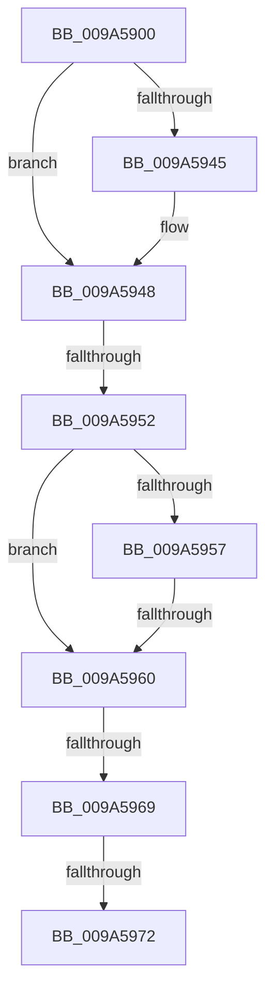

# IoCreateStreamFileObjectEx2

- RVA: `0x009A5900`–`0x009A5974` (길이 `116` bytes)
- VA: `0x00000001409A5900`
- 실행 섹션: `PAGE`
- PDB 이름 있음: `예`; PDB Function 태그: `예`
- unwind 정보 RVA: `0x0009C654`
- 디코드: `35`개 명령, `116/116` bytes 표시
- 미해석 바이트: `0` (있으면 어셈블리에 `.byte`로 보존)

> 이 문서는 커널 이미지의 기계어와 PDB 기호를 분석해 생성했습니다. 4번과 5번은 함수 원형과 자료형을 바이너리 사용 방식에서 추정한 C 해석이며 원본 소스 복구 결과는 아닙니다.

## 1. Dependencies

- 직접 호출 지점: **0**; 고유 호출 대상: **0**
- 직접 호출자로 확인된 함수: **3**
- RIP 상대 이미지 참조: **0**

### Outgoing calls
- 직접 디코드된 call 명령이 없습니다.

### Direct callers
- [IoCreateStreamFileObject](IoCreateStreamFileObject_function_009A38D0.md) at `0x009A38FD`
- [IoCreateStreamFileObjectLite](IoCreateStreamFileObjectLite_function_009A58B0.md) at `0x009A58DD`
- [IoCreateStreamFileObjectEx](IoCreateStreamFileObjectEx_function_009A6170.md) at `0x009A619C`

### Static image references
- 디코드된 RIP-relative 메모리 참조가 없습니다.

## 2. Other-region calls and transfers

- 다른 실행 섹션으로 향하는 call: **0**
- call이 아닌 외부 분기/꼬리 이동: **4**
  - `0x009A594C` → [sub_009A5B7B](Unknown_function_009A5B7B.md) (`tail-transfer`)
  - `0x009A595A` → [sub_009A5B10 + 0x13](Unknown_function_009A5B10.md) (`tail-transfer`)
  - `0x009A5963` → [sub_009A5BBB](Unknown_function_009A5BBB.md) (`tail-transfer`)
  - `0x009A596C` → [sub_009A5B10 + 0x20](Unknown_function_009A5B10.md) (`tail-transfer`)

## 3. Assembly (complete function range)

```asm
009A5900  40 55                           push rbp
009A5902  53                              push rbx
009A5903  56                              push rsi
009A5904  57                              push rdi
009A5905  41 54                           push r12
009A5907  41 55                           push r13
009A5909  41 56                           push r14
009A590B  48 8B EC                        mov rbp, rsp
009A590E  48 81 EC 80 00 00 00            sub rsp, 0x80
009A5915  0F B7 59 02                     movzx ebx, word ptr [rcx + 2]
009A5919  45 33 ED                        xor r13d, r13d
009A591C  4C 8B 75 60                     mov r14, qword ptr [rbp + 0x60]
009A5920  66 83 E3 02                     and bx, 2
009A5924  4C 89 6D 40                     mov qword ptr [rbp + 0x40], r13
009A5928  4D 8B E1                        mov r12, r9
009A592B  44 89 6D D4                     mov dword ptr [rbp - 0x2c], r13d
009A592F  49 8B F0                        mov rsi, r8
009A5932  44 89 6D EC                     mov dword ptr [rbp - 0x14], r13d
009A5936  48 8B F9                        mov rdi, rcx
009A5939  4C 89 6D 58                     mov qword ptr [rbp + 0x58], r13
009A593D  4D 89 29                        mov qword ptr [r9], r13
009A5940  4D 85 F6                        test r14, r14
009A5943  74 03                           je 0x1409a5948
009A5945  4D 89 2E                        mov qword ptr [r14], r13
009A5948  66 83 39 10                     cmp word ptr [rcx], 0x10
009A594C  0F 85 29 02 00 00               jne 0x1409a5b7b
009A5952  66 85 DB                        test bx, bx
009A5955  74 09                           je 0x1409a5960
009A5957  4D 85 F6                        test r14, r14
009A595A  0F 85 C3 01 00 00               jne 0x1409a5b23
009A5960  48 85 D2                        test rdx, rdx
009A5963  0F 85 52 02 00 00               jne 0x1409a5bbb
009A5969  4D 85 C0                        test r8, r8
009A596C  0F 84 BE 01 00 00               je 0x1409a5b30
009A5972  B2 01                           mov dl, 1
```

## 4. C-style interpretation (structured pseudocode)

```c
void __fastcall IoCreateStreamFileObjectEx2(__int64 a1, __int64 a2, __int64 a3, __int64 a4, __int64 a5)
{
    __int64 v_r13;
    __int64 v_rbx;
    __int64 v_rsp;
    unsigned int v_stack_m4C;
    unsigned int v_stack_m64;
    unsigned __int64 v_stack_p20;
    unsigned __int64 v_stack_p8;

    v_rsp = (v_rsp) - (128);
    v_r13 = 0;
    v_rbx = (unsigned __int16)((*(unsigned __int16 *)(a1 + 2)) & (2));
    v_stack_p8 = 0;
    v_stack_m64 = 0;
    v_stack_m4C = 0;
    v_stack_p20 = 0;
    *(unsigned __int64 *)(a4) = 0;
    if (a5 != 0) {
        *(unsigned __int64 *)(a5) = 0;
    }
    if ((unsigned __int16)(v_rbx) == 0) goto loc_009A5960;
loc_009A5960:
    return;
}
```

## 5. (Beta) C Style

```c
void IoCreateStreamFileObjectEx2(void *Arg1, int64_t Arg2, int64_t Arg3, void *Arg4, int64_t Arg5)
{
    uint8_t *arg1 = (uint8_t *)Arg1;
    uint8_t *arg4 = (uint8_t *)Arg4;

    int64_t local_r13;
    int64_t local_rbx;
    int64_t local_rsp;
    uint32_t v_stack_m4C;
    uint32_t v_stack_m64;
    uint64_t v_stack_p20;
    uint64_t v_stack_p8;

    local_rsp = (local_rsp) - (128);
    local_r13 = 0;
    local_rbx = (uint16_t)((*(uint16_t *)(arg1 + 0x2)) & (2));
    v_stack_p8 = 0;
    v_stack_m64 = 0;
    v_stack_m4C = 0;
    v_stack_p20 = 0;
    *(uint64_t *)(arg4) = 0;
    if (Arg5 != 0) {
        *(uint64_t *)(Arg5) = 0;
    }
    if ((uint16_t)(local_rbx) == 0) goto loc_009A5960;
loc_009A5960:
    return;
}
```

### 관측된 메모리 오프셋

구조체 형식이 확인되지 않은 접근은 인자 기준의 오프셋으로만 기록했습니다.

| 기준 인자 | 오프셋 표현 | 폭 (bit) | 접근 |
|---|---:|---:|---|
| `Arg1` | `+ 0x0` | `16` | `R` |
| `Arg1` | `+ 0x2` | `16` | `R` |
| `Arg4` | `+ 0x0` | `64` | `W` |

## 6. Execution-region graph

[열기: 2D/3D 그래프와 함수 탐색 컨트롤 패널](../../../control-panel.html?section=page&rva=0x009A5900&view=graph)

- 2D 그래프는 위에서 아래로 흐르고, 3D 그래프는 빈 공간을 드래그해 회전합니다. Shift+드래그는 이동, 휠은 확대·축소, 함수 노드 선택은 대상 보고서 이동입니다.

### Static fallback


