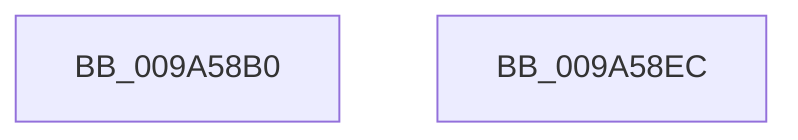

# IoCreateStreamFileObjectLite

- RVA: `0x009A58B0`–`0x009A58ED` (길이 `61` bytes)
- VA: `0x00000001409A58B0`
- 실행 섹션: `PAGE`
- PDB 이름 있음: `예`; PDB Function 태그: `아니요`
- unwind 정보 RVA: `0x00082420`
- 디코드: `16`개 명령, `61/61` bytes 표시
- 미해석 바이트: `0` (있으면 어셈블리에 `.byte`로 보존)

> 이 문서는 커널 이미지의 기계어와 PDB 기호를 분석해 생성했습니다. 4번과 5번은 함수 원형과 자료형을 바이너리 사용 방식에서 추정한 C 해석이며 원본 소스 복구 결과는 아닙니다.

## 1. Dependencies

- 직접 호출 지점: **1**; 고유 호출 대상: **1**
- 직접 호출자로 확인된 함수: **2**
- RIP 상대 이미지 참조: **0**

### Outgoing calls
- `0x009A58DD` → [IoCreateStreamFileObjectEx2](IoCreateStreamFileObjectEx2_function_009A5900.md) (function, `0x009A5900`)

### Direct callers
- [RawMountVolume](RawMountVolume_function_009A4844.md) at `0x009A496B`
- [IopInvalidateVolumesForDevice](IopInvalidateVolumesForDevice_function_009A5E74.md) at `0x009A5F17`

### Static image references
- 디코드된 RIP-relative 메모리 참조가 없습니다.

## 2. Other-region calls and transfers

- 다른 실행 섹션으로 향하는 call: **0**
- 별도 외부 분기/꼬리 이동을 확인하지 못했습니다.

## 3. Assembly (complete function range)

```asm
009A58B0  48 8B C4                        mov rax, rsp
009A58B3  48 83 EC 48                     sub rsp, 0x48
009A58B7  48 83 60 18 00                  and qword ptr [rax + 0x18], 0
009A58BC  4C 8D 48 18                     lea r9, [rax + 0x18]
009A58C0  48 83 60 D8 00                  and qword ptr [rax - 0x28], 0
009A58C5  0F 57 C0                        xorps xmm0, xmm0
009A58C8  4C 8B C2                        mov r8, rdx
009A58CB  48 8B D1                        mov rdx, rcx
009A58CE  0F 11 40 E8                     movups xmmword ptr [rax - 0x18], xmm0
009A58D2  48 8D 48 E8                     lea rcx, [rax - 0x18]
009A58D6  C7 40 E8 10 00 03 00            mov dword ptr [rax - 0x18], 0x30010
009A58DD  E8 1E 00 00 00                  call 0x1409a5900
009A58E2  48 8B 44 24 60                  mov rax, qword ptr [rsp + 0x60]
009A58E7  48 83 C4 48                     add rsp, 0x48
009A58EB  C3                              ret
009A58EC  CC                              int3
```

## 4. C-style interpretation (structured pseudocode)

```c
__int64 __fastcall IoCreateStreamFileObjectLite(__int64 a1, __int64 a2)
{
    __int64 result;
    __int64 v_rsp;
    unsigned __int64 v_stack_p18;

    v_rsp = (v_rsp) - (72);
    *(unsigned __int64 *)(v_rsp - 24) = v_xmm0;
    *(unsigned int *)(v_rsp - 24) = 0x30010ULL;
    result = IoCreateStreamFileObjectEx2(v_rsp - 24, a1, a2, v_rsp + 24);
    v_rsp = (v_rsp) + (72);
    return v_stack_p18;
}
```

## 5. (Beta) C Style

```c
int64_t IoCreateStreamFileObjectLite(int64_t Arg1, int64_t Arg2)
{
    int64_t result;
    int64_t local_rsp;
    uint64_t v_stack_p18;

    local_rsp = (local_rsp) - (72);
    *(uint64_t *)(local_rsp - 0x18) = v_xmm0;
    *(uint32_t *)(local_rsp - 0x18) = 0x30010ULL;
    result = IoCreateStreamFileObjectEx2(local_rsp - 24, Arg1, Arg2, local_rsp + 24);
    local_rsp = (local_rsp) + (72);
    return v_stack_p18;
}
```

## 6. Execution-region graph

[열기: 2D/3D 그래프와 함수 탐색 컨트롤 패널](../../../control-panel.html?section=page&rva=0x009A58B0&view=graph)

- 2D 그래프는 위에서 아래로 흐르고, 3D 그래프는 빈 공간을 드래그해 회전합니다. Shift+드래그는 이동, 휠은 확대·축소, 함수 노드 선택은 대상 보고서 이동입니다.

### Static fallback


