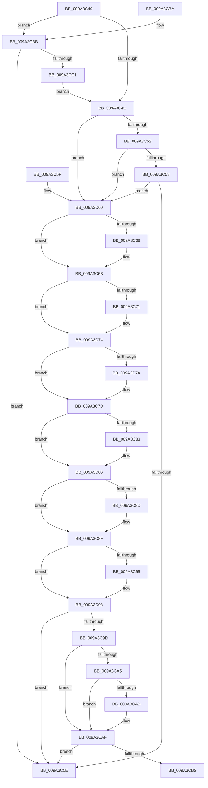

# IoRemoveLinkShareAccessEx

- RVA: `0x009A3C40`–`0x009A3CC3` (길이 `131` bytes)
- VA: `0x00000001409A3C40`
- 실행 섹션: `PAGE`
- PDB 이름 있음: `예`; PDB Function 태그: `아니요`
- unwind 정보 RVA: `0x000DB714`
- 디코드: `47`개 명령, `131/131` bytes 표시
- 미해석 바이트: `0` (있으면 어셈블리에 `.byte`로 보존)

> 이 문서는 커널 이미지의 기계어와 PDB 기호를 분석해 생성했습니다. 4번과 5번은 함수 원형과 자료형을 바이너리 사용 방식에서 추정한 C 해석이며 원본 소스 복구 결과는 아닙니다.

## 1. Dependencies

- 직접 호출 지점: **0**; 고유 호출 대상: **0**
- 직접 호출자로 확인된 함수: **3**
- RIP 상대 이미지 참조: **0**

### Outgoing calls
- 직접 디코드된 call 명령이 없습니다.

### Direct callers
- [IoRemoveLinkShareAccess](../71/IoRemoveLinkShareAccess_function_0071DBD0.md) at `0x0071DBD7`
- [RawCleanup](RawCleanup_function_009A3B38.md) at `0x009A3B7D`
- [IoRemoveShareAccess](IoRemoveShareAccess_function_009A3C20.md) at `0x009A3C2A`

### Static image references
- 디코드된 RIP-relative 메모리 참조가 없습니다.

## 2. Other-region calls and transfers

- 다른 실행 섹션으로 향하는 call: **0**
- 별도 외부 분기/꼬리 이동을 확인하지 못했습니다.

## 3. Assembly (complete function range)

```asm
009A3C40  48 8B 81 D0 00 00 00            mov rax, qword ptr [rcx + 0xd0]
009A3C47  48 85 C0                        test rax, rax
009A3C4A  75 6F                           jne 0x1409a3cbb
009A3C4C  80 79 4A 00                     cmp byte ptr [rcx + 0x4a], 0
009A3C50  75 0E                           jne 0x1409a3c60
009A3C52  80 79 4B 00                     cmp byte ptr [rcx + 0x4b], 0
009A3C56  75 08                           jne 0x1409a3c60
009A3C58  80 79 4C 00                     cmp byte ptr [rcx + 0x4c], 0
009A3C5C  75 02                           jne 0x1409a3c60
009A3C5E  C3                              ret
009A3C5F  CC                              int3
009A3C60  FF 0A                           dec dword ptr [rdx]
009A3C62  80 79 4A 00                     cmp byte ptr [rcx + 0x4a], 0
009A3C66  74 03                           je 0x1409a3c6b
009A3C68  FF 4A 04                        dec dword ptr [rdx + 4]
009A3C6B  80 79 4B 00                     cmp byte ptr [rcx + 0x4b], 0
009A3C6F  74 03                           je 0x1409a3c74
009A3C71  FF 4A 08                        dec dword ptr [rdx + 8]
009A3C74  80 79 4D 00                     cmp byte ptr [rcx + 0x4d], 0
009A3C78  74 03                           je 0x1409a3c7d
009A3C7A  FF 4A 10                        dec dword ptr [rdx + 0x10]
009A3C7D  80 79 4E 00                     cmp byte ptr [rcx + 0x4e], 0
009A3C81  74 03                           je 0x1409a3c86
009A3C83  FF 4A 14                        dec dword ptr [rdx + 0x14]
009A3C86  80 79 4C 00                     cmp byte ptr [rcx + 0x4c], 0
009A3C8A  74 03                           je 0x1409a3c8f
009A3C8C  FF 4A 0C                        dec dword ptr [rdx + 0xc]
009A3C8F  80 79 4F 00                     cmp byte ptr [rcx + 0x4f], 0
009A3C93  74 03                           je 0x1409a3c98
009A3C95  FF 4A 18                        dec dword ptr [rdx + 0x18]
009A3C98  4D 85 C0                        test r8, r8
009A3C9B  74 C1                           je 0x1409a3c5e
009A3C9D  41 FF 08                        dec dword ptr [r8]
009A3CA0  45 84 C9                        test r9b, r9b
009A3CA3  78 0A                           js 0x1409a3caf
009A3CA5  80 79 4C 00                     cmp byte ptr [rcx + 0x4c], 0
009A3CA9  74 04                           je 0x1409a3caf
009A3CAB  41 FF 48 04                     dec dword ptr [r8 + 4]
009A3CAF  80 79 4F 00                     cmp byte ptr [rcx + 0x4f], 0
009A3CB3  74 A9                           je 0x1409a3c5e
009A3CB5  41 FF 48 08                     dec dword ptr [r8 + 8]
009A3CB9  C3                              ret
009A3CBA  CC                              int3
009A3CBB  8B 00                           mov eax, dword ptr [rax]
009A3CBD  A8 01                           test al, 1
009A3CBF  75 9D                           jne 0x1409a3c5e
009A3CC1  EB 89                           jmp 0x1409a3c4c
```

## 4. C-style interpretation (structured pseudocode)

```c
__int64 __fastcall IoRemoveLinkShareAccessEx(__int64 a1, __int64 a2, __int64 a3, unsigned __int8 a4)
{
    if (*(unsigned __int64 *)(a1 + 208) != 0) goto loc_009A3CBB;
loc_009A3C4C:
    if ((*(unsigned __int8 *)(a1 + 74)) != 0) goto loc_009A3C60;
    if ((*(unsigned __int8 *)(a1 + 75)) != 0) goto loc_009A3C60;
    if ((*(unsigned __int8 *)(a1 + 76)) != 0) goto loc_009A3C60;
loc_009A3C5E:
    return *(unsigned __int64 *)(a1 + 208);
loc_009A3C60:
    if ((*(unsigned __int8 *)(a1 + 74)) != 0) {
    }
    if ((*(unsigned __int8 *)(a1 + 75)) != 0) {
    }
    if ((*(unsigned __int8 *)(a1 + 77)) != 0) {
    }
    if ((*(unsigned __int8 *)(a1 + 78)) != 0) {
    }
    if ((*(unsigned __int8 *)(a1 + 76)) != 0) {
    }
    if ((*(unsigned __int8 *)(a1 + 79)) != 0) {
    }
    if (a3 == 0) goto loc_009A3C5E;
    if (sign_flag) goto loc_009A3CAF;
    if ((*(unsigned __int8 *)(a1 + 76)) != 0) {
    }
    if ((*(unsigned __int8 *)(a1 + 79)) == 0) goto loc_009A3C5E;
    return *(unsigned __int64 *)(a1 + 208);
loc_009A3CBB:
    if ((((unsigned __int8)((unsigned int)(*(unsigned int *)(*(unsigned __int64 *)(a1 + 208))))) & (1)) != 0) goto loc_009A3C5E;
    goto loc_009A3C4C;
}
```

## 5. (Beta) C Style

```c
int64_t IoRemoveLinkShareAccessEx(void *Arg1, void *Arg2, int64_t Arg3, uint8_t Arg4)
{
    uint8_t *arg1 = (uint8_t *)Arg1;
    uint8_t *arg2 = (uint8_t *)Arg2;

    if (*(uint64_t *)(arg1 + 0xD0) != 0) goto loc_009A3CBB;
loc_009A3C4C:
    if ((*(uint8_t *)(arg1 + 0x4A)) != 0) goto loc_009A3C60;
    if ((*(uint8_t *)(arg1 + 0x4B)) != 0) goto loc_009A3C60;
    if ((*(uint8_t *)(arg1 + 0x4C)) != 0) goto loc_009A3C60;
loc_009A3C5E:
    return *(uint64_t *)(arg1 + 0xD0);
loc_009A3C60:
    if ((*(uint8_t *)(arg1 + 0x4A)) != 0) {
    }
    if ((*(uint8_t *)(arg1 + 0x4B)) != 0) {
    }
    if ((*(uint8_t *)(arg1 + 0x4D)) != 0) {
    }
    if ((*(uint8_t *)(arg1 + 0x4E)) != 0) {
    }
    if ((*(uint8_t *)(arg1 + 0x4C)) != 0) {
    }
    if ((*(uint8_t *)(arg1 + 0x4F)) != 0) {
    }
    if (Arg3 == 0) goto loc_009A3C5E;
    if (sign_flag) goto loc_009A3CAF;
    if ((*(uint8_t *)(arg1 + 0x4C)) != 0) {
    }
    if ((*(uint8_t *)(arg1 + 0x4F)) == 0) goto loc_009A3C5E;
    return *(uint64_t *)(arg1 + 0xD0);
loc_009A3CBB:
    if ((((uint8_t)((uint32_t)(*(uint32_t *)(*(uint64_t *)(arg1 + 0xD0))))) & (1)) != 0) goto loc_009A3C5E;
    goto loc_009A3C4C;
}
```

### 관측된 메모리 오프셋

구조체 형식이 확인되지 않은 접근은 인자 기준의 오프셋으로만 기록했습니다.

| 기준 인자 | 오프셋 표현 | 폭 (bit) | 접근 |
|---|---:|---:|---|
| `Arg1` | `+ 0x4A` | `8` | `R` |
| `Arg1` | `+ 0x4B` | `8` | `R` |
| `Arg1` | `+ 0x4C` | `8` | `R` |
| `Arg1` | `+ 0x4D` | `8` | `R` |
| `Arg1` | `+ 0x4E` | `8` | `R` |
| `Arg1` | `+ 0x4F` | `8` | `R` |
| `Arg1` | `+ 0xD0` | `64` | `R` |
| `Arg2` | `+ 0x0` | `32` | `R/W` |
| `Arg2` | `+ 0x4` | `32` | `R/W` |
| `Arg2` | `+ 0x8` | `32` | `R/W` |
| `Arg2` | `+ 0xC` | `32` | `R/W` |
| `Arg2` | `+ 0x10` | `32` | `R/W` |
| `Arg2` | `+ 0x14` | `32` | `R/W` |
| `Arg2` | `+ 0x18` | `32` | `R/W` |

## 6. Execution-region graph

[열기: 2D/3D 그래프와 함수 탐색 컨트롤 패널](../../../control-panel.html?section=page&rva=0x009A3C40&view=graph)

- 2D 그래프는 위에서 아래로 흐르고, 3D 그래프는 빈 공간을 드래그해 회전합니다. Shift+드래그는 이동, 휠은 확대·축소, 함수 노드 선택은 대상 보고서 이동입니다.

### Static fallback


