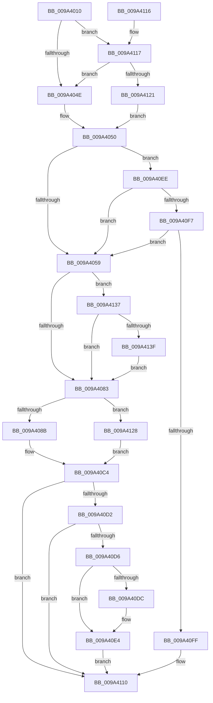

# IoSetLinkShareAccess

- RVA: `0x009A4010`–`0x009A4149` (길이 `313` bytes)
- VA: `0x00000001409A4010`
- 실행 섹션: `PAGE`
- PDB 이름 있음: `예`; PDB Function 태그: `아니요`
- unwind 정보 RVA: `0x0009C45C`
- 디코드: `85`개 명령, `313/313` bytes 표시
- 미해석 바이트: `0` (있으면 어셈블리에 `.byte`로 보존)

> 이 문서는 커널 이미지의 기계어와 PDB 기호를 분석해 생성했습니다. 4번과 5번은 함수 원형과 자료형을 바이너리 사용 방식에서 추정한 C 해석이며 원본 소스 복구 결과는 아닙니다.

## 1. Dependencies

- 직접 호출 지점: **0**; 고유 호출 대상: **0**
- 직접 호출자로 확인된 함수: **3**
- RIP 상대 이미지 참조: **0**

### Outgoing calls
- 직접 디코드된 call 명령이 없습니다.

### Direct callers
- [IoSetShareAccessEx](IoSetShareAccessEx_function_009A30A0.md) at `0x009A30BA`
- [RawCreate](RawCreate_function_009A3E5C.md) at `0x009A3F3B`
- [IoSetShareAccess](IoSetShareAccess_function_009A3FF0.md) at `0x009A3FFF`

### Static image references
- 디코드된 RIP-relative 메모리 참조가 없습니다.

## 2. Other-region calls and transfers

- 다른 실행 섹션으로 향하는 call: **0**
- 별도 외부 분기/꼬리 이동을 확인하지 못했습니다.

## 3. Assembly (complete function range)

```asm
009A4010  48 89 5C 24 08                  mov qword ptr [rsp + 8], rbx
009A4015  44 8B D1                        mov r10d, ecx
009A4018  44 8B D9                        mov r11d, ecx
009A401B  41 83 E2 21                     and r10d, 0x21
009A401F  0F 95 C0                        setne al
009A4022  41 83 E3 06                     and r11d, 6
009A4026  41 88 40 4A                     mov byte ptr [r8 + 0x4a], al
009A402A  0F 95 C0                        setne al
009A402D  81 E1 00 00 01 00               and ecx, 0x10000
009A4033  41 88 40 4B                     mov byte ptr [r8 + 0x4b], al
009A4037  0F 95 C0                        setne al
009A403A  41 88 40 4C                     mov byte ptr [r8 + 0x4c], al
009A403E  49 8B 80 D0 00 00 00            mov rax, qword ptr [r8 + 0xd0]
009A4045  48 85 C0                        test rax, rax
009A4048  0F 85 C9 00 00 00               jne 0x1409a4117
009A404E  32 DB                           xor bl, bl
009A4050  45 85 D2                        test r10d, r10d
009A4053  0F 84 95 00 00 00               je 0x1409a40ee
009A4059  0F B6 CA                        movzx ecx, dl
009A405C  8B C2                           mov eax, edx
009A405E  C1 EA 02                        shr edx, 2
009A4061  80 E1 01                        and cl, 1
009A4064  80 E2 01                        and dl, 1
009A4067  D1 E8                           shr eax, 1
009A4069  24 01                           and al, 1
009A406B  41 88 50 4F                     mov byte ptr [r8 + 0x4f], dl
009A406F  8B 54 24 30                     mov edx, dword ptr [rsp + 0x30]
009A4073  41 88 48 4D                     mov byte ptr [r8 + 0x4d], cl
009A4077  41 88 40 4E                     mov byte ptr [r8 + 0x4e], al
009A407B  85 D2                           test edx, edx
009A407D  0F 88 B4 00 00 00               js 0x1409a4137
009A4083  84 DB                           test bl, bl
009A4085  0F 85 9D 00 00 00               jne 0x1409a4128
009A408B  41 C7 01 01 00 00 00            mov dword ptr [r9], 1
009A4092  41 0F B6 40 4A                  movzx eax, byte ptr [r8 + 0x4a]
009A4097  41 89 41 04                     mov dword ptr [r9 + 4], eax
009A409B  41 0F B6 40 4B                  movzx eax, byte ptr [r8 + 0x4b]
009A40A0  41 89 41 08                     mov dword ptr [r9 + 8], eax
009A40A4  41 0F B6 40 4C                  movzx eax, byte ptr [r8 + 0x4c]
009A40A9  41 89 41 0C                     mov dword ptr [r9 + 0xc], eax
009A40AD  41 0F B6 40 4D                  movzx eax, byte ptr [r8 + 0x4d]
009A40B2  41 89 41 10                     mov dword ptr [r9 + 0x10], eax
009A40B6  41 0F B6 40 4E                  movzx eax, byte ptr [r8 + 0x4e]
009A40BB  41 89 41 14                     mov dword ptr [r9 + 0x14], eax
009A40BF  41 0F B6 40 4F                  movzx eax, byte ptr [r8 + 0x4f]
009A40C4  48 8B 4C 24 28                  mov rcx, qword ptr [rsp + 0x28]
009A40C9  41 89 41 18                     mov dword ptr [r9 + 0x18], eax
009A40CD  48 85 C9                        test rcx, rcx
009A40D0  74 3E                           je 0x1409a4110
009A40D2  84 DB                           test bl, bl
009A40D4  75 3A                           jne 0x1409a4110
009A40D6  FF 01                           inc dword ptr [rcx]
009A40D8  84 D2                           test dl, dl
009A40DA  78 08                           js 0x1409a40e4
009A40DC  41 0F B6 40 4C                  movzx eax, byte ptr [r8 + 0x4c]
009A40E1  01 41 04                        add dword ptr [rcx + 4], eax
009A40E4  41 0F B6 40 4F                  movzx eax, byte ptr [r8 + 0x4f]
009A40E9  01 41 08                        add dword ptr [rcx + 8], eax
009A40EC  EB 22                           jmp 0x1409a4110
009A40EE  45 85 DB                        test r11d, r11d
009A40F1  0F 85 62 FF FF FF               jne 0x1409a4059
009A40F7  85 C9                           test ecx, ecx
009A40F9  0F 85 5A FF FF FF               jne 0x1409a4059
009A40FF  33 C0                           xor eax, eax
009A4101  49 89 01                        mov qword ptr [r9], rax
009A4104  49 89 41 08                     mov qword ptr [r9 + 8], rax
009A4108  49 89 41 10                     mov qword ptr [r9 + 0x10], rax
009A410C  41 89 41 18                     mov dword ptr [r9 + 0x18], eax
009A4110  48 8B 5C 24 08                  mov rbx, qword ptr [rsp + 8]
009A4115  C3                              ret
009A4116  CC                              int3
009A4117  8B 00                           mov eax, dword ptr [rax]
009A4119  A8 01                           test al, 1
009A411B  0F 84 2D FF FF FF               je 0x1409a404e
009A4121  B3 01                           mov bl, 1
009A4123  E9 28 FF FF FF                  jmp 0x1409a4050
009A4128  33 C0                           xor eax, eax
009A412A  49 89 01                        mov qword ptr [r9], rax
009A412D  49 89 41 08                     mov qword ptr [r9 + 8], rax
009A4131  49 89 41 10                     mov qword ptr [r9 + 0x10], rax
009A4135  EB 8D                           jmp 0x1409a40c4
009A4137  84 C9                           test cl, cl
009A4139  0F 85 44 FF FF FF               jne 0x1409a4083
009A413F  41 C6 40 4D 01                  mov byte ptr [r8 + 0x4d], 1
009A4144  E9 3A FF FF FF                  jmp 0x1409a4083
```

## 4. C-style interpretation (structured pseudocode)

```c
__int64 __fastcall IoSetLinkShareAccess(int a1, int a2, __int64 a3, __int64 a4, __int64 a5, unsigned int a6)
{
    __int64 result;
    __int64 v_r10;
    __int64 v_r11;
    __int64 v_rbx;
    unsigned __int64 v_stack_p8;

    v_stack_p8 = v_rbx;
    v_r10 = (unsigned int)(((unsigned int)(a1)) & (33));
    result = (condition_is_not_equal) ? 1 : 0;
    v_r11 = (unsigned int)(((unsigned int)(a1)) & (6));
    *(unsigned __int8 *)(a3 + 74) = (unsigned __int8)(result);
    result = (condition_is_not_equal) ? 1 : 0;
    a1 = (unsigned int)((a1) & (0x10000ULL));
    *(unsigned __int8 *)(a3 + 75) = (unsigned __int8)(result);
    result = (condition_is_not_equal) ? 1 : 0;
    *(unsigned __int8 *)(a3 + 76) = (unsigned __int8)(result);
    if (*(unsigned __int64 *)(a3 + 208) != 0) goto loc_009A4117;
loc_009A404E:
    v_rbx = 0;
loc_009A4050:
    if ((unsigned int)(v_r10) == 0) goto loc_009A40EE;
loc_009A4059:
    a2 = (unsigned int)((a2) >> (2));
    a1 = (unsigned __int8)(((unsigned __int8)(a2)) & (1));
    a2 = (unsigned __int8)((a2) & (1));
    result = (unsigned int)(((unsigned int)(a2)) >> (1));
    result = (unsigned __int8)((result) & (1));
    *(unsigned __int8 *)(a3 + 79) = (unsigned __int8)(a2);
    *(unsigned __int8 *)(a3 + 77) = (unsigned __int8)(a1);
    *(unsigned __int8 *)(a3 + 78) = (unsigned __int8)(result);
    if (sign_flag) goto loc_009A4137;
loc_009A4083:
    if (0 != 0) goto loc_009A4128;
    *(unsigned int *)(a4) = 1;
    *(unsigned int *)(a4 + 4) = (unsigned int)(*(unsigned __int8 *)(a3 + 74));
    *(unsigned int *)(a4 + 8) = (unsigned int)(*(unsigned __int8 *)(a3 + 75));
    *(unsigned int *)(a4 + 12) = (unsigned int)(*(unsigned __int8 *)(a3 + 76));
    *(unsigned int *)(a4 + 16) = (unsigned int)(*(unsigned __int8 *)(a3 + 77));
    *(unsigned int *)(a4 + 20) = (unsigned int)(*(unsigned __int8 *)(a3 + 78));
loc_009A40C4:
    *(unsigned int *)(a4 + 24) = (unsigned int)(*(unsigned __int8 *)(a3 + 79));
    if (a5 == 0) goto loc_009A4110;
    if (0 != 0) goto loc_009A4110;
    result = *(unsigned __int8 *)(a3 + 79);
    if (!(sign_flag)) {
        result = *(unsigned __int8 *)(a3 + 76);
    }
    goto loc_009A4110;
loc_009A40EE:
    if ((unsigned int)(v_r11) != 0) goto loc_009A4059;
    if ((unsigned int)(a5) != 0) goto loc_009A4059;
    result = 0;
    *(unsigned __int64 *)(a4) = 0;
    *(unsigned __int64 *)(a4 + 8) = 0;
    *(unsigned __int64 *)(a4 + 16) = 0;
    *(unsigned int *)(a4 + 24) = 0;
loc_009A4110:
    return result;
loc_009A4117:
    if ((((unsigned __int8)((unsigned int)(*(unsigned int *)(result)))) & (1)) == 0) goto loc_009A404E;
    goto loc_009A4050;
loc_009A4128:
    result = 0;
    *(unsigned __int64 *)(a4) = 0;
    *(unsigned __int64 *)(a4 + 8) = 0;
    *(unsigned __int64 *)(a4 + 16) = 0;
    goto loc_009A40C4;
loc_009A4137:
    if ((unsigned __int8)(a5) != 0) goto loc_009A4083;
    *(unsigned __int8 *)(a3 + 77) = 1;
    goto loc_009A4083;
}
```

## 5. (Beta) C Style

```c
int64_t IoSetLinkShareAccess(int32_t Arg1, int32_t Arg2, void *Arg3, void *Arg4, int64_t Arg5, uint32_t Arg6)
{
    uint8_t *arg3 = (uint8_t *)Arg3;
    uint8_t *arg4 = (uint8_t *)Arg4;

    int64_t result;
    int64_t local_r10;
    int64_t local_r11;
    int64_t local_rbx;
    uint64_t v_stack_p8;

    v_stack_p8 = local_rbx;
    local_r10 = (uint32_t)(((uint32_t)(Arg1)) & (33));
    result = (condition_is_not_equal) ? 1 : 0;
    local_r11 = (uint32_t)(((uint32_t)(Arg1)) & (6));
    *(uint8_t *)(arg3 + 0x4A) = (uint8_t)(result);
    result = (condition_is_not_equal) ? 1 : 0;
    Arg1 = (uint32_t)((Arg1) & (0x10000ULL));
    *(uint8_t *)(arg3 + 0x4B) = (uint8_t)(result);
    result = (condition_is_not_equal) ? 1 : 0;
    *(uint8_t *)(arg3 + 0x4C) = (uint8_t)(result);
    if (*(uint64_t *)(arg3 + 0xD0) != 0) goto loc_009A4117;
loc_009A404E:
    local_rbx = 0;
loc_009A4050:
    if ((uint32_t)(local_r10) == 0) goto loc_009A40EE;
loc_009A4059:
    Arg2 = (uint32_t)((Arg2) >> (2));
    Arg1 = (uint8_t)(((uint8_t)(Arg2)) & (1));
    Arg2 = (uint8_t)((Arg2) & (1));
    result = (uint32_t)(((uint32_t)(Arg2)) >> (1));
    result = (uint8_t)((result) & (1));
    *(uint8_t *)(arg3 + 0x4F) = (uint8_t)(Arg2);
    *(uint8_t *)(arg3 + 0x4D) = (uint8_t)(Arg1);
    *(uint8_t *)(arg3 + 0x4E) = (uint8_t)(result);
    if (sign_flag) goto loc_009A4137;
loc_009A4083:
    if (0 != 0) goto loc_009A4128;
    *(uint32_t *)(arg4) = 1;
    *(uint32_t *)(arg4 + 0x4) = (uint32_t)(*(uint8_t *)(arg3 + 0x4A));
    *(uint32_t *)(arg4 + 0x8) = (uint32_t)(*(uint8_t *)(arg3 + 0x4B));
    *(uint32_t *)(arg4 + 0xC) = (uint32_t)(*(uint8_t *)(arg3 + 0x4C));
    *(uint32_t *)(arg4 + 0x10) = (uint32_t)(*(uint8_t *)(arg3 + 0x4D));
    *(uint32_t *)(arg4 + 0x14) = (uint32_t)(*(uint8_t *)(arg3 + 0x4E));
loc_009A40C4:
    *(uint32_t *)(arg4 + 0x18) = (uint32_t)(*(uint8_t *)(arg3 + 0x4F));
    if (Arg5 == 0) goto loc_009A4110;
    if (0 != 0) goto loc_009A4110;
    result = *(uint8_t *)(arg3 + 0x4F);
    if (!(sign_flag)) {
        result = *(uint8_t *)(arg3 + 0x4C);
    }
    goto loc_009A4110;
loc_009A40EE:
    if ((uint32_t)(local_r11) != 0) goto loc_009A4059;
    if ((uint32_t)(Arg5) != 0) goto loc_009A4059;
    result = 0;
    *(uint64_t *)(arg4) = 0;
    *(uint64_t *)(arg4 + 0x8) = 0;
    *(uint64_t *)(arg4 + 0x10) = 0;
    *(uint32_t *)(arg4 + 0x18) = 0;
loc_009A4110:
    return result;
loc_009A4117:
    if ((((uint8_t)((uint32_t)(*(uint32_t *)(result)))) & (1)) == 0) goto loc_009A404E;
    goto loc_009A4050;
loc_009A4128:
    result = 0;
    *(uint64_t *)(arg4) = 0;
    *(uint64_t *)(arg4 + 0x8) = 0;
    *(uint64_t *)(arg4 + 0x10) = 0;
    goto loc_009A40C4;
loc_009A4137:
    if ((uint8_t)(Arg5) != 0) goto loc_009A4083;
    *(uint8_t *)(arg3 + 0x4D) = 1;
    goto loc_009A4083;
}
```

### 관측된 메모리 오프셋

구조체 형식이 확인되지 않은 접근은 인자 기준의 오프셋으로만 기록했습니다.

| 기준 인자 | 오프셋 표현 | 폭 (bit) | 접근 |
|---|---:|---:|---|
| `Arg3` | `+ 0x4A` | `8` | `R` |
| `Arg3` | `+ 0x4A` | `8` | `W` |
| `Arg3` | `+ 0x4B` | `8` | `R` |
| `Arg3` | `+ 0x4B` | `8` | `W` |
| `Arg3` | `+ 0x4C` | `8` | `R` |
| `Arg3` | `+ 0x4C` | `8` | `W` |
| `Arg3` | `+ 0x4D` | `8` | `R` |
| `Arg3` | `+ 0x4D` | `8` | `W` |
| `Arg3` | `+ 0x4E` | `8` | `R` |
| `Arg3` | `+ 0x4E` | `8` | `W` |
| `Arg3` | `+ 0x4F` | `8` | `R` |
| `Arg3` | `+ 0x4F` | `8` | `W` |
| `Arg3` | `+ 0xD0` | `64` | `R` |
| `Arg4` | `+ 0x0` | `32` | `W` |
| `Arg4` | `+ 0x0` | `64` | `W` |
| `Arg4` | `+ 0x4` | `32` | `W` |
| `Arg4` | `+ 0x8` | `32` | `W` |
| `Arg4` | `+ 0x8` | `64` | `W` |
| `Arg4` | `+ 0xC` | `32` | `W` |
| `Arg4` | `+ 0x10` | `32` | `W` |
| `Arg4` | `+ 0x10` | `64` | `W` |
| `Arg4` | `+ 0x14` | `32` | `W` |
| `Arg4` | `+ 0x18` | `32` | `W` |

## 6. Execution-region graph

[열기: 2D/3D 그래프와 함수 탐색 컨트롤 패널](../../../control-panel.html?section=page&rva=0x009A4010&view=graph)

- 2D 그래프는 위에서 아래로 흐르고, 3D 그래프는 빈 공간을 드래그해 회전합니다. Shift+드래그는 이동, 휠은 확대·축소, 함수 노드 선택은 대상 보고서 이동입니다.

### Static fallback


