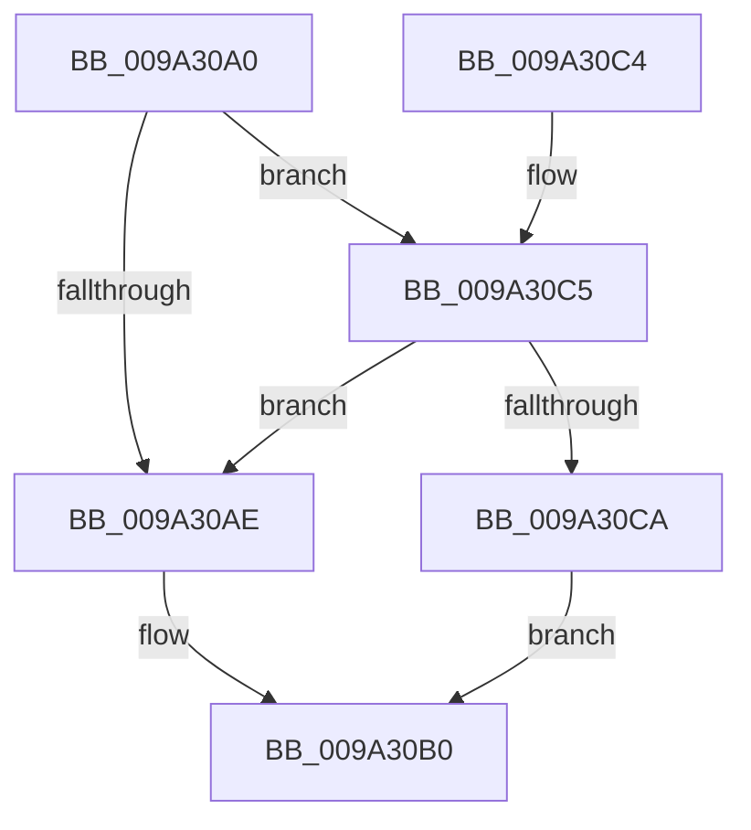

# IoSetShareAccessEx

- RVA: `0x009A30A0`–`0x009A30D1` (길이 `49` bytes)
- VA: `0x00000001409A30A0`
- 실행 섹션: `PAGE`
- PDB 이름 있음: `예`; PDB Function 태그: `아니요`
- unwind 정보 RVA: `0x00093A44`
- 디코드: `15`개 명령, `49/49` bytes 표시
- 미해석 바이트: `0` (있으면 어셈블리에 `.byte`로 보존)

> 이 문서는 커널 이미지의 기계어와 PDB 기호를 분석해 생성했습니다. 4번과 5번은 함수 원형과 자료형을 바이너리 사용 방식에서 추정한 C 해석이며 원본 소스 복구 결과는 아닙니다.

## 1. Dependencies

- 직접 호출 지점: **1**; 고유 호출 대상: **1**
- 직접 호출자로 확인된 함수: **0**
- RIP 상대 이미지 참조: **0**

### Outgoing calls
- `0x009A30BA` → [IoSetLinkShareAccess](IoSetLinkShareAccess_function_009A4010.md) (function, `0x009A4010`)

### Direct callers
- 이 함수 시작 RVA로 연결되는 직접 call은 확인되지 않았습니다. 간접 호출은 완전히 역산할 수 없습니다.

### Static image references
- 디코드된 RIP-relative 메모리 참조가 없습니다.

## 2. Other-region calls and transfers

- 다른 실행 섹션으로 향하는 call: **0**
- 별도 외부 분기/꼬리 이동을 확인하지 못했습니다.

## 3. Assembly (complete function range)

```asm
009A30A0  48 83 EC 38                     sub rsp, 0x38
009A30A4  48 8B 44 24 60                  mov rax, qword ptr [rsp + 0x60]
009A30A9  48 85 C0                        test rax, rax
009A30AC  75 17                           jne 0x1409a30c5
009A30AE  33 C0                           xor eax, eax
009A30B0  89 44 24 28                     mov dword ptr [rsp + 0x28], eax
009A30B4  48 83 64 24 20 00               and qword ptr [rsp + 0x20], 0
009A30BA  E8 51 0F 00 00                  call 0x1409a4010
009A30BF  48 83 C4 38                     add rsp, 0x38
009A30C3  C3                              ret
009A30C4  CC                              int3
009A30C5  80 38 00                        cmp byte ptr [rax], 0
009A30C8  75 E4                           jne 0x1409a30ae
009A30CA  B8 00 00 00 80                  mov eax, 0x80000000
009A30CF  EB DF                           jmp 0x1409a30b0
```

## 4. C-style interpretation (structured pseudocode)

```c
__int64 __fastcall IoSetShareAccessEx(__int64 a1, __int64 a2, __int64 a3, __int64 a4, __int64 a5)
{
    __int64 result;
    __int64 v_rsp;
    unsigned int v_stack_m10;
    unsigned __int64 v_stack_m18;

    v_rsp = (v_rsp) - (56);
    if (a5 != 0) goto loc_009A30C5;
loc_009A30AE:
    result = 0;
loc_009A30B0:
    v_stack_m10 = 0;
    result = IoSetLinkShareAccess(a1, a2, a3, a4);
    v_rsp = (v_rsp) + (56);
    return result;
loc_009A30C5:
    if ((*(unsigned __int8 *)(result)) != 0) goto loc_009A30AE;
    goto loc_009A30B0;
}
```

## 5. (Beta) C Style

```c
int64_t IoSetShareAccessEx(int64_t Arg1, int64_t Arg2, int64_t Arg3, int64_t Arg4, int64_t Arg5)
{
    int64_t result;
    int64_t local_rsp;
    uint32_t v_stack_m10;
    uint64_t v_stack_m18;

    local_rsp = (local_rsp) - (56);
    if (Arg5 != 0) goto loc_009A30C5;
loc_009A30AE:
    result = 0;
loc_009A30B0:
    v_stack_m10 = 0;
    result = IoSetLinkShareAccess(Arg1, Arg2, Arg3, Arg4);
    local_rsp = (local_rsp) + (56);
    return result;
loc_009A30C5:
    if ((*(uint8_t *)(result)) != 0) goto loc_009A30AE;
    goto loc_009A30B0;
}
```

## 6. Execution-region graph

[열기: 2D/3D 그래프와 함수 탐색 컨트롤 패널](../../../control-panel.html?section=page&rva=0x009A30A0&view=graph)

- 2D 그래프는 위에서 아래로 흐르고, 3D 그래프는 빈 공간을 드래그해 회전합니다. Shift+드래그는 이동, 휠은 확대·축소, 함수 노드 선택은 대상 보고서 이동입니다.

### Static fallback


