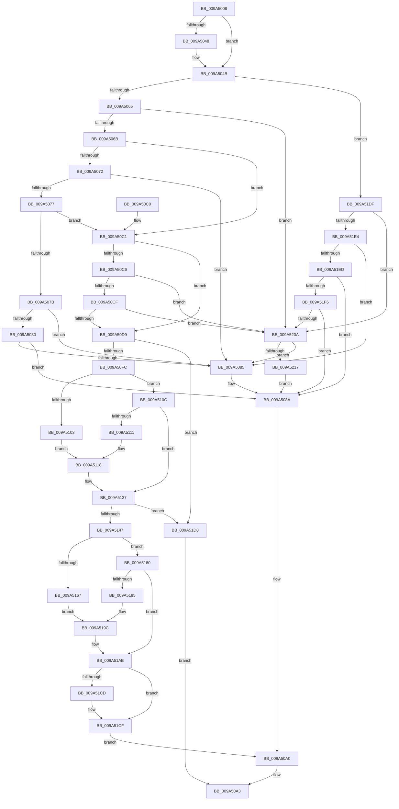

# IopCreateDefaultDeviceSecurityDescriptor

- RVA: `0x009A5008`–`0x009A522C` (길이 `548` bytes)
- VA: `0x00000001409A5008`
- 실행 섹션: `PAGE`
- PDB 이름 있음: `예`; PDB Function 태그: `아니요`
- unwind 정보 RVA: `0x0009C5B8`
- 디코드: `142`개 명령, `548/548` bytes 표시
- 미해석 바이트: `0` (있으면 어셈블리에 `.byte`로 보존)

> 이 문서는 커널 이미지의 기계어와 PDB 기호를 분석해 생성했습니다. 4번과 5번은 함수 원형과 자료형을 바이너리 사용 방식에서 추정한 C 해석이며 원본 소스 복구 결과는 아닙니다.

## 1. Dependencies

- 직접 호출 지점: **8**; 고유 호출 대상: **8**
- 직접 호출자로 확인된 함수: **2**
- RIP 상대 이미지 참조: **3**

### Outgoing calls
- `0x009A5095` → [IopCreateSecurityDescriptorPerType](../AD/IopCreateSecurityDescriptorPerType_function_00ADCC6C.md) (function, `0x00ADCC6C`)
- `0x009A50EF` → [RtlGetNtProductType](../../text/43/RtlGetNtProductType_function_00436270.md) (function, `0x00436270`)
- `0x009A5136` → [ExAllocatePool2](../../poolcode/B8/ExAllocatePool2_function_00B820F0.md) (function, `0x00B820F0`)
- `0x009A5156` → [memcpy](../../text/6C/memcpy_function_006C6840.md) (function, `0x006C6840`)
- `0x009A51A6` → [RtlpAddKnownAce](../92/RtlpAddKnownAce_function_00929A20.md) (function, `0x00929A20`)
- `0x009A51B3` → [RtlCreateSecurityDescriptor](../9F/RtlCreateSecurityDescriptor_function_009F1DF0.md) (function, `0x009F1DF0`)
- `0x009A51C3` → [RtlSetDaclSecurityDescriptor](../9E/RtlSetDaclSecurityDescriptor_function_009EC210.md) (function, `0x009EC210`)
- `0x009A520A` → [Feature_AppContainerVolumeDeviceAccess__private_IsEnabledDeviceUsageNoInline](../../text/59/Feature_AppContainerVolumeDeviceAccess__private_IsEnabledDeviceUsageNoInline_function_0059788C.md) (function, `0x0059788C`)

### Direct callers
- [IoCreateDevice](IoCreateDevice_function_009A4B00.md) at `0x009A4BFC`
- [sub_00B2C0F2](../B2/Unknown_function_00B2C0F2.md) at `0x00B2C128`

### Static image references
- `0x009A50D9` → RVA `0x00FD9B40` (`PAGEDATA`; read)
- `0x009A5103` → RVA `0x00E67B80` (`.data`; read)
- `0x009A5111` → RVA `0x00E67D48` (`.data`; read)

## 2. Other-region calls and transfers

- 다른 실행 섹션으로 향하는 call: **4**
  - `0x009A50EF` → [RtlGetNtProductType](../../text/43/RtlGetNtProductType_function_00436270.md) (`PAGE` → `.text`)
  - `0x009A5136` → [ExAllocatePool2](../../poolcode/B8/ExAllocatePool2_function_00B820F0.md) (`PAGE` → `POOLCODE`)
  - `0x009A5156` → [memcpy](../../text/6C/memcpy_function_006C6840.md) (`PAGE` → `.text`)
  - `0x009A520A` → [Feature_AppContainerVolumeDeviceAccess__private_IsEnabledDeviceUsageNoInline](../../text/59/Feature_AppContainerVolumeDeviceAccess__private_IsEnabledDeviceUsageNoInline_function_0059788C.md) (`PAGE` → `.text`)
- 별도 외부 분기/꼬리 이동을 확인하지 못했습니다.

## 3. Assembly (complete function range)

```asm
009A5008  48 8B C4                        mov rax, rsp
009A500B  48 89 58 08                     mov qword ptr [rax + 8], rbx
009A500F  48 89 68 10                     mov qword ptr [rax + 0x10], rbp
009A5013  48 89 70 20                     mov qword ptr [rax + 0x20], rsi
009A5017  44 88 40 18                     mov byte ptr [rax + 0x18], r8b
009A501B  57                              push rdi
009A501C  41 54                           push r12
009A501E  41 55                           push r13
009A5020  41 56                           push r14
009A5022  41 57                           push r15
009A5024  48 83 EC 30                     sub rsp, 0x30
009A5028  48 8B BC 24 90 00 00 00         mov rdi, qword ptr [rsp + 0x90]
009A5030  45 33 ED                        xor r13d, r13d
009A5033  48 8B AC 24 88 00 00 00         mov rbp, qword ptr [rsp + 0x88]
009A503B  4D 8B F1                        mov r14, r9
009A503E  8B D9                           mov ebx, ecx
009A5040  44 8B FA                        mov r15d, edx
009A5043  48 85 FF                        test rdi, rdi
009A5046  74 03                           je 0x1409a504b
009A5048  44 89 2F                        mov dword ptr [rdi], r13d
009A504B  4C 8B A4 24 80 00 00 00         mov r12, qword ptr [rsp + 0x80]
009A5053  BE 04 00 00 00                  mov esi, 4
009A5058  4D 89 2C 24                     mov qword ptr [r12], r13
009A505C  83 FB 12                        cmp ebx, 0x12
009A505F  0F 87 7A 01 00 00               ja 0x1409a51df
009A5065  0F 84 9F 01 00 00               je 0x1409a520a
009A506B  8B C3                           mov eax, ebx
009A506D  83 E8 02                        sub eax, 2
009A5070  74 4F                           je 0x1409a50c1
009A5072  83 E8 01                        sub eax, 1
009A5075  74 0E                           je 0x1409a5085
009A5077  2B C6                           sub eax, esi
009A5079  74 46                           je 0x1409a50c1
009A507B  83 E8 01                        sub eax, 1
009A507E  74 05                           je 0x1409a5085
009A5080  83 F8 01                        cmp eax, 1
009A5083  75 05                           jne 0x1409a508a
009A5085  BE 02 00 00 00                  mov esi, 2
009A508A  49 8B CE                        mov rcx, r14
009A508D  4C 8B CF                        mov r9, rdi
009A5090  4C 8B C5                        mov r8, rbp
009A5093  8B D6                           mov edx, esi
009A5095  E8 D2 7B 13 00                  call 0x140adcc6c
009A509A  85 C0                           test eax, eax
009A509C  4D 0F 48 F5                     cmovs r14, r13
009A50A0  49 8B C6                        mov rax, r14
009A50A3  48 8B 5C 24 60                  mov rbx, qword ptr [rsp + 0x60]
009A50A8  48 8B 6C 24 68                  mov rbp, qword ptr [rsp + 0x68]
009A50AD  48 8B 74 24 78                  mov rsi, qword ptr [rsp + 0x78]
009A50B2  48 83 C4 30                     add rsp, 0x30
009A50B6  41 5F                           pop r15
009A50B8  41 5E                           pop r14
009A50BA  41 5D                           pop r13
009A50BC  41 5C                           pop r12
009A50BE  5F                              pop rdi
009A50BF  C3                              ret
009A50C0  CC                              int3
009A50C1  83 FB 02                        cmp ebx, 2
009A50C4  74 13                           je 0x1409a50d9
009A50C6  83 FB 07                        cmp ebx, 7
009A50C9  0F 85 3B 01 00 00               jne 0x1409a520a
009A50CF  41 F6 C7 01                     test r15b, 1
009A50D3  0F 84 31 01 00 00               je 0x1409a520a
009A50D9  48 8B 05 60 4A 63 00            mov rax, qword ptr [rip + 0x634a60]
009A50E0  48 8D 4C 24 70                  lea rcx, [rsp + 0x70]
009A50E5  44 89 6C 24 70                  mov dword ptr [rsp + 0x70], r13d
009A50EA  44 0F B7 78 02                  movzx r15d, word ptr [rax + 2]
009A50EF  E8 7C 11 A9 FF                  call 0x140436270
009A50F4  84 C0                           test al, al
009A50F6  0F 84 DC 00 00 00               je 0x1409a51d8
009A50FC  83 7C 24 70 01                  cmp dword ptr [rsp + 0x70], 1
009A5101  75 09                           jne 0x1409a510c
009A5103  48 8B 05 76 2A 4C 00            mov rax, qword ptr [rip + 0x4c2a76]
009A510A  EB 0C                           jmp 0x1409a5118
009A510C  83 FB 02                        cmp ebx, 2
009A510F  75 16                           jne 0x1409a5127
009A5111  48 8B 05 30 2C 4C 00            mov rax, qword ptr [rip + 0x4c2c30]
009A5118  0F B6 48 01                     movzx ecx, byte ptr [rax + 1]
009A511C  66 03 CE                        add cx, si
009A511F  66 C1 E1 02                     shl cx, 2
009A5123  66 44 03 F9                     add r15w, cx
009A5127  41 0F B7 D7                     movzx edx, r15w
009A512B  B9 00 01 00 00                  mov ecx, 0x100
009A5130  41 B8 49 6F 53 65               mov r8d, 0x65536f49
009A5136  E8 B5 CF 1D 00                  call 0x140b820f0
009A513B  48 8B E8                        mov rbp, rax
009A513E  48 85 C0                        test rax, rax
009A5141  0F 84 91 00 00 00               je 0x1409a51d8
009A5147  48 8B 15 F2 49 63 00            mov rdx, qword ptr [rip + 0x6349f2]
009A514E  48 8B C8                        mov rcx, rax
009A5151  44 0F B7 42 02                  movzx r8d, word ptr [rdx + 2]
009A5156  E8 E5 16 D2 FF                  call 0x1406c6840
009A515B  83 7C 24 70 01                  cmp dword ptr [rsp + 0x70], 1
009A5160  66 44 89 7D 02                  mov word ptr [rbp + 2], r15w
009A5165  75 19                           jne 0x1409a5180
009A5167  48 8B 0D 12 2A 4C 00            mov rcx, qword ptr [rip + 0x4c2a12]
009A516E  41 B9 00 00 01 C0               mov r9d, 0xc0010000
009A5174  44 88 6C 24 28                  mov byte ptr [rsp + 0x28], r13b
009A5179  48 89 4C 24 20                  mov qword ptr [rsp + 0x20], rcx
009A517E  EB 1C                           jmp 0x1409a519c
009A5180  83 FB 02                        cmp ebx, 2
009A5183  75 26                           jne 0x1409a51ab
009A5185  48 8B 05 BC 2B 4C 00            mov rax, qword ptr [rip + 0x4c2bbc]
009A518C  41 B9 00 00 00 80               mov r9d, 0x80000000
009A5192  44 88 6C 24 28                  mov byte ptr [rsp + 0x28], r13b
009A5197  48 89 44 24 20                  mov qword ptr [rsp + 0x20], rax
009A519C  45 33 C0                        xor r8d, r8d
009A519F  48 8B CD                        mov rcx, rbp
009A51A2  41 8D 50 02                     lea edx, [r8 + 2]
009A51A6  E8 75 48 F8 FF                  call 0x140929a20
009A51AB  BA 01 00 00 00                  mov edx, 1
009A51B0  49 8B CE                        mov rcx, r14
009A51B3  E8 38 CC 04 00                  call 0x1409f1df0
009A51B8  45 33 C9                        xor r9d, r9d
009A51BB  4C 8B C5                        mov r8, rbp
009A51BE  B2 01                           mov dl, 1
009A51C0  49 8B CE                        mov rcx, r14
009A51C3  E8 48 70 04 00                  call 0x1409ec210
009A51C8  48 85 FF                        test rdi, rdi
009A51CB  74 02                           je 0x1409a51cf
009A51CD  09 37                           or dword ptr [rdi], esi
009A51CF  49 89 2C 24                     mov qword ptr [r12], rbp
009A51D3  E9 C8 FE FF FF                  jmp 0x1409a50a0
009A51D8  33 C0                           xor eax, eax
009A51DA  E9 C4 FE FF FF                  jmp 0x1409a50a3
009A51DF  83 FB 14                        cmp ebx, 0x14
009A51E2  74 26                           je 0x1409a520a
009A51E4  83 FB 20                        cmp ebx, 0x20
009A51E7  0F 84 98 FE FF FF               je 0x1409a5085
009A51ED  83 FB 35                        cmp ebx, 0x35
009A51F0  0F 87 94 FE FF FF               ja 0x1409a508a
009A51F6  48 B9 00 00 00 00 10 20 20 00   movabs rcx, 0x20201000000000
009A5200  48 0F A3 D9                     bt rcx, rbx
009A5204  0F 83 80 FE FF FF               jae 0x1409a508a
009A520A  E8 7D 26 BF FF                  call 0x14059788c
009A520F  85 C0                           test eax, eax
009A5211  0F 84 6E FE FF FF               je 0x1409a5085
009A5217  41 8B F7                        mov esi, r15d
009A521A  81 E6 00 00 20 00               and esi, 0x200000
009A5220  0F BA EE 14                     bts esi, 0x14
009A5224  C1 EE 13                        shr esi, 0x13
009A5227  E9 5E FE FF FF                  jmp 0x1409a508a
```

## 4. C-style interpretation (structured pseudocode)

```c
__int64 __fastcall IopCreateDefaultDeviceSecurityDescriptor(int a1, int a2, unsigned __int8 a3, __int64 a4, __int64 a5, __int64 a6, __int64 a7)
{
    __int64 result;
    __int64 v_r13;
    __int64 v_r15;
    __int64 v_rsi;
    __int64 v_rsp;
    unsigned __int64 v_stack_p10;
    unsigned __int64 v_stack_p20;
    unsigned __int8 v_stack_p28;
    unsigned __int64 v_stack_p70;
    unsigned __int64 v_stack_p8;

    *(unsigned __int64 *)(v_rsp + 8) = v_rbx;
    *(unsigned __int64 *)(v_rsp + 16) = v_rbp;
    *(unsigned __int64 *)(v_rsp + 32) = v_rsi;
    *(unsigned __int8 *)(v_rsp + 24) = a3;
    v_rsp = (v_rsp) - (48);
    v_r13 = 0;
    if (a7 != 0) {
        *(unsigned int *)(a7) = 0;
    }
    *(unsigned __int64 *)(a5) = 0;
    if (((unsigned int)((unsigned int)(a1))) > 18) goto loc_009A51DF;
    if (((unsigned int)((unsigned int)(a1))) == 18) goto loc_009A520A;
    result = (unsigned int)(((unsigned int)((unsigned int)((unsigned int)(a1)))) - (2));
    if (condition_is_equal) goto loc_009A50C1;
    result = (unsigned int)((result) - (1));
    if (condition_is_equal) goto loc_009A5085;
    result = (unsigned int)((result) - (4));
    if (condition_is_equal) goto loc_009A50C1;
    result = (unsigned int)((result) - (1));
    if (condition_is_equal) goto loc_009A5085;
    v_rsi = 4;
    if (((unsigned int)(result)) == 1) {
        v_rsi = 2;
    }
    result = IopCreateSecurityDescriptorPerType(a4, (unsigned int)((unsigned int)(v_rsi)), a6, a7);
    if (sign_flag) { a4 = 0; }
loc_009A50A0:
loc_009A50A3:
    v_rsp = (v_rsp) + (48);
    return a4;
loc_009A50C1:
    if (((unsigned int)(v_stack_p8)) == 2) goto loc_009A50D9;
    if (((unsigned int)(v_stack_p8)) != 7) goto loc_009A520A;
    if ((((unsigned __int8)((unsigned int)(a2))) & (1)) == 0) goto loc_009A520A;
loc_009A50D9:
    v_stack_p70 = 0;
    result = RtlGetNtProductType(v_stack_p70, (unsigned int)((unsigned int)(v_rsi)), a6, a7);
    if ((unsigned __int8)(result) == 0) goto loc_009A51D8;
    if (v_stack_p70 != 1) goto loc_009A510C;
    goto loc_009A5118;
loc_009A510C:
    if (((unsigned int)(v_stack_p8)) != 2) goto loc_009A5127;
loc_009A5118:
    a1 = (unsigned __int16)((*(unsigned __int8 *)(*(unsigned __int64 *)(v_rip + 4992048) + 1)) + ((unsigned __int16)(v_stack_p20)));
    a1 = (unsigned __int16)((a1) << (2));
    v_r15 = (unsigned __int16)((*(unsigned __int16 *)(*(unsigned __int64 *)(v_rip + 6507104) + 2)) + ((unsigned __int16)(a1)));
loc_009A5127:
    result = ExAllocatePool2(256, (unsigned __int16)(v_r15), (unsigned int)(0x65536F49ULL), a7);
    if (result == 0) goto loc_009A51D8;
    result = memcpy(result, *(unsigned __int64 *)(v_rip + 6506994), *(unsigned __int16 *)(*(unsigned __int64 *)(v_rip + 6506994) + 2), a7);
    *(unsigned __int16 *)(result + 2) = (unsigned __int16)(v_r15);
    if (v_stack_p70 != 1) goto loc_009A5180;
    v_stack_p28 = 0;
    v_stack_p20 = *(unsigned __int64 *)(v_rip + 4991506);
    goto loc_009A519C;
loc_009A5180:
    if (((unsigned int)(v_stack_p8)) != 2) goto loc_009A51AB;
    v_stack_p28 = 0;
    v_stack_p20 = *(unsigned __int64 *)(v_rip + 4991932);
loc_009A519C:
    a3 = 0;
    result = RtlpAddKnownAce(result, a3 + 2, a3, (unsigned int)(0x80000000ULL));
loc_009A51AB:
    result = RtlCreateSecurityDescriptor(a4, 1, a3, (unsigned int)(0x80000000ULL));
    a4 = 0;
    result = RtlSetDaclSecurityDescriptor(0, 1, result, a4);
    if (a7 != 0) {
    }
    *(unsigned __int64 *)(a5) = result;
    goto loc_009A50A0;
loc_009A51D8:
    result = 0;
    goto loc_009A50A3;
loc_009A51DF:
    if (((unsigned int)(v_stack_p8)) == 20) goto loc_009A520A;
    if (((unsigned int)(v_stack_p8)) == 32) goto loc_009A5085;
    if (((unsigned int)(v_stack_p8)) > 53) goto loc_009A508A;
    if (((unsigned int)(v_stack_p8)) >= 53) goto loc_009A508A;
loc_009A520A:
    result = Feature_AppContainerVolumeDeviceAccess__private_IsEnabledDeviceUsageNoInline(0, 1, result, a4);
    if ((unsigned int)(result) == 0) goto loc_009A5085;
    v_rsi = (unsigned int)(((unsigned int)((unsigned int)(v_r15))) & (0x200000ULL));
    v_rsi = (unsigned int)((v_rsi) >> (19));
    goto loc_009A508A;
}
```

## 5. (Beta) C Style

```c
int64_t IopCreateDefaultDeviceSecurityDescriptor(int32_t Arg1, int32_t Arg2, uint8_t Arg3, int64_t Arg4, void *Arg5, int64_t Arg6, int64_t Arg7)
{
    uint8_t *arg5 = (uint8_t *)Arg5;

    int64_t result;
    int64_t local_r13;
    int64_t local_r15;
    int64_t local_rsi;
    int64_t local_rsp;
    uint64_t v_stack_p10;
    uint64_t v_stack_p20;
    uint8_t v_stack_p28;
    uint64_t v_stack_p70;
    uint64_t v_stack_p8;

    *(uint64_t *)(local_rsp + 0x8) = local_rbx;
    *(uint64_t *)(local_rsp + 0x10) = local_rbp;
    *(uint64_t *)(local_rsp + 0x20) = local_rsi;
    *(uint8_t *)(local_rsp + 0x18) = Arg3;
    local_rsp = (local_rsp) - (48);
    local_r13 = 0;
    if (Arg7 != 0) {
        *(uint32_t *)(Arg7) = 0;
    }
    *(uint64_t *)(arg5) = 0;
    if (((uint32_t)((uint32_t)(Arg1))) > 18) goto loc_009A51DF;
    if (((uint32_t)((uint32_t)(Arg1))) == 18) goto loc_009A520A;
    result = (uint32_t)(((uint32_t)((uint32_t)((uint32_t)(Arg1)))) - (2));
    if (condition_is_equal) goto loc_009A50C1;
    result = (uint32_t)((result) - (1));
    if (condition_is_equal) goto loc_009A5085;
    result = (uint32_t)((result) - (4));
    if (condition_is_equal) goto loc_009A50C1;
    result = (uint32_t)((result) - (1));
    if (condition_is_equal) goto loc_009A5085;
    local_rsi = 4;
    if (((uint32_t)(result)) == 1) {
        local_rsi = 2;
    }
    result = IopCreateSecurityDescriptorPerType(Arg4, (uint32_t)((uint32_t)(local_rsi)), Arg6, Arg7);
    if (sign_flag) { Arg4 = 0; }
loc_009A50A0:
loc_009A50A3:
    local_rsp = (local_rsp) + (48);
    return Arg4;
loc_009A50C1:
    if (((uint32_t)(v_stack_p8)) == 2) goto loc_009A50D9;
    if (((uint32_t)(v_stack_p8)) != 7) goto loc_009A520A;
    if ((((uint8_t)((uint32_t)(Arg2))) & (1)) == 0) goto loc_009A520A;
loc_009A50D9:
    v_stack_p70 = 0;
    result = RtlGetNtProductType(v_stack_p70, (uint32_t)((uint32_t)(local_rsi)), Arg6, Arg7);
    if ((uint8_t)(result) == 0) goto loc_009A51D8;
    if (v_stack_p70 != 1) goto loc_009A510C;
    goto loc_009A5118;
loc_009A510C:
    if (((uint32_t)(v_stack_p8)) != 2) goto loc_009A5127;
loc_009A5118:
    Arg1 = (uint16_t)((*(uint8_t *)(*(uint64_t *)(v_rip + 0x4C2C30) + 0x1)) + ((uint16_t)(v_stack_p20)));
    Arg1 = (uint16_t)((Arg1) << (2));
    local_r15 = (uint16_t)((*(uint16_t *)(*(uint64_t *)(v_rip + 0x634A60) + 0x2)) + ((uint16_t)(Arg1)));
loc_009A5127:
    result = ExAllocatePool2(256, (uint16_t)(local_r15), (uint32_t)(0x65536F49ULL), Arg7);
    if (result == 0) goto loc_009A51D8;
    result = memcpy(result, *(uint64_t *)(v_rip + 0x6349F2), *(uint16_t *)(*(uint64_t *)(v_rip + 0x6349F2) + 0x2), Arg7);
    *(uint16_t *)(result + 0x2) = (uint16_t)(local_r15);
    if (v_stack_p70 != 1) goto loc_009A5180;
    v_stack_p28 = 0;
    v_stack_p20 = *(uint64_t *)(v_rip + 0x4C2A12);
    goto loc_009A519C;
loc_009A5180:
    if (((uint32_t)(v_stack_p8)) != 2) goto loc_009A51AB;
    v_stack_p28 = 0;
    v_stack_p20 = *(uint64_t *)(v_rip + 0x4C2BBC);
loc_009A519C:
    Arg3 = 0;
    result = RtlpAddKnownAce(result, Arg3 + 2, Arg3, (uint32_t)(0x80000000ULL));
loc_009A51AB:
    result = RtlCreateSecurityDescriptor(Arg4, 1, Arg3, (uint32_t)(0x80000000ULL));
    Arg4 = 0;
    result = RtlSetDaclSecurityDescriptor(0, 1, result, Arg4);
    if (Arg7 != 0) {
    }
    *(uint64_t *)(arg5) = result;
    goto loc_009A50A0;
loc_009A51D8:
    result = 0;
    goto loc_009A50A3;
loc_009A51DF:
    if (((uint32_t)(v_stack_p8)) == 20) goto loc_009A520A;
    if (((uint32_t)(v_stack_p8)) == 32) goto loc_009A5085;
    if (((uint32_t)(v_stack_p8)) > 53) goto loc_009A508A;
    if (((uint32_t)(v_stack_p8)) >= 53) goto loc_009A508A;
loc_009A520A:
    result = Feature_AppContainerVolumeDeviceAccess__private_IsEnabledDeviceUsageNoInline(0, 1, result, Arg4);
    if ((uint32_t)(result) == 0) goto loc_009A5085;
    local_rsi = (uint32_t)(((uint32_t)((uint32_t)(local_r15))) & (0x200000ULL));
    local_rsi = (uint32_t)((local_rsi) >> (19));
    goto loc_009A508A;
}
```

### 관측된 메모리 오프셋

구조체 형식이 확인되지 않은 접근은 인자 기준의 오프셋으로만 기록했습니다.

| 기준 인자 | 오프셋 표현 | 폭 (bit) | 접근 |
|---|---:|---:|---|
| `Arg5` | `+ 0x0` | `64` | `W` |

## 6. Execution-region graph

[열기: 2D/3D 그래프와 함수 탐색 컨트롤 패널](../../../control-panel.html?section=page&rva=0x009A5008&view=graph)

- 2D 그래프는 위에서 아래로 흐르고, 3D 그래프는 빈 공간을 드래그해 회전합니다. Shift+드래그는 이동, 휠은 확대·축소, 함수 노드 선택은 대상 보고서 이동입니다.

### Static fallback


