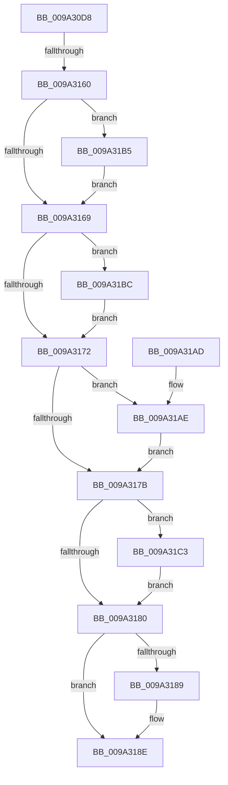

# IopCreateSecureDeviceClassSettings

- RVA: `0x009A30D8`–`0x009A31CF` (길이 `247` bytes)
- VA: `0x00000001409A30D8`
- 실행 섹션: `PAGE`
- PDB 이름 있음: `예`; PDB Function 태그: `예`
- unwind 정보 RVA: `0x0009C310`
- 디코드: `73`개 명령, `247/247` bytes 표시
- 미해석 바이트: `0` (있으면 어셈블리에 `.byte`로 보존)

> 이 문서는 커널 이미지의 기계어와 PDB 기호를 분석해 생성했습니다. 4번과 5번은 함수 원형과 자료형을 바이너리 사용 방식에서 추정한 C 해석이며 원본 소스 복구 결과는 아닙니다.

## 1. Dependencies

- 직접 호출 지점: **7**; 고유 호출 대상: **5**
- 직접 호출자로 확인된 함수: **1**
- RIP 상대 이미지 참조: **1**

### Outgoing calls
- `0x009A3142` → [RtlInitUnicodeString](../../text/42/RtlInitUnicodeString_function_0042A780.md) (function, `0x0042A780`)
- `0x009A3151` → [RtlStringFromGUIDEx](../91/RtlStringFromGUIDEx_function_00915450.md) (function, `0x00915450`)
- `0x009A3189` → [ExFreePool](../../poolcode/B8/ExFreePool_function_00B82850.md) (function, `0x00B82850`)
- `0x009A31AE` → [ZwClose](../../text/6A/ZwClose_function_006AD2B0.md) (function, `0x006AD2B0`)
- `0x009A31B5` → [ZwClose](../../text/6A/ZwClose_function_006AD2B0.md) (function, `0x006AD2B0`)
- `0x009A31BC` → [ZwClose](../../text/6A/ZwClose_function_006AD2B0.md) (function, `0x006AD2B0`)
- `0x009A31C8` → [ExFreePoolWithTag](../../poolcode/B8/ExFreePoolWithTag_function_00B82870.md) (function, `0x00B82870`)

### Direct callers
- [IoCreateDeviceSecure](IoCreateDeviceSecure_function_009A31E0.md) at `0x009A3357`

### Static image references
- `0x009A30FB` → RVA `0x00AFCBE0` (` ?? ::NNGAKEGL::`string'`; read)

## 2. Other-region calls and transfers

- 다른 실행 섹션으로 향하는 call: **6**
  - `0x009A3142` → [RtlInitUnicodeString](../../text/42/RtlInitUnicodeString_function_0042A780.md) (`PAGE` → `.text`)
  - `0x009A3189` → [ExFreePool](../../poolcode/B8/ExFreePool_function_00B82850.md) (`PAGE` → `POOLCODE`)
  - `0x009A31AE` → [ZwClose](../../text/6A/ZwClose_function_006AD2B0.md) (`PAGE` → `.text`)
  - `0x009A31B5` → [ZwClose](../../text/6A/ZwClose_function_006AD2B0.md) (`PAGE` → `.text`)
  - `0x009A31BC` → [ZwClose](../../text/6A/ZwClose_function_006AD2B0.md) (`PAGE` → `.text`)
  - `0x009A31C8` → [ExFreePoolWithTag](../../poolcode/B8/ExFreePoolWithTag_function_00B82870.md) (`PAGE` → `POOLCODE`)
- call이 아닌 외부 분기/꼬리 이동: **1**
  - `0x009A315A` → [sub_00B2D22A](../B2/Unknown_function_00B2D22A.md) (`tail-transfer`)

## 3. Assembly (complete function range)

```asm
009A30D8  48 8B C4                        mov rax, rsp
009A30DB  48 89 58 08                     mov qword ptr [rax + 8], rbx
009A30DF  48 89 70 10                     mov qword ptr [rax + 0x10], rsi
009A30E3  48 89 78 18                     mov qword ptr [rax + 0x18], rdi
009A30E7  55                              push rbp
009A30E8  41 55                           push r13
009A30EA  41 56                           push r14
009A30EC  48 8D 68 A1                     lea rbp, [rax - 0x5f]
009A30F0  48 81 EC 90 00 00 00            sub rsp, 0x90
009A30F7  83 65 7F 00                     and dword ptr [rbp + 0x7f], 0
009A30FB  48 8D 05 DE 9A 15 00            lea rax, [rip + 0x159ade]
009A3102  48 89 45 27                     mov qword ptr [rbp + 0x27], rax
009A3106  4C 8B F2                        mov r14, rdx
009A3109  33 C0                           xor eax, eax
009A310B  48 C7 45 1F 70 00 72 00         mov qword ptr [rbp + 0x1f], 0x720070
009A3113  48 21 45 E7                     and qword ptr [rbp - 0x19], rax
009A3117  48 8B D9                        mov rbx, rcx
009A311A  48 21 45 EF                     and qword ptr [rbp - 0x11], rax
009A311E  48 8D 4D 2F                     lea rcx, [rbp + 0x2f]
009A3122  48 21 45 F7                     and qword ptr [rbp - 9], rax
009A3126  0F 57 C0                        xorps xmm0, xmm0
009A3129  0F 57 C9                        xorps xmm1, xmm1
009A312C  89 45 03                        mov dword ptr [rbp + 3], eax
009A312F  33 FF                           xor edi, edi
009A3131  33 D2                           xor edx, edx
009A3133  48 89 7D FF                     mov qword ptr [rbp - 1], rdi
009A3137  49 8B F0                        mov rsi, r8
009A313A  0F 11 45 0F                     movups xmmword ptr [rbp + 0xf], xmm0
009A313E  0F 11 4D 2F                     movups xmmword ptr [rbp + 0x2f], xmm1
009A3142  E8 39 76 A8 FF                  call 0x14042a780
009A3147  41 B0 01                        mov r8b, 1
009A314A  48 8D 55 2F                     lea rdx, [rbp + 0x2f]
009A314E  48 8B CB                        mov rcx, rbx
009A3151  E8 FA 22 F7 FF                  call 0x140915450
009A3156  8B D8                           mov ebx, eax
009A3158  85 C0                           test eax, eax
009A315A  0F 89 CA A0 18 00               jns 0x140b2d22a
009A3160  48 8B 4D EF                     mov rcx, qword ptr [rbp - 0x11]
009A3164  48 85 C9                        test rcx, rcx
009A3167  75 4C                           jne 0x1409a31b5
009A3169  48 8B 4D E7                     mov rcx, qword ptr [rbp - 0x19]
009A316D  48 85 C9                        test rcx, rcx
009A3170  75 4A                           jne 0x1409a31bc
009A3172  48 8B 4D F7                     mov rcx, qword ptr [rbp - 9]
009A3176  48 85 C9                        test rcx, rcx
009A3179  75 33                           jne 0x1409a31ae
009A317B  48 85 FF                        test rdi, rdi
009A317E  75 43                           jne 0x1409a31c3
009A3180  48 8B 4D 37                     mov rcx, qword ptr [rbp + 0x37]
009A3184  48 85 C9                        test rcx, rcx
009A3187  74 05                           je 0x1409a318e
009A3189  E8 C2 F6 1D 00                  call 0x140b82850
009A318E  4C 8D 9C 24 90 00 00 00         lea r11, [rsp + 0x90]
009A3196  8B C3                           mov eax, ebx
009A3198  49 8B 5B 20                     mov rbx, qword ptr [r11 + 0x20]
009A319C  49 8B 73 28                     mov rsi, qword ptr [r11 + 0x28]
009A31A0  49 8B 7B 30                     mov rdi, qword ptr [r11 + 0x30]
009A31A4  49 8B E3                        mov rsp, r11
009A31A7  41 5E                           pop r14
009A31A9  41 5D                           pop r13
009A31AB  5D                              pop rbp
009A31AC  C3                              ret
009A31AD  CC                              int3
009A31AE  E8 FD A0 D0 FF                  call 0x1406ad2b0
009A31B3  EB C6                           jmp 0x1409a317b
009A31B5  E8 F6 A0 D0 FF                  call 0x1406ad2b0
009A31BA  EB AD                           jmp 0x1409a3169
009A31BC  E8 EF A0 D0 FF                  call 0x1406ad2b0
009A31C1  EB AF                           jmp 0x1409a3172
009A31C3  33 D2                           xor edx, edx
009A31C5  48 8B CF                        mov rcx, rdi
009A31C8  E8 A3 F6 1D 00                  call 0x140b82870
009A31CD  EB B1                           jmp 0x1409a3180
```

## 4. C-style interpretation (structured pseudocode)

```c
__int64 __fastcall IopCreateSecureDeviceClassSettings(__int64 a1, __int64 a2, __int64 a3)
{
    __int64 result;
    __int64 v_rdi;
    __int64 v_rsp;
    unsigned __int64 v_stack_m18;

    *(unsigned __int64 *)(v_rsp + 8) = v_rbx;
    *(unsigned __int64 *)(v_rsp + 16) = v_rsi;
    *(unsigned __int64 *)(v_rsp + 24) = v_rdi;
    v_rsp = (v_rsp) - (144);
    *(unsigned __int64 *)(v_rsp - 95 + 39) = v_rip + 1415902;
    result = 0;
    *(unsigned __int64 *)(v_rsp - 95 + 31) = 0x720070ULL;
    *(unsigned int *)(v_rsp - 95 + 3) = 0;
    v_rdi = 0;
    a2 = 0;
    *(unsigned __int64 *)(v_rsp - 95 - 1) = 0;
    *(unsigned __int64 *)(v_rsp - 95 + 15) = v_xmm0;
    *(unsigned __int64 *)(v_rsp - 95 + 47) = v_xmm1;
    result = RtlInitUnicodeString(v_rsp - 95 + 47, a2, a3, a4);
    result = RtlStringFromGUIDEx(a1, v_rsp - 95 + 47, 1, a4);
    if (*(unsigned __int64 *)(v_rsp - 95 - 17) != 0) goto loc_009A31B5;
loc_009A3169:
    if (*(unsigned __int64 *)(v_rsp - 95 - 25) != 0) goto loc_009A31BC;
loc_009A3172:
    if (*(unsigned __int64 *)(v_rsp - 95 - 9) != 0) goto loc_009A31AE;
loc_009A317B:
    if (0 != 0) goto loc_009A31C3;
loc_009A3180:
    if (*(unsigned __int64 *)(v_rsp - 95 + 55) != 0) {
        result = ExFreePool(*(unsigned __int64 *)(v_rsp - 95 + 55), v_rsp - 95 + 47, 1, a4);
    }
    return (unsigned int)((unsigned int)((unsigned int)((unsigned int)(result))));
loc_009A31AE:
    result = ZwClose(*(unsigned __int64 *)(v_rsp - 95 + 55), v_rsp - 95 + 47, 1, a4);
    goto loc_009A317B;
loc_009A31B5:
    result = ZwClose(*(unsigned __int64 *)(v_rsp - 95 + 55), v_rsp - 95 + 47, 1, a4);
    goto loc_009A3169;
loc_009A31BC:
    result = ZwClose(*(unsigned __int64 *)(v_rsp - 95 + 55), v_rsp - 95 + 47, 1, a4);
    goto loc_009A3172;
loc_009A31C3:
    a2 = 0;
    result = ExFreePoolWithTag(*(unsigned __int64 *)(v_stack_m18 + 48), a2, 1, a4);
    goto loc_009A3180;
}
```

## 5. (Beta) C Style

```c
int64_t IopCreateSecureDeviceClassSettings(int64_t Arg1, int64_t Arg2, int64_t Arg3)
{
    int64_t result;
    int64_t local_rdi;
    int64_t local_rsp;
    uint64_t v_stack_m18;

    *(uint64_t *)(local_rsp + 0x8) = local_rbx;
    *(uint64_t *)(local_rsp + 0x10) = local_rsi;
    *(uint64_t *)(local_rsp + 0x18) = local_rdi;
    local_rsp = (local_rsp) - (144);
    *(uint64_t *)(local_rsp - 0x5F + 0x27) = v_rip + 1415902;
    result = 0;
    *(uint64_t *)(local_rsp - 0x5F + 0x1F) = 0x720070ULL;
    *(uint32_t *)(local_rsp - 0x5F + 0x3) = 0;
    local_rdi = 0;
    Arg2 = 0;
    *(uint64_t *)(local_rsp - 0x5F - 0x1) = 0;
    *(uint64_t *)(local_rsp - 0x5F + 0xF) = v_xmm0;
    *(uint64_t *)(local_rsp - 0x5F + 0x2F) = v_xmm1;
    result = RtlInitUnicodeString(local_rsp - 95 + 47, Arg2, Arg3, a4);
    result = RtlStringFromGUIDEx(Arg1, local_rsp - 95 + 47, 1, a4);
    if (*(uint64_t *)(local_rsp - 0x5F - 0x11) != 0) goto loc_009A31B5;
loc_009A3169:
    if (*(uint64_t *)(local_rsp - 0x5F - 0x19) != 0) goto loc_009A31BC;
loc_009A3172:
    if (*(uint64_t *)(local_rsp - 0x5F - 0x9) != 0) goto loc_009A31AE;
loc_009A317B:
    if (0 != 0) goto loc_009A31C3;
loc_009A3180:
    if (*(uint64_t *)(local_rsp - 0x5F + 0x37) != 0) {
        result = ExFreePool(*(uint64_t *)(local_rsp - 0x5F + 0x37), local_rsp - 95 + 47, 1, a4);
    }
    return (uint32_t)((uint32_t)((uint32_t)((uint32_t)(result))));
loc_009A31AE:
    result = ZwClose(*(uint64_t *)(local_rsp - 0x5F + 0x37), local_rsp - 95 + 47, 1, a4);
    goto loc_009A317B;
loc_009A31B5:
    result = ZwClose(*(uint64_t *)(local_rsp - 0x5F + 0x37), local_rsp - 95 + 47, 1, a4);
    goto loc_009A3169;
loc_009A31BC:
    result = ZwClose(*(uint64_t *)(local_rsp - 0x5F + 0x37), local_rsp - 95 + 47, 1, a4);
    goto loc_009A3172;
loc_009A31C3:
    Arg2 = 0;
    result = ExFreePoolWithTag(*(uint64_t *)(v_stack_m18 + 0x30), Arg2, 1, a4);
    goto loc_009A3180;
}
```

## 6. Execution-region graph

[열기: 2D/3D 그래프와 함수 탐색 컨트롤 패널](../../../control-panel.html?section=page&rva=0x009A30D8&view=graph)

- 2D 그래프는 위에서 아래로 흐르고, 3D 그래프는 빈 공간을 드래그해 회전합니다. Shift+드래그는 이동, 휠은 확대·축소, 함수 노드 선택은 대상 보고서 이동입니다.

### Static fallback


