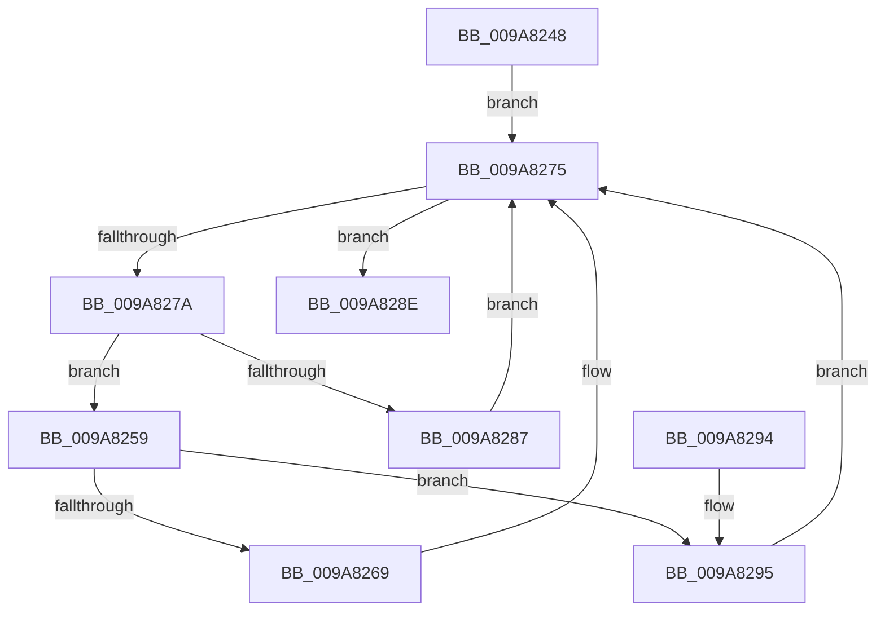

# IopFreeCompletionListPackets

- RVA: `0x009A8248`–`0x009A829C` (길이 `84` bytes)
- VA: `0x00000001409A8248`
- 실행 섹션: `PAGE`
- PDB 이름 있음: `예`; PDB Function 태그: `아니요`
- unwind 정보 RVA: `0x0005DAC8`
- 디코드: `24`개 명령, `84/84` bytes 표시
- 미해석 바이트: `0` (있으면 어셈블리에 `.byte`로 보존)

> 이 문서는 커널 이미지의 기계어와 PDB 기호를 분석해 생성했습니다. 4번과 5번은 함수 원형과 자료형을 바이너리 사용 방식에서 추정한 C 해석이며 원본 소스 복구 결과는 아닙니다.

## 1. Dependencies

- 직접 호출 지점: **3**; 고유 호출 대상: **3**
- 직접 호출자로 확인된 함수: **1**
- RIP 상대 이미지 참조: **0**

### Outgoing calls
- `0x009A8270` → [IopDropIrp](../../text/21/IopDropIrp_function_002107B0.md) (function, `0x002107B0`)
- `0x009A8287` → [IopFreeMiniCompletionPacket](IopFreeMiniCompletionPacket_function_009A82D0.md) (function, `0x009A82D0`)
- `0x009A8295` → [IoFreeIrp](../../text/24/IoFreeIrp_function_0024DF70.md) (function, `0x0024DF70`)

### Direct callers
- [IopDeleteIoCompletionInternal](../../text/35/IopDeleteIoCompletionInternal_function_00351438.md) at `0x003514C2`

### Static image references
- 디코드된 RIP-relative 메모리 참조가 없습니다.

## 2. Other-region calls and transfers

- 다른 실행 섹션으로 향하는 call: **2**
  - `0x009A8270` → [IopDropIrp](../../text/21/IopDropIrp_function_002107B0.md) (`PAGE` → `.text`)
  - `0x009A8295` → [IoFreeIrp](../../text/24/IoFreeIrp_function_0024DF70.md) (`PAGE` → `.text`)
- 별도 외부 분기/꼬리 이동을 확인하지 못했습니다.

## 3. Assembly (complete function range)

```asm
009A8248  40 53                           push rbx
009A824A  48 83 EC 20                     sub rsp, 0x20
009A824E  48 8B 59 08                     mov rbx, qword ptr [rcx + 8]
009A8252  48 83 61 08 00                  and qword ptr [rcx + 8], 0
009A8257  EB 1C                           jmp 0x1409a8275
009A8259  48 81 C1 58 FF FF FF            add rcx, -0xa8
009A8260  F7 41 10 00 20 00 00            test dword ptr [rcx + 0x10], 0x2000
009A8267  74 2C                           je 0x1409a8295
009A8269  48 8B 91 C0 00 00 00            mov rdx, qword ptr [rcx + 0xc0]
009A8270  E8 3B 85 86 FF                  call 0x1402107b0
009A8275  48 85 DB                        test rbx, rbx
009A8278  74 14                           je 0x1409a828e
009A827A  48 8B CB                        mov rcx, rbx
009A827D  48 8B 5B 08                     mov rbx, qword ptr [rbx + 8]
009A8281  80 79 10 00                     cmp byte ptr [rcx + 0x10], 0
009A8285  74 D2                           je 0x1409a8259
009A8287  E8 44 00 00 00                  call 0x1409a82d0
009A828C  EB E7                           jmp 0x1409a8275
009A828E  48 83 C4 20                     add rsp, 0x20
009A8292  5B                              pop rbx
009A8293  C3                              ret
009A8294  CC                              int3
009A8295  E8 D6 5C 8A FF                  call 0x14024df70
009A829A  EB D9                           jmp 0x1409a8275
```

## 4. C-style interpretation (structured pseudocode)

```c
__int64 __fastcall IopFreeCompletionListPackets(__int64 a1)
{
    __int64 result;
    __int64 v_rsp;

    v_rsp = (v_rsp) - (32);
    goto loc_009A8275;
loc_009A8259:
    a1 = (a1) + (-168);
    if (((*(unsigned int *)(a1 + 16)) & (0x2000ULL)) == 0) goto loc_009A8295;
    result = IopDropIrp(a1, *(unsigned __int64 *)(a1 + 192), a3, a4);
loc_009A8275:
    if (*(unsigned __int64 *)(a1 + 8) == 0) goto loc_009A828E;
    if ((*(unsigned __int8 *)(*(unsigned __int64 *)(a1 + 8) + 16)) == 0) goto loc_009A8259;
    result = IopFreeMiniCompletionPacket(*(unsigned __int64 *)(a1 + 8), *(unsigned __int64 *)(a1 + 192), a3, a4);
    goto loc_009A8275;
loc_009A828E:
    v_rsp = (v_rsp) + (32);
    return result;
loc_009A8295:
    result = IoFreeIrp(*(unsigned __int64 *)(a1 + 8), *(unsigned __int64 *)(a1 + 192), a3, a4);
    goto loc_009A8275;
}
```

## 5. (Beta) C Style

```c
int64_t IopFreeCompletionListPackets(void *Arg1)
{
    uint8_t *arg1 = (uint8_t *)Arg1;

    int64_t result;
    int64_t local_rsp;

    local_rsp = (local_rsp) - (32);
    goto loc_009A8275;
loc_009A8259:
    Arg1 = (Arg1) + (-168);
    if (((*(uint32_t *)(arg1 + 0x10)) & (0x2000ULL)) == 0) goto loc_009A8295;
    result = IopDropIrp(Arg1, *(uint64_t *)(arg1 + 0xC0), a3, a4);
loc_009A8275:
    if (*(uint64_t *)(arg1 + 0x8) == 0) goto loc_009A828E;
    if ((*(uint8_t *)(*(uint64_t *)(arg1 + 0x8) + 0x10)) == 0) goto loc_009A8259;
    result = IopFreeMiniCompletionPacket(*(uint64_t *)(arg1 + 0x8), *(uint64_t *)(arg1 + 0xC0), a3, a4);
    goto loc_009A8275;
loc_009A828E:
    local_rsp = (local_rsp) + (32);
    return result;
loc_009A8295:
    result = IoFreeIrp(*(uint64_t *)(arg1 + 0x8), *(uint64_t *)(arg1 + 0xC0), a3, a4);
    goto loc_009A8275;
}
```

### 관측된 메모리 오프셋

구조체 형식이 확인되지 않은 접근은 인자 기준의 오프셋으로만 기록했습니다.

| 기준 인자 | 오프셋 표현 | 폭 (bit) | 접근 |
|---|---:|---:|---|
| `Arg1` | `+ 0x8` | `64` | `R` |
| `Arg1` | `+ 0x8` | `64` | `R/W` |

## 6. Execution-region graph

[열기: 2D/3D 그래프와 함수 탐색 컨트롤 패널](../../../control-panel.html?section=page&rva=0x009A8248&view=graph)

- 2D 그래프는 위에서 아래로 흐르고, 3D 그래프는 빈 공간을 드래그해 회전합니다. Shift+드래그는 이동, 휠은 확대·축소, 함수 노드 선택은 대상 보고서 이동입니다.

### Static fallback


