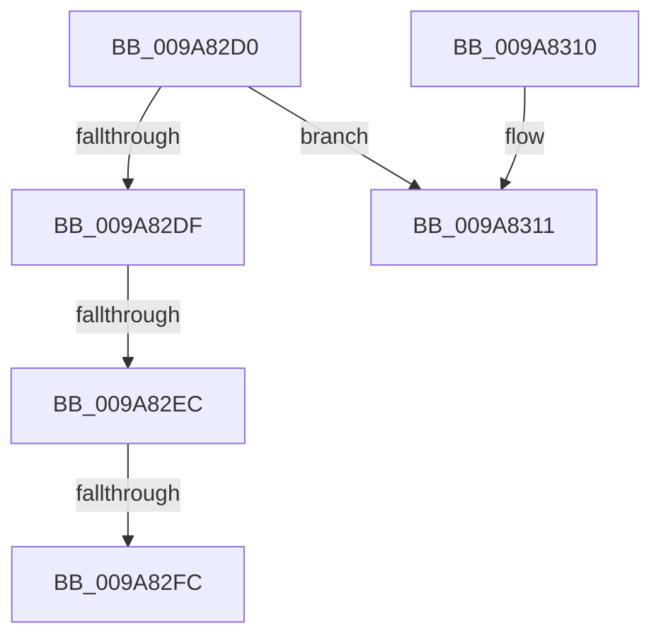

# IopFreeMiniCompletionPacket

- RVA: `0x009A82D0`–`0x009A831A` (길이 `74` bytes)
- VA: `0x00000001409A82D0`
- 실행 섹션: `PAGE`
- PDB 이름 있음: `예`; PDB Function 태그: `아니요`
- unwind 정보 RVA: `0x0009CE30`
- 디코드: `20`개 명령, `74/74` bytes 표시
- 미해석 바이트: `0` (있으면 어셈블리에 `.byte`로 보존)

> 이 문서는 커널 이미지의 기계어와 PDB 기호를 분석해 생성했습니다. 4번과 5번은 함수 원형과 자료형을 바이너리 사용 방식에서 추정한 C 해석이며 원본 소스 복구 결과는 아닙니다.

## 1. Dependencies

- 직접 호출 지점: **1**; 고유 호출 대상: **1**
- 직접 호출자로 확인된 함수: **6**
- RIP 상대 이미지 참조: **1**

### Outgoing calls
- `0x009A8305` → [ObfDereferenceObject](../../text/2F/ObfDereferenceObject_function_002F9350.md) (function, `0x002F9350`)

### Direct callers
- [IoRemoveIoCompletion](../../text/20/IoRemoveIoCompletion_function_0020B580.md) at `0x0020B76C`
- [NtCreateWorkerFactory](NtCreateWorkerFactory_function_009A7E10.md) at `0x009A818A`
- [IopFreeCompletionListPackets](IopFreeCompletionListPackets_function_009A8248.md) at `0x009A8287`
- [IoFreeMiniCompletionPacket](IoFreeMiniCompletionPacket_function_009A82B0.md) at `0x009A82B9`
- [NtSetInformationJobObject](../9F/NtSetInformationJobObject_function_009F84C0.md) at `0x009F8A61`
- [sub_00B3731E](../B3/Unknown_function_00B3731E.md) at `0x00B3732A`

### Static image references
- `0x009A82F0` → RVA `0x009F2240` (`PspIoMiniPacketCallbackRoutine`; read)

## 2. Other-region calls and transfers

- 다른 실행 섹션으로 향하는 call: **1**
  - `0x009A8305` → [ObfDereferenceObject](../../text/2F/ObfDereferenceObject_function_002F9350.md) (`PAGE` → `.text`)
- call이 아닌 외부 분기/꼬리 이동: **2**
  - `0x009A82E6` → [sub_009A83B5](Unknown_function_009A83B5.md) (`tail-transfer`)
  - `0x009A82FA` → [sub_009A8352](Unknown_function_009A8352.md) (`tail-transfer`)

## 3. Assembly (complete function range)

```asm
009A82D0  40 53                           push rbx
009A82D2  48 83 EC 20                     sub rsp, 0x20
009A82D6  80 79 10 04                     cmp byte ptr [rcx + 0x10], 4
009A82DA  48 8B D9                        mov rbx, rcx
009A82DD  75 32                           jne 0x1409a8311
009A82DF  48 8B 41 38                     mov rax, qword ptr [rcx + 0x38]
009A82E3  48 85 C0                        test rax, rax
009A82E6  0F 84 C9 00 00 00               je 0x1409a83b5
009A82EC  48 8B 51 40                     mov rdx, qword ptr [rcx + 0x40]
009A82F0  48 8D 0D 49 9F 04 00            lea rcx, [rip + 0x49f49]
009A82F7  48 3B C1                        cmp rax, rcx
009A82FA  75 56                           jne 0x1409a8352
009A82FC  48 8B CA                        mov rcx, rdx
009A82FF  C7 02 00 00 00 00               mov dword ptr [rdx], 0
009A8305  E8 46 10 95 FF                  call 0x1402f9350
009A830A  48 83 C4 20                     add rsp, 0x20
009A830E  5B                              pop rbx
009A830F  C3                              ret
009A8310  CC                              int3
009A8311  65 48 8B 0C 25 20 00 00 00      mov rcx, qword ptr gs:[0x20]
```

## 4. C-style interpretation (structured pseudocode)

```c
__int64 __fastcall IopFreeMiniCompletionPacket(__int64 a1)
{
    __int64 result;
    __int64 v_rsp;

    v_rsp = (v_rsp) - (32);
    if ((*(unsigned __int8 *)(a1 + 16)) != 4) goto loc_009A8311;
    *(unsigned int *)(*(unsigned __int64 *)(a1 + 64)) = 0;
    result = ObfDereferenceObject(*(unsigned __int64 *)(a1 + 64), *(unsigned __int64 *)(a1 + 64), a3, a4);
    v_rsp = (v_rsp) + (32);
    return result;
loc_009A8311:
    return result;
}
```

## 5. (Beta) C Style

```c
int64_t IopFreeMiniCompletionPacket(void *Arg1)
{
    uint8_t *arg1 = (uint8_t *)Arg1;

    int64_t result;
    int64_t local_rsp;

    local_rsp = (local_rsp) - (32);
    if ((*(uint8_t *)(arg1 + 0x10)) != 4) goto loc_009A8311;
    *(uint32_t *)(*(uint64_t *)(arg1 + 0x40)) = 0;
    result = ObfDereferenceObject(*(uint64_t *)(arg1 + 0x40), *(uint64_t *)(arg1 + 0x40), a3, a4);
    local_rsp = (local_rsp) + (32);
    return result;
loc_009A8311:
    return result;
}
```

### 관측된 메모리 오프셋

구조체 형식이 확인되지 않은 접근은 인자 기준의 오프셋으로만 기록했습니다.

| 기준 인자 | 오프셋 표현 | 폭 (bit) | 접근 |
|---|---:|---:|---|
| `Arg1` | `+ 0x10` | `8` | `R` |
| `Arg1` | `+ 0x38` | `64` | `R` |
| `Arg1` | `+ 0x40` | `64` | `R` |

## 6. Execution-region graph

[열기: 2D/3D 그래프와 함수 탐색 컨트롤 패널](../../../control-panel.html?section=page&rva=0x009A82D0&view=graph)

- 2D 그래프는 위에서 아래로 흐르고, 3D 그래프는 빈 공간을 드래그해 회전합니다. Shift+드래그는 이동, 휠은 확대·축소, 함수 노드 선택은 대상 보고서 이동입니다.

### Static fallback


