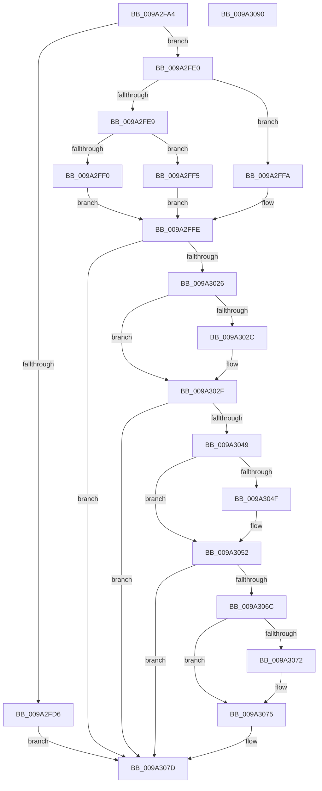

# IopGetSecurityDescriptorInformation

- RVA: `0x009A2FA4`–`0x009A3091` (길이 `237` bytes)
- VA: `0x00000001409A2FA4`
- 실행 섹션: `PAGE`
- PDB 이름 있음: `예`; PDB Function 태그: `아니요`
- unwind 정보 RVA: `0x0009C2F8`
- 디코드: `83`개 명령, `237/237` bytes 표시
- 미해석 바이트: `0` (있으면 어셈블리에 `.byte`로 보존)

> 이 문서는 커널 이미지의 기계어와 PDB 기호를 분석해 생성했습니다. 4번과 5번은 함수 원형과 자료형을 바이너리 사용 방식에서 추정한 C 해석이며 원본 소스 복구 결과는 아닙니다.

## 1. Dependencies

- 직접 호출 지점: **3**; 고유 호출 대상: **3**
- 직접 호출자로 확인된 함수: **2**
- RIP 상대 이미지 참조: **0**

### Outgoing calls
- `0x009A301B` → [RtlGetGroupSecurityDescriptor](../A9/RtlGetGroupSecurityDescriptor_function_00A90020.md) (function, `0x00A90020`)
- `0x009A303E` → [RtlGetSaclSecurityDescriptor](../A3/RtlGetSaclSecurityDescriptor_function_00A36710.md) (function, `0x00A36710`)
- `0x009A3061` → [RtlGetDaclSecurityDescriptor](../../text/45/RtlGetDaclSecurityDescriptor_function_00459570.md) (function, `0x00459570`)

### Direct callers
- [IoCreateDeviceSecure](IoCreateDeviceSecure_function_009A31E0.md) at `0x009A3380`
- [IopQuerySecureDeviceClassState](../AB/IopQuerySecureDeviceClassState_function_00ABC9A4.md) at `0x00ABCA57`

### Static image references
- 디코드된 RIP-relative 메모리 참조가 없습니다.

## 2. Other-region calls and transfers

- 다른 실행 섹션으로 향하는 call: **1**
  - `0x009A3061` → [RtlGetDaclSecurityDescriptor](../../text/45/RtlGetDaclSecurityDescriptor_function_00459570.md) (`PAGE` → `.text`)
- 별도 외부 분기/꼬리 이동을 확인하지 못했습니다.

## 3. Assembly (complete function range)

```asm
009A2FA4  48 89 5C 24 18                  mov qword ptr [rsp + 0x18], rbx
009A2FA9  55                              push rbp
009A2FAA  56                              push rsi
009A2FAB  57                              push rdi
009A2FAC  41 56                           push r14
009A2FAE  41 57                           push r15
009A2FB0  48 8B EC                        mov rbp, rsp
009A2FB3  48 83 EC 20                     sub rsp, 0x20
009A2FB7  33 C0                           xor eax, eax
009A2FB9  45 33 FF                        xor r15d, r15d
009A2FBC  4C 8B F2                        mov r14, rdx
009A2FBF  44 88 3A                        mov byte ptr [rdx], r15b
009A2FC2  49 8B F0                        mov rsi, r8
009A2FC5  44 88 7D 30                     mov byte ptr [rbp + 0x30], r15b
009A2FC9  48 8B F9                        mov rdi, rcx
009A2FCC  41 89 00                        mov dword ptr [r8], eax
009A2FCF  8D 50 01                        lea edx, [rax + 1]
009A2FD2  38 11                           cmp byte ptr [rcx], dl
009A2FD4  74 0A                           je 0x1409a2fe0
009A2FD6  B9 58 00 00 C0                  mov ecx, 0xc0000058
009A2FDB  E9 9D 00 00 00                  jmp 0x1409a307d
009A2FE0  0F B7 49 02                     movzx ecx, word ptr [rcx + 2]
009A2FE4  66 85 C9                        test cx, cx
009A2FE7  79 11                           jns 0x1409a2ffa
009A2FE9  8B 47 04                        mov eax, dword ptr [rdi + 4]
009A2FEC  85 C0                           test eax, eax
009A2FEE  75 05                           jne 0x1409a2ff5
009A2FF0  49 8B C7                        mov rax, r15
009A2FF3  EB 09                           jmp 0x1409a2ffe
009A2FF5  48 03 C7                        add rax, rdi
009A2FF8  EB 04                           jmp 0x1409a2ffe
009A2FFA  48 8B 47 08                     mov rax, qword ptr [rdi + 8]
009A2FFE  22 CA                           and cl, dl
009A3000  48 89 45 48                     mov qword ptr [rbp + 0x48], rax
009A3004  48 85 C0                        test rax, rax
009A3007  88 4D 38                        mov byte ptr [rbp + 0x38], cl
009A300A  41 8B DF                        mov ebx, r15d
009A300D  4C 8D 45 38                     lea r8, [rbp + 0x38]
009A3011  0F 45 DA                        cmovne ebx, edx
009A3014  48 8B CF                        mov rcx, rdi
009A3017  48 8D 55 48                     lea rdx, [rbp + 0x48]
009A301B  E8 00 D0 0E 00                  call 0x140a90020
009A3020  8B C8                           mov ecx, eax
009A3022  85 C0                           test eax, eax
009A3024  78 57                           js 0x1409a307d
009A3026  4C 39 7D 48                     cmp qword ptr [rbp + 0x48], r15
009A302A  74 03                           je 0x1409a302f
009A302C  83 CB 02                        or ebx, 2
009A302F  4C 8D 4D 38                     lea r9, [rbp + 0x38]
009A3033  48 8B CF                        mov rcx, rdi
009A3036  4C 8D 45 48                     lea r8, [rbp + 0x48]
009A303A  48 8D 55 30                     lea rdx, [rbp + 0x30]
009A303E  E8 CD 36 09 00                  call 0x140a36710
009A3043  8B C8                           mov ecx, eax
009A3045  85 C0                           test eax, eax
009A3047  78 34                           js 0x1409a307d
009A3049  44 38 7D 30                     cmp byte ptr [rbp + 0x30], r15b
009A304D  74 03                           je 0x1409a3052
009A304F  83 CB 08                        or ebx, 8
009A3052  4C 8D 4D 38                     lea r9, [rbp + 0x38]
009A3056  48 8B CF                        mov rcx, rdi
009A3059  4C 8D 45 48                     lea r8, [rbp + 0x48]
009A305D  48 8D 55 30                     lea rdx, [rbp + 0x30]
009A3061  E8 0A 65 AB FF                  call 0x140459570
009A3066  8B C8                           mov ecx, eax
009A3068  85 C0                           test eax, eax
009A306A  78 11                           js 0x1409a307d
009A306C  44 38 7D 30                     cmp byte ptr [rbp + 0x30], r15b
009A3070  74 03                           je 0x1409a3075
009A3072  83 CB 04                        or ebx, 4
009A3075  8A 45 38                        mov al, byte ptr [rbp + 0x38]
009A3078  41 88 06                        mov byte ptr [r14], al
009A307B  89 1E                           mov dword ptr [rsi], ebx
009A307D  48 8B 5C 24 60                  mov rbx, qword ptr [rsp + 0x60]
009A3082  8B C1                           mov eax, ecx
009A3084  48 83 C4 20                     add rsp, 0x20
009A3088  41 5F                           pop r15
009A308A  41 5E                           pop r14
009A308C  5F                              pop rdi
009A308D  5E                              pop rsi
009A308E  5D                              pop rbp
009A308F  C3                              ret
009A3090  CC                              int3
```

## 4. C-style interpretation (structured pseudocode)

```c
__int64 __fastcall IopGetSecurityDescriptorInformation(__int64 a1, __int64 a2, __int64 a3)
{
    __int64 result;
    __int64 v_r15;
    __int64 v_rbx;
    __int64 v_rsp;
    unsigned __int8 v_stack_p10;
    unsigned __int64 v_stack_p18;
    unsigned __int64 v_stack_p20;
    unsigned __int8 v_stack_p8;

    v_stack_p18 = v_rbx;
    v_rsp = (v_rsp) - (32);
    result = 0;
    v_r15 = 0;
    *(unsigned __int8 *)(a2) = 0;
    v_stack_p8 = 0;
    *(unsigned int *)(a3) = 0;
    if ((*(unsigned __int8 *)(a1)) == ((unsigned __int8)(result + 1))) goto loc_009A2FE0;
    goto loc_009A307D;
loc_009A2FE0:
    if (!sign_flag) goto loc_009A2FFA;
    if ((unsigned int)((unsigned int)(*(unsigned int *)(a1 + 4))) != 0) goto loc_009A2FF5;
    goto loc_009A2FFE;
loc_009A2FF5:
    result = (0) + (a1);
    goto loc_009A2FFE;
loc_009A2FFA:
loc_009A2FFE:
    a1 = (unsigned __int8)((*(unsigned __int16 *)((unsigned int)(0xC0000058ULL) + 2)) & ((unsigned __int8)(result + 1)));
    v_stack_p20 = *(unsigned __int64 *)(a1 + 8);
    v_stack_p10 = (unsigned __int8)(a1);
    v_rbx = 0;
    if (*(unsigned __int64 *)(a1 + 8) != 0) { v_rbx = (unsigned int)(result + 1); }
    result = RtlGetGroupSecurityDescriptor(a1, v_stack_p20, v_stack_p10, a4);
    if (sign_flag) goto loc_009A307D;
    if (v_stack_p20 != 0) {
        v_rbx = (unsigned int)((v_rbx) | (2));
    }
    result = RtlGetSaclSecurityDescriptor(a1, v_stack_p8, v_stack_p20, v_stack_p10);
    if (sign_flag) goto loc_009A307D;
    if (v_stack_p8 != 0) {
        v_rbx = (unsigned int)((v_rbx) | (8));
    }
    result = RtlGetDaclSecurityDescriptor(a1, v_stack_p8, v_stack_p20, v_stack_p10);
    if (sign_flag) goto loc_009A307D;
    if (v_stack_p8 != 0) {
        v_rbx = (unsigned int)((v_rbx) | (4));
    }
    *(unsigned __int8 *)(a2) = (unsigned __int8)(v_stack_p10);
    *(unsigned int *)(a3) = (unsigned int)(v_rbx);
loc_009A307D:
    v_rsp = (v_rsp) + (32);
    return (unsigned int)((unsigned int)((unsigned int)((unsigned int)(result))));
}
```

## 5. (Beta) C Style

```c
int64_t IopGetSecurityDescriptorInformation(void *Arg1, void *Arg2, void *Arg3)
{
    uint8_t *arg1 = (uint8_t *)Arg1;
    uint8_t *arg2 = (uint8_t *)Arg2;
    uint8_t *arg3 = (uint8_t *)Arg3;

    int64_t result;
    int64_t local_r15;
    int64_t local_rbx;
    int64_t local_rsp;
    uint8_t v_stack_p10;
    uint64_t v_stack_p18;
    uint64_t v_stack_p20;
    uint8_t v_stack_p8;

    v_stack_p18 = local_rbx;
    local_rsp = (local_rsp) - (32);
    result = 0;
    local_r15 = 0;
    *(uint8_t *)(arg2) = 0;
    v_stack_p8 = 0;
    *(uint32_t *)(arg3) = 0;
    if ((*(uint8_t *)(arg1)) == ((uint8_t)(result + 1))) goto loc_009A2FE0;
    goto loc_009A307D;
loc_009A2FE0:
    if (!sign_flag) goto loc_009A2FFA;
    if ((uint32_t)((uint32_t)(*(uint32_t *)(arg1 + 0x4))) != 0) goto loc_009A2FF5;
    goto loc_009A2FFE;
loc_009A2FF5:
    result = (0) + (Arg1);
    goto loc_009A2FFE;
loc_009A2FFA:
loc_009A2FFE:
    Arg1 = (uint8_t)((*(uint16_t *)((uint32_t)(0xC0000058ULL) + 0x2)) & ((uint8_t)(result + 1)));
    v_stack_p20 = *(uint64_t *)(arg1 + 0x8);
    v_stack_p10 = (uint8_t)(Arg1);
    local_rbx = 0;
    if (*(uint64_t *)(arg1 + 0x8) != 0) { local_rbx = (uint32_t)(result + 1); }
    result = RtlGetGroupSecurityDescriptor(Arg1, v_stack_p20, v_stack_p10, a4);
    if (sign_flag) goto loc_009A307D;
    if (v_stack_p20 != 0) {
        local_rbx = (uint32_t)((local_rbx) | (2));
    }
    result = RtlGetSaclSecurityDescriptor(Arg1, v_stack_p8, v_stack_p20, v_stack_p10);
    if (sign_flag) goto loc_009A307D;
    if (v_stack_p8 != 0) {
        local_rbx = (uint32_t)((local_rbx) | (8));
    }
    result = RtlGetDaclSecurityDescriptor(Arg1, v_stack_p8, v_stack_p20, v_stack_p10);
    if (sign_flag) goto loc_009A307D;
    if (v_stack_p8 != 0) {
        local_rbx = (uint32_t)((local_rbx) | (4));
    }
    *(uint8_t *)(arg2) = (uint8_t)(v_stack_p10);
    *(uint32_t *)(arg3) = (uint32_t)(local_rbx);
loc_009A307D:
    local_rsp = (local_rsp) + (32);
    return (uint32_t)((uint32_t)((uint32_t)((uint32_t)(result))));
}
```

### 관측된 메모리 오프셋

구조체 형식이 확인되지 않은 접근은 인자 기준의 오프셋으로만 기록했습니다.

| 기준 인자 | 오프셋 표현 | 폭 (bit) | 접근 |
|---|---:|---:|---|
| `Arg1` | `+ 0x0` | `8` | `R` |
| `Arg1` | `+ 0x2` | `16` | `R` |
| `Arg1` | `+ 0x4` | `32` | `R` |
| `Arg1` | `+ 0x8` | `64` | `R` |
| `Arg2` | `+ 0x0` | `8` | `W` |
| `Arg3` | `+ 0x0` | `32` | `W` |

## 6. Execution-region graph

[열기: 2D/3D 그래프와 함수 탐색 컨트롤 패널](../../../control-panel.html?section=page&rva=0x009A2FA4&view=graph)

- 2D 그래프는 위에서 아래로 흐르고, 3D 그래프는 빈 공간을 드래그해 회전합니다. Shift+드래그는 이동, 휠은 확대·축소, 함수 노드 선택은 대상 보고서 이동입니다.

### Static fallback


