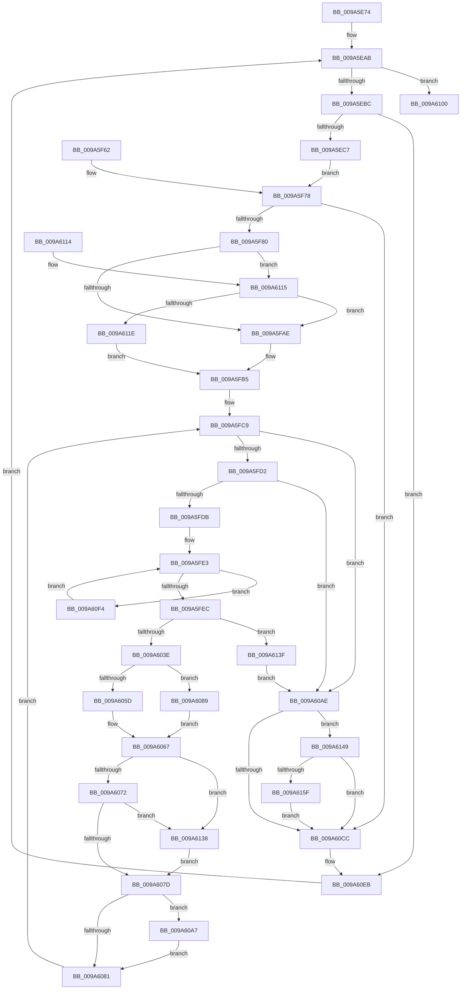

# IopInvalidateVolumesForDevice

- RVA: `0x009A5E74`–`0x009A6169` (길이 `757` bytes)
- VA: `0x00000001409A5E74`
- 실행 섹션: `PAGE`
- PDB 이름 있음: `예`; PDB Function 태그: `아니요`
- unwind 정보 RVA: `0x0009C73C`
- 디코드: `174`개 명령, `757/757` bytes 표시
- 미해석 바이트: `0` (있으면 어셈블리에 `.byte`로 보존)

> 이 문서는 커널 이미지의 기계어와 PDB 기호를 분석해 생성했습니다. 4번과 5번은 함수 원형과 자료형을 바이너리 사용 방식에서 추정한 C 해석이며 원본 소스 복구 결과는 아닙니다.

## 1. Dependencies

- 직접 호출 지점: **15**; 고유 호출 대상: **14**
- 직접 호출자로 확인된 함수: **2**
- RIP 상대 이미지 참조: **5**

### Outgoing calls
- `0x009A5EF8` → [KeWaitForSingleObject](../../text/20/KeWaitForSingleObject_function_0020E6B0.md) (function, `0x0020E6B0`)
- `0x009A5F17` → [IoCreateStreamFileObjectLite](IoCreateStreamFileObjectLite_function_009A58B0.md) (function, `0x009A58B0`)
- `0x009A5F55` → [ObOpenObjectByPointer](../8B/ObOpenObjectByPointer_function_008B7420.md) (function, `0x008B7420`)
- `0x009A5F9C` → [ExAcquireResourceSharedLite](../../text/21/ExAcquireResourceSharedLite_function_00211BC0.md) (function, `0x00211BC0`)
- `0x009A5FBF` → [KeInitializeEvent](../../text/40/KeInitializeEvent_function_0040DD10.md) (function, `0x0040DD10`)
- `0x009A5FF1` → [KeResetEvent](../../text/24/KeResetEvent_function_00248350.md) (function, `0x00248350`)
- `0x009A6030` → [IoBuildDeviceIoControlRequest](../../text/20/IoBuildDeviceIoControlRequest_function_00204FD0.md) (function, `0x00204FD0`)
- `0x009A6051` → [IofCallDriver](../../text/29/IofCallDriver_function_0029B4B0.md) (function, `0x0029B4B0`)
- `0x009A609C` → [KeWaitForSingleObject](../../text/20/KeWaitForSingleObject_function_0020E6B0.md) (function, `0x0020E6B0`)
- `0x009A60B5` → [ExReleaseResourceLite](../../text/25/ExReleaseResourceLite_function_0025FA10.md) (function, `0x0025FA10`)
- `0x009A60BD` → [KeLeaveCriticalRegionThread](../../text/25/KeLeaveCriticalRegionThread_function_0025EFF0.md) (function, `0x0025EFF0`)
- `0x009A60D9` → [KeSetEvent](../../text/33/KeSetEvent_function_0033F310.md) (function, `0x0033F310`)
- `0x009A60DE` → [KeLeaveCriticalRegion](../../text/25/KeLeaveCriticalRegion_function_0025D8B0.md) (function, `0x0025D8B0`)
- `0x009A6149` → [ObfDereferenceObject](../../text/2F/ObfDereferenceObject_function_002F9350.md) (function, `0x002F9350`)
- `0x009A615F` → [ZwClose](../../text/6A/ZwClose_function_006AD2B0.md) (function, `0x006AD2B0`)

### Direct callers
- [PiIrpQueryRemoveDevice](../73/PiIrpQueryRemoveDevice_function_0073E088.md) at `0x0073E1AE`
- [IopRemoveDevice](../8F/IopRemoveDevice_function_008FC7FC.md) at `0x008FC99E`

### Static image references
- `0x009A5F3E` → RVA `0x00FC6AE0` (`ALMOSTRO`; read)
- `0x009A5F95` → RVA `0x00F8D320` (`.data`; read)
- `0x009A5FAE` → RVA `0x00F8D280` (`.data`; read)
- `0x009A611E` → RVA `0x00F8D270` (`.data`; read)
- `0x009A6125` → RVA `0x00F8D260` (`.data`; read)

## 2. Other-region calls and transfers

- 다른 실행 섹션으로 향하는 call: **13**
  - `0x009A5EF8` → [KeWaitForSingleObject](../../text/20/KeWaitForSingleObject_function_0020E6B0.md) (`PAGE` → `.text`)
  - `0x009A5F9C` → [ExAcquireResourceSharedLite](../../text/21/ExAcquireResourceSharedLite_function_00211BC0.md) (`PAGE` → `.text`)
  - `0x009A5FBF` → [KeInitializeEvent](../../text/40/KeInitializeEvent_function_0040DD10.md) (`PAGE` → `.text`)
  - `0x009A5FF1` → [KeResetEvent](../../text/24/KeResetEvent_function_00248350.md) (`PAGE` → `.text`)
  - `0x009A6030` → [IoBuildDeviceIoControlRequest](../../text/20/IoBuildDeviceIoControlRequest_function_00204FD0.md) (`PAGE` → `.text`)
  - `0x009A6051` → [IofCallDriver](../../text/29/IofCallDriver_function_0029B4B0.md) (`PAGE` → `.text`)
  - `0x009A609C` → [KeWaitForSingleObject](../../text/20/KeWaitForSingleObject_function_0020E6B0.md) (`PAGE` → `.text`)
  - `0x009A60B5` → [ExReleaseResourceLite](../../text/25/ExReleaseResourceLite_function_0025FA10.md) (`PAGE` → `.text`)
  - `0x009A60BD` → [KeLeaveCriticalRegionThread](../../text/25/KeLeaveCriticalRegionThread_function_0025EFF0.md) (`PAGE` → `.text`)
  - `0x009A60D9` → [KeSetEvent](../../text/33/KeSetEvent_function_0033F310.md) (`PAGE` → `.text`)
  - `0x009A60DE` → [KeLeaveCriticalRegion](../../text/25/KeLeaveCriticalRegion_function_0025D8B0.md) (`PAGE` → `.text`)
  - `0x009A6149` → [ObfDereferenceObject](../../text/2F/ObfDereferenceObject_function_002F9350.md) (`PAGE` → `.text`)
  - `0x009A615F` → [ZwClose](../../text/6A/ZwClose_function_006AD2B0.md) (`PAGE` → `.text`)
- 별도 외부 분기/꼬리 이동을 확인하지 못했습니다.

## 3. Assembly (complete function range)

```asm
009A5E74  4C 8B DC                        mov r11, rsp
009A5E77  49 89 4B 08                     mov qword ptr [r11 + 8], rcx
009A5E7B  56                              push rsi
009A5E7C  57                              push rdi
009A5E7D  41 54                           push r12
009A5E7F  41 55                           push r13
009A5E81  41 56                           push r14
009A5E83  41 57                           push r15
009A5E85  48 81 EC 98 00 00 00            sub rsp, 0x98
009A5E8C  4C 8B F1                        mov r14, rcx
009A5E8F  33 FF                           xor edi, edi
009A5E91  0F 57 C0                        xorps xmm0, xmm0
009A5E94  33 C0                           xor eax, eax
009A5E96  0F 11 44 24 70                  movups xmmword ptr [rsp + 0x70], xmm0
009A5E9B  49 89 43 B8                     mov qword ptr [r11 - 0x48], rax
009A5E9F  49 21 43 10                     and qword ptr [r11 + 0x10], rax
009A5EA3  0F 11 44 24 60                  movups xmmword ptr [rsp + 0x60], xmm0
009A5EA8  48 8B F1                        mov rsi, rcx
009A5EAB  48 89 B4 24 E0 00 00 00         mov qword ptr [rsp + 0xe0], rsi
009A5EB3  48 85 F6                        test rsi, rsi
009A5EB6  0F 84 44 02 00 00               je 0x1409a6100
009A5EBC  48 83 7E 38 00                  cmp qword ptr [rsi + 0x38], 0
009A5EC1  0F 84 24 02 00 00               je 0x1409a60eb
009A5EC7  65 48 8B 04 25 88 01 00 00      mov rax, qword ptr gs:[0x188]
009A5ED0  66 FF 88 E4 01 00 00            dec word ptr [rax + 0x1e4]
009A5ED7  90                              nop
009A5ED8  48 8D 86 18 01 00 00            lea rax, [rsi + 0x118]
009A5EDF  48 89 84 24 E8 00 00 00         mov qword ptr [rsp + 0xe8], rax
009A5EE7  48 83 64 24 20 00               and qword ptr [rsp + 0x20], 0
009A5EED  45 33 C9                        xor r9d, r9d
009A5EF0  45 33 C0                        xor r8d, r8d
009A5EF3  33 D2                           xor edx, edx
009A5EF5  48 8B C8                        mov rcx, rax
009A5EF8  E8 B3 87 86 FF                  call 0x14020e6b0
009A5EFD  48 C7 84 24 D8 00 00 00 00 00 00 00  mov qword ptr [rsp + 0xd8], 0
009A5F09  48 C7 44 24 58 00 00 00 00      mov qword ptr [rsp + 0x58], 0
009A5F12  48 8B D6                        mov rdx, rsi
009A5F15  33 C9                           xor ecx, ecx
009A5F17  E8 94 F9 FF FF                  call 0x1409a58b0
009A5F1C  48 8B C8                        mov rcx, rax
009A5F1F  48 89 44 24 58                  mov qword ptr [rsp + 0x58], rax
009A5F24  48 8B 46 38                     mov rax, qword ptr [rsi + 0x38]
009A5F28  48 89 41 10                     mov qword ptr [rcx + 0x10], rax
009A5F2C  48 8D 84 24 D8 00 00 00         lea rax, [rsp + 0xd8]
009A5F34  48 89 44 24 30                  mov qword ptr [rsp + 0x30], rax
009A5F39  C6 44 24 28 00                  mov byte ptr [rsp + 0x28], 0
009A5F3E  48 8B 05 9B 0B 62 00            mov rax, qword ptr [rip + 0x620b9b]
009A5F45  48 89 44 24 20                  mov qword ptr [rsp + 0x20], rax
009A5F4A  45 33 C9                        xor r9d, r9d
009A5F4D  45 33 C0                        xor r8d, r8d
009A5F50  BA 00 02 00 00                  mov edx, 0x200
009A5F55  E8 C6 14 F1 FF                  call 0x1408b7420
009A5F5A  8B F8                           mov edi, eax
009A5F5C  89 44 24 50                     mov dword ptr [rsp + 0x50], eax
009A5F60  EB 16                           jmp 0x1409a5f78
009A5F62  8B F8                           mov edi, eax
009A5F64  89 44 24 50                     mov dword ptr [rsp + 0x50], eax
009A5F68  48 8B B4 24 E0 00 00 00         mov rsi, qword ptr [rsp + 0xe0]
009A5F70  4C 8B B4 24 D0 00 00 00         mov r14, qword ptr [rsp + 0xd0]
009A5F78  85 FF                           test edi, edi
009A5F7A  0F 88 4C 01 00 00               js 0x1409a60cc
009A5F80  65 4C 8B 24 25 88 01 00 00      mov r12, qword ptr gs:[0x188]
009A5F89  66 41 FF 8C 24 E4 01 00 00      dec word ptr [r12 + 0x1e4]
009A5F92  90                              nop
009A5F93  B2 01                           mov dl, 1
009A5F95  48 8D 0D 84 73 5E 00            lea rcx, [rip + 0x5e7384]
009A5F9C  E8 1F BC 86 FF                  call 0x140211bc0
009A5FA1  41 8B 46 48                     mov eax, dword ptr [r14 + 0x48]
009A5FA5  83 F8 07                        cmp eax, 7
009A5FA8  0F 85 67 01 00 00               jne 0x1409a6115
009A5FAE  4C 8D 35 CB 72 5E 00            lea r14, [rip + 0x5e72cb]
009A5FB5  45 33 C0                        xor r8d, r8d
009A5FB8  33 D2                           xor edx, edx
009A5FBA  48 8D 4C 24 70                  lea rcx, [rsp + 0x70]
009A5FBF  E8 4C 7D A6 FF                  call 0x14040dd10
009A5FC4  33 FF                           xor edi, edi
009A5FC6  4D 8B 3E                        mov r15, qword ptr [r14]
009A5FC9  4D 3B FE                        cmp r15, r14
009A5FCC  0F 84 DC 00 00 00               je 0x1409a60ae
009A5FD2  4D 39 37                        cmp qword ptr [r15], r14
009A5FD5  0F 84 D3 00 00 00               je 0x1409a60ae
009A5FDB  4D 8D 6F B0                     lea r13, [r15 - 0x50]
009A5FDF  49 8B 45 18                     mov rax, qword ptr [r13 + 0x18]
009A5FE3  48 85 C0                        test rax, rax
009A5FE6  0F 85 08 01 00 00               jne 0x1409a60f4
009A5FEC  48 8D 4C 24 70                  lea rcx, [rsp + 0x70]
009A5FF1  E8 5A 23 8A FF                  call 0x140248350
009A5FF6  48 8D 44 24 60                  lea rax, [rsp + 0x60]
009A5FFB  48 89 44 24 40                  mov qword ptr [rsp + 0x40], rax
009A6000  48 8D 44 24 70                  lea rax, [rsp + 0x70]
009A6005  48 89 44 24 38                  mov qword ptr [rsp + 0x38], rax
009A600A  C6 44 24 30 00                  mov byte ptr [rsp + 0x30], 0
009A600F  83 64 24 28 00                  and dword ptr [rsp + 0x28], 0
009A6014  48 83 64 24 20 00               and qword ptr [rsp + 0x20], 0
009A601A  41 B9 08 00 00 00               mov r9d, 8
009A6020  4C 8D 84 24 D8 00 00 00         lea r8, [rsp + 0xd8]
009A6028  49 8B D5                        mov rdx, r13
009A602B  B9 54 00 09 00                  mov ecx, 0x90054
009A6030  E8 9B EF 85 FF                  call 0x140204fd0
009A6035  48 85 C0                        test rax, rax
009A6038  0F 84 01 01 00 00               je 0x1409a613f
009A603E  48 8B 90 B8 00 00 00            mov rdx, qword ptr [rax + 0xb8]
009A6045  66 C7 42 B8 0D 00               mov word ptr [rdx - 0x48], 0xd
009A604B  48 8B D0                        mov rdx, rax
009A604E  49 8B CD                        mov rcx, r13
009A6051  E8 5A 54 8F FF                  call 0x14029b4b0
009A6056  3D 03 01 00 00                  cmp eax, 0x103
009A605B  74 2C                           je 0x1409a6089
009A605D  89 44 24 60                     mov dword ptr [rsp + 0x60], eax
009A6061  48 83 64 24 68 00               and qword ptr [rsp + 0x68], 0
009A6067  3D 10 00 00 C0                  cmp eax, 0xc0000010
009A606C  0F 84 C6 00 00 00               je 0x1409a6138
009A6072  3D 02 00 00 C0                  cmp eax, 0xc0000002
009A6077  0F 84 BB 00 00 00               je 0x1409a6138
009A607D  85 FF                           test edi, edi
009A607F  79 26                           jns 0x1409a60a7
009A6081  4D 8B 3F                        mov r15, qword ptr [r15]
009A6084  E9 40 FF FF FF                  jmp 0x1409a5fc9
009A6089  48 83 64 24 20 00               and qword ptr [rsp + 0x20], 0
009A608F  45 33 C9                        xor r9d, r9d
009A6092  45 33 C0                        xor r8d, r8d
009A6095  33 D2                           xor edx, edx
009A6097  48 8D 4C 24 70                  lea rcx, [rsp + 0x70]
009A609C  E8 0F 86 86 FF                  call 0x14020e6b0
009A60A1  8B 44 24 60                     mov eax, dword ptr [rsp + 0x60]
009A60A5  EB C0                           jmp 0x1409a6067
009A60A7  85 C0                           test eax, eax
009A60A9  0F 48 F8                        cmovs edi, eax
009A60AC  EB D3                           jmp 0x1409a6081
009A60AE  48 8D 0D 6B 72 5E 00            lea rcx, [rip + 0x5e726b]
009A60B5  E8 56 99 8B FF                  call 0x14025fa10
009A60BA  49 8B CC                        mov rcx, r12
009A60BD  E8 2E 8F 8B FF                  call 0x14025eff0
009A60C2  48 8B 4C 24 58                  mov rcx, qword ptr [rsp + 0x58]
009A60C7  48 85 C9                        test rcx, rcx
009A60CA  75 7D                           jne 0x1409a6149
009A60CC  45 33 C0                        xor r8d, r8d
009A60CF  33 D2                           xor edx, edx
009A60D1  48 8B 8C 24 E8 00 00 00         mov rcx, qword ptr [rsp + 0xe8]
009A60D9  E8 32 92 99 FF                  call 0x14033f310
009A60DE  E8 CD 77 8B FF                  call 0x14025d8b0
009A60E3  4C 8B B4 24 D0 00 00 00         mov r14, qword ptr [rsp + 0xd0]
009A60EB  48 8B 76 18                     mov rsi, qword ptr [rsi + 0x18]
009A60EF  E9 B7 FD FF FF                  jmp 0x1409a5eab
009A60F4  4C 8B E8                        mov r13, rax
009A60F7  48 8B 40 18                     mov rax, qword ptr [rax + 0x18]
009A60FB  E9 E3 FE FF FF                  jmp 0x1409a5fe3
009A6100  8B C7                           mov eax, edi
009A6102  48 81 C4 98 00 00 00            add rsp, 0x98
009A6109  41 5F                           pop r15
009A610B  41 5E                           pop r14
009A610D  41 5D                           pop r13
009A610F  41 5C                           pop r12
009A6111  5F                              pop rdi
009A6112  5E                              pop rsi
009A6113  C3                              ret
009A6114  CC                              int3
009A6115  83 F8 24                        cmp eax, 0x24
009A6118  0F 84 90 FE FF FF               je 0x1409a5fae
009A611E  4C 8D 35 4B 71 5E 00            lea r14, [rip + 0x5e714b]
009A6125  48 8D 0D 34 71 5E 00            lea rcx, [rip + 0x5e7134]
009A612C  83 F8 02                        cmp eax, 2
009A612F  4C 0F 45 F1                     cmovne r14, rcx
009A6133  E9 7D FE FF FF                  jmp 0x1409a5fb5
009A6138  33 C0                           xor eax, eax
009A613A  E9 3E FF FF FF                  jmp 0x1409a607d
009A613F  BF 9A 00 00 C0                  mov edi, 0xc000009a
009A6144  E9 65 FF FF FF                  jmp 0x1409a60ae
009A6149  E8 02 32 95 FF                  call 0x1402f9350
009A614E  48 8B 8C 24 D8 00 00 00         mov rcx, qword ptr [rsp + 0xd8]
009A6156  48 85 C9                        test rcx, rcx
009A6159  0F 84 6D FF FF FF               je 0x1409a60cc
009A615F  E8 4C 71 D0 FF                  call 0x1406ad2b0
009A6164  E9 63 FF FF FF                  jmp 0x1409a60cc
```

## 4. C-style interpretation (structured pseudocode)

```c
__int64 __fastcall IopInvalidateVolumesForDevice(__int64 a1, int a2, int a3, int a4)
{
    __int64 result;
    __int64 v_r14;
    __int64 v_rdi;
    __int64 v_rsp;
    unsigned __int64 v_stack_m58;
    unsigned __int64 v_stack_m60;
    unsigned __int64 v_stack_m68;
    unsigned __int64 v_stack_m70;
    unsigned int v_stack_m78;
    unsigned __int64 v_stack_m88;
    unsigned __int64 v_stack_m90;
    unsigned __int64 v_stack_m98;
    unsigned __int8 v_stack_mA0;
    unsigned __int64 v_stack_mA8;
    unsigned __int64 v_stack_p10;
    unsigned __int64 v_stack_p18;
    unsigned __int64 v_stack_p20;
    unsigned __int64 v_stack_p8;
    unsigned __int64 v_stack_pD8;

    *(unsigned __int64 *)(v_rsp + 8) = a1;
    v_rsp = (v_rsp) - (152);
    v_rdi = 0;
    result = 0;
    v_stack_m58 = v_xmm0;
    *(unsigned __int64 *)(v_rsp - 72) = 0;
    v_stack_m68 = v_xmm0;
loc_009A5EAB:
    v_stack_p18 = a1;
    if (a1 == 0) goto loc_009A6100;
    if ((*(unsigned __int64 *)(a1 + 56)) == 0) goto loc_009A60EB;
    v_stack_p20 = a1 + 280;
    a4 = 0;
    a3 = 0;
    a2 = 0;
    result = KeWaitForSingleObject(a1 + 280, a2, a3, a4);
    v_stack_p10 = 0;
    v_stack_m70 = 0;
    a1 = 0;
    result = IoCreateStreamFileObjectLite(a1, a1, a3, a4);
    v_stack_m70 = result;
    *(unsigned __int64 *)(result + 16) = *(unsigned __int64 *)(a1 + 56);
    v_stack_m98 = v_stack_p10;
    v_stack_mA0 = 0;
    v_stack_mA8 = *(unsigned __int64 *)(v_rip + 6425499);
    a4 = 0;
    a3 = 0;
    result = ObOpenObjectByPointer(result, 512, a3, a4);
    v_stack_m78 = (unsigned int)(result);
    goto loc_009A5F78;
loc_009A5F78:
    if (sign_flag) goto loc_009A60CC;
    result = ExAcquireResourceSharedLite(v_rip + 6189956, 1, a3, a4);
    if (((unsigned int)((unsigned int)(*(unsigned int *)(a1 + 72)))) != 7) goto loc_009A6115;
loc_009A5FAE:
loc_009A5FB5:
    a3 = 0;
    a2 = 0;
    result = KeInitializeEvent(v_stack_m58, a2, a3, a4);
    v_rdi = 0;
loc_009A5FC9:
    if ((*(unsigned __int64 *)(v_rip + 6189771)) == (v_rip + 6189771)) goto loc_009A60AE;
    if ((*(unsigned __int64 *)(*(unsigned __int64 *)(v_rip + 6189771))) == (v_rip + 6189771)) goto loc_009A60AE;
loc_009A5FE3:
    if (*(unsigned __int64 *)(*(unsigned __int64 *)(v_rip + 6189771) - 80 + 24) != 0) goto loc_009A60F4;
    result = KeResetEvent(v_stack_m58, a2, a3, a4);
    v_stack_m88 = v_stack_m68;
    v_stack_m90 = v_stack_m58;
    v_stack_m98 = 0;
    result = IoBuildDeviceIoControlRequest((unsigned int)(0x90054ULL), *(unsigned __int64 *)(v_rip + 6189771) - 80, v_stack_p10, 8);
    if (result == 0) goto loc_009A613F;
    *(unsigned __int16 *)(*(unsigned __int64 *)(result + 184) - 72) = 13;
    result = IofCallDriver(*(unsigned __int64 *)(v_rip + 6189771) - 80, result, v_stack_p10, 8);
    if (((unsigned int)(result)) == 259) goto loc_009A6089;
    v_stack_m68 = (unsigned int)(result);
loc_009A6067:
    if (((unsigned int)(result)) == 0xC0000010ULL) goto loc_009A6138;
    if (((unsigned int)(result)) == 0xC0000002ULL) goto loc_009A6138;
loc_009A607D:
    if (!sign_flag) goto loc_009A60A7;
loc_009A6081:
    goto loc_009A5FC9;
loc_009A6089:
    a4 = 0;
    a3 = 0;
    a2 = 0;
    result = KeWaitForSingleObject(v_stack_m58, a2, a3, a4);
    goto loc_009A6067;
loc_009A60A7:
    if (sign_flag) { v_rdi = (unsigned int)((unsigned int)(v_stack_m68)); }
    goto loc_009A6081;
loc_009A60AE:
    result = ExReleaseResourceLite(v_rip + 6189675, a2, a3, a4);
    result = KeLeaveCriticalRegionThread(*(unsigned __int64 *)(gs_base + (0 + 392)), a2, a3, a4);
    if (v_stack_m70 != 0) goto loc_009A6149;
loc_009A60CC:
    a3 = 0;
    a2 = 0;
    result = KeSetEvent(v_stack_p20, a2, a3, a4);
    result = KeLeaveCriticalRegion(v_stack_p20, a2, a3, a4);
loc_009A60EB:
    goto loc_009A5EAB;
loc_009A60F4:
    goto loc_009A5FE3;
loc_009A6100:
    v_rsp = (v_rsp) + (152);
    return (unsigned int)((unsigned int)(v_rdi));
loc_009A6115:
    if (((unsigned int)((unsigned int)((unsigned int)(v_rdi)))) == 36) goto loc_009A5FAE;
    v_r14 = v_rip + 6189387;
    if (((unsigned int)((unsigned int)((unsigned int)(v_rdi)))) != 2) { v_r14 = v_rip + 6189364; }
    goto loc_009A5FB5;
loc_009A6138:
    result = 0;
    goto loc_009A607D;
loc_009A613F:
    goto loc_009A60AE;
loc_009A6149:
    result = ObfDereferenceObject(v_rip + 6189364, a2, a3, a4);
    if (v_stack_pD8 == 0) goto loc_009A60CC;
    result = ZwClose(v_stack_pD8, a2, a3, a4);
    goto loc_009A60CC;
}
```

## 5. (Beta) C Style

```c
int64_t IopInvalidateVolumesForDevice(int64_t Arg1, int32_t Arg2, int32_t Arg3, int32_t Arg4)
{
    int64_t result;
    int64_t local_r14;
    int64_t local_rdi;
    int64_t local_rsp;
    uint64_t v_stack_m58;
    uint64_t v_stack_m60;
    uint64_t v_stack_m68;
    uint64_t v_stack_m70;
    uint32_t v_stack_m78;
    uint64_t v_stack_m88;
    uint64_t v_stack_m90;
    uint64_t v_stack_m98;
    uint8_t v_stack_mA0;
    uint64_t v_stack_mA8;
    uint64_t v_stack_p10;
    uint64_t v_stack_p18;
    uint64_t v_stack_p20;
    uint64_t v_stack_p8;
    uint64_t v_stack_pD8;

    *(uint64_t *)(local_rsp + 0x8) = Arg1;
    local_rsp = (local_rsp) - (152);
    local_rdi = 0;
    result = 0;
    v_stack_m58 = v_xmm0;
    *(uint64_t *)(local_rsp - 0x48) = 0;
    v_stack_m68 = v_xmm0;
loc_009A5EAB:
    v_stack_p18 = Arg1;
    if (Arg1 == 0) goto loc_009A6100;
    if ((*(uint64_t *)(Arg1 + 0x38)) == 0) goto loc_009A60EB;
    v_stack_p20 = Arg1 + 280;
    Arg4 = 0;
    Arg3 = 0;
    Arg2 = 0;
    result = KeWaitForSingleObject(Arg1 + 280, Arg2, Arg3, Arg4);
    v_stack_p10 = 0;
    v_stack_m70 = 0;
    Arg1 = 0;
    result = IoCreateStreamFileObjectLite(Arg1, Arg1, Arg3, Arg4);
    v_stack_m70 = result;
    *(uint64_t *)(result + 0x10) = *(uint64_t *)(Arg1 + 0x38);
    v_stack_m98 = v_stack_p10;
    v_stack_mA0 = 0;
    v_stack_mA8 = *(uint64_t *)(v_rip + 0x620B9B);
    Arg4 = 0;
    Arg3 = 0;
    result = ObOpenObjectByPointer(result, 512, Arg3, Arg4);
    v_stack_m78 = (uint32_t)(result);
    goto loc_009A5F78;
loc_009A5F78:
    if (sign_flag) goto loc_009A60CC;
    result = ExAcquireResourceSharedLite(v_rip + 6189956, 1, Arg3, Arg4);
    if (((uint32_t)((uint32_t)(*(uint32_t *)(Arg1 + 0x48)))) != 7) goto loc_009A6115;
loc_009A5FAE:
loc_009A5FB5:
    Arg3 = 0;
    Arg2 = 0;
    result = KeInitializeEvent(v_stack_m58, Arg2, Arg3, Arg4);
    local_rdi = 0;
loc_009A5FC9:
    if ((*(uint64_t *)(v_rip + 0x5E72CB)) == (v_rip + 6189771)) goto loc_009A60AE;
    if ((*(uint64_t *)(*(uint64_t *)(v_rip + 0x5E72CB))) == (v_rip + 6189771)) goto loc_009A60AE;
loc_009A5FE3:
    if (*(uint64_t *)(*(uint64_t *)(v_rip + 0x5E72CB) - 0x50 + 0x18) != 0) goto loc_009A60F4;
    result = KeResetEvent(v_stack_m58, Arg2, Arg3, Arg4);
    v_stack_m88 = v_stack_m68;
    v_stack_m90 = v_stack_m58;
    v_stack_m98 = 0;
    result = IoBuildDeviceIoControlRequest((uint32_t)(0x90054ULL), *(uint64_t *)(v_rip + 0x5E72CB) - 80, v_stack_p10, 8);
    if (result == 0) goto loc_009A613F;
    *(uint16_t *)(*(uint64_t *)(result + 0xB8) - 0x48) = 13;
    result = IofCallDriver(*(uint64_t *)(v_rip + 0x5E72CB) - 80, result, v_stack_p10, 8);
    if (((uint32_t)(result)) == 259) goto loc_009A6089;
    v_stack_m68 = (uint32_t)(result);
loc_009A6067:
    if (((uint32_t)(result)) == 0xC0000010ULL) goto loc_009A6138;
    if (((uint32_t)(result)) == 0xC0000002ULL) goto loc_009A6138;
loc_009A607D:
    if (!sign_flag) goto loc_009A60A7;
loc_009A6081:
    goto loc_009A5FC9;
loc_009A6089:
    Arg4 = 0;
    Arg3 = 0;
    Arg2 = 0;
    result = KeWaitForSingleObject(v_stack_m58, Arg2, Arg3, Arg4);
    goto loc_009A6067;
loc_009A60A7:
    if (sign_flag) { local_rdi = (uint32_t)((uint32_t)(v_stack_m68)); }
    goto loc_009A6081;
loc_009A60AE:
    result = ExReleaseResourceLite(v_rip + 6189675, Arg2, Arg3, Arg4);
    result = KeLeaveCriticalRegionThread(*(uint64_t *)(gs_base + (0 + 0x188)), Arg2, Arg3, Arg4);
    if (v_stack_m70 != 0) goto loc_009A6149;
loc_009A60CC:
    Arg3 = 0;
    Arg2 = 0;
    result = KeSetEvent(v_stack_p20, Arg2, Arg3, Arg4);
    result = KeLeaveCriticalRegion(v_stack_p20, Arg2, Arg3, Arg4);
loc_009A60EB:
    goto loc_009A5EAB;
loc_009A60F4:
    goto loc_009A5FE3;
loc_009A6100:
    local_rsp = (local_rsp) + (152);
    return (uint32_t)((uint32_t)(local_rdi));
loc_009A6115:
    if (((uint32_t)((uint32_t)((uint32_t)(local_rdi)))) == 36) goto loc_009A5FAE;
    local_r14 = v_rip + 6189387;
    if (((uint32_t)((uint32_t)((uint32_t)(local_rdi)))) != 2) { local_r14 = v_rip + 6189364; }
    goto loc_009A5FB5;
loc_009A6138:
    result = 0;
    goto loc_009A607D;
loc_009A613F:
    goto loc_009A60AE;
loc_009A6149:
    result = ObfDereferenceObject(v_rip + 6189364, Arg2, Arg3, Arg4);
    if (v_stack_pD8 == 0) goto loc_009A60CC;
    result = ZwClose(v_stack_pD8, Arg2, Arg3, Arg4);
    goto loc_009A60CC;
}
```

## 6. Execution-region graph

[열기: 2D/3D 그래프와 함수 탐색 컨트롤 패널](../../../control-panel.html?section=page&rva=0x009A5E74&view=graph)

- 2D 그래프는 위에서 아래로 흐르고, 3D 그래프는 빈 공간을 드래그해 회전합니다. Shift+드래그는 이동, 휠은 확대·축소, 함수 노드 선택은 대상 보고서 이동입니다.

### Static fallback


